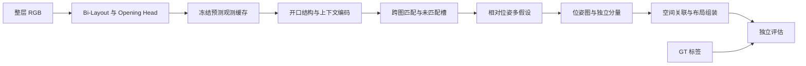

> 修改记录：2026-11-05 19:40 CST - 按计算机视觉工程分层重构，合并当前指南并建立历史来源映射。

# 架构与实现边界

主输入是整层全部有效 RGB panorama，基础节点是 observation，未知真实房间分组。数据加载不把 GT 房间、位姿或开口对应提供给预测阶段。

| 职责 | 当前源码 |
| --- | --- |
| 双布局与开口前端 | `portallayout/models/bi_layout.py`、`cross_scene_matcher.py` |
| 前端预测/缓存编排 | `portallayout/engine/floor_observation_pipeline.py` |
| 几何与上下文编码 | `portallayout/models/opening_representation.py` |
| 候选对匹配 | `portallayout/models/opening_pair_matcher.py` |
| 辅助 pose/room 网络 | `portallayout/models/floor_auxiliary.py` |
| 楼层推理编排 | `portallayout/engine/floor_layout_pipeline.py` |
| 几何假设与图优化 | `portallayout/geometry/floor_geometry.py`、`floor_pose_graph.py` |
| 布局融合 | `portallayout/geometry/floor_assembly.py` |
| 七指标 | `portallayout/evaluation/floor_metrics.py` |

## 两代匹配器

`OpeningPairMatcher` 已实现 log-Sinkhorn、dustbin 与边缘分布收敛检查。`OpeningGuidedCrossAttentionMatcher` 是早期 softmax 版本；`LegacyFloorMatcher` 将其接入冻结候选对照。输出记录 assignment 方法，阈值需要各自标定。

开口头预测“哪里可能有开口”；pair matcher 预测“两个候选是否对应”；pose 模块预测“如何对齐”；楼层组装决定“哪些观测能在同一坐标系表达”。这些能力及相应指标不能相互替代。

## 实现不等于实验结论

楼层训练、辅助任务、标定、strict/exploratory 推理、断连分量、图优化及七指标都有代码。初步整层输出与 verifier 对照已有历史产物，但严格工作点可行性、可靠连接和最终留出集效果应以对应实验报告为准。本次仅重构工程结构，没有改变模型、损失或门槛。

详细阶段推导、模型输入输出与早期结构图见 [历史实现](archive/implementation.md) 和 [早期手册](archive/legacy_handbook.md)；其中过期的“待实现”描述不能覆盖当前源码事实。
