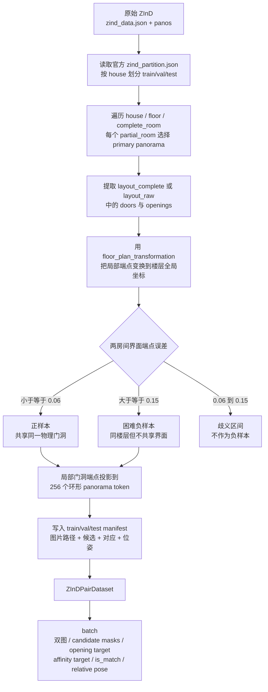
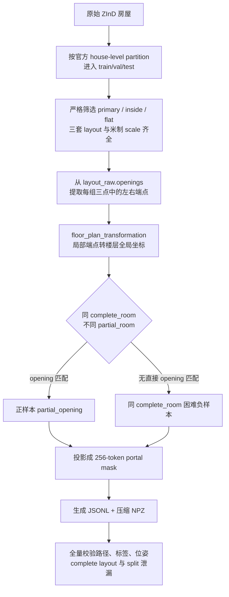

> 修改记录：2026-11-05 19:36 CST - 合并历史资料，保留来源、原修改记录和日期边界，调整迁移后的文档链接。

# 数据集历史设计与构建记录

本文为历史来源合订本。原文中的“当前”“待实现”“正在运行”均以原日期为准；当前维护文档从 [文档入口](../README.md) 阅读。代码与数据路径可能保留历史写法，迁移对应表见 [项目结构](../development.md)。

- [ZInD匹配数据格式.md](#source-faed420bd5)
- [ZInD-BiPair-v1数据集说明.md](#source-4660a67882)
- [ZInD-ObservablePairs-v1构建报告.md](#source-943ea1aae3)
- [docs/ZInD_FloorSet_v1_使用说明.md](#source-4ba12f040e)
- [docs/ZInD_FloorSet_v1_数据格式设计.md](#source-96d4b12958)
- [docs/ZInD_FloorSet_v1_构建交付.md](#source-86623bf261)
- [docs/ZInD_FloorSet_v1_构建提示词.md](#source-6d6ed12171)
- [docs/zind_floorset_build_audit.md](#source-3c37ab514b)

---

<a id="source-faed420bd5"></a>

## 来源：ZInD匹配数据格式.md

合并前 SHA-256：`cd35a66010ced80512eb7a50f9014bc77ecd22c516465e28d0203c8ef516ba7c`。原文与修改记录如下（仅相对链接重定位）：

> 统一文档已合并至 [项目总览与学习手册](legacy_handbook.md#source-5de1910be5)（2026-09-07）。本文件保留为历史资料；其中“当前状态”和“下一步”以原记录日期为准，后续阅读与维护以统一手册为入口。

> 修改记录：2026-07-16 16:45 CST - 建立 ZInD 跨场景共享开口匹配数据格式、转换命令与批数据契约。
> 修改记录：2026-07-16 16:56 CST - 新增数据处理流程图与真实 A/B 样本标签拆解。

# ZInD 匹配数据格式

## 目的

原始 ZInD 以“房屋 → 楼层 → 完整房间 → 局部房间 → 全景”的层级保存，适合单张全景布局训练，但不能直接监督双全景匹配。匹配器需要把同一物理门洞两侧的全景组成正样本，同时提供开口位置、对应关系和相对位姿。

本项目不复制 28 GB 全景图，而是保留原始图片，在 `src/dataset/ZInD_matching/` 生成三个 manifest：

```text
src/dataset/ZInD_matching/
├── train.json
├── val.json
├── test.json
└── summary.json
```

`src/dataset/` 已被 Git 忽略，生成的数据不会混入代码提交。

## 处理流程图



关键点是先在楼层全局坐标中判断两条门洞线段是否属于同一物理界面，再回到各自全景局部坐标生成 token 标签；不能直接按相机距离配对。

## 样本构造规则

- 严格沿用官方 `zind_partition.json` 的 house-level train/val/test 划分，避免同一房屋跨集合泄漏。
- 每个局部房间优先选择 primary panorama。
- 将两个完整房间中全局端点平均误差不超过 `0.06` 的重复 door/opening 标注视为同一共享界面，生成正样本。
- 从同一楼层、两侧都含 door/opening、但最小端点误差至少为 `0.15` 的房间中选困难负样本。
- 默认正负比例接近 1:1；没有安全负样本的楼层不会强行补齐。
- 每条门洞线段投影到与 Bi-Layout `patch_num=256` 一致的环形 token 区间，跨全景接缝的区间可表示为 `[start > end]`。

## Manifest 关键字段

每条记录包含：

| 字段 | 含义 |
| --- | --- |
| `image_a`, `image_b` | 相对 `dataRoot` 的原始 ZInD 全景路径 |
| `scene_id`, `floor_id` | 房屋与楼层，便于分组评估 |
| `candidates_a`, `candidates_b` | 两侧全部 door/opening 候选及其局部/全局端点、256-token 区间 |
| `supervision.is_match` | 是否共享同一物理门洞/开口 |
| `target_candidate_a/b` | 正样本两侧真值候选索引；负样本为 `-1` |
| `relative_transform_b_to_a` | 从 B 局部平面坐标变换到 A 局部平面坐标的 3×3 similarity matrix |
| `relative_yaw_radians` | 从真值变换提取的相对 yaw |
| `pose_valid` | 仅正样本为 `true`，用于屏蔽负样本的位姿损失 |

Manifest 只保存紧凑 token 区间，不保存每条样本的 256×256 密集矩阵。密集监督在 DataLoader 中按需展开。

## 真实 A/B 数据点与标签示例

以下记录来自全量 `train.json`，不是手工构造样本：

```text
pair_id: 0919_floor_01_pano_41_pano_29_3
house/floor: 0919 / floor_01
A: kitchen, complete_room_01, pano_41
B: bedroom, complete_room_06, pano_29
```

这里的 A 是一张全景数据点；door/opening 不是单个点，而是由两个端点组成的线段。A 一共有 5 个门候选：

| A 候选索引 | 类型 | token 区间 | 是否为共享门真值 |
| ---: | --- | --- | --- |
| 0 | door | `[247, 1]`，跨接缝 | 否 |
| 1 | door | `[143, 162]` | 否 |
| 2 | door | `[107, 117]` | 是 |
| 3 | door | `[155, 160]` | 否 |
| 4 | door | `[135, 143]` | 否 |

A 真值门候选 2 的原始局部端点是 `[[0.5024, 1.9959], [1.0023, 1.8260]]`，变换到楼层全局坐标后是 `[[0.0112, -1.8036], [0.2246, -1.8036]]`。它对应 B 的门候选 1：

| B 真值候选 | token 区间 | 全局端点 |
| ---: | --- | --- |
| 1 | `[97, 109]` | `[[0.0041, -1.7669], [0.2241, -1.7669]]` |

两侧门洞端点平均误差为 `0.0370`，小于正样本阈值 `0.06`，因此生成的标签为：

| 标签 | 本样本的值 | 训练含义 |
| --- | --- | --- |
| `is_match` | `true` | A/B 共享同一物理门洞 |
| `target_candidate_pair` | `[2, 1]` | A 候选 2 对应 B 候选 1 |
| `opening_target_A` | A 的 5 个候选区间并集 | 监督 A 上所有已标注 door/opening，不只监督共享门 |
| `opening_target_B` | B 的 4 个候选区间并集 | 监督 B 上所有已标注 door/opening |
| `affinity_target_AB` | A `[107,117]` 与 B `[97,109]` 的外积 | 143 个正 token 对，其余为 0 |
| `relative_yaw_radians` | `2.8274`，约 `162.0°` | 环形水平旋转监督 |
| `relative_transform_B_to_A` | 3×3 similarity matrix | B 局部布局变换到 A 局部布局 |
| `pose_valid` | `true` | 该样本参与位姿损失 |

负样本仍保留两侧各自的 `opening_target`，但 `is_match=false`、`target_candidate_pair=[-1,-1]`、`affinity_target_AB` 全零且 `pose_valid=false`。

## DataLoader 输出

```python
from dataset.panorama_pair_dataset import build_pair_dataloader

loader = build_pair_dataloader(
    "src/dataset/ZInD_matching/train.json",
    batch_size=4,
    shuffle=True,
)
batch = next(iter(loader))
```

训练相关 batch 键：

| 键 | 形状 | 用途 |
| --- | --- | --- |
| `image_A`, `image_B` | `[B, 3, H, W]` | 双全景输入 |
| `candidate_masks_A/B` | `[B, Kmax, 256]` | 开口候选区间，K 维已 padding |
| `candidate_valid_A/B` | `[B, Kmax]` | 屏蔽 padding 候选 |
| `opening_target_A/B` | `[B, 256]` | Opening Signal Head 的门洞/开口监督 |
| `affinity_target_AB` | `[B, 256, 256]` | 正样本共享界面的 token 对应监督；负样本全零 |
| `is_match` | `[B]` | 正负样本标签 |
| `target_candidate_pair` | `[B, 2]` | 候选级共享界面索引 |
| `relative_transform_B_to_A` | `[B, 3, 3]` | 相对位姿真值 |
| `relative_yaw_radians` | `[B]` | 环形 shift/yaw 监督 |
| `pose_valid` | `[B]` | 位姿损失有效性掩码 |

如数据移动到另一台机器，可在 `build_pair_dataloader(..., data_root="/new/zind/data")` 覆盖 manifest 中的 `dataRoot`。

## 转换命令

完整转换：

```bash
conda run -n bi_layout python tools/build_zind_matching_dataset.py \
  --zind_root /home/feixia/pythonProject/AAAsrk/zind/data \
  --partition /home/feixia/pythonProject/AAAsrk/zind/zind_partition.json \
  --output_dir src/dataset/ZInD_matching
```

小样本格式检查：

```bash
conda run -n bi_layout python tools/build_zind_matching_dataset.py \
  --max_houses_per_split 3 \
  --output_dir src/output/zind_matching_dataset_smoke
```

## 2026-07-16 全量转换结果

| Split | 房屋 | 正样本 | 负样本 | 总数 |
| --- | ---: | ---: | ---: | ---: |
| train | 1260 | 14741 | 14584 | 29325 |
| val | 157 | 1827 | 1803 | 3630 |
| test | 158 | 1856 | 1833 | 3689 |
| 合计 | 1575 | 18424 | 18220 | 36644 |

所有 1575 套房屋转换成功，缺失标注为 0，缺失图片为 0。以上是训练数据规模，不是匹配模型准确率。


---

<a id="source-4660a67882"></a>

## 来源：ZInD-BiPair-v1数据集说明.md

合并前 SHA-256：`31b746203e664511517f6c4213602bcce983f8b8ca9ed9b44a4e48c9fb18cbeb`。原文与修改记录如下（仅相对链接重定位）：

> 统一文档已合并至 [项目总览与学习手册](legacy_handbook.md#source-5de1910be5)（2026-09-07）。本文件保留为历史资料；其中“当前状态”和“下一步”以原记录日期为准，后续阅读与维护以统一手册为入口。

> 修改记录：2026-07-17 11:48 CST - 记录 ZInD-BiPair-v1 的命名、筛选规则、处理代码、标签契约、全量规模和验证结果。
> 修改记录：2026-07-17 13:43 CST - 补充唯一 panorama 开口召回评估、双分支语义和正式 test 基线。

# ZInD-BiPair-v1 数据集说明

## 命名与位置

数据集命名为 **ZInD-BiPair-v1**：

- `ZInD`：原始数据来源。
- `BiPair`：面向 Bi-Layout 的双全景 pair dataset。
- `v1`：第一版只研究同一 `complete_room` 内通过 `opening` 连接的不同 `partial_room`。

完整数据已生成在：

```text
/home/feixia/pythonProject/AAAsrk/zind/ZInD-BiPair-v1/
├── dataset_info.json
├── README.md
├── manifests/
│   ├── train_pairs.jsonl
│   ├── val_pairs.jsonl
│   └── test_pairs.jsonl
├── labels/
│   ├── train/*.npz
│   ├── val/*.npz
│   └── test/*.npz
└── statistics/
    ├── train_stats.json
    ├── val_stats.json
    ├── test_stats.json
    └── invalid_pairs.jsonl
```

图片没有复制，manifest 中的路径仍指向同目录的原始 `data/`，因此派生数据本身只有约 205 MB。

## v1 样本定义

```text
same house
+ same floor
+ same complete_room
+ different partial_room
+ different primary panorama
+ layout_raw.openings 在楼层全局坐标中匹配
```

每个视图还必须满足：

- `is_primary=true`
- `is_inside=true`
- `is_ceiling_flat=true`
- 同时存在 `layout_raw`、`layout_visible`、`layout_complete`
- 存在 `floor_plan_transformation`
- 楼层存在 `scale_meters_per_coordinate`
- 原始全景图片存在

## 处理流程



Opening 匹配同时要求：

| 指标 | 阈值 |
| --- | ---: |
| 中点距离 | `≤ 0.20 m` |
| 无向方向差 | `≤ 10°` |
| 长度相对误差 | `≤ 20%` |
| 正反端点最小平均误差 | `≤ 0.25 m` |

负样本只从同一 `complete_room` 内没有直接 opening 连接的 partial-room pair 中选择，不使用过于简单的跨房屋随机负样本。

## 每个 NPZ 的训练标签

| 标签 | 形状 | 来源/用途 |
| --- | --- | --- |
| `depth_enclosed_A/B` | `[256]` | `layout_raw`，Bi-Layout enclosed 分支 |
| `depth_extended_A/B` | `[256]` | `layout_visible`，extended 分支 |
| `extension_depth_A/B` | `[256]` | `max(0, visible - raw)` 辅助监督 |
| `ratio_A/B` | `[1]` | `(ceiling_height-camera_height)/camera_height` |
| `corners_enclosed/extended_A/B` | `[N,2]` | 两套 layout 投影后的 UV 角点 |
| `opening_mask_all_A/B` | `[256]` | 当前视图所有 raw openings |
| `portal_mask_A/B` | `[256]` | 当前 pair 的共享 opening；负样本全零 |
| `portal_center/width_A/B` | `[1]` | 环形 token 中心和宽度 |
| `affinity_gt` | `[256,256]` | 两侧共享 portal mask 的外积 |
| `T_B_to_A` | `[3,3]` | B 局部坐标到 A 局部坐标的 similarity transform |
| `relative_yaw_gt` | `[1]` | 相对水平旋转 |
| `translation_gt` | `[2]` | A 局部坐标中的相对平移 |
| `translation_meters_gt` | `[2]` | 通过楼层 scale 换算后的米制平移 |
| `relative_scale_gt` | `[1]` | B/A 相对尺度 |
| `joint_layout_global` | `[N,2]` | `layout_complete` 的楼层全局 polygon |
| `shared_portal_global` | `[2,2]` | 共享 opening 全局端点；负样本为空 |

## 全量规模

| Split | 正样本 | 困难负样本 | 总数 | 有 pair 的房屋 |
| --- | ---: | ---: | ---: | ---: |
| train | 4612 | 4612 | 9224 | 1101 |
| val | 571 | 571 | 1142 | 133 |
| test | 495 | 495 | 990 | 127 |
| 合计 | 5678 | 5678 | 11356 | 1361 |

训练集共享 opening 的端点平均误差约 `0.0599 m`，三套 split 的 `layout_complete` A/B 重合率均约为 `1.0`。

## 开口召回评估

单图 Opening Head 的监督与评估必须使用 `opening_mask_all_A/B`。`portal_mask_A/B` 只表示当前 pair 的共享 opening；负 pair 中虽然它全零，但两张单图仍各自存在真实开口。

评估按 `image_path` 去重后，val 有 897 张、test 有 787 张唯一 panorama。当前 ZInD 权重的语义是 `new_depth=raw/enclosed`、`depth=visible/extended`，不能反向解释。

| 深度来源 | Split | val 固定阈值 | Token Precision | Token Recall | F1 | 区间 Recall@IoU0.3 |
| --- | --- | ---: | ---: | ---: | ---: | ---: |
| GT depth | test | 0.12 | 93.98% | 88.32% | 91.06% | 88.34% |
| Bi-Layout checkpoint depth | test | 0.12 | 76.97% | 78.92% | 77.93% | 80.89% |

这说明数据标签和 `visible-raw` 几何线索足够用于第一阶段训练。当前约 9.4 个百分点的 token recall 差距主要来自预测深度误差；下一步应冻结 Bi-Layout，按唯一 panorama 训练 Opening Head，再考虑微调双深度分支。

## 代码与命令

- 构造逻辑：`dataset/zind_bipair_builder.py`
- PyTorch Dataset：`dataset/zind_bipair_dataset.py`
- 生成入口：`tools/build_zind_bipair_v1.py`
- 全量验证：`tools/validate_zind_bipair_v1.py`
- 开口召回评估：`tools/evaluate_zind_opening_recall.py`
- 环形开口指标：`evaluation/opening_recall.py`
- 单元测试：`tests/test_zind_bipair_builder.py`

重新生成：

```bash
conda run -n bi_layout python tools/build_zind_bipair_v1.py \
  --zind_root /home/feixia/pythonProject/AAAsrk/zind/data \
  --partition /home/feixia/pythonProject/AAAsrk/zind/zind_partition.json \
  --output_dir /home/feixia/pythonProject/AAAsrk/zind/ZInD-BiPair-v1 \
  --overwrite
```

全量验证：

```bash
conda run -n bi_layout python tools/validate_zind_bipair_v1.py \
  /home/feixia/pythonProject/AAAsrk/zind/ZInD-BiPair-v1
```

加载训练 batch：

```python
from dataset.zind_bipair_dataset import build_zind_bipair_dataloader

loader = build_zind_bipair_dataloader(
    "/home/feixia/pythonProject/AAAsrk/zind/ZInD-BiPair-v1/manifests/train_pairs.jsonl",
    batch_size=4,
    shuffle=True,
)
batch = next(iter(loader))
```

全量验证结果为 `valid=true`，11,356 个缓存全部通过，train/val/test 房屋泄漏数为 0。当前完成的是训练数据前置条件，还没有开始训练 matcher 或 pose estimator。


---

<a id="source-943ea1aae3"></a>

## 来源：ZInD-ObservablePairs-v1构建报告.md

合并前 SHA-256：`082913f658aafecfdddd36e5dd660459aed9836d3fa7519fccf48ee2c07d6be2`。原文与修改记录如下（仅相对链接重定位）：

# ZInD-ObservablePairs-v1：构建报告与数据契约

> GitHub 发布入口：[完整压缩索引与最终训练结果](../../experiments/zind_observable_v1/README.md)。审核 RGB 包由本地工具生成，不随仓库发布。

更新：2026-09-10。交付快照：`train_auto_v2`；数据集版本仍为 `ZInD-ObservablePairs-v1`。

**结论：已经完成训练房屋的自动构建、可复现索引和双阶段待审核材料。尚未完成真人可辨识性核验和阈值校准，不能称为“已验证可观测数据集”，不能据此宣称 Matcher 的视觉成功率上限。**

## 1. 交付入口

- [正式自动构建统计](../../experiments/zind_observable_v1/dataset/summary.json)
- [主索引 JSONL](../../experiments/zind_observable_v1/release_manifest.json)：唯一标签来源；约 1.1 GB。
- RGB 输入白名单索引（本地文件：`experiments/zind_observable_v1/dataset/rgb_input_index.jsonl`）
- [连接索引](../../experiments/zind_observable_v1/dataset/connections.jsonl.gz) / [全部视点组合](../../experiments/zind_observable_v1/dataset/all_combinations.jsonl.gz)
- 第一阶段盲审包（本地生成：`src/output/zind_observable_pairs_v1/review_pilot_final/stage1_package.zip`） / 盲审页面（本地生成：`src/output/zind_observable_pairs_v1/review_pilot_final/stage1_blind/index.html`）
- 第二阶段 GT 包（本地生成：`src/output/zind_observable_pairs_v1/review_pilot_final/stage2_package.zip`）：只在第一阶段提交归档后发放。
- 实际 RGB / GT 核验图册（本地生成：`src/output/zind_observable_pairs_v1/figures/index.html`）：含 GT，不提前发给盲审者。
- [全量索引审计](../../experiments/zind_observable_v1/audit/audit.json) / [官方坐标数值对照](../../experiments/zind_observable_v1/audit/coordinate_contract.json)
- [阈值配置](../../configs/zind_observable_pairs_v1.json) / [构建代码](../../tools/build_zind_observable_pairs.py) / [核心实现](../../portallayout/datasets/zind_observable_pairs.py)

旧 BiPair 数据、Matcher 实验和可视化保留，未训练或修改 Matcher。`train_auto_v1` 是审计发现重复视点编号前的中间产物；请使用 `train_auto_v2` 和 `review_pilot_final`，不要混用旧审核包。

## 2. 实际环境与契约核对

仓库：`/home/feixia/pythonProject/AAAsrk/Bi_Layout`。原始数据：相邻仓库 `../zind/data`；划分文件：`../zind/zind_partition.json`。官方划分为 train / val / test = **1260 / 157 / 158 个房屋**，房屋集合互斥。这次构建只读取 train 的注释和图像；读取完整划分名单用于泄漏检查，不等于读取测试样本。

构建前检查了 Git 状态和项目约定，重新阅读了 `dataset/zind_pair_mining.py`、已有 ZInD 数据适配/构建代码，以及官方 `code/transformations.py`、`code/render.py` 和本地真实 JSON。旧 miner 的 `_primary_panoramas` 按 partial room 选择 primary，并使用 complete/raw 开口构造几何对；这些选择不构成双 RGB 可见或可辨识的证据。新实现只复用已经数值核对的坐标函数，数据枚举、标签和审核协议独立。

官方依据：[ZInD README](https://github.com/zillow/zind)、[数据组织说明](https://github.com/zillow/zind/blob/main/data_organization.md)、[坐标实现](https://github.com/zillow/zind/blob/main/code/transformations.py)、[渲染实现](https://github.com/zillow/zind/blob/main/code/render.py)。本地对应文件的 SHA-256 已保存，结论不依赖旧报告行号。

| 字段 / 概念 | 核对后的含义 | 本版本使用方式 |
|---|---|---|
| `complete_room` | 合并 partial 几何后的完整房间单元 | 不同 complete room 的连接标记 `cross_complete_room` |
| `partial_room` | 完整房间内的标注子空间，不能直接当成独立完整房间 | 同一 complete 内不同 partial 的连接标记 `within_complete_partial` |
| `layout_raw` | 原始人工标注几何 | 保留子空间边界和人工 opening |
| `layout_complete` | 合并 partial 后的派生完整布局 | 跨完整房间几何、墙体射线代理 |
| `layout_visible` | 当前视点的派生可见布局 | 支持度代理；不等价于 RGB 无遮挡标签 |
| primary / secondary | primary 用于人工布局标注；secondary 为额外定位视点 | 两类都参与组合枚举，不假定 primary 对目标共享开口最优 |
| door | 门位置标注 | 保留 `door` 来源；没有可靠门开闭状态 |
| opening | 官方定义的人工子空间分界，可在合并处理中移除 | 保留 `opening` 语义，特别用于完整房间内部子空间连接 |
| window | 窗位置标注 | 解析验证，但不作为可通行共享连接 GT |
| `internal` | 不连接外墙的内部多边形，如岛台 | 仅用于已标注内部结构的 2D 遮挡代理 |
| `redraw` | 面向最终平面图的清理结果 | 不替代 merger 几何，也不作为模型输入 |

**“opening”不应直接解释为物理门洞类型的全部集合。** 本项目的共享开口任务同时保留门连接与人工子空间连接，但分开统计；后者即便几何清楚，也可能缺乏独立可见边框或唯一视觉语义。长走廊的额外自主切分尚未在本版本引入。

### 坐标、尺度和投影

设局部全景平面坐标为 `p`、相似变换尺度为 `s`，楼层米制比例为 `m`：

```text
p_floor = s * R(theta) * p_local + translation
p_meters = m * p_floor
local_length_m = local_length * s * m
T_B_to_A = inverse(T_A_to_floor) @ T_B_to_floor
```

官方使用行向量右乘旋转，新代码使用等价列向量矩阵。相机高度通常归一化为 1，而不是默认为真实 1 米。W/D/O 每条标注占三个二元组：`[左端点 xy, 右端点 xy, [底部 z, 顶部 z]]`；第三项是相对相机的高度，不是第三个平面点。换到楼层高度时用 `(z + camera_height) * s`。

`T_B_to_A` 是归一化局部坐标之间的相似变换，可能带 `s_B/s_A`，不是直接的米制 SE(2)。后续米制位姿评价应使用相对旋转 `R_A.T @ R_B`，并将其平移乘以 `a_local_to_meters = m*s_A`；缺 `m` 时不能报告米制平移误差。

全景经度 `atan2(-x,y)`，归一化横坐标 `u = theta/(2*pi)+0.5`，纵坐标 `v=0.5-atan2(z,r_xy)/pi`；像素使用 `(W-1,H-1)`。区间采用圆周 `start_u + length_u`，支持左右接缝。与官方代码比较 388 个训练全景：楼层坐标最大绝对误差 `8.88e-16`，投影最大误差 `1.42e-13` 像素。仅在独立测试进程给官方旧式 `np.float` 类型注解提供兼容别名，未改官方文件。

真实训练数据共有 **211 个楼层缺少有效米制比例**。它们不会设为 1；关系保留 unknown，缺米制的位姿也不进入米制评价。

### 审计发现的真实编号冲突

`0363 / floor_02 / complete_room_05` 的 `partial_room_05/pano_34` 和 `partial_room_08/pano_34` 具有不同图像、布局和变换，裸 `pano_id` 不能作为楼层唯一键。初次构建有 8 条重复 ID。修订版在碰撞时使用 complete/partial/pano 完整路径，保留两个视点。

修订采用受约束的增量重建：固定修复前后代码哈希，逐个检查全部训练房屋的原始编号；仅重建有碰撞的 `0363`，复用其余 1259 个未进入修复分支的房屋分片。证明条件、分片哈希和父快照见 [增量来源记录](../../experiments/zind_observable_v1/dataset/incremental_provenance.json)。全新完整构建不依赖父快照，命令见下文。

## 3. 三个标签维度与推理输入隔离

| 维度 | 标签 | 当前自动快照 |
|---|---|---|
| adjacency | positive / negative / unknown | 根据标注几何提出，仍为 auto_proposed |
| visibility | clear / partial / not_visible / uncertain；逐 GT、逐侧 | 真实像素可见性保留 uncertain；负样本无目标时不适用 |
| identifiability | clear_evidence / multiple_plausible / insufficient_evidence / unreviewed | 全部 unreviewed |

几何代理单独保存在 `auto_proposal`、`gt.correspondences[*].A/B`，不覆盖人审标签。几何 positive 但看不清仍为 positive；歧义、候选漏检、模型 abstain 均不能改成真实 no_match。`no_match` 是盲审者/模型的回答；只有标签可靠的 negative 才是非相邻监督。

普通配置为 `rgb_pair`，固定 **1024×512 / 张**。`public_input` 和 `ObservablePairsDataset.__getitem__` 只返回 RGB、路径、分辨率和不编码类别的 ID。路径只负责定位文件，不应编码成模型特征。GT 位姿、布局、对应、房间归属在离线 `supervision()` 中。

`gt_candidate_diagnostic()` 明示 `gt_assisted=true`，用于 GT 候选诊断，不能当普通 RGB 实验。当前没有接入预测 layout / 开口 / 类型；以后如接入应另命名配置，并使用训练分割外生成预测，报告候选召回与对应效果。

## 4. 自动构建流程与边界

1. **同房屋、同楼层、按两类房间单元枚举。** 不同 complete 之间比较完整布局；同 complete 内不同 partial 比较 raw 布局。不产生跨房屋简单负样本。
2. **几何确认使用条件交集。** 同类 door/opening，端点反转最小误差、宽度比、方向、垂直高度重叠、双方边界支持、局部法向两侧内部关系和多边形重叠共同约束。多视点重复标注合并并保存来源。多条真实对应保留集合。
3. **冲突进入 unknown。** 近阈值不一致、一对多几何对应、缺尺度、布局或开口清单不一致等不能硬判负。未找到匹配本身不是负证据。负样本要求标注清单一致且两空间多边形有足够间隙，使共享边界在这份标注下不成立；证书明确不是人审事实。
4. **全部视点组合记录。** 主体宽度、角宽、距离、入射角、两端点射线、图像解码/长宽比/灰度分布、visible 支持共同形成代理。沿开口采样射线区分目标接触与前方墙/内部结构，允许数值容差并处理共线遮挡。
5. **视点重选。** 优先通过代理、提高较差一侧得分；后续组合增加低权重的视点互补项，每个房间单元对最多 3 组。保留未入选组合、得分与原因。多 GT 时自动通过只要求至少一条对应双侧通过；严格 core 则要求完整 GT 集合得到核验，二者不要混淆。
6. **核验与分层。** 300 对训练试点；人工结果经独立导入形成新的 reviewed 主索引与 ID 视图，不回写原自动快照。

图像质量目前为粗代理，不是完善的模糊/异常检测。2D 墙体射线没有家具和门板三维模型；其“挡住”也不是像素层面的最终真值。人工 opening 被合并移除时，使用 `layout_visible` 派生 footprint 的支持并单独标来源，证据弱于显式开口线支持。CoVis 未用于选择或裁决；仅核对官方存在评分表，不把全局重叠替代共享开口可见性，也不宣称已经复现其定义。

所有业务阈值均在配置中，当前为 **draft_train_only / 待校准**：端点 0.20 m、疑似冲突 0.45 m、宽度相对差 0.25、方向 15°、负样本空间间隙 0.75 m；最小宽 16 px、角宽 5.625°、距离上限 10 m、入射余弦 0.25、射线通过比例 0.85、visible 支持 0.80。数值不是已经验证的最优值。

## 5. 实际训练数据统计

读取 54,034 个全景标注条目：primary 26,606，secondary 27,428；raw/complete 各 54,034 条，visible 51,602 条。编号碰撞涉及不同图像，条目数不因此减少。

| 关系范围 | 几何 positive | 几何 negative | unknown | 总计 |
|---|---:|---:|---:|---:|
| 不同完整房间 | 25,789 | 76,625 | 90,157 | 192,571 |
| 同完整房间内子空间 | 15,380 | 21,674 | 22,025 | 59,079 |
| 合计 | **41,169** | **98,299** | **112,182** | **251,650** |

这些是选中的 **panorama pair 数量**，不是独立房间连接数，更不是人工已确认样本数。共枚举 106,404 个房间单元对、850,243 个 panorama 组合。关系枚举包含非连接和 unknown，不能把 106,404 都称作真实连接。

单元对层面为 positive 15,591、negative 43,180、unknown 47,633。选中正样本中 517 对包含多个 GT；共有 25,946 个 GT 侧投影跨全景接缝，未因跨界删除。28,273 对缺少楼层米制尺度并保留 unknown。

全量验收通过：251,650 个唯一 ID，1,260 份源注释及 53,581 张入选图像的 SHA-256 均核对；850,243 个组合与最多 3 组的选择结果一致，全部 ID 视图、输入白名单和试点概率抽样可复现。主索引 SHA-256：`0eba445d9c0d3db169a5b12deef1a0028501cd0700730c821e13ccef686f6854`。几何/原 miner 回归与人审流程共 27 项不同测试通过；浏览器测试使用显式 synthetic 临时数据，不计入真人审核。

| ID 视图 | 数量 | 用途与限制 |
|---|---:|---|
| `auto_observable` | **35,659** | 几何 positive 且至少一条 GT 双侧代理通过；待审核 |
| `core_verified` | **0** | 没有人审，不能自动填充 |
| `pending_review` | 251,650 | 当前全部样本 |
| `geometry_positive / negative / unknown` | 41,169 / 98,299 / 112,182 | 保留关系三态 |
| `gt_candidate_diagnostic` | 41,169 | 仅 GT 候选辅助协议 |
| `hard_or_ambiguous` | 215,991 | 当前是 auto_observable 的补集，含普通负样本；不是纯困难集 |

负样本中 84,749 对带至少一个困难代理，13,550 对为普通负样本。困难标记包括空间较近、door 类型/宽度相似、双方门清单较多。**后两项不是 RGB 外观相似和重复纹理的人工确认**，必须在第二阶段核验；标记可重叠，不能直接相加。

同一批 15,591 个几何 positive 单元对中，primary 优先、最近相机的参照方案有 13,172 个代理通过；重选首对有 14,853 个通过，增加 1,681 个，约 **+10.78 pp**。9,273 个更换了视点组合。该对照固定的是新几何标签，不是旧数据集构建的精确复放；效果也是几何代理改善，不是 Matcher accuracy。

## 6. 300 对双阶段审核与加权分析

抽样覆盖 261 个训练房屋，10 个分层各 30 对：两种关系范围 × 正样本通过/未通过、负样本困难代理/普通，以及 unknown。正样本 120 对、负样本 120 对、unknown 60 对。分层内先均匀抽房屋，再在房屋内抽一对，完全不使用 Matcher 结果。

若某层有 H 个房屋，抽 q 个，房屋 h 有 N_h 对，则逐样本包含概率 `pi=(q/H)/N_h`，权重 `1/pi`。抽样文件保存原始数量、概率、权重与确定性随机种子。目标总体是**已选择的主索引**，不是全部 850,243 个组合。不同层/组合可能共享房屋，后续置信区间必须考虑房屋聚类。

协调者流程：

1. 分别发第一阶段 ZIP 给两名独立审核者。完成整批第一阶段；无把握选 uncertain，不猜“非相邻”。允许在完整 RGB 任意位置自由框选多组对应，跨接缝可选外侧区间。
2. 回收第一阶段 JSON 并归档；之后再发第二阶段 ZIP。若第一阶段只完成部分，应标缺失，看到 GT 后不能再把其余样本补成独立盲审。
3. 第二阶段导入本人第一阶段文件并锁定 SHA-256，检查完整 GT 对应集合、两侧可见性、归属/投影错误和歧义，保留第一次选择不变。审核者必须明确确认独立完成。
4. 导入工具校验版本、审核者、阶段顺序、原文件哈希、坐标范围和证据文本。一对多 GT 采用集合的一对一匹配；选中另一条正确 GT 不算错，但 strict core 要求完整集合。
5. 分歧保留两份原始答案，第三人提交显式 `resolution` 和依据。裁决可以更新诊断标签，但不替代缺少的独立盲审证据；这些记录留在 `adjudicated_pending_blind_confirmation`。GT 标注需要修改时另建版本，不能在审核文件中偷偷换 GT。

core 的正样本要求：原几何 positive、两人独立盲审完整集合正确、GT 阶段一致、所有真实对应双侧清楚、明确可辨识且标注检查通过。负样本要求原有非相邻证书、两人独立 no_match 及第二阶段一致确认。自动流程没有真人身份认证能力；独立性由审核组织和本人声明保证。

[加权汇总工具](../../tools/summarize_zind_observable_review.py) 只在试点审核完整解决后输出 HT 加权总量 / Hájek 比例；缺审核时仅给响应情况和受审者诊断，不假定缺失随机。当前 **0/300 已审核，总体可辨识率不可估计**。人类识别证据也不是严格信息论上限。

## 7. 复现、加载与后续操作

在仓库根目录使用已有环境；以下命令均选新输出目录，不覆盖旧数据：

```bash
conda activate bi_layout
export PYTHONDONTWRITEBYTECODE=1
export MPLCONFIGDIR=/tmp/observable_mpl

# 完整从原始训练房屋复现，不需要任何旧分片
python -B tools/build_zind_observable_pairs.py \
  --root ../zind/data --partition ../zind/zind_partition.json \
  --config configs/zind_observable_pairs_v1.json --split train \
  --output src/dataset/ZInD-ObservablePairs-v1/builds/train_reproduction

# 中断后用相同参数增加 --resume；代码、配置和注释哈希不一致时拒绝续建
python -B tools/audit_zind_observable_build.py \
  --build src/dataset/ZInD-ObservablePairs-v1/builds/train_reproduction \
  --output src/output/zind_observable_reproduction/audit
python -B tools/prepare_zind_observable_review.py \
  --build src/dataset/ZInD-ObservablePairs-v1/builds/train_reproduction \
  --output src/output/zind_observable_reproduction/review
python -B tools/visualize_zind_observable_build.py \
  --build src/dataset/ZInD-ObservablePairs-v1/builds/train_reproduction \
  --audit src/output/zind_observable_reproduction/audit \
  --output src/output/zind_observable_reproduction/figures

python -B -m unittest tests.test_zind_observable_pairs \
  tests.test_zind_observable_reviews tests.test_zind_pair_mining -v
```

模型加载示意：

```python
from dataset.zind_observable_pairs import ObservablePairsDataset
base = 'src/dataset/ZInD-ObservablePairs-v1/builds/train_auto_v2'
data = ObservablePairsDataset(base+'/main_index.jsonl', '../zind/data',
                              view=base+'/views/auto_observable.json')
rgb_only = data[0]                 # 不含 GT 监督
offline = data.supervision(0)      # 只用于离线监督/评估
```

当前读取器会将主索引读入内存，完整索引需要数 GB RAM；批量构建与审计按 JSONL/房屋分片工作。大索引和原始图片不应作为代码 PR 附件；保留本地版本化目录与哈希即可。

实际审核文件回收后：

```bash
python -B tools/import_zind_observable_reviews.py \
  --build src/dataset/ZInD-ObservablePairs-v1/builds/train_auto_v2 \
  --mapping src/output/zind_observable_pairs_v1/review_pilot_final/coordinator_mapping.json \
  --stage1 /path/to/reviewer_A_stage1.json --stage1 /path/to/reviewer_B_stage1.json \
  --stage2 /path/to/reviewer_A_stage2.json --stage2 /path/to/reviewer_B_stage2.json \
  --output src/dataset/ZInD-ObservablePairs-v1/builds/train_reviewed_v1
python -B tools/summarize_zind_observable_review.py \
  --build src/dataset/ZInD-ObservablePairs-v1/builds/train_auto_v2 \
  --reviewed src/dataset/ZInD-ObservablePairs-v1/builds/train_reviewed_v1 \
  --output src/output/zind_observable_pairs_v1/review_weighted_summary.json
```

阈值校准应使用训练试点中真实核验的通过/未通过证据，比较误筛与漏筛，记录变更原因、房屋名单和配置哈希。完成后人工写入真实冻结记录：`status=frozen`、`calibration_split=train`、`calibration_houses`、`config_sha256`、`evidence`。`--split val/test` 必须传匹配的 `--freeze-record`，否则在读取样本和创建输出前报错。当前没有伪造冻结记录，因此 **val/test 未构建**。

## 8. 当前研究判断与未完成事项

现在可以量化“几何对应 → 几何观测代理”的损失，并审核视点重选是否有用；还不能量化“真实可见 → 唯一可辨识”的损失。大量 unknown 被显式保留是证据质量问题的暴露，不宜为了提高正负比例而删除或改负。

下一步优先级：两名审核者完成试点 → 按抽样权重检查真实可见性/可辨识性及错误来源 → 只在训练房屋校准阈值并冻结 → 构建 val/test → 按跨完整房间和子空间分别评价 RGB Matcher。报告指标应包括 adjacency、集合对应 precision/recall、abstention/coverage、GT 候选与预测候选召回差异、可用端点的 pose 误差，并以房屋/连接聚合，避免把最多三个相关视点对当独立证据。

本轮完成自动构建和审核工具；真人审核、困难外观的确认、校准冻结、验证/测试最终索引及任何新训练结果均未完成。ZInD 的住宅分布和人工子空间标注也不能单独证明对宿舍长走廊等场景覆盖充分。

需求文本在第 6 节 `core_verified` 的“负样本难度”处截断，因此其他 ID 视图名称与规则是本次明确列出的可调整初稿，没有假装已实现未收到的后续条款。


---

<a id="source-4ba12f040e"></a>

## 来源：docs/ZInD_FloorSet_v1_使用说明.md

合并前 SHA-256：`06abee4736c28e27b3677a0682b9b37779e22bc45b72068afb69479bc4833ffd`。原文与修改记录如下（仅相对链接重定位）：

# ZInD-FloorSet-v1 使用说明

本轮实现 RGB-only 楼层 Dataset、构建器、验证器和分层标签；原始图像只读引用。正式 train 构建输出为 `src/dataset/ZInD-FloorSet-v1/train_20261021`。构建/验证的最终实测结果见同目录的 `dataset_meta.json`、`audit/statistics.json` 和 [构建交付报告](datasets.md#source-86623bf261)。

## 1. 已实现的目录与格式

一个主样本是一层，基础节点是一张 panorama。主输入同时保留 primary、secondary 和缺少部分 GT 的有效 RGB，不要求真实房间分组或正确连接。输入只在 `inputs/<sample_id>/manifest.json`；GT 独立在 `labels/<floor_uid>/`。

```text
dataset_meta.json
index/{floors,observations,source_map}.jsonl
inputs/<sample_id>/manifest.json
labels/<floor_uid>/{floor_gt.json,observations_gt.jsonl,portal_links.jsonl}
labels/<floor_uid>/{pairs_policy.json,pairs_gt.jsonl}
samples/{all_panoramas,primary_only,one_per_space,sampled_N_views}.jsonl
splits/{official_house_split,derived_house_split}.json
schemas/{input,floor_gt,observation_gt,pair_gt}.schema.json
audit/{statistics.json,source_hashes.json,build_contract.json,label_issues.jsonl,exclusions.jsonl}
audit/houses/<house_id>.json
```

原图不复制。RGB 路径相对于显式传入的原始 ZInD root；其他数据引用相对于当前数据集 root。原始目录移动时更换 root，不修改索引中的相对路径。

完整观测对默认 **lazy_all_unordered**：`pairs_gt.jsonl` 有意为空，由 `pairs_policy.json` 声明来源和总数。`iter_pairs` 从单图标签、floor GT 与稀疏开口对应恢复每个无序 pair，并非只返回正样本。需要离线展开时，构建使用 `--materialize-pairs`，写入全量 pair JSONL，文件可能较大。

## 2. RGB 推理与训练读取

```python
from dataset.zind_floor_dataset import ZInDFloorDataset, ZInDFloorSupervisedDataset

dataset_root = "src/dataset/ZInD-FloorSet-v1/train_20261021"
raw_root = "/home/feixia/pythonProject/AAAsrk/zind/data"

# 默认只读 RGB manifest，不读取标签；选择 dev 可用于内部开发。
dataset = ZInDFloorDataset(
    dataset_root, raw_root, training_subset="dev", load_images=True,
    image_shape=(512, 1024),
)
inputs = dataset[0]
ids = inputs["observation_order"]
images = inputs["images"]  # 变长 list；每张 uint8 RGB [512,1024,3]

# 当前返回 uint8 HWC，模型调用方需转换为自己的 float CHW 表示。
# 不把文件名、标签、source_map 或 GT membership 作为模型特征。

# 明确需要监督时，才调用独立 accessor。
targets = dataset.supervision(0)
for pair_target in dataset.iter_pairs(0):
    pass

# 训练包装：输入和监督仍为两个不同对象。
train = ZInDFloorSupervisedDataset(
    dataset_root, raw_root, training_subset="fit", load_images=True,
)
record = train[0]
inputs, targets = record["inputs"], record["targets"]
```

不加载图片时设置 `load_images=False`（默认），可以轻量检查全部 manifest。`image_shape=None` 保留原始 RGB 分辨率；其内存需求随整层图片数增长，不建议一次将全部高分辨率图装入 GPU。

`sample_view` 支持 `all_panoramas`、`primary_only`、`one_per_space`、`sampled_N_views`。`one_per_space` 明确为 GT 分组辅助的简化采样，不等同于未知房间分组的主任务。小 N 组按 seed 随机采样，不按 GT 连通性挑选。

## 3. 实际构建与验证入口

以下入口已经实现。输出目录必须为新目录；历史结果不覆盖。

```bash
PY=/home/feixia/anaconda3/envs/bi_layout/bin/python

# 只审计 train 标注数量，不解码图像，不构建数据。
"$PY" tools/build_zind_floor_dataset.py \
  --root /home/feixia/pythonProject/AAAsrk/zind/data \
  --partition /home/feixia/pythonProject/AAAsrk/zind/zind_partition.json \
  --splits train --dry-run

# 小样本构建；把 output 改为尚不存在的新目录。
OPENBLAS_NUM_THREADS=1 OMP_NUM_THREADS=1 MKL_NUM_THREADS=1 \
"$PY" tools/build_zind_floor_dataset.py \
  --root /home/feixia/pythonProject/AAAsrk/zind/data \
  --partition /home/feixia/pythonProject/AAAsrk/zind/zind_partition.json \
  --output /tmp/zind_floorset_smoke_new \
  --splits train --houses 0665 --house-workers 1 --workers 2

# 全 train：本次使用的参数。已有目录不重复运行，恢复时加 --resume。
OPENBLAS_NUM_THREADS=1 OMP_NUM_THREADS=1 MKL_NUM_THREADS=1 \
"$PY" tools/build_zind_floor_dataset.py \
  --root /home/feixia/pythonProject/AAAsrk/zind/data \
  --partition /home/feixia/pythonProject/AAAsrk/zind/zind_partition.json \
  --output src/dataset/ZInD-FloorSet-v1/train_20261021 \
  --splits train --house-workers 4 --workers 2

# 检查全部 schema、引用、输入白名单、全无序 pair 与原图内容哈希。
OPENBLAS_NUM_THREADS=1 OMP_NUM_THREADS=1 MKL_NUM_THREADS=1 \
"$PY" tools/validate_zind_floor_dataset.py \
  src/dataset/ZInD-FloorSet-v1/train_20261021 \
  --raw-root /home/feixia/pythonProject/AAAsrk/zind/data \
  --check-images --all-pairs \
  --report experiments/zind_floorset_v1_20261021/train_validation.json
```

`--house-workers` 是独立房屋进程数，`--workers` 是每房屋解码图像的线程数。它们不改变样本语义。断点恢复要求相同代码/配置/来源身份，并验证已提交房屋的输出哈希与源文件状态；最终全局索引重新生成，不追加重复记录。

CLI 显式支持 `--splits val/test`，但本轮未启用；不能因为 partition 清单包含其 house ID，就声称已处理正式 val/test 数据。

新增依赖为 `jsonschema>=4.17,<4.24`；已写入 `requirements.txt`，当前项目环境已具备 4.23.0。本轮未修改/安装全局环境或下载任何数据/权重。

## 4. 标签的实际边界

- 单图保留 raw/complete/visible 原生几何；没有运行 Bi-Layout，预测缓存状态 `not_run`。
- 与当前 ZInD/Bi 分支语义对应，`depth_enclosed` mask 来自 `layout_raw`，`depth_extended` mask 来自 `layout_visible`；`layout_complete` 用于完整房间目标。这里仅保存原生几何和有效性，未生成模型的 256 列深度训练张量。
- complete-room 为整层目标，partial-space 为局部目标；同房多 pano 在 GT 中不重复计房间。
- GT 相对变换采用原 ZInD local xy，`p_A = T_B_to_A*p_B`；不是直接可与 Bi 导出 JSON 混用的坐标。
- 缺失尺度保留 null；缺 GT 位姿不删除有效 RGB。尺度、位姿、单图布局的有效性分别记录。
- raw 接口几何对应是保守的自动代理，保留同侧/异侧/歧义，**没有人工可辨识核验**。
- 所有视觉 pair 标签仍为 unknown，共视为 null，视觉 assignment 和 pose 训练 mask 暂关闭。开口检测、空间归属、物理几何代理与合法 GT 位姿可独立读取，训练时应明确选择监督协议。
- 派生边界图不等于人工核验物理墙实例图；未完成全局交点 planarization。结构评价前需按冻结的 evaluator 规则处理，并保留规范化说明。
- 原始 complete-room 多视图不一致、自交或缺失等问题保留在 labels/audit；不能把数据组织完成称为标签全部可靠或整层模型已完成。

后续首先用输入加载器接单图模型，生成版本化预测缓存；之后才能运行匹配、位姿图与整层估计。数据构建不会替这些模块生成默认开口、假位姿或伪结果。


---

<a id="source-96d4b12958"></a>

## 来源：docs/ZInD_FloorSet_v1_数据格式设计.md

合并前 SHA-256：`b7473adabab42259e2f6d9de1e587a211bfc0879303abff680fcf03d2de62bfe`。原文与修改记录如下（仅相对链接重定位）：

# ZInD-FloorSet-v1：整层全景布局估计的数据格式设计

设计日期：2026-10-21。本文保留格式设计及研究依据。用户随后授权实施，已落实构建器、读取接口与官方 train 数据组织；最终结果见 [构建交付](datasets.md#source-86623bf261)，实际字段和命令见 [使用说明](datasets.md#source-4ba12f040e)。本文中的“拟议”“建议”描述设计阶段，不代表后续实际交付状态。

用户最终确认的任务为：

```text
某一楼层的全部全景 RGB
  → 每张全景的 enclosed / extended 局部布局与开口实例预测
  → 同空间多视点关联 + 跨空间可信开口匹配
  → 相对位姿与全局分量组装
  → 房间划分、统一平面布局、未连接分量与七项指标
```

**唯一必需的推理观测是 RGB 全景。** 单图布局、开口和特征缓存都是模型中间产物；整层 GT、相机 GT 位姿、真实房间分组只用于监督/评估。

配套：[可复制的后续构建提示词](datasets.md#source-6d6ed12171)。本设计更新了先前方案“每房间一张代表图”的默认假设：该方案保留为派生基线，新的主数据单元是一层的全部 panorama。

## 1. 原始 ZInD 能否使用

**可以作为主数据源，不必重新采集或先获得 SALVe 的派生数据。** ZInD 官方按 house 保存 RGB、单图布局、W/D/O、局部到楼层变换和尺度，足以派生楼层输入、布局监督、相对位姿与一部分关系标签；官方划分以房屋为单位。[原始格式](https://github.com/zillow/zind/blob/main/data_organization.md)、[官方说明与划分](https://github.com/zillow/zind)

但原始数据不是一份可直接喂给模型的楼层 manifest：

- RGB 不必重新复制；需要生成可移植索引与来源映射。
- `layout_raw / layout_complete / layout_visible` 是 GT，不能改名为预测布局当推理输入。
- `camera_height` 按官方格式为归一化高度，不能直接当真实米制相机高度。
- 门的开闭/视觉可辨识性、跨图同一个物理接口的统一身份，需要额外派生与核验；不能仅凭 door/opening 标注断定存在可用跨图视觉证据。
- 原始房间边界可以派生结构墙图，但不能宣称已有 MvFFN 式人工核验的全局物理墙实例标签。
- `floor_plans/*.png` 仅作参考显示，主 GT 使用结构化几何。

官方提醒 door 开闭未标注、部分楼层缺尺度、merger 与最终 redraw 不完全对齐。因此 v1 默认用 **merger 系列 GT**，保留 redraw 作独立参考，不混成同一套精确标注。[官方数据限制](https://github.com/zillow/zind#readme)

## 2. 参考项目实际如何组织数据

以下“样本单位”不等同于各项目都提供同一种 JSON；只有明确核对代码/schema 的项目才描述磁盘格式。

| 项目 | 经核对的数据/样本组织 | 对我们的借鉴 |
| --- | --- | --- |
| ZInD 原始 | house→floor→complete_room→partial_room→pano；每 house 一个 `zind_data.json`，图像独立保存 | 保留层级与来源；按 floor 聚合输入，按 house 划分 |
| SALVe：整层重建 | `FloorData(floor_id, panos)`、`PoseGraph2d`，节点保存单 pano 的局部边界、W/D/O 与变换；读取 merger/raw | 基础观测节点是 pano，不能要求一图对应唯一房间；预测与 GT 分层 |
| SALVe：验证器训练 | 对一个 panorama pair 的**对齐假设**组织 BEV 样本，正确/错误 alignment 分开；同一 pair 可有不同假设 | pair 身份、开口对应和变换假设分开存；错误对齐不等于两个图不相邻 |
| CoVisPose | 双图样本，监督共视、列对应、边界和相对位姿；跨 door 的标签构造需要处理开闭状态 | 全景对标签需有可见性状态；物理相邻不等于视觉正样本 |
| Graph-CoVis | 论文从共定位图像组采样多视图 cluster，训练使用 3/4/5-view 组 | 将多视图子集作为整层 master 的派生 sample，不把固定小组当完整楼层 |
| MvFFN/ZInD-XV | 多视图组配全局墙实例、房间序列与列标签，是额外整理的监督层 | 预留 wall/column annotation 接口，原始 ZInD v1 不冒充其数据 |
| BADGR | 以整层结构布局和相机/边界观测组织几何修正；还使用二维平面图生成模拟观测训练 | GT 布局层与 RGB 观测层解耦；模拟数据另建轨道 |

对应一手证据：

- SALVe [PanoData/FloorData](https://github.com/zillow/salve/blob/main/salve/common/pano_data.py)、[PoseGraph2d](https://github.com/zillow/salve/blob/main/salve/common/posegraph2d.py)、[验证器 Dataset](https://github.com/zillow/salve/blob/main/salve/dataset/zind_data.py)、[单 pano 预测 schema](https://github.com/zillow/salve/blob/main/horizon_net_schema.json)。
- [CoVisPose 原论文 §4.4–5.1](https://www.ecva.net/papers/eccv_2022/papers_ECCV/papers/136920610.pdf)。
- [Graph-CoVis 原论文 §3.5](https://openaccess.thecvf.com/content/CVPR2023W/OmniCV/papers/Nejatishahidin_Graph-CoVis_GNN-Based_Multi-View_Panorama_Global_Pose_Estimation_CVPRW_2023_paper.pdf)：组织方式据原论文检索文本，未核实其实际文件 schema。
- [MvFFN 正文与附录 F/G](https://arxiv.org/html/2610.14315v2)、[BADGR 官方项目](https://badgr-diffusion.github.io/)。

SALVe 源码还包含对缺失尺度的均值填补。这类历史策略**不移植到本项目正式米制 GT**：缺尺度仍为缺失，保留非米制样本，不伪造厘米精度。

## 3. 主数据单元和任务假设

### 3.1 样本、观测、房间各自独立

- 一个主样本 = 一个 house 的一个 floor，N 可变。
- 一个观测节点 = 一张 panorama，具有稳定 `observation_id`。
- 一个真实房间 = GT 中的 complete/partial 空间实体，具有独立 `room_uid`；一个房间可关联多张 panorama。
- 模型输入**不默认已知 panorama→GT room 的分组**。房间数也不从 GT 提供。系统要通过观测关联/融合恢复房间，或在实验中明确声明已提供分组的简化轨道。
- `same_partial_room`、`same_complete_different_partial`、`different_complete_room` 同时保留，不能把它们都当跨完整房间连接。

只匹配跨房间开口还不足以处理该数据设置。同一房间的两张图可能没有共同可用开口，需要保留共视/结构关联的监督接口；若首版算法暂不能利用，必须报告能力限制，而不能删掉同房多图或把它们画成两个房间。

### 3.2 “全部全景”的可核算定义

主索引保留该 floor **全部可关联的原始 panorama 记录**，包括 primary/secondary、GT 不完整、质量不足和失效记录。模型可消费的输入列表是其中可解码 RGB 的集合，不以候选数量、模型表现、GT 共视连通性或完整 GT 几何是否存在筛选。

每层必须有：`annotated_observation_count`、`selected_observation_count`、`unreadable_count`、`missing_prediction_count`、`excluded_observations[]` 及原因。RGB 有效但缺 GT 的图仍可入推理列表，只关闭相应监督/评价 mask。无法关联标注的 orphan 图片另列，不能静默忽略或凭文件名补出真实房间身份。

派生视图：`all_panoramas` 主任务；`primary_only` 稀疏基线；`one_per_space` 人为简化基线；`sampled_N_views` 小组学习。全部从同一 master 导出，保留成员顺序、seed 与筛选依据。GT 选出的连通/共视子集只能单列为受控实验。

## 4. 建议目录：输入、标签、中间预测物理分离

以下路径均为拟议格式，不表示本轮已生成：

```text
ZInD-FloorSet-v1/
├── dataset_meta.json                 版本、来源、协议和总统计
├── splits/
│   ├── official_house_split.json      官方原划分的副本/哈希
│   └── derived_house_split.json       train 内 fit/dev 划分
├── index/
│   ├── floors.jsonl                  离线总目录，可引用输入与 GT
│   ├── observations.jsonl            全量来源清单，含失效记录
│   └── source_map.jsonl              observation_id 到原层级/JSON pointer
├── inputs/<sample_id>/
│   └── manifest.json                 推理只读：RGB 观测、投影等合法输入
├── labels/<floor_uid>/
│   ├── floor_gt.json                 房间、几何、结构、尺度和标签质量
│   ├── observations_gt.jsonl         GT 位姿、单图布局、空间归属
│   └── pairs_gt.jsonl                共视/开口/位姿等分开的监督
├── samples/
│   ├── all_panoramas.jsonl
│   ├── primary_only.jsonl
│   └── sampled_N_views.jsonl
├── predictions/<prediction_run_id>/  可选模型产物，初始可不存在
│   ├── prediction_manifest.json
│   ├── views/<observation_id>.json
│   ├── tensors/<observation_id>.npz
│   ├── layouts/<observation_id>.json
│   └── features/                     可选 1D/2D 特征
├── audit/
│   ├── statistics.json
│   ├── exclusions.jsonl
│   ├── label_issues.jsonl
│   └── source_hashes.json
└── README.md
```

原始 ZInD 用 `roots.zind_raw` 在运行时绑定；索引只存 root_key + 相对路径，不复制几十 GB 原图。`index/` 和 `labels/` 不作为模型输入。图片路径可能含原房间编号，路径只供 I/O，不能用文件名解析 GT 分组后送入网络。

manifest 的 rgb 路径相对于声明的 root；数据集内部索引引用相对于 dataset root；prediction JSON 中的张量/布局/特征引用相对于 prediction run root。三类基准明确分开，不能依赖当前工作目录解析。

### 4.1 推理 manifest 示例

**以下是两张图的虚构示例，只说明字段，不是实际楼层样本；实际不限制观测数量。**

```json
{
  "schema_version": "zind-floorset.input.v1",
  "sample_id": "sample_demo",
  "floor_uid": "floor_demo",
  "task": "unposed_floor_layout_from_panoramas",
  "input_mode": "panorama_only",
  "selection_policy": "all_panoramas",
  "projection": "equirectangular",
  "pose_prior": "none",
  "calibration_mode": "scale_unknown",
  "observation_order": ["view_demo_01", "view_demo_02"],
  "observations": [
    {
      "observation_id": "view_demo_01",
      "rgb": {
        "root_key": "zind_raw",
        "relative_path": "house_demo/panos/image_a.jpg"
      },
      "image_size_wh": [2048, 1024]
    },
    {
      "observation_id": "view_demo_02",
      "rgb": {
        "root_key": "zind_raw",
        "relative_path": "house_demo/panos/image_b.jpg"
      },
      "image_size_wh": [2048, 1024]
    }
  ]
}
```

禁止必填或隐式补入：GT room_id、房间数、单图 GT polygon、真实相对位姿、GT 邻接、真实开口对应、共视真值、整层 GT 布局。主 manifest 不要求 `layout_path/opening_path/feature_cache_path`。

校准轨道可额外给已知的标量 `camera_height_m` 及其来源，必须显式标为 `known_height`，与 `scale_unknown` 分开。GT yaw/translation 不能以“校准元数据”名义混入。

### 4.2 observation_id 与来源映射

`observation_id` 用完整来源路径和 house/floor 生成确定性不透明 ID；保留原 `pano_id` 在 source_map。原 bare pano_id 可能重复，禁止仅以 `pano_34` 作全数据主键。稳定 ID 不依赖输入顺序，也不依赖模型输出。

同图内容重复时，分开记录 observation 身份和 image SHA-256：不同注释路径不静默覆盖，同图重复不自动变成独立房间。所有派生样本、GT、预测和缓存通过同一 observation_id 关联。

## 5. 我们需要哪些原始数据和派生标签

| 数据 | 来源 | 用途 | 是否送入推理模型 |
| --- | --- | --- | --- |
| RGB 全景与图像尺寸 | `panos`、`image_path` | 唯一必需观测 | 是 |
| house/floor 归组 | 原始层级 | 形成“已知属于同层的一组图” | 仅用于分组调度 |
| primary/secondary、inside、ceiling 标志 | pano 标注 | 标签审计、派生实验 | 默认不作为网络特征 |
| raw/complete/visible 局部布局 | pano 标注 | 双布局监督、目标几何派生 | 否 |
| 相机变换与归一化高度 | `floor_plan_transformation`、高度字段 | GT 位姿、单位换算 | 否；已声明高度轨道除外 |
| 楼层米制比例 | `scale_meters_per_coordinate` | GT 米制评价 | 默认否 |
| room/space 归属 | complete/partial 层级 | 房间恢复监督、去重评价 | 否 |
| W/D/O 端点、高度 | 各布局字段 | 开口检测/实例对应监督 | 否 |
| 门开闭、视觉可见性 | 原始未充分提供 | unknown 或新增核验/代理 | 代理仅监督；预测量另存 |
| 同一接口跨图身份、同侧/异侧 | 根据 GT 几何与空间关系派生 | 区分视觉对应和直接连接 | 否 |
| floor 房间/墙段/junction 图 | 结构化布局派生 | 七指标与点二监督 | 否 |
| 单图预测、开口概率、候选、特征 | 当前模型未来运行产生 | matcher 与组装 | 是，中间预测量 |

数据构建本身不需要 GPU 或网络权重，预测缓存不存在也应能完成 master/GT 索引。缓存生成是之后单独、显式执行的阶段。

### 5.1 单图标签

保留三套原始布局与来源，不按字段名称猜分支语义。与当前权重适配时显式记录 `depth_branch_order=extended_first`，即 `depth→visible/extended`、`new_depth→raw/enclosed`。二维顶点投影为 256 token 的监督是派生标签，需记录经纬度、采样点、相机高度归一化和接缝规则。

W/D/O 按官方实现的三条一组解析：两个平面端点 + `[bottom_z, top_z]`，不能把第三条当第三个平面端点。raw/complete/visible 中的接口集合不必完全相同；保留各来源索引并建立明确映射，不能共用一个不注明来源的 interface_index。[SALVe 原始解析](https://github.com/zillow/salve/blob/main/salve/common/pano_data.py)

### 5.2 整层 GT 及房间粒度

`floor_gt.json` 至少包含：

```text
schema_version, floor_uid, house_id, floor_id, source_family="merger"
coordinate_spec, metric_scale, metric_valid
room_partition_default="complete_room"
complete_rooms[], partial_spaces[], observations_membership[]
structural_walls[], junctions[], interfaces[], room_adjacency[]
target_scope="all_annotated_rooms_on_floor"
label_status, source_refs[], issues[], evaluation_masks
```

**目标整层房间默认按 complete_room 计数**；partial-room 用于局部 enclosed 和虚拟 opening 连接监督。两级都存，评估一次只能选定一个 partition，不能重复计算同一完整房间或混合父子空间。此前 partial-room 主线仍可作为独立轨道，不再默认等于最终物理房间划分。

同一房间在多 pano 中重复出现的 complete polygon，先投影到同一 GT floor 坐标并审计一致性。规范几何来源使用固定规则，例如首个合法 primary，再稳定 ID；**不按模型误差选择最有利 GT**。明显不一致保留多个来源和 issue；不平均成伪精确轮廓，不静默用 `buffer(0)` 修复后宣称原 GT 合法。

结构图保留内部隔墙；不能只取整层区域 union 的外边界。room-side wall ID 可以确定性派生，跨房间物理墙分组需额外证据，不能因共线或很近就强制同一实例。所有派生 graph 标注 `annotation_origin=derived`；GT 不足时对应结构指标为部分可评价，不伪装为人工核验墙实例数据。

### 5.3 Pair 标签必须拆成多个维度

pair 记录以**观测对**为单位，一个无序 pair 只存一次；反向变换求逆。可以按需生成全部 N(N−1)/2 对，必须记录枚举/分片策略，训练采样表与整层自然全对评价分开。

| 字段 | 含义 |
| --- | --- |
| `pair_id, observation_a, observation_b` | 稳定观测身份 |
| `relation_scope` | same_partial / same_complete_different_partial / different_complete / unknown |
| `same_room_gt, same_room_partition` | 指定 partition 下是否同房；不交给推理 |
| `physical_portal_label` | 有共享物理接口 / 已确认无共享 / unknown |
| `visual_portal_label` | 可辨识共享开口 / 已确认无可用对应 / unknown |
| `portal_correspondences[]` | 完整多实例集合、单侧源 ID、physical interface UID、同侧/异侧、置信与核验状态 |
| `covisibility` | 比例/双向 mask/代理来源，可 null；不能默认零 |
| `pose_gt_available` | 是否有合法 GT 变换，独立于视觉是否可匹配 |
| `pose_supervision_valid` | 当前训练协议是否启用该 pair 的位姿监督 |
| `T_B_to_A_gt` | 指定坐标与单位的 3×3 变换；缺失才为 null |
| `supervision_masks` | 开口检测/分配/房间归属/位姿等任务分别有效 |
| `label_source, evidence, review_status` | 原始/几何代理/人工核验，自动标签不写 human_verified |

关键情形：

- 同房间两张图可能共视很高而没有共享可用开口，应支持同空间融合，不能一律标成跨房间负样本。
- 两张图都看到同一扇门，不代表它们在门两侧；必须区分“同侧观察”与“跨侧连接”。否则现有异侧端点 solver 可能产生错误展开。
- A 与 C 通过 B 可达，不代表 A–C 直接共享开口。
- GT 位姿可获得不等于视觉关系为 positive；反之缺 GT 也不等于 no_match。
- 不把 SALVe 的 incorrect_alignment 样本直接当成本项目负 panorama pair；它可能只是同一 pair 的错误假设。
- window 可支持几何/共视信息，但不作为可通行直接邻接标签。
- 原始门开闭不足时，视觉标签为 unknown/自动代理；标签数组为空不自动等于已确认负样本。

## 6. 中间预测缓存格式

未来由单图模型生成，独立于数据集构建。每个 observation 只预测一次；RGB 主入口不依赖缓存已存在。

```json
{
  "schema_version": "zind-floorset.prediction.v1",
  "observation_id": "view_demo_01",
  "prediction_status": "available",
  "provenance": {
    "kind": "model_prediction",
    "model_id": "bi_layout_plus_opening_demo",
    "checkpoint_sha256": "demo_only_not_a_real_hash",
    "preprocessing_id": "upright_rgb_512x1024_demo",
    "branch_order": "extended_first"
  },
  "coordinate_spec": {
    "frame": "bi_camera_local_xz",
    "units": "camera_height_normalized",
    "scale_status": "unknown",
    "camera_height_m": null
  },
  "geometry": {
    "tensors_ref": "tensors/view_demo_01.npz",
    "depth_enclosed_key": "depth_enclosed",
    "depth_extended_key": "depth_extended",
    "ratio_key": "ratio",
    "layout_local_ref": "layouts/view_demo_01.json"
  },
  "openings": {
    "status": "predicted_empty",
    "probability_key": "opening_probability",
    "instances": []
  },
  "features_ref": null
}
```

示例同样虚构，实际 SHA-256 必须真实生成。NPZ 可用 `[L]` 深度与概率、`[1]` ratio；L 与配置一致，当前主线为 256。实例采用连续圆周区间 `[start_u,start_u+length_u]` 加 `wraps_seam` 为 canonical 表示，token inclusive 区间作为带 L 的派生字段。

候选记录 instance_id、概率、区间、预测端点/支撑墙、quality、valid、source；空候选为正常结果，不填墙中心兜底门。`not_run / failed / predicted_empty / available` 分开。真实二维特征若未输出则为 null，不由一维 reshape 冒充。

缓存身份包含：RGB 内容、权重、模型结构、resize/归一化、预旋转/镜像、branch_order、候选配置、帧与单位。图像旋转后需更新位置映射及候选，不能复用旧身份。

## 7. 坐标与尺度契约

保留原始字段，并派生显式矩阵；不得直接混用 SALVe Sim2 内部平移约定与本项目齐次矩阵。

在原 ZInD local/floor 约定下记：

```text
q_floor = G_i · p_i
G_i = [[s_i R(theta_i), t_i], [0,0,1]]
T_B_to_A_gt = inverse(G_A) · G_B
q_floor_m = diag(m_f, m_f, 1) · q_floor
camera_height_m(i) = m_f * s_i * camera_height_annotation(i)
```

其中 m_f 为 floor 的 `scale_meters_per_coordinate`。转换到 Bi x/z、镜像、朝向规范化或不同相机高度后，使用显式换基矩阵 C_i：

```text
p_zind_i = C_i · p_model_i
T_Bmodel_to_Amodel_gt = inverse(C_A) · inverse(G_A) · G_B · C_B
```

C_i 的方向、是否含归一化尺度必须写清并测试，不能靠字段名或按经验翻 yaw。`utils/writer.xyz2json` 还包含缩放和坐标变换，预测导出坐标不能直接当成 `depth2xyz` 原始坐标。

以下轨道分开：

- **scale_unknown**：输入仅 RGB；指标采用明确的一次评估尺度规范，标为 scale-aligned，不声称 RGB 已恢复绝对尺度。
- **known_height**：额外提供合法标量高度输入及来源；不能同时偷带 GT 位置/朝向。
- **metric GT unavailable**：保留推理/非米制监督，cm 指标 mask=False；不使用其他楼层/全数据均值补成真实 GT。

## 8. 构建后的审计与划分要求

1. 先尊重官方 house split；train 内的 fit/dev 也按 house 隔离，同房屋的所有 floor、view、pair 不跨划分。
2. 第一轮未来构建默认只用 train；official val/test 在规则、阈值和标签协议冻结后单独构建，不能把 test 用于选门洞容差或可见性阈值。
3. 不照搬历史 house/pano 数量；按本地实际版本统计，并记录原始/入组/可评价数量。
4. 缺尺度、缺布局、无开口、无匹配、同房多图、多连通分量和非法标签逐项计数，不能全部删除以获得“干净且连通”的主数据集。
5. 重建成功/失败不参与数据入组，现有 ObservablePairs 内部监控不能冒充新 floor test。
6. 输入白名单、GT 修改/置乱不影响输入和预测、重复 pano ID、变换反向/链式、接缝与相机高度是必要验证。
7. 主任务全图先用观测/相机定位覆盖率；房间恢复需额外的一对一房间匹配，不将重复 pano 当重复房间计数。详见下节的原评估协议修订。

## 9. 对当前项目方案的必要修订

原来的七指标协议默认一房一图，不能直接用于新的 all-panoramas 主任务。后续 evaluator 需增加：

- 分开的 `observation_localization_coverage` 与 `room_reconstruction_coverage`；明确主表定位覆盖率是相机/观测口径。
- 预测房间与 GT complete-room 的一对一匹配；重复重建的房间计 FP，缺房间计 FN，不能借 GT membership 合并预测。
- 多 pano 覆盖的同一 GT 房间只计一次布局/墙段；GT 全部目标房间留在 IoU、Wall/Junction recall 分母。
- 独立的同空间融合接口，与跨房间开口连接图并存；视图可达图不等于房间可通行拓扑图。
- 不可观测区域保持缺失标记；若另做布局补全，独立方法行，不为画完整平面而在数据层补边/补墙。

**推荐先确定这套 master 格式，再用同一数据源导出一房一图基线与整层全部全景主任务。** 数据层保留能力与真值，算法先完成哪一条路径应如实单独报告。


---

<a id="source-86623bf261"></a>

## 来源：docs/ZInD_FloorSet_v1_构建交付.md

合并前 SHA-256：`14773eaec5afb54aeab7b54f13563c77fb101b07e6040716830d25a90c42e1e5`。原文与修改记录如下（仅相对链接重定位）：

# ZInD-FloorSet-v1 构建交付

构建日期：2026-10-21；全量验证完成日期：2026-10-22。**官方 train 已构建完成并通过全量验证。**

## 交付范围

本轮将之前的格式设计落实为构建器、RGB-only Dataset、独立监督读取接口、JSON Schema、验证器及实际数据。正式输出为 `src/dataset/ZInD-FloorSet-v1/train_20261021`；原始图像只读引用，不复制、不修改。仅处理官方 train，未读取 val/test 房屋的标注或图像。

主任务输入是一层的全部可解码全景 RGB。模型需要自行预测局部布局与开口，再进行观测关联、开口匹配和全局布局估计。GT 房间分组、位姿、布局及接口在独立 labels 目录，不作为 RGB 输入字段。一个 panorama 是一个观测，不等于一个房间。

使用方式与可复现命令见 [使用说明](datasets.md#source-4ba12f040e)，设计依据见 [数据格式设计](datasets.md#source-96d4b12958)，来源审计见 [构建前审计](datasets.md#source-3c37ab514b)。实际数据身份由输出目录下 `audit/build_contract.json`、`audit/source_hashes.json` 和每张图像的 SHA-256 共同确定。

## 全量 train 实际数量

| 项目 | 数量 |
| --- | ---: |
| 官方 train 房屋 | 1,260 |
| 楼层主样本 | 2,168 |
| 全部标注观测 / 有效 RGB 输入 | 54,034 / 54,034 |
| 不可解码 RGB | 0 |
| primary 观测 | 26,606 |
| complete-room / partial-space | 18,002 / 26,607 |
| 全无序观测对（lazy） | 905,871 |
| 自动几何开口观测对应（未人工核验） | 277,884 |
| 有米制尺度 / 缺米制尺度楼层 | 1,957 / 211 |
| 重复图像 SHA-256 组 | 0 |
| 已运行实际模型预测 / 正式 val、test 数据处理 | 0 / 0 |

构建耗时 989.5 秒，使用 4 个房屋进程、每房屋 2 个图像线程。正式目录磁盘占用约 2.3 GB，原始 RGB 不计入此占用。总体统计位于 `audit/statistics.json`；逐项质量与 mask 统计在 `experiments/zind_floorset_v1_20261021/train_data_health.json`。

train 内部按 house 固定分为 fit 1,134 房屋 / 1,947 层 / 48,610 张全景，dev 126 房屋 / 221 层 / 5,424 张全景。每层观测数最少 1 张、中位数 21 张、最多 137 张，后续模型需要支持变长输入或分批提取单图特征。

标签可用性不等于 RGB 可用性：54,034 张图都有合法 raw/complete 多边形与 GT 位姿；visible 多边形可用 51,602 张，缺失/无效 2,432 张。raw 接口清单完整性 mask 为真 54,030 张。审计共记录 259 条接口几何无效项、1 组重复 bare pano ID（以完整来源稳定 ID 区分，未覆盖）。complete-room 几何在当前阈值下全部一致，但 2,609 个房间的多视图接口清单不完全一致，冲突保留在对应 room GT 中，不能解释为人工核验通过。

## 实现入口

| 内容 | 路径 |
| --- | --- |
| 参数、采样与几何阈值 | `configs/zind_floorset_v1.json` |
| 构建 CLI | `tools/build_zind_floor_dataset.py` |
| 构建逻辑与来源审计 | `dataset/zind_floor_builder.py` |
| RGB 输入、监督 accessor、lazy pair 读取 | `dataset/zind_floor_dataset.py` |
| 输入与标签 Schema | `dataset/zind_floor_schemas.py` |
| 独立验证 CLI | `tools/validate_zind_floor_dataset.py` |
| 数据契约测试 | `tests/test_zind_floor_dataset.py` |
| 实际运行记录 | `experiments/zind_floorset_v1_20261021/` |

构建可按房屋并行，支持相同代码/来源契约下恢复；拒绝覆盖不匹配的已有输出。原始 house→floor→complete_room→partial_room→pano 映射独立留存。主样本与 primary-only、one-per-space、随机小 N 组分别建立清单；one-per-space 明确标识 GT 辅助筛选。

## 验证范围

已通过 16 项数据契约测试和项目 276 项回归测试。测试包括有效 RGB 保留、缺失标签 mask、同房多视点、重复 pano ID、原生坐标变换、输入与监督隔离、路径边界、恢复一致性、并行一致性，以及 lazy 与全量展开 pair 的等价性。

25 个 train 房屋预检：42 层、1,038 张全景、16,941 个无序观测对。全部逐对与图像哈希验证通过，0 错误、0 验证器警告。

正式全量验证于 2026-10-22 完成：2,168 层、54,034 个观测、905,871 个无序 pair 全部检查，54,034 张原图 SHA-256 全部一致；输入 Schema、标签引用、GT 变换方向及四类派生采样清单均通过。最终状态 `passed`，0 错误、0 验证器警告。该结果表示数据格式与引用符合检查规则，不代表原始标签已人工核验。

最终证据：[全量验证报告](../../experiments/zind_floorset_v1_20261021/train_validation.json)、[完整进度日志](../../experiments/zind_floorset_v1_20261021/train_validation_20261022_resumed.log)、[运行清单](../../experiments/zind_floorset_v1_20261021/run_manifest.json)。早前中断的两次校验没有最终报告；结论仅依据这次完整运行。验证器新增进度输出后，16 项数据契约测试再次通过。

正式数据读取抽测通过：房屋 0665 的 floor_03 共 20 张 RGB，默认输出 `uint8 [512,1024,3]`，可以枚举 190 个无序 pair；输入对象没有监督字段。记录见 `experiments/zind_floorset_v1_20261021/train_loader_smoke.json`。

## 与最终七项指标的对应

| 指标 | 本次保留的依据 | 后续还需确定 |
| --- | --- | --- |
| 整体 IoU | complete-room 楼层原生坐标多边形、可用性及一致性 mask | 全局对齐方式、房间并集/分区口径、失败样本计分 |
| 定位覆盖率 | 整层全部有效 RGB observation ID、每个观测的 GT 位姿可用性 | 分母使用全部输入；另报 GT 可评价子集，禁止只计算成功分量 |
| 平移误差 cm | 单图 local→floor GT、独立米制 scale | 楼层配准与尺度协议；缺尺度层单列 |
| 旋转误差 ° | 单图 GT 变换及明确的 B→A 相对变换方向 | 全局旋转 gauge 对齐及失败相机处理 |
| Wall F1 | 派生 room-side 墙段及关联房间 | 墙实例规范化、交点 planarization、匹配阈值 |
| Junction F1 | 派生边界端点及墙段索引 | 角点定义、共墙/交叉点去重与匹配阈值 |
| 墙体距离 cm | 米制有效楼层的墙段、尺度与来源 | 距离定义、采样密度、缺失墙惩罚与有效子集 |

数据层已保存这些指标需要的来源和有效性信息；本轮未实现正式七指标 evaluator，不能直接将派生墙图等同于冻结的标准答案。

## 后续使用边界

- 预测缓存为 `not_run`，本次没有运行实际布局/开口模型，也没有生成整层估计结果。
- 缺失米制尺度保留 null，不以均值替补；厘米指标需使用独立米制有效 mask，并报告覆盖率。
- 开口跨图对应来自保守几何代理，保留歧义与来源；没有人工视觉核验。visual label 为 unknown，共视为 null，视觉 assignment 和 pose-training mask 暂关闭。可用 GT 位姿与视觉可匹配性分别记录。
- 全无序 pair 采用 lazy 存储，`pairs_gt.jsonl` 有意为空；必须使用 `iter_pairs` 或显式 materialize，不能把空文件当作没有监督或只采样正对。
- complete-room 多视图几何冲突保留并标注；派生边界图是 room-side graph，尚未完成全局交点 planarization，也不是人工物理墙实例标签。Wall/Junction F1 的正式评价仍需冻结结构规范化与匹配协议。
- 数据构建完成不等于全局布局系统完成。下一步接入单图预测并生成带模型版本的缓存，再实现匹配、位姿优化与整层融合。


---

<a id="source-6d6ed12171"></a>

## 来源：docs/ZInD_FloorSet_v1_构建提示词.md

合并前 SHA-256：`f0527a6de6cd32cdf7e88a9caeddd769feb3632867d3c3109ef55e2826a2ef94`。原文与修改记录如下（仅相对链接重定位）：

# ZInD-FloorSet-v1 数据集构建提示词

状态：2026-10-21 的构建任务说明，保留原始任务正文。用户随后已明确授权按此方案组织数据集；实施结果见 [构建交付](datasets.md#source-86623bf261)。用户确认的主任务是“整层全部 RGB 全景→预测局部布局与开口→关联与全局组装”，不是已知整层平面图定位，也不要求提前提供局部预测。

使用方式：以下正文描述设计阶段的构建要求。详细字段解释见 [数据格式设计](datasets.md#source-96d4b12958)；当前已实现的入口、实际字段和复现命令以 [使用说明](datasets.md#source-4ba12f040e) 为准。

---

你是一名熟悉 ZInD、全景室内布局、多视图关联、数据工程与评估协议的算法工程师。请在我的 Bi_Layout 项目上构建独立、可审计的 **ZInD-FloorSet-v1** 数据集。不要训练新网络，不要改变算法，不要用旧 pair 数据简单拼成整层样本。

## 一、任务定义和不允许改变的边界

模型的真实推理输入只有：**同一楼层全部可用的原始 RGB 全景图，以及显式允许的非位姿元数据。**

完整方法流程为：

```text
整层 RGB 全景列表
→ Bi-Layout 单图预测 enclosed/extended
→ Opening Head 预测全部开口实例
→ 同空间多视点关联、跨空间开口对应和拒绝
→ 相对位姿、连通分量与全局组装
→ 房间与墙体结构、未定位结果
```

GT 局部布局、GT 开口、GT 房间归属、GT 相机位姿和 GT 整层几何只用于训练监督/事后评价，不能进入 RGB 推理输入。预测布局和特征属于以后由冻结模型生成的中间缓存，本次没有权重或 GPU 也不应阻塞索引、标签和 Dataset 的构建。

一个主样本是一层，一个基础观测是一张 panorama。N 可变，必须支持同一真实房间有多张全景；不默认提供 panorama→GT room 分组，也不提供 GT 房间数。

当前工作只做数据集及必要的读取/验证代码，不实施新 matcher、Sinkhorn、PGO、局部布局优化，不开展完整训练或正式 test 评估，不生成伪预测。

## 二、先审计真实工程和数据版本

保护当前工作区、旧数据、权重和实验，先核实分支、HEAD、工作区、适用 AGENTS.md、可用解释器。不要重置、删除、提交或推送。

优先阅读并复用：

- `dataset/zind_observable_pairs.py`
- `dataset/zind_pair_mining.py`
- `dataset/zind_dataset.py` 及原始布局读取实现
- `dataset/zind_matching_feature_dataset.py`
- `dataset/zind_bipair_adapter.py`
- `models/cross_scene_contracts.py`
- `utils/conversion.py`、`utils/writer.py`
- 现有坐标/候选/ObservablePairs 测试
- `docs/ZInD_FloorSet_v1_数据格式设计.md`
- `docs/research1_architecture_audit.md`

原始 ZInD 根目录的定位线索是 `/home/feixia/pythonProject/AAAsrk/zind/data`，官方 partition 位于其相邻数据目录或官方发布；实际执行时核实，不硬编码机器绝对路径。

核实 ZInD house→floor→complete_room→partial_room→pano 的实际字段，区分 merger、redraw 与 floorplan_to_redraw_transformation。统计当前实际版本，不照搬论文数量。审计记录中注明当前数据是否已有预训练/诊断暴露历史。

一手参考：

- ZInD：`https://github.com/zillow/zind/blob/main/data_organization.md`
- ZInD 官方划分与限制：`https://github.com/zillow/zind`
- SALVe 楼层/单图结构：`https://github.com/zillow/salve/blob/main/salve/common/pano_data.py`
- SALVe 坐标/位姿图：`https://github.com/zillow/salve/blob/main/salve/common/posegraph2d.py`
- SALVe 验证器样本：`https://github.com/zillow/salve/blob/main/salve/dataset/zind_data.py`

借鉴其数据分层，不照搬 SALVe 的缺尺度均值补齐、裸 pano_id 唯一性假设或把错误 alignment 当负图像对的做法。

先输出 `docs/zind_floorset_build_audit.md`，说明实际来源、输入/GT 边界、坐标与缺失项，再继续实现被授权的数据构建工作。未执行的步骤不得写通过。

## 三、文件组织与稳定身份

在全新输出目录中生成以下结构，路径可按工程习惯调整，语义不得删减：

```text
dataset_meta.json
splits/official_house_split.json
splits/derived_house_split.json
index/floors.jsonl
index/observations.jsonl
index/source_map.jsonl
inputs/<sample_id>/manifest.json
labels/<floor_uid>/floor_gt.json
labels/<floor_uid>/observations_gt.jsonl
labels/<floor_uid>/pairs_gt.jsonl
samples/all_panoramas.jsonl
samples/primary_only.jsonl
samples/sampled_N_views.jsonl
schemas/*.schema.json
audit/statistics.json
audit/exclusions.jsonl
audit/label_issues.jsonl
audit/source_hashes.json
README.md
```

`predictions/<prediction_run_id>/` 仅作为可选的未来输出契约，可初始不存在；不能要求数据集自带模型预测或提前运行前端。

原图使用 root_key + 相对路径引用，不复制全量图片、不改写原图。路径解析有清晰基准，拒绝越出声明 root 的路径。离线总目录和 labels 不送入模型；RGB 路径只给 I/O，不解析其中房间编号用作推理先验。

`house_id` 保留字符串前导零；floor_uid、sample_id、observation_id、room_uid、interface observation ID 采用确定性规则并记录版本。observation_id 根据完整原始 JSON 路径/图像相对路径生成不透明稳定 ID，不仅使用 bare pano_id，不依赖输入顺序或模型预测。

识别并报告重复 pano_id、重复图片和同图多条标注；不得用字典覆盖丢掉记录。稳定 ID 与图像内容哈希分开管理。source_map 保留完整 JSON pointer、原 house/floor/complete/partial/pano 标识。

## 四、RGB 推理输入 schema

manifest 必含：

```text
schema_version="zind-floorset.input.v1"
sample_id, floor_uid
task="unposed_floor_layout_from_panoramas"
input_mode="panorama_only"
selection_policy, projection="equirectangular"
pose_prior="none", calibration_mode="scale_unknown"
observation_order[]
observations[]: observation_id, rgb{root_key,relative_path}, image_size_wh
```

可选的 known_height 轨道只提供明确合法的标量 camera_height_m 和来源，独立标注校准模式。不提供 yaw、translation、GT room membership、GT 邻接、GT 开口、GT 共视或 GT 轮廓。原始 camera_height=1 一类归一化值不能直接写成 1m。

主 manifest 不要求 layout_path、opening_path 或 feature_cache_path。预处理只来自图像和模型配置，记录 resize、归一化、去倾斜/消失点校正与逆变换，不用 GT floor heading 做预对齐。

Master 必须保留 primary 与 secondary、缺 GT、质量不足及失效记录。主输入选取该 floor 可解码的 RGB，不能按模型有没有开口、正确匹配或 GT 连通性删图。无法用图保留 exclusion reason，缺 GT 但 RGB 有效的图保留为输入并关闭相应 label mask。

## 五、GT 单图、房间和整层结构

GT observation 记录至少有：

```text
observation_id, source_ref
complete_room_uid, partial_space_uid, membership_status
is_primary, is_inside, is_ceiling_flat
layout_raw, layout_complete, layout_visible 及各自有效性/来源
GT W/D/O instances 及 type、两个局部端点、bottom/top z、source index
G_local_to_floor_gt, camera_height_annotation, ceiling_height_annotation
coordinate_spec, metric_valid, source_quality, issues
```

W/D/O 按两个平面端点加一组 bottom/top 高度的 triplet 解析，第三条不是平面第三点。不同 layout family 的接口身份不混用。保留全图全部开口，而不是只保留某个 pair 的 shared portal。

floor_gt 至少有：

```text
schema_version, floor_uid, house_id, floor_id
source_family="merger", coordinate_spec
metric_scale, metric_valid
room_partition_default="complete_room"
complete_rooms[], partial_spaces[], observations_membership[]
structural_walls[], junctions[], interfaces[], room_adjacency[]
target_scope="all_annotated_rooms_on_floor"
evaluation_masks, source_refs[], label_status, issues[]
```

同时保留 complete 与 partial 层级：主整层房间目标按 complete-room，局部 raw/enclosed 与虚拟 opening 监督保留 partial-space；父子目标不能重复计面积、墙段或覆盖率。

同房间多 pano 的 GT polygon 投影后审计一致性，按固定合法来源规则选 canonical GT，并保存冲突；不按预测表现选 GT，不将冲突平均成无问题标签。GT 不可评价是数据状态，不能直接删除推理房间。

保留内部隔墙和 room-side 边身份。可派生结构边界图及 junction，但必须标 `annotation_origin=derived`；没有人工全局墙实例 ID 时不冒充 ZInD-XV。近距离/共线不充分证明两个墙面是同一物理墙，不强行合并。

merger 作为 v1 一致几何来源；redraw 和 floorplan PNG 单独引用，不能混用其顶点与 merger pano 位姿来生成精确监督。不得自动添加布局补全标签或无依据墙体。

## 六、观测对监督：禁止单一 is_match 混合全部任务

无序观测对只存一次，并记录固定方向 `p_A=T_B_to_A*p_B`。全部 pair 可以 JSONL 分片或延迟派生，保留确定性枚举规则、总对数和采样表。禁止将全部 dense L×L affinity 复制进每个 floor JSON。

pair GT 至少表达：

```text
pair_id, observation_a, observation_b
relation_scope:
  same_partial / same_complete_different_partial / different_complete / unknown
same_room_gt, same_room_partition
physical_portal_label: shared / no_shared / unknown
visual_portal_label: positive / negative / unknown
portal_correspondences[]:
  source_interface_a/b, physical_interface_uid, side_relation,
  type, label_source, confidence_or_quality, review_status
covisibility: 可空，区分逐侧代理/精确标签/不可用
pose_gt_available, pose_supervision_valid, T_B_to_A_gt
coordinate_spec, units, supervision_masks, evidence, issues
```

必须遵守：

1. 同房多图可能没有共享开口但仍应可融合，不能标成错误房间连接或强制使用异侧开口 solver。
2. 两张图看到同一扇门可能在同侧；明确 same_side/opposite_side/unknown。能看到同一开口不等于相机位于两个相邻房间。
3. 物理相邻、共享接口、视觉可辨识与可定位分别存。缺开闭/可见性依据时 unknown，不把空列表当已确认 negative。
4. GT 位姿合法与是否存在视觉匹配无关；即使 no_match，也可能有可评价 GT 位姿。
5. 保留全部多实例对应，不随便挑第一个；原始接口/候选映射不清时标歧义，不能按最低 GT pose error 选对应。
6. window 不作为可通行直接边。A–B–C 间接可达不新增 A–C 开口或直接边。
7. 几何代理通过不写 human_verified；可见性代理和真实 RGB 核验分开。
8. 不导入 SALVe incorrect_alignment 标签作为负 panorama pair；若以后建 alignment hypothesis 训练集，另设 hypothesis_id 和 alignment correctness。
9. unknown 不参与二分类负监督。已确认无对应的候选/负 pair 才可监督 dustbin；正确候选缺失时维持现有 mask_positive 规则。

优先复用 ObservablePairs 的完整对应、来源、可见性代理和坐标实现，并审计其语义。旧 pair 数据可提供参考，不作为完整 floor 的唯一来源。

## 七、坐标、米制与数据隔离

原 ZInD local→floor 原生矩阵应显式保存为 3×3，参数语义为 `q=s*R*p+t`。SALVe 内部 Sim2 的平移参数约定不同，不能原样拷贝一个 t 后混算。

```text
T_B_to_A_gt = inv(G_A) @ G_B
floor_m = diag(m_f,m_f,1) @ floor_native
camera_height_m = m_f * pano_scale * normalized_camera_height
```

若模型局部 frame 到 ZInD 原生 frame 为 C_i：

```text
T_Bmodel_to_Amodel_gt = inv(C_A) @ inv(G_A) @ G_B @ C_B
```

记录 C 的镜像、轴、朝向与高度归一化；核对 `depth2xyz` 与 `xyz2json` 导出的区别。测试反向、链式、已知旋转、非单位尺度、不等高度及全景接缝。

缺米制比例则 metric_valid=False，不填楼层/全数据均值或默认 1。GT 单位换算可用于离线评价，不能把 GT matrix/尺度以隐藏字段喂给 RGB 模型。known_height 输入轨道和 scale_unknown 主轨道分开，scale-aligned cm 不写成原生绝对尺度恢复。

训练读取返回 inputs 与 targets 两个对象；模型 forward 的签名只接 inputs。推理 Dataset 不读取 labels 或 source_map 中的真实房间分组。设计严格白名单和测试证明更换 GT 不改变 inputs。

## 八、划分、派生样本与预算

1. 官方 house split 优先，所有 floor、view、pair 继承 house split。train 内 fit/dev 也按 house 划分。
2. 默认只构建 train；val/test 需由后续明确指定阶段启用，不默认扫描 test 标注或图片，不用 test 校准阈值。
3. 不强行平衡整层评价样本的正负 pair。训练 pair 可采样，保留采样清单、权重和自然类别统计。
4. all_panoramas 是主样本；primary_only、one_per_space、sampled_N_views 是派生轨道。按 GT 共视选出的连通小组单独标注，不替代有孤立/断连观测的主数据。
5. 原始数量与可用数量、GT 有效数量分别统计；不要复制历史 1,524/1,575 等数量作为当前版本事实。
6. 索引/标签生成不依赖模型和 GPU；预测缓存显式标 not_run，而非用 GT 或随机值填充。
7. 避免每个 pair 重复全部单图标签和图像数据；复用 observation 记录与引用。

## 九、拟新增工程接口与验证

根据实际工程决定位置，可采用以下独立入口，但必须真正实现后才能给“可运行命令”：

- `tools/build_zind_floor_dataset.py`
- `tools/validate_zind_floor_dataset.py`
- `dataset/zind_floor_dataset.py`：RGB 推理视图；训练 targets 显式独立加载
- `configs/zind_floorset_v1.json`
- 本数据集 schemas 与针对性 tests

构建器先提供 audit/dry-run 和新目录保护，默认拒绝覆盖旧数据；支持按 house/floor 指定小样本，以及可恢复的 JSONL 分片/原子写出。记录实际命令、配置、版本、参数、来源哈希和成功/失败状态。

必要验证：

- N=1/2/3/5；一房多 pano、多房、空开口、全部未知关系；
- 一层多个潜在连通分量，主输入成员不因连通性被删；
- 两个相同 bare pano_id 对应不同完整来源路径，不覆盖；
- 相同图片多条来源、缺图、缺 GT、缺尺度、非法 polygon 有明确状态；
- 同房多图不产生多个 GT 房间；complete/partial 评估不混用；
- 同侧/异侧开口观察可区分，错误假设不等于负图像对；
- 0/360° 区间正确，triplet 的高度不被当平面点；
- 原生/模型/米制换基和变换组合正确；
- 输入次序改变后 ID、pair 集和 GT 不变；
- house split 无泄漏；默认阶段不访问 test；
- RGB 推理输入不含 GT，更改隐藏 GT 不影响输入或受控模型输出；
- schema/引用/观测数量和 pair 数可校验；未生成预测缓存不报伪成功。

先跑合成标签/图像的测试及旧相关回归，再在明确授权范围内构建少量 train floor 验证引用和单位。合成成功不写真实模型重建成功；没有实际执行的检查不得标通过。

## 十、交付与停止范围

交付真实新增/修改文件清单、schema、Dataset 使用方式、已验证的命令、少量 train 示例、审计统计、原图引用说明、GT 使用边界、未核验标签和阻塞项。不要自动运行全量模型预测/训练、访问最终 test、提交或推送。

同时写明后续算法需要支持的两类关系：同空间观测融合与跨空间开口连接。数据集可以先准备完整监督，但不能声称现有 matcher 已能处理所有同房多图。

最后修订七指标使用说明：主定位覆盖率按 observation/相机统计，房间覆盖另报；预测房间与 GT complete-room 一对一匹配，重复房间计 FP。标签不充分时保留 evaluation mask；不同分量不得用各自 GT 对齐后拼成虚假整层结果。

**完成标准：同一版本的数据能够从“仅 RGB 的一层观测集合”独立运行模型输入读取，又能由训练/评估端另行加载完整、可追溯的监督；不要求预先知道正确房间分组、连接、位姿或单图预测，不伪造可见性、尺度和模型结果。**


---

<a id="source-3c37ab514b"></a>

## 来源：docs/zind_floorset_build_audit.md

合并前 SHA-256：`a4aba6a00e80aeee77accdaa09ec26a26e71c9e011ff42e3aa1c82c16de41d97`。原文与修改记录如下（仅相对链接重定位）：

# ZInD-FloorSet-v1 构建前审计

执行日期：2026-10-21；分支 `agent/zind-bipair-opening-matcher`，HEAD `8484b620d1850a27776445178c7f0f2e753213ac`。用户本轮已授权按设计实施并组织数据集；之前“仅设计、不执行”的限制已被本轮明确指令替代。

原始目录 `/home/feixia/pythonProject/AAAsrk/zind/data`，官方划分 `/home/feixia/pythonProject/AAAsrk/zind/zind_partition.json`。划分列出 train 1260、val 157、test 158 个 house。本轮只读取 train 房屋的源文件和图像；读取 partition 中的 ID 清单不代表读取 val/test 样本。

现有真实 train 房屋 0665 含 merger 的三个楼层；抽查全部具备 raw/complete/visible 和局部到楼层变换字段。存在归一化相机高度与楼层米制换算两层尺度，必须分别保存。输出使用新目录，不覆盖旧 ObservablePairs、BiPair、权重或实验。祖先/仓库未发现适用的非空 AGENTS.md。系统 Python 不等于项目解释器，执行使用 `/home/feixia/anaconda3/envs/bi_layout/bin/python`。

可复用：`zind_transform_matrix`、`transform_points`、ObservablePairs 的 polygon/接口 triplet/圆周投影与保守几何关系工具。**不直接复用旧 load_house**：其对缺少合法 GT 变换的观测会提前跳过，不满足本数据集“RGB 有效即保留输入、GT 单独 mask”的契约。

输入只含 RGB 引用、尺寸、稳定 observation 身份和楼层调度标识。GT membership、位姿、布局、接口与结构图独立存储；预测缓存尚未运行，不使用 GT 填充。原始图像只读，记录完整解码状态与内容哈希，不以图像质量、GT 连接性或开口候选筛选主输入。

主 GT 来源为 merger，complete-room 作整层目标，partial-space 保留局部监督。重复几何按确定性 primary/稳定 ID 规则选规范源并报告冲突，不混用 redraw。结构边界图标为 derived room-side graph，不声称是人工核验的全球物理墙实例图。

门开闭、RGB 可辨识性不充分：视觉标签保留 unknown；几何接口对应/邻接仅为 auto_proposed。第一版不虚构精确共视监督。Pair 使用显式 lazy 全无序对枚举作为默认，避免将每侧全部单图 GT 重复展开；支持显式 materialize。lazy 文件策略和 loader 的迭代结果需实测验证，不能把空文件误称完整 pair 标签。

构建后实际数量、运行命令、验证结果及限制记录在数据集 README 和本目录后续交付报告中；本文件不提前宣称构建/测试通过。

