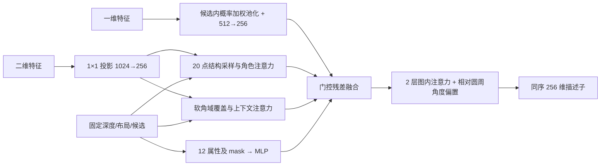

> 修改记录：2026-11-05 19:36 CST - 合并历史资料，保留来源、原修改记录和日期边界，调整迁移后的文档链接。

# 分阶段实现与验收记录

本文为历史来源合订本。原文中的“当前”“待实现”“正在运行”均以原日期为准；当前维护文档从 [文档入口](../README.md) 阅读。代码与数据路径可能保留历史写法，迁移对应表见 [项目结构](../development.md)。

- [docs/research1_frontend_implementation.md](#source-282bee59fc)
- [docs/research1_opening_representation.md](#source-53a8886b20)
- [docs/research1_opening_pair_implementation.md](#source-250b91c6d5)
- [docs/research1_floor_layout_implementation.md](#source-dc38012538)
- [docs/research1_round2_implementation.md](#source-0c8ca3bd96)
- [docs/research1_preliminary_implementation.md](#source-c292b6f473)
- [docs/research1_pose_verifier_implementation.md](#source-96a8707835)
- [docs/research1_pose_geometry_experiment.md](#source-c79f6c184e)
- [docs/research1_completion_audit.md](#source-c50135df8c)

---

<a id="source-282bee59fc"></a>

## 来源：docs/research1_frontend_implementation.md

合并前 SHA-256：`dd24b5a360fa730b0970350f189a051dd9c91fb604922f5aa6e13941fd965f34`。原文与修改记录如下（仅相对链接重定位）：

# 研究点一第一阶段：整层 RGB 前端与预测缓存

2026-10-22。本阶段已实现并在真实 train 楼层验证：**整层全部 RGB → 每张全景的 enclosed/extended 布局、开口候选、真实二维特征与可复用缓存**。主单元仍是 panorama，不提供 GT 房间分组。本阶段输出不含整层定位或组装结果。

后续进展：单图开口增强模块已独立实现，直接消费本阶段缓存，见 [几何与上下文联合表征](implementation.md#source-53a8886b20)。以下内容仍描述前端本身，新的描述子与诊断结果单独保存。

## 已修改的模块

| 文件 | 作用 |
| --- | --- |
| `models/modules/horizon_net_feature_extractor.py` | 可选返回高度压缩前实际 encoder pyramid；默认输出保持兼容 |
| `models/bi_layout.py` | `return_feature_pyramid=True` 暴露四级二维特征，不新增参数键 |
| `utils/single_view_prediction.py` | 从旧调试入口提取公共权重加载与布局后处理；新增不经旧 writer 变换的局部几何输出 |
| `tools/debug_cross_scene_flow.py` | 从公共模块导入原函数，继续保留旧名称、默认行为及原命令参数 |
| `utils/floor_observation_pipeline.py` | 整层 RGB 分批编码、布局后处理、环形开口候选与墙段映射；不调用 GT accessor |
| `utils/room_feature_cache.py` | 模型/代码/预处理/图像指纹、原子写入、内容校验及恢复读取 |
| `tools/predict_floor_observations.py` | 选择 train 楼层、dry-run、缓存构建与恢复入口 |
| `configs/research1_floor_frontend.json` | 显式权重、分支语义、采样与二维缓存配置 |

`return_features=True` 保留原一维特征。新二维特征来自实际 ResNet pyramid，不是由一维特征 reshape；当前保留第 2 级（stride 16）1024 个通道，再作空间平均池化到 16×64。尚未添加需训练的 256 维投影、联合开口表征或候选对检索网络。

## 运行方式

默认仅处理一个楼层。以下真实示例使用房屋 0665 的 floor_03，包含全部 20 张全景；可用 floor UID 从数据集 `index/floors.jsonl` 离线查看，但预测器仅读取 samples 与 RGB manifest。

```bash
PY=/home/feixia/anaconda3/envs/bi_layout/bin/python

# 只查看选择结果，不加载权重、不读取原图、不生成预测。
"$PY" tools/predict_floor_observations.py \
  --dataset src/dataset/ZInD-FloorSet-v1/train_20261021 \
  --raw-root /home/feixia/pythonProject/AAAsrk/zind/data \
  --floor-uids floor_1c68d80c249a3a23bdadf67f --dry-run

# 复现实测：使用一个新的输出目录。
OPENBLAS_NUM_THREADS=1 OMP_NUM_THREADS=1 MKL_NUM_THREADS=1 \
"$PY" tools/predict_floor_observations.py \
  --dataset src/dataset/ZInD-FloorSet-v1/train_20261021 \
  --raw-root /home/feixia/pythonProject/AAAsrk/zind/data \
  --floor-uids floor_1c68d80c249a3a23bdadf67f \
  --output src/output/research1_floor_frontend/new_smoke_run \
  --batch-size 2 --device cuda --torch-threads 2
```

重复读取同一输出目录时加 `--resume`；仅允许相同代码、模型、预处理及候选配置。图像内容改变会生成新的观测缓存键；损坏的已提交张量会明确报错。`--house-ids`、`--floor-uids`、`--training-subset fit/dev` 可以选择样本；`--max-floors N` 或 `--all-floors` 明确扩大运行范围。当前 CLI 仅选择官方 train。

本轮没有启动全 train 推理。按真实样本估计，全部 54,034 张图的特征缓存约需 122 GiB，具体随输出几何变化，不能把一次楼层 smoke 当作全量预测完成。

## 输出及坐标约定

实际输出：`src/output/research1_floor_frontend/smoke_train_0665_floor03_20261022/`。

```text
cache_contract.json                  模型内容哈希、代码哈希、软件与推理配置
model_report.json                    严格加载结果、Opening Head 兼容性与工作阈值
run_report.json                      完成状态、推理/复用/错误数、楼层结果引用
floors/<sample_hash>.json             与原输入同序的全部观测、各自缓存引用
observations/<observation_id>/<key>.json
observations/<observation_id>/<key>.npz
```

一张全景的 NPZ 字段：

| 字段 | 实测形状 | dtype |
| --- | --- | --- |
| `feature_1d` | `[256,512]` | float16 |
| `feature_2d` | `[1024,16,64]` | float16 |
| `depth_enclosed` / `depth_extended` | `[256]` | float32 |
| `opening_logits` / `opening_probability` | `[256]` | float32 |
| `ratio` | `[1]` | float32 |

JSON 保存 enclosed/extended 多边形、后处理诊断、开口实例的稳定 ID、含首尾 token 区间、墙段和局部端点。没有开口时输出空集合；不使用最大概率峰补出候选。映射失败时保留角域实例并标记几何不可用；读取失败的观测仍出现在楼层清单中，整个运行状态为 partial。

几何统一为 **Bi 全景局部 x/z、camera-height-normalized 单位、尺度未知**。`camera_height_m=null`。全景 token 中心 `u=(index+0.5)/256`，射线为 `[sin(2π(u−0.5)), cos(2π(u−0.5))]`。使用预测深度估计 Manhattan 方向，并在拟合后旋转回原全景坐标。原始预测深度保存在 NPZ；几何处理采用 abs/clamp，诊断记录负值与截断数量。

新局部几何不经过 `xyz2json` 的默认 1.6 缩放和坐标轴变换。旧导出函数仍兼容旧脚本。后续与 ZInD GT 评价时必须通过显式坐标 adapter，不能直接把本地 x/z 当作 ZInD floor x/y 或米制位置。

Opening Head 使用现有 `zind_matching_v1/best.pt`，严格检查其骨干、分支顺序、特征宽度及图像尺寸。实测工作阈值 0.47 来自 checkpoint，未改成旧的 0.12，也未用本次楼层 GT 重新调参。所有 score 仍标记为未校准；开口正确性需要独立标签评价。

## 实测与验证证据

- 真正运行现有 Bi-Layout 与训练过的 Opening Head：20 张图、51 个开口候选，其中 7 个跨接缝；40 个 enclosed/extended 多边形均有效，未发生后处理回退。缓存约 48.5 MB。
- 严格权重加载：缺失键 0、额外键 0；Opening Head 的骨干兼容性校验通过。
- 缓存恢复：20 张全部复用，新增实际 RGB 编码 0 次。运行时同时禁止 labels/index/源标注读取与 encoder 调用，检查通过。
- 新测试覆盖默认模型输出兼容、真实二维张量及梯度保留、变长/空楼层、同图跨样本只编码一次、图像变化失效、损坏缓存、缺图保留、非法浮点、空开口、跨接缝端点与原生归一化尺度。
- 项目回归：289 tests，全部通过。该数量包含既有测试和本阶段新增测试。

证据：[真实缓存校验](../../experiments/research1_floor_frontend_20261022/smoke_validation.json)、[禁止 GT 读取的缓存恢复](../../experiments/research1_floor_frontend_20261022/guarded_resume.json)、[回归日志](../../experiments/research1_floor_frontend_20261022/regression.log)。布局有效和文件校验通过不代表预测准确。

2026-10-23 已接入以 panorama 为节点的全对匹配、候选对条件化双向检索、自适应 Sinkhorn、位姿多假设和分量，完成 20 图/190 对及 200 步弱监督短训练，详见[双图实现与验证](implementation.md#source-250b91c6d5)。现有前端预测缓存保持不变。正式训练/校准、同房无共同开口关联、多视点融合、鲁棒 PGO、全局房间布局及七项指标实验尚未完成。


---

<a id="source-53a8886b20"></a>

## 来源：docs/research1_opening_representation.md

合并前 SHA-256：`0808f3bbe7091f0677fafd456314906ad80e2b82a895e88b6f5838f3fa0070cf`。原文与修改记录如下（仅相对链接重定位）：

# 单图开口增强模块：几何与上下文联合表征

2026-10-22。已按方案实现独立 `OpeningRepresentationEncoder`，并完成现有 train 楼层 20 图的前向、梯度、缓存恢复和诊断预览验证。**新增权重当前为 `initialized_untrained`，未进行匹配训练，不能据此声称精度提升。**

本阶段固定现有布局、开口概率和候选，读取上一阶段预测缓存，单独保存增强结果。不运行双图匹配、Sinkhorn 或位姿估计。

## 1. 独立模块与输入输出

核心实现：[opening_representation.py](../../portallayout/models/opening_representation.py)。模块只依赖 PyTorch，不加载图像、权重文件、GT 或另一张全景。

```python
from models.opening_representation import OpeningRepresentationEncoder
from utils.opening_representation_adapter import prepare_opening_representation_batch

# records/arrays 来自 ObservationFeatureCache.load；不调用 dataset.supervision。
batch = prepare_opening_representation_batch(records, arrays, device="cuda")
encoder = OpeningRepresentationEncoder().cuda()
output = encoder(*batch.encoder_inputs(), return_diagnostics=True)
descriptors = output.descriptors       # [B,K,256]
memory = output.projected_feature_2d   # [B,256,H,W]
```

| 接口 | 类型/形状与语义 |
| --- | --- |
| `feature_1d` | `[B,N,512]`，现有一维特征，实测 N=256 |
| `feature_2d` | `[B,1024,H,W]`，真实骨干二维特征，实测 H=16/W=64 |
| `opening_probability` | `[B,N]`，固定预测概率；有限值且位于 [0,1] |
| `RepresentationCandidates` | `[B,K,2]` int64 含首尾 token 区间、`[B,K]` bool mask、同序稳定字符串 ID |
| `PredictedOpeningGeometry` | 双分支深度、高度比、六项原始墙面属性及其独立有效性 mask |
| `OpeningRepresentationOutput` | 描述子、ID、mask、投影二维特征、一维对照描述子、可选诊断张量 |

有效候选 ID 不重复；padding 可用 None，interval 的 padding 值忽略。候选顺序原样保持。K=0 返回 `[B,0,256]`；全 padding 行得到精确零描述子。批内不同全景之间不交换候选信息。

预测概率和几何在模块内 detach；视觉特征保持可微，以便以后显式选择微调策略。当前缓存运行路径不加载骨干/Opening Head，新增参数从缓存特征获得梯度。

## 2. 已实现的增强流程



### 结构分支

五列采样位置为候选左侧上下文、左边界、中心、右边界、右侧上下文；两侧各向外扩展角宽的 25%。每列在预测墙面带的 20%/50%/80% 高度及墙地交界采样，共 20 点。

对正的相机高度归一化深度 d，墙地交界 `v_floor=0.5+atan2(1,d)/π`，墙顶 `v_ceil=0.5−atan2(ratio,d)/π`。使用预测深度的 abs 表示，与前端几何一致；无效深度/高度比对应采样点关闭。

水平双线性插值通过首尾列扩展实现圆周采样；垂直方向使用边界截断。采样坐标采用图像归一化中心约定、`align_corners=False`。加入五列与四层角色 embedding，以候选基础特征为 Query 聚合成 `f_open`。这些是墙面/开口边界结构代理，**没有假定真实门顶高度**。

### 上下文分支

覆盖开口及两侧各半个角宽，使用圆周距离和 sigmoid 平滑边缘。垂直方向使用预测墙面带；该列的几何不可用时，保留该列全高视觉上下文并记录 band-valid mask。

内容分数由投影二维特征、候选基础特征和相对圆周位置共同生成，加上 `log(M+eps)` 后在二维位置归一化，得到 `f_ctx`。全圆周覆盖不产生人为水平接缝；软覆盖不强制屏蔽所有外围信息。

### 几何分支

固定属性顺序在 `GEOMETRY_ATTRIBUTES` 中定义：角宽（turns）、开口宽/中位深度、开口宽/墙长、墙长/中位深度、中心到最近墙端的相对距离、两端转角余弦最小/最大值、相对扩展深度均值/最大值、概率均值/最大值、主墙覆盖比例。

原始墙属性从固定预测多边形/端点提取，倒转 polygon winding 不改变排序后的转角和最近墙端距离。十二项数值与十二项有效性拼接，经 `MLP(24→128→256)` 编码。缺失项数值为零、mask 为假；不使用米制尺度、GT 位置或真实房间身份。

### 融合和图内关系

三路 softmax 门控控制结构、上下文和几何的增强权重，以一维池化特征为残差基础，再作 LayerNorm。不可用分支不分配权重；所有增强分支关闭时退化到一维对照。

图内交互采用 2 层、4 头、256 维自注意力，FFN 宽度 512、dropout 0.1。偏置由候选之间圆周角差的 sin/cos 编码得到，不使用候选序号编码。padding key 不获得注意力，全 padding 图像跳过该交互。

## 3. 缓存入口与运行命令

入口：[encode_floor_openings.py](../../tools/encode_floor_openings.py)。配置：[research1_opening_representation.json](../../configs/research1_opening_representation.json)。旧前端源码与缓存格式保持不变。

```bash
PY=/home/feixia/anaconda3/envs/bi_layout/bin/python

# 输出目录使用一个尚不存在的新目录。
OPENBLAS_NUM_THREADS=1 OMP_NUM_THREADS=1 MKL_NUM_THREADS=1 \
"$PY" tools/encode_floor_openings.py \
  --prediction-cache src/output/research1_floor_frontend/smoke_train_0665_floor03_20261022 \
  --output src/output/research1_opening_representation/new_run \
  --device cuda --batch-size 2 \
  --diagnostics --visualize \
  --dataset src/dataset/ZInD-FloorSet-v1/train_20261021 \
  --raw-root /home/feixia/pythonProject/AAAsrk/zind/data
```

没有 `--checkpoint` 时，以 seed 123 初始化新模块，模型及全部记录标为 `initialized_untrained`。只做实现诊断，不偷偷载入旧 matcher 的权重。以后使用训练过的同结构 checkpoint 时，必须保留格式、架构、状态内容哈希和 training-status 信息并严格加载。当前未实现描述子训练器。

`--resume` 加载已保存模型，并验证同一模型状态、代码、源前端合同、设备与诊断/消融设置。源预测 JSON 或候选变化只使该观测的新描述子失效；损坏的已提交张量拒绝复用。源缓存中失败的观测仍保留为 `source_unavailable`，整个结果为 partial。

可选 `--ablation` 为累计对照：`baseline` → `structure` → `structure_context` → `structure_context_geometry` → `full`（加入图内注意力）。比较时使用同一模型权重；推理开关和缓存合同明确记录该项选择，不能将这些未训练输出当作消融精度结论。

```text
encoder_contract.json                  架构、状态、代码和源缓存指纹
model.pt                               可复现的新模块权重；当前未训练
observations/<key>.json                 原候选 ID、源缓存引用、结果校验信息
observations/<key>.npz                  描述子、基线、二维记忆及可选诊断
floors/<sample_hash>.json               与源楼层同序的全部观测
run_report.json                        编码/复用/失败与源文件不变性核对结果
review/index.html                      诊断图入口
review/*.png                           各全景的结构采样、上下文注意力和融合权重
```

NPZ 主字段为 `descriptors [K,256]`、`baseline_descriptors [K,256]`、`valid_mask [K]`、`projected_feature_2d [256,H,W]`。诊断字段以 `diag_` 开头，包括三路分支特征、`sampling_uv [K,20,2]`、采样有效性、结构注意力、二维 soft-cover/attention、门控权重及 12 项属性/mask。稳定字符串 ID 保存于配套 JSON，NPZ 不依赖 object pickle。

## 4. 真实结果与验证

实际输出：`src/output/research1_opening_representation/smoke_train_0665_floor03_20261022`。

- 20 张全景，51 个开口描述子，维度 256；候选身份和顺序保持一致。
- 1,020 个有效结构采样点；612 项预测几何属性有效。属性有效性不等于其预测准确性。
- 已生成 20 张 RGB 诊断图与 HTML 总览，明确标注 initialized/untrained。
- 编码前后 42 个源缓存文件 SHA-256 一致；原布局、概率和候选未修改。
- 在真实 256 维模块上完成 synthetic backward：各新增分支梯度有限且非零，未执行优化器更新，参数状态哈希不变。
- 禁止读取 GT 和禁止 encoder 再次 forward 时恢复成功：20 图全部复用、重新编码 0 次。
- 20 项本阶段测试通过，项目回归共 309 tests 全部通过。覆盖空/单/变长候选、全 padding、候选排列、批内图像隔离、接缝连续性与圆周平移、缺失几何、梯度与固定输入、归一化属性、跨采样视图只编码一次、缓存失效及源错误保留。

查看：[20 图诊断总览](../../outputs/research1_opening_representation/smoke_train_0665_floor03_20261022/review/index.html)、[两开口示例图](../../outputs/research1_opening_representation/smoke_train_0665_floor03_20261022/review/4b03683adda4cf8a618bbe0cc95fdc492fdf94dbe291a4c61a8a193b215cfa00.png)、[验证记录](../../experiments/research1_opening_representation_20261022/validation.json)、[回归日志](../../experiments/research1_opening_representation_20261022/regression.log)。

2026-10-23 后续进度：已接入[候选对条件化检索和双图训练](implementation.md#source-250b91c6d5)，新增联合 checkpoint 完成 200 步几何弱监督短训练。本文所述原单图诊断缓存仍保持 initialized_untrained。原视觉 unknown 不作为正负对应，正式校准及匹配/整层指标收益尚待验证。


---

<a id="source-250b91c6d5"></a>

## 来源：docs/research1_opening_pair_implementation.md

合并前 SHA-256：`bfd860bb4f3ede9ee2d75f70eba71dcb4ff380edf006cdda88b15f82925b45ee`。原文与修改记录如下（仅相对链接重定位）：

# 双图开口匹配：实现、修复与验证

2026-10-23。已实现几何弱监督、候选对条件化双向检索、带收敛检查的 Sinkhorn、位姿多假设、全景全对调度和联合训练入口。完成真实 train 楼层 20 图、190 对推理及 200 步短训练。**当前 checkpoint 为 `smoke_trained`，未经 dev 校准；输出用于诊断，不代表匹配泛化能力或全层重建效果。**

## 已修复的问题

| 问题 | 当前处理 |
| --- | --- |
| 楼层视觉对应全部 unknown，无法直接训练 | 独立生成 geometry_weak 标签；原视觉标签不修改，未知不转换成负例 |
| 只读取最终描述子会切断单图增强梯度 | 训练读取冻结前端的原始特征，现场运行增强编码器 |
| 旧求解器以质心异侧强制选择方向 | 新入口同时保留两种端点映射；使用其他开口提供独立证据 |
| 单开口端点零残差被误认为验证成功 | 拟合端点及其墙方向不计入独立证据，无额外证据时保持 unverified |
| Sinkhorn 固定 50 次可能未收敛 | FP32 log-space，在 50/100/200/500/1000 次检查相对边际误差 |
| 双向计算顺序可能导致不对称 | 查询共享参数、评分对称融合；平均两种 Sinkhorn 更新方向的 transport |
| 为得到整层平面强行连接分量 | 保留孤立节点和多个分量，只由已校准且独立验证的对应添加位姿边 |

## 模块与接口

- [匹配器](../../portallayout/models/opening_pair_matcher.py)：`OpeningPairView` 包含 `[K,256]` 描述子、`[256,H,W]` 视觉记忆、候选区间/ID/有效 mask、12 个归一化几何属性及 mask。单次 forward 处理一个全景对，padding 在求解前剔除，输出保留原索引映射。
- [弱监督](../../portallayout/datasets/opening_pair_supervision.py)：圆周 IoU≥0.5、最佳与次佳差≥0.1、双向唯一；重复/合并候选和缺失标注保留歧义。几何负例使用已有负例证据，或两标注线段间距下界大于 0.45 米；缺少 metric 时不使用这一判据。
- [训练入口](../../portallayout/engine/opening_pair_training.py)：读取源特征，联合优化增强编码器和匹配器。按 fit 房屋训练，保存模型、优化器、随机状态、源数据/代码指纹；支持严格恢复。训练采样交替选有正对应和仅无匹配监督的 pair，评价使用全部有效 fit pair。
- [预测入口](../../portallayout/engine/opening_pair_pipeline.py)：每张图编码后复用于不同图像对；枚举全层无序 pair，保存对应、分配、位姿假设、独立证据及分量。源缓存访问由 [只读适配](../../portallayout/utils/frozen_opening_cache.py) 检查。
- [位姿入口](../../portallayout/geometry/joint_layout.py)：`generate_opening_pose_hypotheses` 返回两个 `T_B_to_A`；新流程不调用旧质心规则。独立开口残差以该开口 A 侧宽度归一化，默认容差 0.15。唯一获支持且对应已校准时才允许 verified，否则保留 unverified/ambiguous/rejected。旧拼接函数仍用于 legacy 对照。

每方向一个查询、4 头、256 维；候选对 chunk=16。目标候选角域作为二维检索软偏置，二维 K/V 在该次 pair forward 中复用。更换目标描述子或目标角域会改变检索，而不是只改变最后评分。

Sinkhorn 扩展矩阵为 `[m+1,n+1]`，边际分别为 `[1,…,1,n]/(m+n)` 和 `[1,…,1,m]/(m+n)`。最大相对边际误差不超过 `1e-3` 才算收敛。空集合直接返回；未收敛样本不进入分配损失，也不产生确定匹配。

监督文件中的 `cells` 取值为 `1=对应、0=明确不对应、-1=未知`；训练目标取值为 `候选索引、-1=无匹配、-2=忽略`。仅整行/整列完整可判定且满足一对一时生成训练目标。GT 位姿不作为网络输入或直接位姿训练目标。

## 命令与人工审核覆盖

统一入口为 [run_opening_pairs.py](../../tools/run_opening_pairs.py)，子命令彼此独立，`match` 不加载监督文件。

```bash
PY=/home/feixia/anaconda3/envs/bi_layout/bin/python
PRED=src/output/research1_floor_frontend/smoke_train_0665_floor03_20261022
PAIR_RUN=src/output/research1_opening_pairs/new_run

"$PY" tools/run_opening_pairs.py build-labels \
  --prediction-cache "$PRED" \
  --dataset src/dataset/ZInD-FloorSet-v1/train_20261021 \
  --output "$PAIR_RUN/weak_supervision.json"

"$PY" tools/run_opening_pairs.py train \
  --prediction-cache "$PRED" --supervision "$PAIR_RUN/weak_supervision.json" \
  --output "$PAIR_RUN/training" --steps 200 --device cuda \
  --encoder-checkpoint src/output/research1_opening_representation/smoke_train_0665_floor03_20261022/model.pt

"$PY" tools/run_opening_pairs.py match \
  --prediction-cache "$PRED" --checkpoint "$PAIR_RUN/training/checkpoint.pt" \
  --output "$PAIR_RUN/inference" --device cuda --max-visualizations 12
```

`--resume` 指向同配置 checkpoint，`--steps` 表示恢复后的累计目标步数；更换源缓存、标签、代码、设备或初始权重文件会拒绝恢复。默认 AdamW，学习率和 weight decay 均为 `1e-4`，clip=1，batch=2，seed=123，smoke 模式。完整训练需显式设置 `--training-mode full`，训练完成也不自动得到校准资格。

人工审核覆盖格式如下。`pair_id`、完整候选 ID 顺序和 `source_snapshot` 均取自弱监督文件。只填写已审核的 cell，其余保持 -1；审核日期及审核者为实际记录，不能由构造器自动伪造。

```json
{
  "source_snapshot": "源缓存快照指纹",
  "pairs": {
    "数据中的pair_id": {
      "candidate_ids_a": ["opening_a0", "opening_a1"],
      "candidate_ids_b": ["opening_b0"],
      "cells": [[1], [-1]],
      "reviewer": "实际审核者",
      "reviewed_at": "实际审核日期"
    }
  }
}
```

`build-labels --review-file` 写到新的监督文件，同时保存原弱标签、审核矩阵和来源。校准子命令 `calibrate --prediction-cache DEV_CACHE --supervision REVIEWED_DEV_LABELS --checkpoint TRAINED_CHECKPOINT --output NEW_CHECKPOINT` 只使用 fit 房屋之外的已审核 dev 行；要求正例和无匹配例，默认在 precision≥0.95 的阈值中最大化召回。缺少审核数据、达不到条件或使用 smoke 模型都会明确失败。该校准是对应置信度校准，不等于全局重建验证。

## 真实结果

输出目录：[真实运行](../../outputs/research1_opening_pairs/smoke_train_0665_floor03_20261023)。

| 检查 | 结果 |
| --- | --- |
| 候选关联 | 51 个候选中 40 个唯一关联，11 个歧义 |
| 弱监督 | 190 对中 138 对有有效分配监督，41 对含正对应 |
| 候选对标签 | 75 个弱正例、633 个弱负例、513 个 unknown |
| 200 步短训练 | 同一批 138 对上的平均损失 0.62461 → 0.32879 |
| 新模块梯度 | 单图增强各分支、双图查询/记忆/评分/dustbin 均有限且非零 |
| 预测 | 20 图只编码一次，全部 190 对计算完成 |
| 数值 | 未收敛 0 对；最多 100 次迭代；最大相对边际误差约 0.000384 |
| 诊断输出 | 117 个未校准互选对应；436 个位姿假设（含拒绝匹配的诊断提议）；12 组检索图 |
| 来源不变 | 42 个原预测缓存文件哈希一致；推理 GT 文件访问拦截通过 |
| 图输出 | 已验证边 0，保留全部 20 个孤立观测；模型尚未校准，未强制连接 |
| 项目回归 | 344 项通过，包含 35 项新增测试 |

RTX 4060 Ti 16GB、PyTorch 1.12、2 个 CPU 线程。本次训练循环加最终评价约 12.82 秒，峰值 allocated 显存约 167.42 MiB；初始加载及初始评价未计入该训练计时。推理编码、190 对匹配与 12 图渲染约 5.92 秒，峰值 allocated 约 40.05 MiB，检查点加载和源缓存初始校验不计入该计时。这些是该楼层的观测值，不是全数据集吞吐承诺。

查看：[检索诊断图](../../outputs/research1_opening_pairs/smoke_train_0665_floor03_20261023/inference/review/index.html)、[短训练报告](../../outputs/research1_opening_pairs/smoke_train_0665_floor03_20261023/training/training_report.json)、[推理验证](../../experiments/research1_opening_pairs_20261023/inference_validation.json)、[回归日志](../../experiments/research1_opening_pairs_20261023/regression.log)。

当前没有人工审核的 dev 标签，因此未执行正式校准。位姿验证首版采用其他开口的独立证据；单开口且没有其他证据的连接继续保留多假设。多开口分割质量、同房无共同开口关联、跨分量连接、PGO、房间融合及七指标实验仍需后续完成。当前训练损失下降只证明弱监督优化链路有效。


---

<a id="source-dc38012538"></a>

## 来源：docs/research1_floor_layout_implementation.md

合并前 SHA-256：`2f79f87af27c815a4014405830f165dcc143c673264964d7a3b7051c00b25a76`。原文与修改记录如下（仅相对链接重定位）：

修改记录：2026-10-23 07:00（Asia/Shanghai）新增：定时续作核查后的整层实现说明与未完成验收状态。

# 整层布局估计实施状态

2026-10-25 位姿验证器轮次：已实现[冻结 R3 的训练与过滤方案](implementation.md#source-96a8707835)，共享候选、pose-only训练、跨房间AP选模和实验工作点已接入。418项全量测试及20项最终相关复测通过；候选诊断、5000步训练及20层四组对照已完成，选中4000步。2026-10-26修复最后报告输出并核查产物；仅排序开发验证IoU 29.90%、正确定位覆盖5.58%，严格工作点仍不可行。详见[最终报告](../../experiments/research1_pose_verifier_20261025/final_report.md)。

2026-10-25：已增加独立的[整层初步实验模式](implementation.md#source-c292b6f473)，不改变默认严格校准要求。固定 R3 第 5000 步，允许带 tentative 标记的几何拼接，已有 0430 / 1236 / 0641 三层完整结果和七指标；411 项回归通过。20 层阈值及四组后端对照已完成，每组 585 图 / 9,400 对；[最终报告](../../experiments/research1_preliminary_20261025/final_report.md)与 PPT 素材已生成，后台控制器正常退出。此阶段是未经严格校准的开发实验，实际定位误差仍较大，当前结果不能称为可靠重建。

2026-10-24 第二轮更新：上一轮已完成，new 开口校准不可行；legacy 仅有 1 个已知正确对应的旧工作点，位姿校准仍不可行。现按[第二轮实施说明](implementation.md#source-0c8ca3bd96)修复部分已知监督、采样与选模，增加严格的跨房间召回/支持门槛。402 项回归通过，两种辅助目标各完成 200 步 smoke；96 例人工核查包已生成但结论待审核。新服务为 `research1-round2-20261024.service`，实时状态见 `experiments/research1_round2_20261024/controller_state.json`。下文原训练进度为历史记录，不能据此判断当前服务状态。

2026-10-24：按[研究点一实验执行计划](research_design.md#source-65178ac196)启动扩大数据实验，产物保存于 `experiments/research1_main_20261024/`。60 层、1,551 图冻结缓存与 23,942 对弱监督已完成，preflight 通过；391 项回归测试通过。200 步 smoke 的原始 fit probe loss 未下降（0.3824→0.4635），分层检查显示正例损失与均衡损失下降、无匹配损失上升，有限梯度/参数更新/3,163 个源文件校验通过，保留这一诊断而不改写原始状态。new 正式训练已在3,000步早停，选中第500步，fit probe loss 为0.2965、selection loss 为0.3406。后续训练已交给本机 systemd 服务 `research1-main-20261024.service`，当前运行 legacy；每5分钟检查写入 `experiments/research1_main_20261024/monitor_status.json`，实时阶段以 `controller_state.json` 为准。控制器继续执行全对匹配评价、开口校准，通过门槛后执行 pose 与森林/PGO 验证；尚不代表研究点一或可靠定位验收完成。

本文件在五小时定时续作开始时不存在。下列是根据实际代码和新运行补建的说明，不是此前已验收的记录。整层全部 RGB、未知真实房间分组是主任务；旧双图 smoke 不代表本任务完成。

入口为 `tools/run_floor_layout.py`，依次支持 prepare/train/calibrate/infer/evaluate；公共接口为 `utils.floor_layout_pipeline.estimate_floor`、`utils.floor_assembly.assemble_floor`、`evaluation.floor_metrics.evaluate_floor`。推理复用冻结前端缓存，每图编码一次、楼层内全对枚举；GT 只允许离线监督和独立 evaluator 读取。

实现分工：

- `models/floor_auxiliary.py`：共享双向 7→32→64→128 BEV CNN，视觉、几何及 mask 融合，256→128→1 MLP，对两方向分数求均值。位姿与同空间为两个独立模型。
- `utils/floor_auxiliary_features.py`：预测几何、视觉池化和非拟合墙证据；不以拟合端点残差作为独立支持。
- `utils/floor_pose_graph.py`：稳定锚点、最大置信森林、归一化 Sim(2) 残差、Huber 优化、冲突降权、独立路径支持的剔除与重算；失败回退森林，支持 none/robust。
- `utils/floor_assembly.py`：完整链接房间合并、区域并集、内部房间分隔图、开口挂接；证据、位姿、可达关系分开，保留孤立点和原局部几何。
- `dataset/floor_auxiliary_supervision.py`：离线辅助标签、原 fit/dev 保持、dev seed123 分成选择和校准；原 visual unknown 与 pose_training 掩码不修改。
- `utils/floor_training.py`：AdamW lr=wd=1e-4、clip1、matcher batch2/最多20000步、辅助batch32/各最多5000步，默认500步验证、5次不改善早停；smoke 不授予正式校准资格。
- `utils/floor_calibration.py`：几何开发集开口/位姿 precision≥95%、明确负例 FPR≤1%，房间 precision≥98%；不可行返回 calibration_infeasible，记录数量和 Wilson 区间。
- `evaluation/floor_metrics.py`：独立七指标与房间恢复；锚点一次规范，不逐房/分量 GT 对齐；缺米制尺度的厘米及厘米阈值指标 N/A。

每层导出 floor_result.json、pair_results.json、adjacency_pred.json、components.json、floor_bev.svg/png、floor_report.md；评价另存 metrics.json/csv。多分量展示排版不能参与评价。

本轮目录：`experiments/research1_floor_layout_followup_20261023_0656/`。阶段结果见其中日志与最终报告。真实 20 图/190 对已运行，但使用旧 smoke 权重产生 20 个孤立分量，仅证明整层数据流可执行，不是已验证多房间重建。跨房屋试点正式训练正在执行；完整验收状态以最终报告为准。

本轮修复：辅助 prepare 允许 CLI 已创建的空输出目录；完整链接合并对重复的未知/冲突关系采取保守否决，避免由输入顺序覆盖。既有权重、数据、结果和未提交改动均保留。

仍需验收正式训练、辅助训练和恢复、跨房屋校准及端到端结果；未满足前不能宣称任务全部完成或已达到重建效果目标。研究点二局部几何修正不进入默认流程。

修改记录：2026-10-23 07:11（Asia/Shanghai）追加校准特征一致性及 PGO 预算修复。

辅助特征合同升级为 `floor-auxiliary.predicted-only.v2`：离线和推理使用相同的零阈值检索证据构造辅助特征，校准开口阈值仅筛选合法 seed；位姿校准按同一开口门槛筛选。未通过开口门槛的 seed 不得进入位姿图。旧 v1 辅助缓存/权重被显式拒绝，不静默兼容；旧主 matcher checkpoint 保持不变。PGO 冲突剔除后的分量重算共享原三轮优化预算；耗尽后采用可靠森林，新增回归验证坏边剔除、桥边保留与总轮数。

12 层试点 matcher 已完成 3,000 步并早停，使用选择集最佳权重；这不是完整数据集正式主实验。开口开发校准在 5 房屋、19 个检索正对应、57 个明确负例 pair 上无可行阈值，不能据此输出已校准连接。房间有效校准标签仅覆盖 3 房屋，也不足当前 5 房屋支持要求。

## 本次继续执行：恢复、失败记录与数据隔离

- 修复辅助训练保存第二个模块时，第一个模块的最佳权重与最后一步优化器状态不一致的问题：每阶段单独保存 `last_model_state`，用于恢复；最佳权重仅用于模型选择。增加最佳步早于最后一步的逐参数恢复一致性测试。已达到早停条件的阶段不会因恢复额外训练。
- 匹配器保存最佳状态时直接复制张量，不再临时迁移模型设备。
- 辅助监督加载校验 house 级角色和唯一记录 ID，不能通过手写 role 将训练房屋变成校准样本。
- 批量推理发生可记录的运行错误时导出 `runtime_failure`，保留每个输入和全部图像对；独立评价仍计算缺失结构与零覆盖，不能静默丢弃失败楼层。
- BEV 可视化使用带孔区域路径，避免将未观测内部孔洞绘制成已恢复区域。

真实 20 图/190 对隔离检查已重跑：禁止读取 GT，42 个冻结缓存文件校验通过，265 个旧实验与缓存文件哈希不变。辅助训练已从 `auxiliary_full/last.pt` 恢复并完成；试点结果见续作目录中的 `training_report.json`、`calibration/calibration.json`、`pilot_metrics/metrics.json` 和 `final_report.md` 为准。

目前仍不能称完整实验完成：12 层是工程试点；完整数据训练、留出集评测、legacy/new matcher 在同协议下的正式对照尚未验收。不会因试点损失下降或脚本执行成功而声称达到多房间重建目标。

## 本轮工程试点最终结果

中断的辅助训练已完成：位姿验证器 3,000 步（早停），同房间模块 5,000 步。随后运行几何校准、12 层批量推理、独立七指标评价，并按 fit / selection / calibration 分开汇总。222 张全景、2,033 个无序图像对全部有结果，无运行失败；457 个冻结源文件校验通过。最新完整回归为 **380 项通过**。

**校准未通过，全部输出仍是孤立观测。** 开口接受工作点不可行，位姿校准因上游开口门槛不可行而未启用；同房间校准只有 11 个正例、1 个负例，覆盖 3 个房屋，未达到要求。定位覆盖率为 0，非锚点位姿误差为 N/A。不能将本次结果称为已验证的多房间重建。

详细结果与后续缺口见 [工程试点报告](../../experiments/research1_floor_layout_followup_20261023_0656/final_report.md)，机器可读验收记录见 `pilot_acceptance.json`，全部逐层指标见 `pilot_metrics/metrics.csv`。下一阶段必须补足跨房屋有效监督、重新训练与校准，再进行正式留出评测和同协议对照；不通过降低工作点或强行连通替代实验验证。

## 训练前代码补齐与健全性检查

本轮未启动正式训练，仅运行合成回归中的少步参数更新检查及真实冻结缓存推理。复用现有训练器、校准器、导出器和评估器，没有新增另一套训练框架。

- `models/legacy_floor_matcher.py` 适配原 token 交叉注意力，使用与新方案相同的冻结概率和候选；保留原双向 softmax，明确标记不适用 Sinkhorn。`train --matcher-type legacy/new` 选择架构，checkpoint 保存类型，旧 checkpoint 默认按 new 加载。legacy 冻结增强编码器，只更新旧匹配器；它是原架构在当前协议下重新训练的基线，不代表直接复现任何旧权重的成绩。
- `prepare --stage room-pgo` 调用 `dataset/floor_room_supervision.py`，从实际预测分量和 PGO 位姿导出 room 特征。GT 仅在离线导出时判定目标和有效性，不能补边；未知归属保留 unknown。无可靠分量时输出零有效 room 样本，不制造训练标签。
- `train --auxiliary-task pose/room/both` 复用原辅助训练函数。可以先独立训练 pose，按模块校准；随后通过 `--auxiliary-initialization` 固定位姿验证器，只训练 room。PGO room 样本绑定源验证器哈希，更新 room 时不会改动 pose。这样避免“必须先完成 room 才允许定位，必须先定位才有 room 样本”的阶段依赖。
- `tools/preflight_floor_training.py` 校验冻结缓存、house 隔离和有效监督支持。默认建议支持下限为 fit 10 / selection 5 / calibration 5 个房屋，可配置；这是数据准备检查，不替代原精确率/FPR 校准工作点。
- `tools/prepare_floor_training_cohort.py` 按固定 seed 和 RGB manifest 元数据选择房屋/楼层，不依据 GT 连通关系。默认只生成清单，显式传 `--encode` 才执行冻结前端缓存。

验收目录为 `experiments/research1_pretraining_20261023/`。完整回归 **387 项通过**；新增检查覆盖 legacy 转置/排列/空集合/梯度、类型化 checkpoint、冻结编码器、pose 独立训练、room 训练不改变 pose，以及 PGO room 导出对 unknown 的保留。真实新模型接口仍跑通 20 图/190 对，42 个源文件不变。

已生成扩大清单：40 个 fit、10 个 selection、10 个 calibration 房屋，共 60 层、1,551 张全景，见 `expanded_cohort/cohort.json`。该清单尚未编码和训练；仍属于训练/开发数据，不是留出集。旧 12 层试点预检报告仍提示 fit/selection 房屋支持不足，不能用代码通过测试替代模型效果验收。

下一轮的顺序为：扩大清单的冻结缓存 → 开口弱监督与预检 → new/legacy 分别训练与生成辅助监督 → pose 训练及开口/位姿校准 → 实际预测 PGO → room-pgo 样本 → 固定 pose 训练 room → 最终校准、对照与留出评价。若开口或位姿校准失败，停在对应诊断阶段，不跳过门槛向 room 训练输送伪造连通结果。


## 2026-10-26：开口几何对照与受控位姿重训

完成九组几何对照、V0/V1各5000步训练、四组20层全流程评价。local_m2＋单位尺度先验改善了候选上限，但两组位姿工作点仍不可行；过滤组不接边，未增加PGO对照。原前端与R3缓存哈希保持一致。最终425项回归通过；CPU检查点CUDA惰性初始化问题已修复并单独保留源码追溯记录。

详见[实验实现与结果](implementation.md#source-c79f6c184e)、[最终报告](../../experiments/research1_pose_geometry_20261026_0245/final_report.md)、[PPT可视化](../../experiments/research1_pose_geometry_20261026_0245/presentation/index.html)。


---

<a id="source-0c8ca3bd96"></a>

## 来源：docs/research1_round2_implementation.md

合并前 SHA-256：`0814998f5e3b4975fa6cdd102411902e0f4f7a3e4866a965b13186a79e6fcad6`。原文与修改记录如下（仅相对链接重定位）：

# 研究点一第二轮：监督利用与无匹配判别

实验目录：`experiments/research1_round2_20261024/`。本轮沿用原 60 层、1,551 张全景和 23,942 个图像对。fit / selection / calibration 分别为 14,542 / 4,762 / 4,638 对；按房屋划分，protocol seed=123，训练 seed 单独设置。原前端、预测候选、缓存和几何弱标签不改写。

## 代码改动

- `utils/opening_pair_training.py`：保留完整行/列 assignment loss；增加互斥的 `positive_margin` 和 `known_cells` 目标。前者复用原 margin loss（0.2），后者对 `score - dustbin_score` 计算已知单元 BCE，每对内正负类别分别平均后等权汇总。辅助权重均为 0.5。unknown、padding 不参与单元监督；数值未收敛结果跳过损失。
- `models/opening_pair_matcher.py`、`models/legacy_floor_matcher.py`：统一导出已有的 `dustbin_score`，没有新增评分网络。
- `utils/floor_training.py`：在原训练器内切换损失和采样。R2/R3 正例池包含全部 1,230 个有弱正单元的 fit 对，另一池包含 5,651 个无已知正单元且有明确无匹配行的图像对。先均匀采房屋，再采图像对。R1 保留原 762 / 5,674 对采样池。
- `evaluation/opening_matching.py`、`tools/report_opening_matches.py`：每层各图编码一次，直接输出全对分数、双向分配、dustbin、身份和状态，无需生成 BEV。按房屋宏平均跨房间 AP 选模；召回分母保留未检索弱正例，unknown 不计假正例，相同分数整体处理。并列依次比较整体 AP、较低均衡损失、较早步数。无正例房屋单列误接受统计。
- `utils/floor_calibration.py`：新增严格推进门槛，旧实验校准接口保留。新选模 checkpoint 的位姿校准必须提供绑定 matcher、缓存和房屋划分的 `--opening-report`，不能回退到旧门槛。
- `tools/review_floor_opening_matches.py`：构建人工核查包，验证标签身份、掩码及坐标转换；人工结论单独汇总，不覆盖训练标签。

训练契约记录 objective、margin、辅助权重、protocol seed、训练 seed、采样依据和离线房间标签哈希。恢复时逐项校验。`checkpoint.pt` 是匹配质量最优权重，`best_assignment.pt` 是原分配损失最优权重，`last.pt` 包含实际最后一步权重、优化器和随机状态。新旧权重不能混用恢复。

## 实验与门槛

| 组别 | 架构 | 目标 | 采样 |
| --- | --- | --- | --- |
| R1 | new | assignment | 原采样 |
| R2 | new | assignment + 0.5 × positive margin | 扩大正例池 |
| R3 | new | assignment + 0.5 × known-cell BCE | 与 R2 相同 |
| R4 | legacy | selection 最优 new 组的目标 | 对应目标的采样 |

四组从 seed=123 的固定初始化开始，均不继承上一轮权重。AdamW lr=wd=1e-4，batch=2，clip=1，最多 6,000 步，每 500 步评估全部 4,762 个 selection 对，连续五次未改善早停。legacy 沿用既有适配器的冻结增强编码器设置，属于原架构对照，不是 SALVe 复现。

仅由 selection 决定 new 获选组；获选组与 R4 各执行一次完整 23,942 对评价及 calibration。其余 new 组只生成 fit/selection 报告。通过门槛必须同时满足：整体与跨房间已知精确率 ≥95%、明确负例图像对误接受率 ≤1%、跨房间全弱正召回 ≥10%、至少 20 个正确跨房间对应且覆盖至少 5 个房屋。无可行阈值时保留失败原因，不继续 pose/room。通过后才生成辅助 BEV、训练 pose、校准，并比较森林与 PGO；本轮不启动 room。

## 训练前验收

完整回归 402 项通过，另有针对最终报告字段的复测日志。覆盖部分正例梯度、负例方向、unknown 零直接标签梯度、候选索引/排列/交换、无候选、全未知、AP 分母及 ties、单个正确对应不能过门槛，以及恢复一致性。

| 200 步 CUDA smoke | 初始均衡目标损失 | 最终均衡目标损失 | 原 assignment probe |
| --- | ---: | ---: | --- |
| positive margin | 0.7595 | 0.4892 | 0.3832 → 0.4884 |
| known-cell BCE | 0.7448 | 0.7050 | 0.3832 → 0.3849 |

两组新增模块均获得有限梯度并实际更新，各自校验 3,163 个冻结源文件不变。原始报告保留 `diagnostic_loss_not_decreased`，不将均衡目标下降改写为 assignment 改善。smoke 只验证学习链路，200 步 selection 跨房间 AP 为 0，不能宣称有效匹配或授予校准资格。正式训练用于判断改善是否成立。

自动审计覆盖 19,304 个 fit/selection 对、4,497 个开口坐标转换，未发现身份、掩码或坐标矛盾。人工包 96 例：正例被拒绝、高分已知负例、高分 unknown、候选歧义/漏检，各 24 例，每组每房屋最多 4 例；只使用 fit/selection。自动审计不能替代物理对应关系的人工核查。

打开 `experiments/research1_round2_20261024/review/index.html` 查看。将 `review_template.json` 另存为独立覆盖文件，填写审核人、日期及“正确／错误／不确定”；保留所有案例，未审核填 null。独立汇总：

```bash
/home/feixia/anaconda3/envs/bi_layout/bin/python tools/review_floor_opening_matches.py \
  --package experiments/research1_round2_20261024/review/review_manifest.json \
  --review-file /path/to/completed_review.json \
  --output /path/to/new_review_summary.json
```

## 机器托管与产物

固定控制器位于实验目录 `control.py`，使用独立 systemd 用户服务 `research1-round2-20261024.service`。`research1-round2-20261024-monitor.timer` 每五分钟写状态。重启服务可从各组 `last.pt` 恢复；已完成报告跳过，非训练的残缺输出会明确失败，避免混入半成品。启动时核对冻结代码与监督哈希，保留原实验服务和结果。主组完成后自动写入实测速率与剩余训练估计；早停、legacy 速度和可选 pose 阶段会影响实际耗时。

```bash
systemctl --user status research1-round2-20261024.service
cat experiments/research1_round2_20261024/monitor_status.json
tail -n 20 experiments/research1_round2_20261024/R1.log
```

`controller_state.json` 是当前阶段；`comparison.json` 与 `final_report.md` 在正式实验完成后生成。`R*_matching.json` / `.pairs.jsonl` 提供分层错误分解和原始矩阵，`*_final_matching.json` 提供全对结果及校准结论。`run_contract.json`、`pretraining_acceptance.json` 记录冻结来源和启动依据。人工结论尚未填写，几何弱监督统计与人工统计分开。当前全部属于开发实验，不是独立留出成绩。


---

<a id="source-c292b6f473"></a>

## 来源：docs/research1_preliminary_implementation.md

合并前 SHA-256：`680ed524ab34b80ac3a67c6e8d0f188d4b62e9d31ff54878ea47abde9805e332`。原文与修改记录如下（仅相对链接重定位）：

# 研究点一：整层布局初步实验

2026-10-25。本轮将严格校准流程与未经校准的初步实验明确分开。使用固定 R3 第 5,000 步模型，布局、Opening Head、开口候选和匹配权重均不训练。新产物保存在 `experiments/research1_preliminary_20261025/`，实时进度见 `controller_state.json`。

## 已实现的数据流

整层 RGB → 冻结单图布局、开口及特征 → R3 双向互选（包含 dustbin）→ 每个匹配开口的两种 Sim(2) → 其他开口、预测几何与独立路径排序 → 森林或 robust PGO → 几何完整链接聚类与区域并集 → 独立七指标评价。

这是完整推理链路，不是联合端到端训练。`strict` 默认保持原校准要求；只有显式 `--inference-mode exploratory` 才能让 `tentative` 边进入组装。实验边保留 `calibrated=false`，输出的房间为 `tentative_space`。不会伪造校准、读取 GT 选择假设或通过真实房间归属合并区域。

## 几何规则与实现边界

`utils/exploratory_floor_pose.py` 集中实现假设评分、选择及几何房间关系。保留每个匹配的全部双解，排除退化端点和 [0.5, 2] 之外的尺度比。独立支持按相对端点误差 ≤0.15 判断，排除拟合候选、重复几何及同一支撑墙。支持数相同时，依次按双向预测几何代价、匹配分数、稳定 ID 排序。

同空间代价考虑 IoU、非支撑墙距离与相机包含；相邻空间代价考虑区域穿插、相机包含与开口墙两侧关系。两类取较优值，缺少非支撑墙时禁用同空间项。规则只是试探性选择，不能当作验证标签。边权为匹配分数除以 `1 + 几何代价`。

最多三轮独立路径调整，每次排除当前图像对，并要求路径最弱边不低于当前边权。只在唯一假设通过既有残差阈值时更新。PGO 仍使用原 Sim(2) 残差、Huber、三轮上限和失败回退；实验模式采用稀疏雅可比及等价批量残差，严格模式保留原默认求解路径。

几何合并要求 IoU≥0.6、相机互相包含（0.05 倍各自局部尺度容差）、两个方向的归一化边界距离均≤0.15。关系保存为 `rule_passed`，不是网络概率。完整链接阻止未知关系传播；区域并集保留内部边界、孔洞和 MultiPolygon。

## 调用与复用

```bash
OPENBLAS_NUM_THREADS=1 OMP_NUM_THREADS=1 MKL_NUM_THREADS=1 \
/home/feixia/anaconda3/envs/bi_layout/bin/python tools/run_floor_layout.py infer \
  --prediction-cache src/output/research1_floor_frontend/main60_20261024 \
  --pair-checkpoint experiments/research1_round2_20261024/R3/checkpoint.pt \
  --inference-mode exploratory --opening-threshold 0.5 \
  --room-association geometry --pose-opt robust \
  --pair-prediction-cache /path/to/pure_prediction_cache \
  --output /path/to/new_output --device cuda
```

也支持原 `--manifest --raw-root --frontend-cache-output` RGB 入口。0430 的 13 张全景已从 RGB 重跑，首个森林基线形成 13 观测连通分量；原始运行产物在 `rgb_first/`。真实 RGB 首跑计时含前端；其早期显存记录是在前端后重置的，不能据此估计前端峰值。当前入口已将显存统计移至前端前，并记录前端时间及 RGB 源缓存校验。

纯预测图像对缓存独立于弱监督报告，绑定权重、前端契约、候选身份、预测几何、特征哈希和算法版本。变更绑定会拒绝复用。各阈值复用零阈值互选结果，重新筛选独立证据和假设。未校准且没有已训练 pose head 的严格参考也可复用同缓存，但不会接受任何边。

## 实验与评价

第一批为 selection 的 0430 / 1236 / 0641，13 / 14 / 18 图。完整比较包含 20 个开发楼层、585 图、9,400 对：selection 和开发验证分别 10 层。在 selection 比较 0.3 / 0.5 / 0.7，以具有有效 IoU 和定位覆盖率的同一楼层集合上二者均值选参；再比较 Wall F1、更高阈值。缺失值不补零。配置冻结后才评价开发验证层。

四组为严格参考、森林、PGO、PGO＋几何房间融合。主口径沿用原七指标及 S 轨道：主分量锚点一次规范，缺失分量保留在 GT 分母。定位覆盖率是达到 50 cm / 10° 的比例，与图连通率不同。房屋 1289 缺米制尺度，相关指标为 N/A；每组指标文件附有效数量、断连、失败原因和单观测误差。该验证集已用于开发，不声称独立测试。

首批三层的 PGO＋几何融合结果为：IoU 0.1536，定位覆盖率 0.0196，平移误差 pooled median 731.78 cm，旋转 90.20°，Wall F1 0.0154，Junction F1 0.0504，墙距 111.19 cm。所有观测连通不等于正确定位，明显错拼保留在结果中。

## 验收、产物和后台运行

完整回归 411 项通过。新增测试覆盖双解/身份变换、代价交换对称、缺失几何、支撑墙排除、重复开口、独立路径排除当前对、重排、几何同空间/相邻空间、严格模式与预计算图的权限边界、缓存重用和错误绑定、推理禁止 GT 读取，以及批量/标量残差一致性。

每层输出 `floor_result.json`、`pair_results.json`、`adjacency_pred.json`、`components.json`、`floor_bev.svg/png`、`gt_comparison.svg/png`。GT 对照只使用评价器的一次锚点规范，不额外配准。最终 `presentation/` 包含 SVG/PNG 流程图、四组指标表和按 selection 分数选出的较好、中位、失败案例；完整逐层指标同步公开。

独立服务 `research1-preliminary-20261025.service` 执行实验，`research1-preliminary-20261025-monitor.timer` 每五分钟写状态。控制器在机器上保存代码与数据契约、阶段日志和结果，完成后产生 `acceptance.json`、`comparison.json`、`final_report.md`。旧实验目录、缓存和 checkpoint 不覆盖。

```bash
systemctl --user status research1-preliminary-20261025.service
cat experiments/research1_preliminary_20261025/monitor_status.json
```

## 完成核查与结果解释

本次批量控制器于 2026-10-25 09:09 完成，四组各覆盖 20 层、585 张全景和 9,400 对。运行异常楼层为 0；这不代表所有优化收敛。冻结的 3,163 个源文件及匹配权重校验通过，411 项回归测试通过。0430 另完成从原始 RGB 开始的受保护推理，未尝试读取 GT，13 张图/78 对；完整阶段峰值显存约 638.48 MiB。

最终阈值 0.7 由 selection 选定。开发验证集完整系统 IoU 为 19.30%，正确定位覆盖率为 1.75%，平移中位误差 811.99 cm，旋转中位误差 89.95°，Wall F1 为 0.0108，Junction F1 为 0.0395，墙距为 106.30 cm。这些是初步开发结果，不是独立测试成绩。

- 试探性森林的主分量共包含 565/585 张图（按观测汇总的连通覆盖率 96.58%），但大量位姿不正确。连通率不能代替定位覆盖率。
- PGO 两组各有 15 个分量优化失败并回退、6 个分量优化完成、18 个分量仅保留森林。计数单位是分量，失败原因见 [后端诊断](../../experiments/research1_preliminary_20261025/backend_diagnostics.json)；运行完成不能写成优化全部成功。
- 开发验证集森林 IoU 为 21.64%、正确定位覆盖率为 2.52%；PGO 后为 19.30% 和 1.75%。当前不能宣称 PGO 带来提升。
- 几何关联将 585 个单观测区域合为 522 个暂定空间；它不等于恢复了 522 个真实房间。融合没有带来一致的结构指标改善。
- 严格模式共有 585 个孤立分量，20 个主分量仅各含一个锚点；其结构 F1 较高不代表整层定位成功。
- 核查全部试探性图像对，没有被错误标记为 calibrated/verified。全部逐层结果和失败状态保留，未删除难例。

开题报告建议表述：“已完成从整层全景到布局及七指标的完整推理原型；初步结果能构建连接图，但开口误匹配和位姿歧义仍导致明显错拼。”当前旋转误差接近 90° 是需要诊断的现象，尚不能据此断定是坐标转换错误。下一步应先检查坐标契约、开口对应及双解选择，再决定训练与 R3 绑定的验证器；不应直接增加训练时长或通过放宽指标掩盖问题。


---

<a id="source-96a8707835"></a>

## 来源：docs/research1_pose_verifier_implementation.md

合并前 SHA-256：`55acaeb0981092be2408f8e2a639f6653152db42f06c0efb7c1eb23a9a0952ae`。原文与修改记录如下（仅相对链接重定位）：

# 冻结 R3 的位姿验证器实验

2026-10-25。按修订计划实现；固定 R3 第5000步、前端与开口候选，仅训练 `PoseHypothesisVerifier`。本轮允许断连，所有实验边保持 `tentative` / `calibrated=false`，默认严格模式保留原门槛。

## 实现与接口

共享候选入口 `prepare_pose_pair` 复用零阈值双向互选与 dustbin 判断，尺度范围 `[0.5,2]`，等价变换容差 `1e-5`。代表种子按匹配分数降序、稳定候选 ID 排序，在特征导出前去重。其他开口特征固定来自零阈值检索，不随拟合种子的接受阈值变化。

新特征版本为 `floor-auxiliary.pose-filter.v3`，排除重复几何、拟合候选及同支撑墙；视觉特征在导出和推理都使用相同 float16 存储精度后转 float32，避免微小分布差异。`nonfit_evidence_available` 表示有非拟合证据可供检查，`evidence_supports_pose=null` 不将证据存在冒充位姿已验证。旧 v2 特征与权重仍保留兼容。

辅助监督导出支持 pose-only 与逐层恢复，源缓存、GT源文件、特征、候选策略和权重均绑定指纹。GT只用于离线目标和分层；纯预测缓存不含目标、真实房间或GT位姿。推理阶段包装文件访问检查，禁止打开监督文件。

`train_auxiliaries(..., tasks=('pose',), selection_metric='cross_room_ap')` 使用全量 selection、跨房间房屋宏平均 AP 选模；并列比较整体AP、类别均衡BCE、较早步数。正负各半、类别内均匀采房屋，原 BCE、AdamW 1e-4、batch32、clip1，seed123。200步smoke与最多5000步正式训练分别从头初始化；每500步验证、5次无改善早停。未训练room不再导致pose-only状态失败，另存最低BCE诊断权重。

CLI 的 infer 新参数：

- `--pose-policy geometry|verifier_rank|verifier_filter`，默认 geometry。
- `--pose-workpoint PATH`：绑定本轮权重、源缓存与候选策略的实验工作点文件。
- `--pose-prediction-cache PATH`：纯预测验证器分数缓存。

验证器策略要求显式 `--inference-mode exploratory`，以及完成正式训练的 v3 验证器。rank只排序作诊断；filter同时检查概率、分数差与非拟合证据可用性。过滤后的边不会被旧几何路径规则恢复，PGO只处理已经接受的约束。

## 诊断、工作点与对照

先完成已知变换合成审计与 fit/selection 的四级候选诊断：GT端点求解、正确弱对应下的预测端点、R3候选、旧几何选解。GT最优结果只作为离线上限。真实标注投影的内部一致性不能单独证明所有前端几何准确。

工作点只在 selection 搜索，固定 opening=0.7；pose 概率取0.50/0.60/0.70/0.80/0.90/0.95/0.99，差值取0/0.05/0.10/0.20。总体和跨房间精确率≥95%、明确负例对误接受率≤1%、至少20条正确边覆盖5个房屋。unknown/忽略区间不充当负例，证据被拒绝的正例仍保留在召回分母。无可行点时filter输出无连接，继续导出排序诊断和全层结果。calibration仅做冻结工作点的开发检查，不回调参数。

四组统一关闭房间融合：geometry_forest、verifier_rank、verifier_filter、verifier_filter_pgo。每组20层、585图、9400对；七指标口径不变，额外保存边正确性、连通分量及优化回退。1289的厘米指标仍为N/A。案例沿用上轮selection选定房屋，避免按新结果重新挑图。

## 运行与验收

运行目录：[research1_pose_verifier_20261025](../../experiments/research1_pose_verifier_20261025/README.md)。控制器为 `tools/run_pose_verifier_experiment.py`，独立 systemd 用户服务为 `research1-pose-verifier-20261025.service`，每五分钟监控 timer 同名前缀加 `-monitor.timer`。原实验服务与结果不改写。

当前已完成：24个已知变换案例、50个fit/selection楼层共4497个标注开口的投影检查；全量418项测试通过，最终小调整后20项相关复测通过。真实0430导出126个候选位姿样本，78对均保留。

这些是工程验收和内部一致性检查，不是训练提升结论。训练完成情况以运行目录中的状态、训练报告、工作点报告和最终结果为准。

```bash
systemctl --user status research1-pose-verifier-20261025.service
systemctl --user list-timers research1-pose-verifier-20261025-monitor.timer
```

断点续作使用同一控制器与目录；源码、源缓存或权重指纹不一致时拒绝恢复，需创建新实验，不能覆盖旧结论。

## 2026-10-26 完成结论

5000步训练完成，选中4000步；20层四组对照完成。仅排序开发验证IoU 29.90%、正确定位覆盖5.58%，但预设28个工作点均未通过95%精确率要求，过滤两组全部拒绝接边。报告生成错误已修复，旧版回退的两个特征文件已恢复到训练契约哈希，未修改原权重或预测。详见[最终报告](../../experiments/research1_pose_verifier_20261025/final_report.md)。


---

<a id="source-c79f6c184e"></a>

## 来源：docs/research1_pose_geometry_experiment.md

合并前 SHA-256：`858ed2a1e45637b2f810f7d67cd06b1beb12e12d00802e024c3b06f1ce0615ae`。原文与修改记录如下（仅相对链接重定位）：

# 固定匹配结果的几何对照与受控位姿重训

运行目录：`experiments/research1_pose_geometry_20261026_0245`。本轮冻结原前端缓存、候选、R3第5000步及其零阈值互选/dustbin结果。没有训练开口头、匹配器或房间网络。

## 实现与协议

- `utils/pose_geometry.py`：独立几何覆盖及统一位姿候选生成。支持 dominant_wall/raw_depth/local_m2 与 scale_shrinkage=1/0.5/0；原始宽度比先通过[0.5,2]过滤，再收缩。两种端点映射保留并按原allclose规则去重。
- `evaluation/pose_geometry.py`：在几何过滤之前冻结弱对应及R3检索的图像对分母；输出fit/selection、同房/跨房/未知分层统计，真实标注投影核查及GT角域/支撑线/方向/中点/宽度/完整端点干预。GT干预只存在于离线评价。
- 复用 `tools/run_pose_verifier_experiment.py --experiment geometry` 控制入口。阶段实现位于 `tools/pose_geometry_experiment.py`，沿用现有监督导出、训练器、工作点评价、推理和七指标后端。

深度与开口概率按实际256 token的像素中心取射线，一维特征长度512不参与角域定位。M2明确使用Bi x/z输出字段。原预测多边形不变，覆盖文件独立保存全部端点、支持token、支持墙及失败原因。

单图描述子和二维视觉记忆始终由原缓存编码；新几何只进入位姿及验证器几何特征。新特征版本为 `floor-auxiliary.pose-geometry.v4`。支持墙排除覆盖全部拟合来源，无法确定来源时关闭相应独立证据。训练契约及检查点记录pose_geometry配置，旧版本路径保持兼容。

## 决策与训练

只在selection选型：固定R3跨房集合的房屋宏平均候选成功率提高，正确对数增加、覆盖房屋数不下降，弱对应跨房成功率不下降。配对房屋bootstrap使用2000次、seed123。无收益则以no_geometry_gain完成本轮，不启动训练，也不生成新验证器成绩。

有收益后，V0在新特征契约下重训原几何基线，V1使用获选配置。二者从相同seed123初始化；各做200步smoke，正式训练独立初始化，最多5000步；每500步完整selection验证、耐心5次。原BCE及类别/房屋均衡采样不变。

开口工作点固定0.7，位姿概率与差值采用既定28组合。总体与跨房精确率95%、明确负例图像对FAR1%、至少20正确边/5房屋、非拟合证据可用性门槛不变。报告Wilson计数区间和固定检索分母下正确接边率；无可行工作点保持不接边。

两套验证器各跑排序/过滤＋森林，均关闭房间融合。获选过滤组通过selection工作点后增加同边集PGO。所有20开发楼层、585观测、9400对保留；calibration只按冻结配置评价一次。1289相关厘米指标保持N/A，边均为tentative/calibrated=false。

## 后台与检查

机器服务：`research1-pose-geometry-20261026.service`；五分钟状态记录：`research1-pose-geometry-20261026-monitor.timer`。

```bash
systemctl --user status research1-pose-geometry-20261026.service
cat experiments/research1_pose_geometry_20261026_0245/controller_state.json
tail -n 30 experiments/research1_pose_geometry_20261026_0245/controller.log
```

开始运行前通过424项全量回归；最后的几何/位姿针对性复检13项通过。房屋0430的真实新特征导出得到102条假设记录，版本及监督统计正常。详见运行目录regression.log；集成探针单独保存在research1_pose_geometry_probe_20261026，不参与正式统计或训练。

完成阶段输出geometry_selection.json、geometry_report.md、geometry_comparison.csv及SVG/PNG、oracle_summary.json、annotation_inconsistencies.json、24例诊断图（每房最多4例）。通过收益门槛才追加V0/V1训练曲线、工作点和整层对照。当前阶段与结果以controller_state.json及最终报告为准。

## 2026-10-26完成结果

本轮03:30完成，用时约44分钟；四组均20层/585观测/9400对，无运行失败。获选local_m2＋单位尺度先验，selection固定711对跨房R3检索中合格候选30→81，固定203对弱对应中47→182。V0/V1各训练5000步，选中3500/4500步。

两组工作点均未通过，过滤组不接边，没有追加PGO。开发验证排序组IoU26.80%→35.62%、平移735.07→496.38 cm，但正确定位覆盖7.78%→7.58%，结构F1下降；不能解释为整层可靠恢复。

完成后定位并修复CPU检查点无必要初始化CUDA的段错误：随机状态只在CUDA已初始化时保存/恢复。原训练源码备份和哈希记录保存在本轮source_before/postrun_review.json，不改写原运行契约、不重跑实验。最终425项回归通过，新特征v4的恢复一致性复检通过。

最终报告：`experiments/research1_pose_geometry_20261026_0245/final_report.md`；可视化：同目录`presentation/index.html`；材料包：`presentation_bundle.zip`。主服务已结束并禁用开机自启，五分钟状态记录保留。


---

<a id="source-c50135df8c"></a>

## 来源：docs/research1_completion_audit.md

合并前 SHA-256：`3dd16ece8d6cc13a09c9bc751fcd2de24431c947c357dec1fd9e1e027ec4f966`。原文与修改记录如下（仅相对链接重定位）：

# 整层代码完成度复核

结论：主干模块已实现，工程试点可运行；按原整层方案的交付与验收范围，整体尚未完成。不能将“380 项测试通过”理解为“已能可靠恢复整层”。本次只做审查和回归，没有修改模型、阈值或训练结果。

本次重新执行 `python -m unittest discover -s tests -q`：380 项通过，19.520 秒。实验数字来自现有真实产物，未重新训练。复核 `pilot_inference/run_report.json`：12 层、222 张全景、2,033 个图像对，全部状态为 `isolated_observations_only`。

## 已实现的主体

| 环节 | 实现 | 当前证据边界 |
| --- | --- | --- |
| 单图布局、开口、增强表征 | `utils/floor_observation_pipeline.py`、`models/opening_representation.py` | 已有真实缓存及单图回归 |
| 双图检索与分配 | `models/opening_pair_matcher.py` | 可训练、数值测试通过；校准未通过 |
| 位姿多假设与验证 | `utils/joint_layout.py`、`models/floor_auxiliary.py` | 已训练；未取得可用的位姿接受工作点 |
| 全对调度、位姿图、PGO | `utils/floor_layout_pipeline.py`、`utils/floor_pose_graph.py` | 合成几何测试通过；真实试点没有接受边，尚不能验证真实闭环优化收益 |
| 同房间关联、融合与墙图 | `utils/floor_assembly.py`、`models/floor_auxiliary.py` | 算法与合成测试存在；真实多视图合并未验收 |
| 导出、可视化、七项评价 | `tools/run_floor_layout.py`、`evaluation/floor_metrics.py` | 真实逐层文件已导出；缺少有效非锚点位姿，位姿误差 N/A |

## 问题与处理顺序

### P0：开口匹配没有形成可接受的连接

`experiments/research1_floor_layout_followup_20261023_0656/calibration/calibration.json` 显示 opening 为 `no_threshold_meets_operating_point`。校准涉及 5 个房屋、19 个已检索弱正对应及 57 个明确负例图像对；不能同时满足指定精确率与误接受率。位姿校准返回 `opening_gate_infeasible`。当前全部孤立、定位覆盖率为 0，直接阻断整层重建。

应优先检查候选召回、候选与标注关联歧义、正确/错误对应的分数分离、分配监督覆盖；不能仅靠降低接受门槛使图连通。训练 fit probe loss 从 0.4793 降至 0.2202，选择集 loss 为 0.7144，提示应检查泛化，但这些数字不足以单独断定失败根因。

### P1：有效监督不足，尤其是房间关联

弱标签共有 362 个正单元、4,257 个负单元、17,945 个 unknown；343 个候选关联成功，398 个关联歧义。Unknown 的保留符合协议，不能为扩充数据直接改为负例。

同房间训练仅有 17 个有效记录，选择集 4 个记录且仅覆盖 1 个房屋；校准为 11 正、1 负，覆盖 3 个房屋。当前既不足以满足默认房屋支持要求，也不能证明跨房屋能力。需要扩大有效监督覆盖并按独立图像对、房屋统计，避免将重复假设当作独立场景数量。

### P1：同房间模型还缺少最终定位分布上的验证

`dataset/floor_auxiliary_supervision.py:72` 在双图假设回调中导出 room 特征，只对 GT 检验合格的位姿假设给 room 标签；`utils/floor_calibration.py:136` 使用这些缓存特征进行 room 校准。

实际推理在 `utils/floor_layout_pipeline.py:242` 使用 PGO 后相机位姿形成相对变换，并对分量内全部图像对运行 room 模型。训练/校准样本构造与最终推理分布不同，尤其包括间接定位的图像对。目前未验证这种差异的影响，不能将已有 room 校准接口视为最终合并精确率的证明。

建议在开口/位姿模型固定后，以开发集实际预测图和 PGO 结果构造第二阶段 room 样本与校准记录；GT 仍只用于离线目标和有效性判定，不参与推理选边。此项是待补的端到端验证，尚无证据证明当前算法必然错误。

### P1：真实后端有效性尚未验收

12 层没有任何多观测连通分量，因此真实闭环 PGO、同房多图融合、内部隔墙保留等能力，目前主要依赖合成测试。需要在通过校准后验证至少一个真实多房间连接案例，再扩展到跨房屋；人工或 GT 拼接不能代替该验收。

### P2：原计划中的对照集成和正式实验不完整

统一 CLI 已有 `--pose-opt none/robust`、`--no-auxiliary-verification`、`--no-room-fusion`，但 `FloorModelBundle` 固定加载新匹配器，未接入统一整层流程的 legacy/new matcher 选择。旧代码存在不等于已完成同协议对照。

当前只有 4 个 fit、3 个 selection、5 个 calibration 房屋的工程试点，没有本轮冻结模型后的独立留出成绩，也没有完整消融表。需补齐对照适配与实验记录，不能将开发集数据作为最终论文结果。

### P2：文档状态应以最终报告为准

实现说明保留了早期“正在训练”的历史记录；最终结果段已明确训练结束、校准失败。使用时应避免将历史段落误读为当前状态。`run_report.json` 的 `complete` 表示计算完成，不表示重建已通过验收。

## 判定依据

- [本轮真实实验报告](../../experiments/research1_floor_layout_followup_20261023_0656/final_report.md)
- [当前实现说明](implementation.md#source-dc38012538)
- 原批准的整层实施范围要求可用的验证/定位/融合流程、真实楼层验收及正式对照；当前尚缺上述证据和部分对照集成。

本次按“未完成则列问题”的分支交付，不将现有实现包装为已完成系统，也不作优于 SALVe 的性能判断。

## 后续修复状态

训练前代码补齐后，legacy/new 统一入口、实际 PGO room 样本导出及分阶段辅助训练接口已经实现；完整回归增至 387 项通过。此更新解决了上述相应代码集成缺口，但不改变此前模型校准失败、真实结果孤立以及正式实验未完成的结论。当前状态与命令参数见 `research1_floor_layout_implementation.md` 的“训练前代码补齐与健全性检查”。

