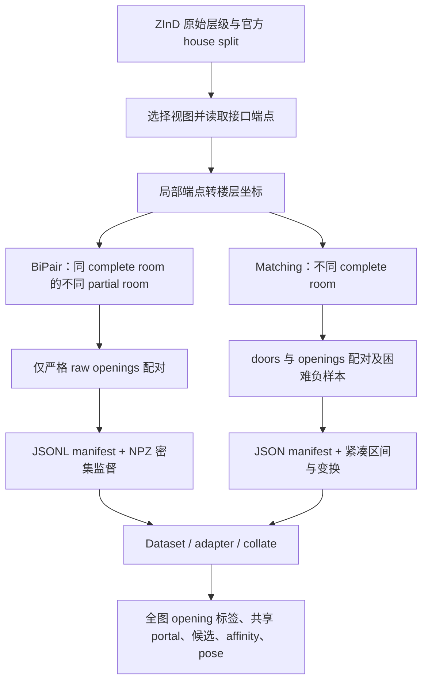
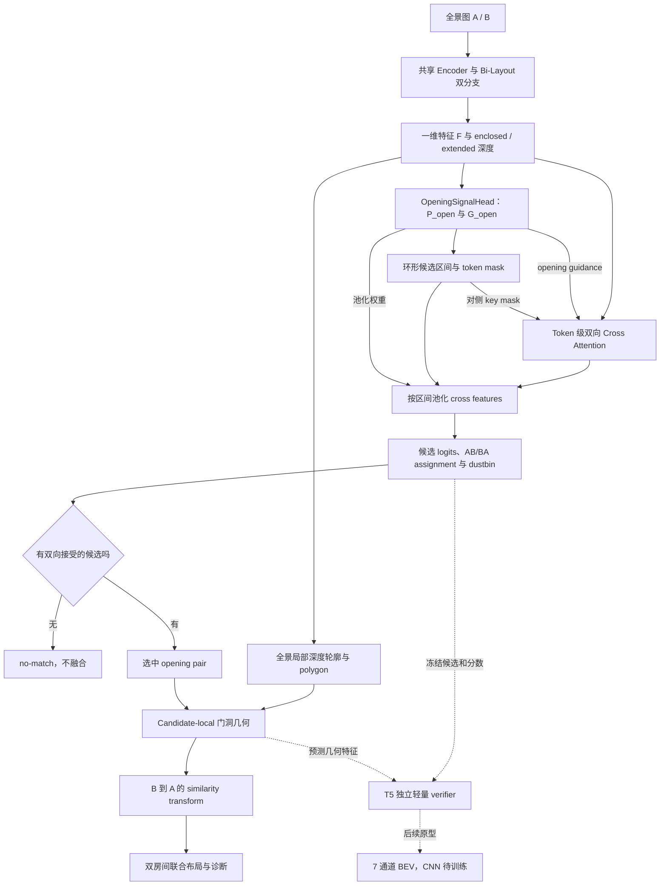
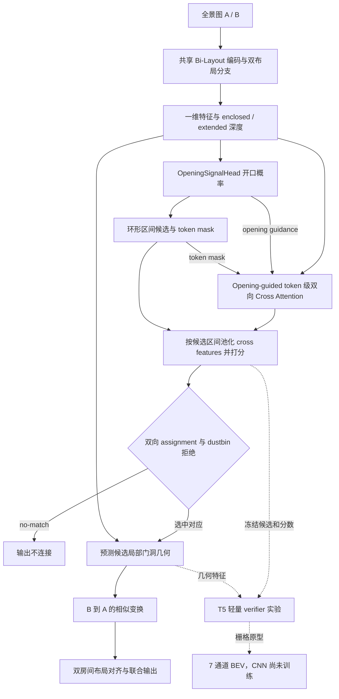
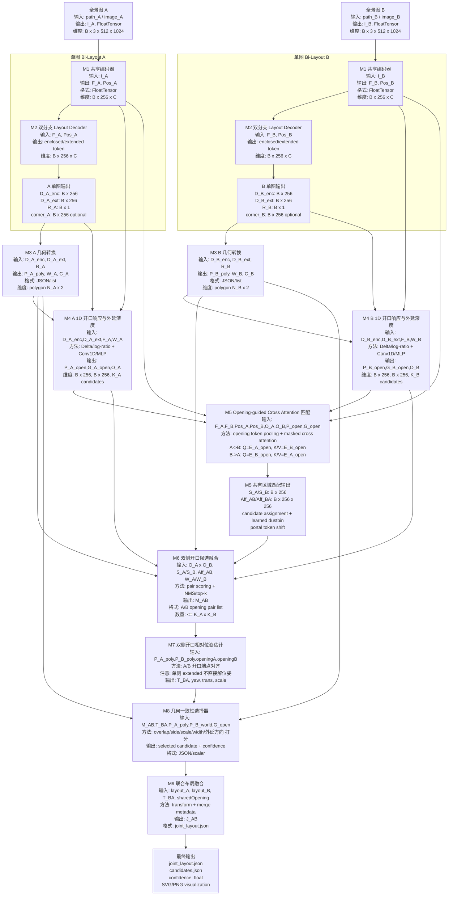
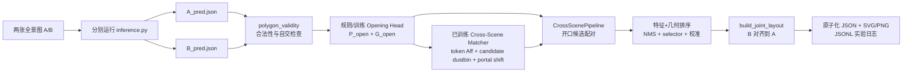

> 修改记录：2026-11-05 19:47 CST - 修复合并时自定义全景结果链接中的尖括号和路径。

> 修改记录：2026-11-05 19:36 CST - 合并历史资料，保留来源、原修改记录和日期边界，调整迁移后的文档链接。

# 早期项目手册与学习材料

本文为历史来源合订本。原文中的“当前”“待实现”“正在运行”均以原日期为准；当前维护文档从 [文档入口](../README.md) 阅读。代码与数据路径可能保留历史写法，迁移对应表见 [项目结构](../development.md)。

- [README_文档总索引.md](#source-91902ecd8f)
- [项目总览与学习手册.md](#source-5de1910be5)
- [学习索引.md](#source-978e500a5f)
- [跨场景共享开口融合网络架构_可编辑.md](#source-927d1962ec)
- [Matcher阶段汇报_五类案例与下一步.md](#source-92cd0ef78d)

---

<a id="source-91902ecd8f"></a>

## 来源：README_文档总索引.md

合并前 SHA-256：`c64e77e210827a30def33bea8385f55d56476599ff2caeb5cdc22773af56d110`。原文与修改记录如下（仅相对链接重定位）：

> 修改记录：2026-11-05 19:21 CST - 项目更名 PortalLayout，增加当前代码入口；保留历史正文及修改记录。

> **PortalLayout 当前入口**：[首页](../../README.md) · [代码地图](project_history.md#source-9861032b1d) · [运行指南](project_history.md#source-28e482e7ae)。以下正文保留原记录日期的状态与术语，不能替代当前代码审计。

> **2026-09 更新：[ZInD-ObservablePairs-v1 数据与端到端训练结果](../../experiments/zind_observable_v1/README.md)**：251,650 对完整索引、实际训练划分及 21 轮结果；最佳内部监控 Top-1 60.37%，不是正式测试成绩。

> 统一文档已合并至 [项目总览与学习手册](legacy_handbook.md#source-5de1910be5)（2026-09-07）。本文件保留为历史资料；其中“当前状态”和“下一步”以原记录日期为准，后续阅读与维护以统一手册为入口。

> 修改记录：2026-07-13 16:32 CST - 跨场景入口由旧版更新为统一工程管线。
> 修改记录：2026-07-16 16:45 CST - 增加 ZInD 匹配数据格式与转换入口。
> 修改记录：2026-07-17 11:48 CST - 增加 ZInD-BiPair-v1 数据集生成、加载和全量验证入口。
> 修改记录：2026-07-17 13:43 CST - 增加 ZInD-BiPair-v1 开口召回评估、环形指标与阈值标定入口。
> 修改记录：2026-08-04 - 增加 ZInD 端到端联合训练正式结果、Top-1 瓶颈与后续优化建议。

# Bi-Layout 文档总索引

这是一页式入口。当前项目主线收敛到 Bi-Layout 基础模型与跨场景共享开口融合网络架构。

## 入口文档

1. [README.md](../../README.md)
   - 看原始 Bi-Layout 项目说明、环境安装、数据准备和训练/测试入口

2. [统一手册：单图结构](legacy_handbook.md#source-5de1910be5)
   - 看可编辑 Mermaid 网络图
   - 适合理解单图 Bi-Layout 双分支结构

3. [跨场景共享开口融合网络架构_可编辑.md](legacy_handbook.md#source-927d1962ec)
   - 看跨场景共享开口融合的完整网络架构、模块输入输出和训练/推理流程
   - 适合确认开口响应、共享开口匹配、相对位姿估计和联合布局融合的研究主线

4. [ZInD-BiPair-v1数据集说明.md](datasets.md#source-4660a67882)
   - 看首版 partial-opening 数据集的筛选、opening 匹配、NPZ 标签、规模和验证结果
   - 这是当前推荐用于训练 Opening Head、Matcher、Pose 和联合布局的 pair dataset

5. [ZInD匹配数据格式.md](datasets.md#source-faed420bd5)
   - 看原始 ZInD 如何转换为正负全景对、开口区间、对应关系和相对位姿监督
   - 这是较早的跨 complete-room door/opening 诊断格式

6. [ZInD端到端训练结果.md](project_history.md#source-4242817bc1)
   - 看 Bi-Layout、Opening Head 和 Matcher 的 15 轮联合微调配置、最佳/测试指标与 checkpoint 身份
   - 重点记录端到端 Top-1 只有 25.65% 的两阶段瓶颈、Top-3 潜力和 M6–M9 几何重排建议

## 读法建议

- 先读 [README.md](../../README.md) 和 [统一手册：单图结构](legacy_handbook.md#source-5de1910be5)，建立原始单图布局估计基础。
- 再读 [跨场景共享开口融合网络架构_可编辑.md](legacy_handbook.md#source-927d1962ec)，理解本文创新点如何从单图 enclosed/extended 输出扩展到跨场景共享开口融合。

## 按问题找文档

- 想知道原始 Bi-Layout 如何训练、测试和组织数据: 看 [README.md](../../README.md)
- 想直接改 Bi-Layout 网络架构图: 看 [统一手册：单图结构](legacy_handbook.md#source-5de1910be5)
- 想确认跨场景共享开口融合的模块输入输出: 看 [跨场景共享开口融合网络架构_可编辑.md](legacy_handbook.md#source-927d1962ec)
- 想生成首版 partial-opening 训练数据: 看 [ZInD-BiPair-v1数据集说明.md](datasets.md#source-4660a67882) 和 [tools/build_zind_bipair_v1.py](../../tools/build_zind_bipair_v1.py)
- 想测试开口召回率并在 val 标定阈值: 看 [tools/evaluate_zind_opening_recall.py](../../tools/evaluate_zind_opening_recall.py)、[evaluation/opening_recall.py](../../portallayout/evaluation/opening_recall.py) 和 [src/output/progress_report_20260716/进度汇报结果.md](../../outputs/progress_report_20260716/进度汇报结果.md)
- 想生成跨 complete-room 的 door/opening 诊断清单: 看 [ZInD匹配数据格式.md](datasets.md#source-faed420bd5) 和 [tools/build_zind_matching_dataset.py](../../tools/build_zind_matching_dataset.py)
- 想查看完整端到端训练结果和 Top-1 诊断: 看 [ZInD端到端训练结果.md](project_history.md#source-4242817bc1) 和 [tools/train_zind_end_to_end.py](../../tools/train_zind_end_to_end.py)
- 想运行跨场景工程版: 看 [tools/estimate_cross_scene_layout.py](../../tools/estimate_cross_scene_layout.py)、[utils/cross_scene_pipeline.py](../../portallayout/engine/cross_scene_pipeline.py) 和 [tools/join_room_layouts.py](../../tools/join_room_layouts.py)

## 关键代码位置

- [main.py](../../main.py): 入口、训练、评估、保存
- [dataset/communal/base_dataset.py](../../portallayout/datasets/communal/base_dataset.py): 数据处理
- [models/bi_layout.py](../../portallayout/models/bi_layout.py): 模型结构
- [loss/](../../loss): 各类损失函数
- [postprocessing/post_process.py](../../portallayout/postprocessing/post_process.py): 后处理
- [evaluation/accuracy.py](../../portallayout/evaluation/accuracy.py): 评估指标
- [tools/estimate_cross_scene_layout.py](../../tools/estimate_cross_scene_layout.py): 自动估计双房间跨场景共享开口候选
- [utils/cross_scene_pipeline.py](../../portallayout/engine/cross_scene_pipeline.py): 统一验证、候选融合、NMS、选择和版本化输出
- [models/cross_scene_matcher.py](../../portallayout/models/cross_scene_matcher.py): 开口响应与双向 cross attention 匹配
- [dataset/zind_bipair_builder.py](../../portallayout/datasets/zind_bipair_builder.py): 构建严格 partial-opening 正负样本与全部监督标签
- [dataset/zind_bipair_dataset.py](../../portallayout/datasets/zind_bipair_dataset.py): 加载 ZInD-BiPair-v1 JSONL/NPZ 并组成训练 batch
- [tools/build_zind_bipair_v1.py](../../tools/build_zind_bipair_v1.py): 在 ZInD 同目录生成 ZInD-BiPair-v1
- [tools/validate_zind_bipair_v1.py](../../tools/validate_zind_bipair_v1.py): 全量检查缓存、标签、路径和房屋级数据泄漏
- [evaluation/opening_recall.py](../../portallayout/evaluation/opening_recall.py): 唯一 panorama 的 token AP/召回、环形连通域和区间 IoU 指标
- [tools/evaluate_zind_opening_recall.py](../../tools/evaluate_zind_opening_recall.py): 评估 GT/预测双深度开口先验并在 val 标定阈值
- [dataset/zind_pair_mining.py](../../portallayout/datasets/zind_pair_mining.py): 从 ZInD 拓扑与重复门洞标注中挖掘正负全景对
- [dataset/panorama_pair_dataset.py](../../portallayout/datasets/panorama_pair_dataset.py): 展开并批处理匹配监督
- [tools/build_zind_matching_dataset.py](../../tools/build_zind_matching_dataset.py): 生成 train/val/test 匹配 manifest
- [tools/join_room_layouts.py](../../tools/join_room_layouts.py): 使用共享开口/接口合并两个房间布局

## 保持原则

- 这里只做导航，不重复正文内容。
- 具体解释、图示、公式和代码示例都放在对应正文文档里。


---

<a id="source-5de1910be5"></a>

## 来源：项目总览与学习手册.md

合并前 SHA-256：`26a7957cfa1e4341bb447cdc25ed3c9a4f387077365145f7516475c4aa3e47b0`。原文与修改记录如下（仅相对链接重定位）：

> 修改记录：2026-11-05 19:21 CST - 项目更名 PortalLayout，增加当前代码入口；保留历史正文及修改记录。

> **PortalLayout 当前入口**：[首页](../../README.md) · [代码地图](project_history.md#source-9861032b1d) · [运行指南](project_history.md#source-28e482e7ae)。以下正文保留原记录日期的状态与术语，不能替代当前代码审计。

> **2026-09 更新：[ZInD-ObservablePairs-v1 数据与端到端训练结果](../../experiments/zind_observable_v1/README.md)**：251,650 对完整索引、实际训练划分及 21 轮结果；最佳内部监控 Top-1 60.37%，不是正式测试成绩。

# Bi-Layout 项目总览与学习手册

> 合并更新：2026-09-07。整合用户列出的 6 份 Markdown，依据代码基线 `50a6ae5`、后续本地实现和已有实验产物校正。本文件是统一阅读入口；原文保留为历史资料。本次未重新训练或评估模型。

本项目以单图 Bi-Layout 为基础：先从每张 360° 全景图预测 enclosed 与 extended 两种布局，再从双深度差异和图像特征中寻找可连通开口，在两张图之间匹配同一物理接口，最后估计 B→A 的相对变换并对齐房间布局。

**当前已经跑通 live Bi-Layout、Opening Head、Matcher 的联合训练，以及预测开口驱动的双房间几何融合。** 完整 val 上冻结 T3 的正确匹配率为 27.42%；独立轻量 verifier E1 将正确匹配数从 501 提升到 526。候选召回、跨房屋的选择与拒绝能力仍限制最终效果；BEV CNN 尚未训练，多房间统一重建也仍需继续验证。

## 阅读目录

1. [项目目标、范围与术语](legacy_handbook.md#source-5de1910be5)
2. [目录、运行入口与环境](legacy_handbook.md#source-5de1910be5)
3. [两套跨场景数据及标签契约](legacy_handbook.md#source-5de1910be5)
4. [单图 Bi-Layout 与跨图网络](legacy_handbook.md#source-5de1910be5)
5. [几何对齐、候选选择和工程输出](legacy_handbook.md#source-5de1910be5)
6. [训练阶段、监督与损失](legacy_handbook.md#source-5de1910be5)
7. [评估指标与证据口径](legacy_handbook.md#source-5de1910be5)
8. [实验演进：BiPair、首次端到端、T0–T5](legacy_handbook.md#source-5de1910be5)
9. [构建、运行与复现命令](legacy_handbook.md#source-5de1910be5)
10. [当前瓶颈与尚未完成的工作](legacy_handbook.md#source-5de1910be5)
11. [学习路线、文档合并说明](legacy_handbook.md#source-5de1910be5)
12. [完整文件索引：266 项](legacy_handbook.md#source-5de1910be5)

第一次阅读按 1→3→4→5→6→7→8 建立全局理解；实际运行看第 9 节；查某个文件看第 12 节。

<a id="project"></a>
## 1. 项目目标、范围与术语

### 1.1 从单图布局到跨空间连接

单图布局有标注歧义：看见一个开放接口时，边界可以在接口处闭合，也可以向可见的邻接区域延伸。Bi-Layout 用两个分支分别表达这些布局语义。项目进一步利用二者的差异，预测开口并寻找跨图对应。

“共享开口”包括 door、无门扇的门洞、宽 opening、开放通道等物理接口。几何对齐依赖的是接口两侧的线段及空间关系；具体训练标签覆盖哪些接口，仍由数据集决定。

extended 只表示可见区域的外延，**不保证完整恢复相邻房间**。窄门洞可能只产生局部深度响应；相邻房间的位置需要双侧候选及几何约束，不能由单张 extended 布局直接确定。

### 1.2 三条任务线

| 任务 | 输入与目标 | 数据/入口 | 当前作用 |
| --- | --- | --- | --- |
| 单图 Bi-Layout | 一张全景 → 两套布局和房高比例 | MP3D、ZInD；[main.py](../../main.py)、[inference.py](../../inference.py) | 基础网络、单图几何与布局评估。 |
| partial-room 匹配 | 同一 complete room 中不同 partial room 的共享 opening | ZInD-BiPair-v1 | 早期严格数据集、Opening 与 Matcher 模块化训练。 |
| complete-room 匹配 | 不同完整房间之间的 door/opening 连接与拒绝 | ZInD_matching；[端到端训练器](../../tools/train_zind_end_to_end.py) | 当前 T0–T3、T4/T5 和几何诊断的主要数据线。 |

### 1.3 术语表

| 术语 | 本项目中的含义 |
| --- | --- |
| complete room / partial room | ZInD 的完整房间 / 局部房间层级；两套 pair 数据的配对范围不同。 |
| enclosed / extended | 语义上的闭合布局 / 外延可见布局；当前 ZInD 分支映射见第 4 节。 |
| opening / portal | opening 常指单图全部开口；shared portal 指当前 A/B pair 对应的那个共享接口。 |
| candidate | 从环形 token 区间得到的候选；GT manifest 候选与 predicted 候选的身份、数量可能不同。 |
| guidance | 进入 attention 和池化的开口响应权重；其来源与 candidate 来源是两个独立开关。 |
| dustbin | 每个候选在另一张图中“没有匹配”的额外类别。 |
| teacher-forced | 给 Matcher 使用 GT guidance 或 manifest 候选的诊断设置，必须写明实际来源。 |
| oracle | 使用真实标签替换某环节、估计误差来源或上限的事后实验；不是实际预测。 |
| S3 | 完整 val 几何报告中，正样本被接受且最终选对候选的集合；不代表位姿也正确。 |
| BEV | 从上方观察的平面布局表示，本项目包括 polygon、标量几何特征和栅格原型。 |

**重名约定：** 架构 `M2` 指双布局解码器；几何实验 `candidate-local M2` 指局部门洞拟合方案。v2 候选配置 G0/G1、几何比较 G0/G1/G2 也不是同一组实验。后文始终加上用途说明。

<a id="repository"></a>
## 2. 目录、运行入口与环境

```text
Bi_Layout/
├── main.py / inference.py        单图训练、评估与推理
├── config/ + src/config/         默认配置树与数据集 YAML
├── dataset/                     数据加载、pair 构建和特征缓存适配代码
├── models/                      Bi-Layout、Opening、Matcher、selector
├── loss/ + evaluation/          单图损失与评估；跨图损失也在 matcher/训练工具中
├── preprocessing/               数据过滤、消失点与全景预对齐
├── postprocessing/              Manhattan/Atlanta 与朝向保留拟合
├── utils/                       坐标、几何融合、候选审计、verifier 与 raster
├── tools/                       数据构建、跨图训练、推理、诊断入口
├── tests/                       行为契约与回归测试
├── visualization/               全景边界、平面图、OBJ 与独立 3D 查看器
├── src/dataset/                 实际图片、标签、manifest 和部分缓存
├── checkpoints/                 权重、恢复状态和训练指标
├── experiments/                 实验协议、消融、预检、诊断报告
└── src/output/                  推理结果、几何评估和可视化产物
```

`dataset/` 与 `src/dataset/` 分别是代码和数据；路径配置可能指向项目外的原始 ZInD。权重和大批量产物不会全部随 Git 克隆，读取本地报告时要保留 checkpoint、manifest、配置和 split 的身份信息。

| 入口 | 实际消费的输入 | 用途 |
| --- | --- | --- |
| [main.py](../../main.py) | 配置、单图 Dataset | 单图训练与 val/test。 |
| [inference.py](../../inference.py) | 图片 glob、配置、权重 | 单图 JSON/PNG，可选 OBJ。 |
| [train_zind_end_to_end.py](../../tools/train_zind_end_to_end.py) | 原始双图、matching manifest、teacher cache、初始化权重 | 联合训练或显式 matcher-only 微调。 |
| [debug_cross_scene_flow.py](../../tools/debug_cross_scene_flow.py) | 模型、双图/样本及运行参数 | 检查 live 特征、开口、匹配和几何表示。 |
| [estimate_cross_scene_layout.py](../../tools/estimate_cross_scene_layout.py) | 两个预测 layout JSON；可附 extended、matcher evidence、selector | 通用几何候选排序与融合；并非自动加载 T3 的双图网络入口。 |
| [join_room_layouts.py](../../tools/join_room_layouts.py) | layout JSON + 人工指定两侧 opening | 已知接口的几何拼接。 |
| [evaluate_zind_room_group.py](../../tools/evaluate_zind_room_group.py) | 固定 train 房间组及模型 | 按预测接受/拒绝进行 pairwise 融合和定性诊断。 |
| [evaluate_zind_portal_geometry_val_full.py](../../tools/evaluate_zind_portal_geometry_val_full.py) | 完整 val、冻结 T3、固定几何配置 | 一次预测供多条几何分支比较，验证 Matcher parity。 |

原项目环境以 Python 3.8、PyTorch 1.12、torchvision 0.13、CUDA 11.3 为基础，其他依赖见 [requirements.txt](../../requirements.txt)。这是仓库的历史环境组合，不是通用最新版安装建议；独立 3D 查看器另有 [依赖](../../portallayout/visualization/visualizer/requirements.txt) 和 [说明](../../portallayout/visualization/visualizer/README.md)。

<a id="datasets"></a>
## 3. 两套跨场景数据及标签契约

### 3.1 共同的生成逻辑

ZInD 的层级为 house → floor → complete_room → partial_room → panorama。两套数据都先按官方 house split 隔离，再利用标注的局部到楼层变换，把接口放入公共坐标比较；确认配对后，回到每张全景的局部坐标生成 256-token 标签。



| 比较项 | ZInD-BiPair-v1 | ZInD_matching |
| --- | --- | --- |
| 配对空间 | 同 complete room、不同 partial room | 不同 complete room、同一楼层 |
| 接口 | `layout_raw.openings` | doors + openings |
| 文件 | `manifests/*_pairs.jsonl` + `labels/*/*.npz` | `train.json` / `val.json` / `test.json` |
| 图片 | 引用原始图片，不复制 | 引用 `dataRoot` 下的原图，不复制 |
| 标签侧重点 | raw/visible 双深度、全部 opening、shared portal、pose、complete layout | 全部候选、共享候选身份、door/opening token 标签与相对变换；密集矩阵按需展开 |
| 训练用途 | 早期冻结特征上的 Opening / Matcher | 域适配和当前完整端到端实验 |

### 3.2 BiPair-v1：严格 partial-opening 数据

视图要求：primary、inside、flat ceiling；raw/visible/complete 三套布局、`floor_plan_transformation`、楼层米制换算和原始图片齐全。正样本来自同一完整房间中不同局部房间的同一 raw opening；负样本来自没有直接 opening 连接的 partial-room pair。

匹配同时满足：中点距离 ≤0.20m、无向方向差 ≤10°、长度相对误差 ≤20%、正反端点最小平均误差 ≤0.25m。原实现见 [zind_bipair_builder.py](../../portallayout/datasets/zind_bipair_builder.py)。

历史生成目录为 `/home/feixia/pythonProject/AAAsrk/zind/ZInD-BiPair-v1/`，包含 `dataset_info.json`、manifest、NPZ 和 `statistics/`。文档记录派生数据约 205MB；11,356 个缓存验证通过，house split 泄漏数为 0。

| Split | 正样本 | 困难负样本 | 总数 | 有 pair 的房屋 |
| --- | ---: | ---: | ---: | ---: |
| train | 4612 | 4612 | 9224 | 1101 |
| val | 571 | 571 | 1142 | 133 |
| test | 495 | 495 | 990 | 127 |
| 合计 | 5678 | 5678 | 11356 | 1361 |

训练集共享 opening 的平均端点误差约 0.0599m，三套 split 中同 pair 的 complete layout A/B 重合率约为 1.0。以上是历史数据生成统计，不是模型成绩。

NPZ 标签如下；这些字段“存在”不表示每次实验都启用了对应损失。

| 标签 | 单样本形状 | 语义 |
| --- | --- | --- |
| `depth_enclosed_A/B` | `[256]` | raw/enclosed 深度。 |
| `depth_extended_A/B` | `[256]` | visible/extended 深度。 |
| `extension_depth_A/B` | `[256]` | `max(0, visible-raw)`。 |
| `ratio_A/B` | `[1]` | `(ceiling_height-camera_height)/camera_height`。 |
| `corners_enclosed/extended_A/B` | `[N,2]` | UV 角点。 |
| `opening_mask_all_A/B` | `[256]` | 该视图全部 raw openings。 |
| `portal_mask_A/B` | `[256]` | 当前 pair 的共享 opening；负 pair 为零。 |
| `portal_center/width_A/B` | `[1]` | 环形中心和宽度。 |
| `affinity_gt` | `[256,256]` | 共享 portal masks 的外积。 |
| `T_B_to_A` | `[3,3]` | B 局部坐标到 A 局部坐标的相似变换。 |
| `relative_yaw_gt` | `[1]` | 变换中的相机相对 yaw。 |
| `translation_gt` / `translation_meters_gt` | `[2]` | A 局部坐标平移 / 米制平移。 |
| `relative_scale_gt` | `[1]` | 相对尺度。 |
| `joint_layout_global` | `[N,2]` | complete layout 的楼层坐标 polygon。 |
| `shared_portal_global` | `[2,2]` | 正样本共享 opening 的楼层坐标端点；负样本为空。 |

Opening 监督必须使用 `opening_mask_all_*`。负 pair 没有共享接口，但每张图仍可能有自己的开口。评估按图片去重：历史 val/test 分别为 897/787 张唯一全景。

### 3.3 ZInD_matching：complete-room 数据

生成代码为 [zind_pair_mining.py](../../portallayout/datasets/zind_pair_mining.py) 和 [build_zind_matching_dataset.py](../../tools/build_zind_matching_dataset.py)。每个 partial room 优先选 primary panorama，提取 complete/raw 中可用的 door/opening 标注。

在楼层坐标下比较正反端点平均距离：≤0.06 为正样本匹配条件；同楼层、两侧有接口且最小误差 ≥0.15 才能成为困难负样本；中间区域不作为安全负例。这两个阈值使用代码中的**楼层标注坐标单位**，不能直接加上“米”；BiPair 上述阈值则显式是米制。默认负正比例接近 1:1，无合格负例的楼层不强行补齐。

| Split | 房屋 | 正样本 | 负样本 | 总数 |
| --- | ---: | ---: | ---: | ---: |
| train | 1260 | 14741 | 14584 | 29325 |
| val | 157 | 1827 | 1803 | 3630 |
| test | 158 | 1856 | 1833 | 3689 |
| 合计 | 1575 | 18424 | 18220 | 36644 |

这是 2026-07-16 全量生成记录，缺失标注和缺失图片均记录为 0。构建结果位于 `src/dataset/ZInD_matching/`，含三个 split manifest 与 `summary.json`。

| Manifest 路径/字段 | 含义 |
| --- | --- |
| 顶层 `dataRoot` / `tokenCount` / `pairs` | 原始图片根目录、token 数和样本列表。 |
| `pairs[].id`、`scene_id`、`floor_id` | pair 身份、房屋与楼层。 |
| `image_a/b` | 相对 dataRoot 的图片路径。 |
| `candidates_a/b` | 全部接口，包含 type、index、localEndpoints、globalEndpoints、tokenInterval。 |
| `supervision.is_match` | 是否共享接口。 |
| `supervision.target_candidate_a/b` | 真实候选索引；负 pair 为 -1。 |
| `supervision.relative_transform_b_to_a` | 3×3 GT similarity matrix。 |
| `supervision.relative_yaw_radians` | 从 GT 变换提取的相机 yaw。 |
| `supervision.pose_valid` | 位姿监督有效性；正样本有效。 |

完整的 256×256 affinity 不逐条存入 manifest，由 DataLoader 根据共享区间按需展开。

### 3.4 一个真实样本如何成为监督

已核对 `train.json` 中的 `0919_floor_01_pano_41_pano_29_3`：A 是 complete_room_01 / kitchen / pano_41，B 是 complete_room_06 / bedroom / pano_29。A 有 5 个候选，B 有 4 个候选。

| A 候选索引 | 类型 | 环形 token 区间 | 当前 pair 真值 |
| ---: | --- | --- | --- |
| 0 | door | `[247,1]`，跨接缝 | 否 |
| 1 | door | `[143,162]` | 否 |
| 2 | door | `[107,117]` | 是，对应 B 候选 1 |
| 3 | door | `[155,160]` | 否 |
| 4 | door | `[135,143]` | 否 |

A 真值门局部端点约为 `[[0.5024,1.9959],[1.0023,1.8260]]`，楼层端点约为 `[[0.0112,-1.8036],[0.2246,-1.8036]]`；B 真值门区间为 `[97,109]`，楼层端点约为 `[[0.0041,-1.7669],[0.2241,-1.7669]]`。端点平均误差 0.0370 满足正样本条件。

```text
is_match = true
target_candidate_pair = [2, 1]
opening_target_A = A 全部 5 个候选区间的并集
opening_target_B = B 全部 4 个候选区间的并集
affinity_target_AB = A[107..117] × B[97..109]，共 11×13=143 个正 token 对
relative_yaw_radians ≈ 2.8274 rad = 162.0°，这是 GT 相机 yaw
pose_valid = true
```

该样本的 GT B→A 变换约为：

```text
[[-0.95104665, -0.30904734, 1.97987342],
 [ 0.30904734, -0.95104665, 2.89796359],
 [ 0.0,         0.0,        1.0       ]]
```

负样本仍保留各自全部 opening 标签，但共享 affinity 为零、候选真值为 `[-1,-1]`、`pose_valid=false`。

### 3.5 Batch、候选身份与 feature cache

[PanoramaPairDataset / ZInDPairDataset](../../portallayout/datasets/panorama_pair_dataset.py) 的常用 batch 接口如下；[BiPair adapter](../../portallayout/datasets/zind_bipair_adapter.py) 将其他命名转到 [PairBatch](../../portallayout/models/cross_scene_contracts.py)。

| 字段 | Batch 形状 | 说明 |
| --- | --- | --- |
| `image_A/B` | `[B,3,H,W]` | 双图，当前主配置为 512×1024。 |
| `candidate_masks_A/B` | `[B,Kmax,256]` | 候选区间 mask。 |
| `candidate_valid_A/B` | `[B,Kmax]` | 排除 padding。 |
| `opening_target_A/B` | `[B,256]` | 全部开口标签。 |
| `affinity_target_AB` | `[B,256,256]` | 当前共享 portal 的 token 对应。 |
| `is_match` / `pose_valid` | `[B]` | 正负标签 / 位姿监督掩码。 |
| `target_candidate_pair` | `[B,2]` | manifest 候选的对应索引。 |
| `relative_transform_B_to_A` | `[B,3,3]` | GT B→A 变换。 |
| `relative_yaw_radians` | `[B]` | GT 相机 yaw，不直接作为 portal shift 标签。 |

规范化 `OpeningCandidates` 中，mask 为 bool，ID/interval 为 long；padding 的 valid=false、ID=-1、interval=`[-1,-1]`。区间端点包含在内，`start>end` 表示跨 seam。

预测候选会因阈值、split、merge、dedup、cap 改变数量和顺序，所以不能把 manifest 的索引直接当成预测候选索引。训练时需要按环形区间 IoU 重映射目标；当前主实验 target IoU 为 0.30。

[cache_zind_matching_features.py](../../tools/cache_zind_matching_features.py) 按唯一视图缓存 Bi-Layout 特征与深度，[zind_matching_feature_dataset.py](../../portallayout/datasets/zind_matching_feature_dataset.py) 再关联 pair 与候选。缓存用于冻结特征训练，也可作为端到端训练的低权重 teacher；使用 cache 不代表 live 主干被冻结，具体取决于训练阶段。

<a id="architecture"></a>
## 4. 单图 Bi-Layout 与跨图网络

<a id="single-view"></a>
### 4.1 单图结构与分支语义

[Bi_Layout.forward](../../portallayout/models/bi_layout.py) 共享图像编码器，使用两套 learned context/query 区分布局；[HorizonNetFeatureExtractor](../../portallayout/models/modules/horizon_net_feature_extractor.py) 通过 CNN、左右环形 padding 和高度压缩，将图像转为 256 个水平 tokens；[Share_Feature_Guidance_Module](../../portallayout/models/modules/share_feature_guidance_module.py) 解码两套布局特征。

当前 [zind_all.yaml](../../configs/layout/zind_all.yaml) 的特征维度 C=512，构造器默认值可能为 1024，必须以实际配置为准。

| 返回字段 | 当前 ZInD 语义 | 形状 |
| --- | --- | --- |
| `depth` | visible / extended | `[B,256]` |
| `new_depth` | raw / enclosed | `[B,256]` |
| `ratio` | 两分支房高比例预测的平均 | `[B,1]` |
| `layout_feature` | Transformer 前的序列特征，当前跨图主线使用它 | `[B,256,C]` |
| `enc_feature` / `ext_feature` | 两条解码支路的特征返回键；语义仍须结合当前标签顺序 | `[B,256,C]` |
| `corner_heat_map` | 可选角点热图 | `[B,256]` |

`resolve_enclosed_extended_depth(..., "extended_first")` 显式把 `new_depth` 取为 enclosed，把 `depth` 取为 extended。旧文档中直接将 origin 等同 enclosed、new 等同 extended 的写法不适用于当前 ZInD 权重。

| 配置开关 | 实际作用 | 当前 ZInD 配置 |
| --- | --- | --- |
| `use_same_head` | true 复用输出 heads；false 两分支各有输出 heads | false |
| `share_TF` | true 复用 Transformer；false 创建第二个 Transformer | true |
| `two_conv_out` | true 使用两套高度压缩；图像 encoder 仍共享 | false |
| `output_number` | 1 或 2；双高度压缩要求 2 且为卷积 backbone | 2 |

权重必须与结构开关匹配，不能把改变开关当成无需重训的普通配置切换。相关检查见 [test_bi_layout_config.py](../../tests/test_bi_layout_config.py)。

### 4.2 整体数据流：按实际实现排列



M3 的几何转换可与 Opening/Matcher 的 token 路径并行；当前 OpeningSignalHead 不需要先读取 walls，跨图网络也不是必须先做 Manhattan 后处理。旧图“先候选池化，再候选级 Cross Attention”已在此校正为真实的 token attention → cross-feature pooling。

### 4.3 保留 M0–M9 名称，但分清其职责和状态

| 模块 | 职责与主要输入输出 | 代码 | 当前状态 |
| --- | --- | --- | --- |
| M0 Pair Input | manifest / 图片 → 双图、标签、候选与元数据 | [pair dataset](../../portallayout/datasets/panorama_pair_dataset.py)、[联合训练 Dataset](../../tools/train_zind_end_to_end.py) | 已实现。 |
| M1 Shared Encoder | `[B,3,512,1024]` → `[B,256,C]` 特征 | [feature extractor](../../portallayout/models/modules/horizon_net_feature_extractor.py) | 已有单图权重，参与 joint 微调。 |
| M2 Dual Decoder | context/query → enclosed、extended、ratio | [Bi-Layout](../../portallayout/models/bi_layout.py) | 已实现，参与 joint 微调。 |
| M3 Geometry Converter | depth → UV/XYZ、局部轮廓、polygon、walls 与有效性 | [conversion](../../portallayout/geometry/conversion.py)、[post-process](../../portallayout/postprocessing/post_process.py) | 已实现；需保留坐标与 heading。 |
| M4 Opening | 特征+双深度 → opening probability、expansion depth、区间 | [OpeningSignalHead](../../portallayout/models/cross_scene_matcher.py) | BiPair、matching 训练与 joint 路径均已有。 |
| M5 Matcher | token features+guidance+候选 → affinity、assignment、匹配/拒绝 | [Matcher](../../portallayout/models/cross_scene_matcher.py) | 已训练，后续基线为 T3。 |
| M6 Opening Pair / Geometry | 整理候选对及几何证据；选中区间到显式端点 | [estimator](../../portallayout/engine/cross_scene_estimator.py)、[candidate-local 几何](../../portallayout/geometry/candidate_local_portal_geometry.py) | 解析/离散实现，入口不同路由不同。 |
| M7 Relative Pose | 双侧门洞端点 → B→A 的 yaw、translation、scale | [joint_layout](../../portallayout/geometry/joint_layout.py) | 解析几何；不是已训练独立 pose head。 |
| M8 Selector | 几何+特征代价 → 候选排序 | [estimator](../../portallayout/engine/cross_scene_estimator.py)、[GeometryConsistencySelector](../../portallayout/models/geometry_consistency_selector.py) | 确定性排序已有；该 learned selector 没有已确认的正式训练结果。T5 E1 属于另一条预检实现。 |
| M9 Joint Output | 变换、边界、共享接口、诊断 → JSON / SVG / PNG | [pipeline](../../portallayout/engine/cross_scene_pipeline.py)、[logger](../../portallayout/utils/cross_scene_logger.py) | 双房间工程输出已有。 |

### 4.4 Opening Head：深度差异与可学习响应

代码先将深度取绝对值并钳制到正数，构造三个几何通道：

```text
delta = relu(D_ext - D_enc)
relative_delta = clamp(delta / D_enc, max=10)
log_ratio = clamp(relu(log(D_ext / D_enc)), max=4)

concat(LayerNorm(F), delta, relative_delta, log_ratio)
  → 1×1 Conv → 环形 padding + Conv → opening_logits / depth_scale_logits

P_open = sigmoid(learned_opening_logits + geometry_prior_logits)
G_open = delta × P_open × exp(tanh(depth_scale_logits))
```

geometry prior 由每视图 relative peak 与 magnitude gate 组合；细节以 [OpeningSignalHead](../../portallayout/models/cross_scene_matcher.py) 为准。`G_open` 是局部外延深度证据，不是邻接完整房间形状；当前头没有独立的语义门类别预测，也不直接返回旧设计表中的逐 token opening-width head。

候选生成分两类：`legacy` 按概率阈值提取环形连通区间；实验性的 `recall_topk` 再使用峰值、扩张、去重与数量上限。无学习证据时，通用 JSON 工程管线还可从深度差异或墙中心 fallback 生成候选，不能把 fallback 当成网络召回成功。

### 4.5 Matcher：token attention、池化与双向拒绝

`OpeningGuidedCrossAttentionMatcher.forward` 在 256-token 特征上投影 Q/K/V，并对 key 侧加入 `log(P_open)` 偏置和候选 token mask：A 查询 B，B 查询 A。残差、投影与前馈层得到 `cross_feature_A/B`。

随后 `OpeningTokenPooler` 才按每个候选的 mask 与 opening guidance 加权池化 cross features，得到 `[B,K_A,C]` 与 `[B,K_B,C]`。归一化的 query/key 投影点积经 temperature 缩放，形成候选 logits。

| 输出 | 形状 | 含义 |
| --- | --- | --- |
| `Aff_AB/BA` | `[B,256,256]` | 各方向 token attention 的多头平均。 |
| `S_A/S_B` | `[B,256]` | guidance 与跨图 attention 聚合的共享响应。 |
| `E_A_open/E_B_open` | `[B,K_A/B,C]` | 对 cross features 池化的候选特征。 |
| `candidate_assignment_AB` | `[B,K_A+1,K_B+1]` | A→B 逐行 softmax，含 dustbin。 |
| `candidate_assignment_BA` | `[B,K_B+1,K_A+1]` | B→A 逐行 softmax，含 dustbin。 |
| `candidate_pair_score` | `[B,K_A,K_B]` | 双向 affinity 与两侧候选开口置信度的组合。 |
| `best_candidate_pair` | `[B,2]` | 最佳双向接受 pair；无匹配时 `[-1,-1]`。 |
| `pair_match_probability` / `pair_no_match_probability` | `[B]` | pair 汇总分数；它们不是互补的二分类 softmax。 |
| `relative_token_shift_radians` | `[B]` | 共享 portal 的 B-token−A-token 环形位移。 |

候选分数和接受条件可概括为：

```text
mutual_affinity(i,j) = sqrt(Assign_AB(i,j) × Assign_BA(j,i))
opening_confidence(i,j) = sqrt(mean_guidance_A(i) × mean_guidance_B(j))
score(i,j) = mutual_affinity(i,j) × opening_confidence(i,j)

accepted(i,j) = valid(i,j)
             and Assign_AB(i,j) > Assign_AB(i,dustbin)
             and Assign_BA(j,i) > Assign_BA(j,dustbin)
best = accepted 集合中的最高 score；集合为空则 no-match
```

因此 raw real-real score 的第一名，不一定是最终被接受的第一名。`pair_match_probability` 是最大 real-real score，`pair_no_match_probability` 从双侧平均拒绝概率聚合；两者不保证和为 1，也不能随意用一条 0.5 阈值代替正式双向 assignment 决策。

portal shift 不是 camera yaw：相机中心变化时，同一门洞在全景中的经度位移同时包含视点影响。历史返回键 `relative_yaw_radians` 在 Matcher 中仅是 shift 的兼容别名；manifest 中同名字段则是真实相机 yaw，必须按来源区分。

<a id="geometry"></a>
## 5. 几何对齐、候选选择和工程输出

### 5.1 坐标、单位与变换方向

| 坐标/对象 | 约定 |
| --- | --- |
| Bi 平面 | 水平 x/z；经度使用 `atan2(x,z)`。 |
| ZInD panorama-local | x/y；接口投影采用 Bi 水平 `[-x,y]`，所以存在 x 镜像约定。 |
| ZInD floor | 通过每张全景的 `floor_plan_transformation` 从局部变换到楼层。 |
| `T_B_to_A` | `p_A = T_B_to_A @ p_B`，这里 A 是参考局部坐标，不是天然的绝对世界坐标。 |
| 米制平移误差 | 局部平移误差 × A 的 local-to-floor scale × 楼层 `scale_meters_per_coordinate`。 |

```text
M_A = panorama A 的 local-to-floor similarity matrix
M_B = panorama B 的 local-to-floor similarity matrix
T_B_to_A = inverse(M_A) @ M_B

如果 C_i 是 canonical → panorama-local：
T_local_B_to_A = C_A @ T_canonical_B_to_A @ inverse(C_B)
```

不能仅凭 JSON 中的 `world` 或 `meters` 字样判断实际单位。旧 `build_joint_layout` 保留通用 `floorplan-xz-meters` 标签；ZInD candidate-local 路径显式使用 panorama-A local xy，并在评估时附加米制换算。完整历史审计见 [coordinate_contract.md](../../outputs/zind_room_group_debug/t3_geometry_oracle_0665_floor03/coordinate_contract.md)。

### 5.2 从深度到门洞：为什么要保留朝向

单图深度可经 [conversion](../../portallayout/geometry/conversion.py) 转为局部轮廓，再做 Manhattan/Atlanta 拟合。旧三房间案例的失效点是：固定轴 Manhattan polygon 被当作仍保留全景 heading 的局部 polygon，导致 token 射线投到错误墙段。

当前 [post_process.py](../../portallayout/postprocessing/post_process.py) 提供 heading 估计与 `frame_preserving_manhattan`，围绕预测朝向拟合后还原回局部坐标；[prediction_to_layout](../../tools/debug_cross_scene_flow.py) 保留多种几何表示。对旧文件缺失的 pre-Manhattan 轮廓、raw depth 或 heading，不能用 GT 恢复后冒充原始预测。

candidate-local M2 进一步从**选中的预测 token 区间和局部 raw 深度轮廓**估计门洞端点，减少对全局墙索引的依赖：扩展局部上下文 → RANSAC/TLS 直线拟合 → 区间边界射线求交 → 几何有效性和支持质量诊断。它只解释选中的接口，不修改 Matcher 排名或使用 GT 选门。

实现与不变量见 [candidate_local_portal_geometry.py](../../portallayout/geometry/candidate_local_portal_geometry.py) 和 [对应测试](../../tests/test_candidate_local_portal_geometry.py)。Hard failure 与 soft quality flag 应分别统计，soft flag 不自动等于正式拒绝规则。

### 5.3 从双侧端点求相对位姿

[joint_layout.py](../../portallayout/geometry/joint_layout.py) 提供两条入口：

- `build_joint_layout(layout_a, layout_b, DoorSpec_a, DoorSpec_b)`：由墙编号和区间比例取端点。
- `build_joint_layout_from_endpoints(...)`：直接消费显式局部门洞端点，可用于 candidate-local M2。

对每一组 same/reversed 端点对应，拟合 `p_A = s R p_B + t`；scale 可从门洞宽度比估计，也可按配置保持原尺度。当前底层函数按两个房间质心的开口侧向乘积选择映射；更广泛的 overlap 等排序属于外层候选评估。

width-ratio scale 对理想线段符合 Sim(2)，但端点噪声会放大平移误差。大量样本接近 unit-scale，仍存在少数非单位标签；不能把某个 unit-scale train 个例或事后 scale oracle 推广成所有样本的默认规则。

### 5.4 两条推理路线与 selector 的边界

| 路线 | 决策逻辑 | 使用目的 |
| --- | --- | --- |
| 通用 JSON 工程管线 | 提取深度/墙中心候选 → 枚举开口对 → 几何与可选 matcher evidence 打分 → NMS/top-k → 可选 selector | 调试、自定义布局融合、工程兜底。 |
| 冻结 T3 的 room-group / val 路线 | predicted guidance/candidates → learned 双向 dustbin 决策 → 接受后调用固定几何；GT 后验附加 | 测量真实匹配与条件几何效果。 |
| T5 verifier 预检 | 冻结 T3/M2 的 Top-N 候选 → 预测特征 → 轻量 rank/拒绝模型 | 独立实验，尚未合入所有正式入口。 |

通用排序可使用开口宽度、墙长、尺度、面积/重叠、质心侧向关系、opening confidence 和 matcher feature score。[GeometryConsistencySelector](../../portallayout/models/geometry_consistency_selector.py) 是可学习候选分布接口，存在代码和损失不等于已有训练好的部署模型，也不能用 T5 E1 的结果替它背书。

### 5.5 输出如何阅读

`estimate_cross_scene_layout.py --name NAME` 写出 `NAME_candidates.json`、`NAME_best_joint.json`、`NAME_best_joint.svg`，可用时输出 PNG，并记录评估日志。

| 输出字段 | 含义与限制 |
| --- | --- |
| `rooms` / `boundary` / `cameraCenter` | A 保持参考坐标，B 的边界与相机中心经过相对变换。 |
| `sharedOpening` | 两侧接口、局部/共同坐标端点与宽度；`sharedDoor` 是兼容字段。 |
| `alignment.roomBToWorld` | 该输出参考系中的 B 变换；需结合 coordinateSystem 阅读。 |
| `roomBScale` / `endpointMapping` | 尺度和 same/reversed 映射。 |
| `diagnostics` / candidate metrics | 有效性、排序与失败原因。 |
| candidate `confidence` | 通用管线保留候选上的相对 softmax；不是已经校准的真实正确率。 |

候选容器的 `formatVersion=2` 与底层 joint JSON 的版本可能不同，不能用旧设计示意的单一 schema 替代实际导出字段。负样本拒绝时应保留 no-match 证据，独立 polygon 图本身不证明拒绝成功。

<a id="training"></a>
## 6. 训练阶段、监督与损失

### 6.1 从模块化训练到 live 联合微调

| 阶段 | 可训练部分 | 数据与入口 | cache 的用途 |
| --- | --- | --- | --- |
| 单图训练 | Bi-Layout encoder / decoder / heads | [main.py](../../main.py) | 常规 Dataset，不是跨图 feature cache 训练。 |
| 单独 Opening | OpeningSignalHead | [BiPair Opening](../../tools/train_zind_opening_head.py)、[matching Opening](../../tools/train_zind_matching_opening_head.py) | 冻结主干特征与深度。 |
| 模块化 Matcher | 依该训练器阶段配置的 Matcher 参数 | [BiPair Matcher](../../tools/train_zind_cross_scene_matcher.py)、[matching Matcher](../../tools/train_zind_matching_matcher.py) | 冻结的单图特征回连 pair。 |
| `training_stage=joint` | live Bi-Layout、Opening、Matcher | [train_zind_end_to_end.py](../../tools/train_zind_end_to_end.py) | feature/depth anchor teacher，不替代 live forward。 |
| `matcher_only_finetune` | Matcher，排除冻结 Opening | 同一训练器，要求 T3 初始化权重 | 上游 frozen+eval，反传目标是 matching loss。 |
| T5 lightweight verifier | 独立 Logistic / MLP | [Phase A](../../tools/preflight_zind_bev_verifier.py)、[Phase B](../../tools/run_zind_bev_verifier_phase_b.py) | T3/M2 冻结 artifact；没有重新训练主干或 BEV CNN。 |

联合训练路径：`JointZInDMatchingDataset` 读取图片与 teacher → `live_layout` 合并 A/B 为一次主干 batch → `_candidate_inputs` 和 `_opening_guidance_inputs` 决定来源 → `forward_matcher` → `_forward_loss` → backward / optimizer。

图像沿宽度环形旋转时，A/B 各自的 token 标签、候选 masks、teacher 和 affinity 两个轴必须同步移动。默认一 token 对应 4 个图像像素。

### 6.2 guidance 与 candidates 的独立来源

| 设置 | 能说明什么 |
| --- | --- |
| predicted guidance + predicted candidates | 实际开口预测驱动的跨图结果。 |
| GT guidance + predicted candidates | 固定候选生成误差，隔离 guidance 影响。 |
| predicted guidance + GT candidates | 固定正确候选输入，检查 Matcher 的条件能力和分布差异。 |
| GT guidance + GT candidates | Teacher-forced 诊断；不是自动系统结果。 |

首次完整 joint 训练及 v2 协议为：第 1 轮 GT guidance/candidates；第 2 轮 mixed guidance + predicted candidates；第 3 轮起 predicted/predicted。早期 BiPair Matcher 的 12 轮实验使用过 4/4/4 的 guidance 调度，两者不能混用。

T4 的 `train_gt_candidate_injection` 是额外的训练期补目标措施，eval 禁用；它提高 train target-present 覆盖率，也可能造成与 predicted-only val 的分布差异。

### 6.3 实际训练损失与旧设计损失分开看

单图训练的布局、比例、梯度/角点等损失由 [criterion.py](../../portallayout/models/other/criterion.py)、[loss/](../../loss) 和 YAML 组合。当前 joint 微调不能简单写成“把所有 M0–M9 loss 相加”；其主干稳定项主要是 feature/depth teacher anchor。

实际 `opening_detection_loss` 使用加权 BCE 与 Tversky，默认 pos_weight=2.5、Tversky 权重 0.5、alpha=0.3、beta=0.7：

```text
L_open = BCEWithLogits(P_logits, opening_all; pos_weight)
       + 0.5 × (1 - Tversky(P, opening_all))

L_joint = L_matching
        + w_open × mean(L_open_A, L_open_B)
        + w_feature × L_feature_anchor
        + w_depth × L_depth_anchor
```

`L_matching` 由训练器的 `_matching_loss_bundle` 和 [matcher 训练工具](../../tools/train_zind_cross_scene_matcher.py) 组织，包括下列按权重启用的项：

| 项 | 监督对象 | 关键约束 |
| --- | --- | --- |
| candidate assignment | 双向候选对应或 dustbin | 要用重映射后的 predicted 目标和 valid mask。 |
| bidirectional consistency | 两个方向的候选关系 | 真负例的 dustbin 监督仍需保留。 |
| token affinity | 共享 portal 的 token 对应 | 由共享 mask 构建，不能用全部 opening 外积替代。 |
| shared response | 两侧共享区域 | 是否启用由实验权重决定；v2 协议为 0。 |
| portal shift | 共享 portal 的环形 B−A 位移 | 不使用 GT 相机 yaw 代替。 |
| listwise ranking | 有效 real-real 候选的正确排序 | T2/T3 开启；有效 pair 与有限梯度必须检查。 |
| positive dustbin margin | 正样本正确候选超过双向 dustbin 的 margin | T4 探索项，只对有效 target 生效。 |

通用 `opening_matching_loss` 还提供 expansion SmoothL1 等接口，`relative_pose_loss` 与 `geometry_selector_loss` 也存在；但**接口可用不等于 T3 正式训练消费了这些损失**。M6–M9 的离散/解析几何没有纳入该 joint 反传链路。

### 6.4 missing target、padding 与 T0–T3 因子

`legacy_dustbin` 会让缺少正确预测候选的正样本继续产生无匹配 assignment 监督；`mask_positive` 屏蔽这类样本对应的 candidate assignment 贡献，避免把“候选没找到”教成“两个空间没有连接”。真负例仍正常学习拒绝。

T0/T1 关闭 listwise ranking，T2/T3 权重为 0.1；T1/T3 使用 mask_positive，T0/T2 使用 legacy。候选分数中的平方根必须排除 padding 零乘积的非有限反传问题；该修复与 source 解耦见 [test_zind_end_to_end_candidate_fixes.py](../../tests/test_zind_end_to_end_candidate_fixes.py)。

### 6.5 训练稳定性与参数身份

历史首次 joint 运行使用 RTX 4060 Ti 16GB、FP32、batch=4、LR 为 Bi-Layout 2e-6 / Opening 1e-5 / Matcher 3e-5；最大 24 轮、patience=6、cosine 最低 LR 为初始的 10%。实际完成 15 轮，最佳为显示第 9 轮，GPU 运行约 28.35 小时，batch=4 梯度预检峰值 10.95GiB。

当时 FP16 预检出现上游非有限梯度，PyTorch 1.12 的该骨干双线性上采样不支持 CUDA BF16，因此正式运行采用 FP32。应根据真实环境和预检结果选择精度，不能只凭某个 CLI help 的简短描述认定 AMP 已验证稳定。

checkpoint 应与分支配置、Opening 阈值、feature schema、manifest/cache 和训练阶段匹配。[opening_checkpoint.py](../../portallayout/utils/opening_checkpoint.py) 与 [matcher_checkpoint.py](../../portallayout/utils/matcher_checkpoint.py) 提供严格加载；resume 权重与仅初始化 best 权重用途不同。

<a id="metrics"></a>
## 7. 评估指标与证据口径

### 7.1 从开口到最终布局逐层评估

| 指标 | 分母/对象 | 不能替代的指标 |
| --- | --- | --- |
| 单图 2D/3D IoU | 单图布局与 GT；包括分支/消歧评估 | 跨图匹配或联合布局效果。 |
| Opening token P/R/F1/AP | token；独立单图评估按 panorama 去重 | 完整 opening 区间覆盖率。 |
| Interval Recall@IoU | GT 环形 opening 区间 | 正 pair 两侧同时召回。 |
| Positive candidate recall | 正 pair 中存在 IoU 达标真实候选对的比例 | 最终被接受且选对的比例。 |
| Positive acceptance | 正 pair 被判为有连接 | 被接受的具体候选是否正确。 |
| Pure ranking Top-k / MRR | target-present 的 real-real 候选排序 | dustbin-aware 最终选择。 |
| Conditional Top-1 | target-present 正 pair 中最终接受且选对 | 全部正样本端到端成功。 |
| End-to-end Top-1 | 全部正 pair 中最终接受且选对，即 S3/positives | 位姿成功或联合 IoU。 |
| Negative rejection | 全部负 pair 中正确拒绝 | 正样本召回。 |
| Yaw / translation / log-scale error | 指定几何有效集合 | 若只看 S3，不能代表整体成功率。 |
| Joint BEV IoU / valid fusion | 对齐布局与 GT，需注明 raw/frame 表示及有效数 | 开口或 Matcher 的单独能力。 |

`Conditional Top-k` 的定义还应结合各报告读取；历史 teacher-forced、pure ranking 与含拒绝的 Top-1 不可只凭同名列拼表。

```text
E2E_Top1 = positive_candidate_recall × conditional_Top1
Balanced = (E2E_Top1 + negative_rejection) / 2
Harmonic = 2 × E2E_Top1 × negative_rejection / (E2E_Top1 + negative_rejection)
```

Harmonic 是系统正负表现的调和平均，不是 Opening F1。定义和 T3 指标 parity 可查 [完整 val 评估器](../../tools/evaluate_zind_portal_geometry_val_full.py)。

### 7.2 比较实验前固定口径

每张结果表都应注明：数据集、split 与 house 划分、checkpoint/配置、guidance/candidate 来源、是否使用 GT/oracle、分母和有效样本数、接受规则。val 诊断不替代最终 test；train 三房间示例不代表泛化。

阈值也有不同对象：BiPair 深度差异先验历史为 0.12；BiPair 已训练 Opening Head 为 0.375；matching/T3 为 0.47；通用 JSON 规则管线默认 0.25；T4 扩张边界也用到 0.12。它们不是一个参数在所有入口里的通用最优值。

几何 oracle、GT 注入以及事后挑选的成功案例应显式注明。已保存报告中的运行状态和测试通过数是当时记录，本次只核对文档与产物，不把旧记录当成本轮运行结果。

<a id="experiments"></a>
## 8. 实验演进：BiPair、首次端到端、T0–T5

### 8.1 BiPair：数据、Opening 和模块化 Matcher

早期数据验证后已经继续完成 Opening 和 Matcher 训练，因此原 BiPair 文档末尾“还没有开始训练”的表述只适用于当时的数据准备阶段。

| 实验 | 数据与口径 | 历史结果 |
| --- | --- | --- |
| GT 双深度 opening 先验 | BiPair test，val 固定阈值 0.12 | Token P/R/F1=93.98%/88.32%/91.06%，区间 Recall@IoU0.3=88.34%。 |
| Bi-Layout 预测双深度先验 | 同一 BiPair test，阈值 0.12 | Token P/R/F1=76.97%/78.92%/77.93%，区间 Recall=80.89%。 |
| 已训练 Opening Head | BiPair test 的 787 张唯一 panorama，val 阈值 0.375 | Token Recall=88.08%，F1=83.02%，区间 Recall=86.23%；历史最佳 epoch 13。 |
| 已训练 Matcher | BiPair predicted-opening val，实际训练/验证读取 9,094/1,134 pairs | Candidate recall=77.44%，E2E Top-1=34.28%，negative rejection=85.46%，Balanced=59.87%；12 轮训练，最佳显示第 11 轮。 |
| 跨完整房间小样本诊断 | 旧 BiPair checkpoint 在 matching 的 8 pairs 上运行 | 工程执行 8/8 完成，但 Matcher Top-1=0/8，5/8 使用 fallback；只能说明存在明显域差距。 |

BiPair 生成规模 9,224/1,142 与该 Matcher 实际运行的 9,094/1,134 是不同统计口径。应查 manifest/cache 筛选记录，不能擅自把二者互相覆盖。Matcher 数值已对照 [best_metrics.json](../../checkpoints/Cross_Scene_Matcher/zind_bipair_v1/best_metrics.json)；Opening 和早期域差距为原架构文档记录的历史结果。

### 8.2 首次 matching 端到端：2026-08-04 报告

这次运行验证了 opening/matching loss 可反传到 Bi-Layout CNN、Transformer 和深度 heads。配置及 15 轮早停过程见第 6.5 节。

| predicted-opening 指标 | 历史 best val | 历史 best test |
| --- | ---: | ---: |
| Opening token precision | — | 86.82% |
| Opening token recall | — | 92.26% |
| Opening token F1 | 88.69% | 89.46% |
| Positive candidate recall | 58.89% | 58.19% |
| Conditional Top-1 | — | 44.07% |
| Conditional Top-3 | — | 91.02% |
| End-to-end Top-1 | 25.40% | 25.65% |
| Negative rejection | 93.73% | 92.96% |
| Harmonic | 0.3997 | 0.4020 |
| Balanced | 0.5956 | 0.5930 |
| Mean portal-shift error | — | 65.11° |

Teacher-forced manifest 候选的历史 test Top-1=27.96%、negative rejection=93.29%、Harmonic=0.4303、Balanced=0.6063；这一行属于诊断，不是预测候选系统成绩。

同次报告的模块化 Matcher test 对照为 candidate recall=57.60%、E2E Top-1=23.38%、negative rejection=92.91%、Harmonic=0.3736、Balanced=0.5815。联合微调有改善，但没有消除“候选覆盖不全”和“正确候选未被最终接受/选中”的连续瓶颈。原始结果可查 [test_metrics.json](../../checkpoints/End_To_End/zind_matching_v1/test_metrics.json) 和 [best_metrics.json](../../checkpoints/End_To_End/zind_matching_v1/best_metrics.json)。

历史权重身份由原训练报告记录，本轮没有重新计算大权重哈希：

| 产物 | 大小 | 报告中的 SHA-256 | 用途 |
| --- | ---: | --- | --- |
| `checkpoints/End_To_End/zind_matching_v1/best.pt` | 418,835,381 bytes | `9406f52e209ffb7645b1187dcf21097e8ea0d924685c1521d74657bd6c7de2f8` | 最佳统一网络权重。 |
| `checkpoints/End_To_End/zind_matching_v1/last.pt` | 1,255,777,484 bytes | `49fc6133b09f11593d6763a901d3a7f8f87a75c18dc39f6c087a687596925339` | 含优化器/调度器等恢复状态。 |
| `checkpoints/End_To_End/zind_e2e_v2/g0_seed123/T3/best.pt` | 418,836,277 bytes | `ca083dbbc5a05d738dad36404ad708c623c272aef7a64398b4de3a793278cc5d` | 后续完整 val、M2、T4/T5 冻结基线。 |

### 8.3 v2 preflight 与完整 T0–T3 消融

[v2 preflight](../../experiments/zind_e2e_v2/preflight/ZInD_v2_preflight.md) 验证了历史 forward/loss 兼容性、missing-positive mask、源开关解耦及 padding/ranking 的有限梯度。有限阈值扫描选择的候选 G1=0.55 / min width 2，将历史 val candidate recall 从 58.8944% 提至 60.0985%，但 E2E Top-1 从 25.3968% 变成 25.3421%；提高候选召回并没有自动变成系统收益。

随后完整消融使用 [G0 / seed123 协议](../../experiments/zind_e2e_v2/full_ablation_g0_seed123/run_manifest.json)：threshold=0.47、min width=2、每侧 max candidates=12、target IoU=0.30。下表来自各组 `best_metrics.json → validation.predicted_openings`，分母为完整 val 的 1,827 positives / 1,803 negatives。

| 组别 | missing-positive assignment 策略 | Ranking 权重 | 候选召回 | 端到端 Top-1 | 负样本拒绝 | Harmonic | 指标文件 |
| --- | --- | ---: | ---: | ---: | ---: | ---: | --- |
| T0 | `legacy_dustbin` | 0.0 | 59.22% | 25.23% | 93.68% | 0.397565 | [T0](../../checkpoints/End_To_End/zind_e2e_v2/g0_seed123/T0/best_metrics.json) |
| T1 | `mask_positive` | 0.0 | 58.29% | 26.87% | 93.07% | 0.417060 | [T1](../../checkpoints/End_To_End/zind_e2e_v2/g0_seed123/T1/best_metrics.json) |
| T2 | `legacy_dustbin` | 0.1 | 59.22% | 25.29% | 93.79% | 0.398345 | [T2](../../checkpoints/End_To_End/zind_e2e_v2/g0_seed123/T2/best_metrics.json) |
| T3 | `mask_positive` | 0.1 | 59.11% | 27.42% | 92.79% | 0.423333 | [T3](../../checkpoints/End_To_End/zind_e2e_v2/g0_seed123/T3/best_metrics.json) |

这支持 mask_positive 在该单 seed 实验中的作用，T3 为后续诊断基线；不能将本表 val 的 27.42% 与上一节历史 test 的 25.65% 相减后声称测试集提升。

[training_status.json](../../experiments/zind_e2e_v2/full_ablation_g0_seed123/training_status.json) 停留在 2026-08-10 的 T0 running / T1–T3 pending，是历史快照；后续已有四组 best 指标。不能以此判断当前仍有训练进程运行。

### 8.4 冻结 T3 + candidate-local M2：从个例到完整 val

三房间 train oracle 首先定位了固定轴 Manhattan 的 frame/wall 映射问题；局部门洞审计比较不同方案后，candidate-local M2 进入 smoke 和 full-val 评估。报告分别见 [坐标/几何 oracle](../../outputs/zind_room_group_debug/t3_geometry_oracle_0665_floor03/diagnosis.md)、[局部门洞审计](../../outputs/zind_room_group_debug/t3_portal_geometry_audit_0665_floor03/diagnosis.md)、[64-pair smoke](../../outputs/zind_geometry_val_smoke/t3_seed123_64/report.md) 和 [完整 val](../../outputs/zind_geometry_val_full/t3_frozen_m2/report.md)。

完整 val 3,630 pairs、157 houses 均已评估，Matcher 指标与冻结 T3 一致。正样本漏斗为：

```text
1,827 positives
├─ 747：没有正确候选
└─ 1,080：正确候选已召回，recall=59.11%
   ├─ 437：最终 no-match / dustbin reject
   ├─ 142：接受但选错候选
   └─ 501：接受且选对，S3 / positives = 27.42%

conditional Top-1 = 501 / 1,080 = 46.39%
E2E Top-1 = 59.11% × 46.39% ≈ 27.42%
```

同一 S3 基础集合上，各几何方法结果如下；有效数不同，严格配对结论以完整报告为准。

| 几何方法 | Pose valid | Yaw 中位/平均误差 | 平移中位/平均误差 | abs(log-scale) 中位/平均误差 |
| --- | ---: | --- | --- | --- |
| legacy polygon | 501/501 | 26.29° / 44.59° | 1.696m / 2.772m | 0.475 / 0.638 |
| frame-preserving polygon | 501/501 | 33.24° / 48.59° | 1.760m / 2.822m | 0.542 / 0.692 |
| candidate-local M2 | 497/501 | 9.34° / 28.29° | 0.719m / 1.467m | 0.184 / 0.406 |

M2 的 frame/raw BEV 平均值分别为 0.681/0.772；相对 frame-polygon 的配对位姿与 BEV 改善得到 house bootstrap 支持。但全部正样本中同时满足 yaw<15°、translation<1m 的比例仅 12.32%；条件几何改善仍受上游 72.58% 正样本未进入正确候选几何的限制。

D1 unit-scale / D2 oracle-scale 属于事后诊断，未覆盖正式 M2 scale。该 S3 集中 500/501 接近 unit-scale，不能据此证明对一般非单位样本也应固定 scale=1。

### 8.5 T4：召回增强与 Matcher-only 泛化失败

初始 [T4 preflight](../../experiments/zind_e2e_v3/g0_seed123/T4_recall/preflight/REPORT.md) 使用 threshold=0.47、Top-K=4、peak min=0.20、expansion boundary=0.12、dedup IoU=0.50、max=12。完整 val recall 从 1080/1827 提升到 1107/1827（59.11%→60.59%），但 fixed-input total loss 没有稳定下降，14 项门槛中该项失败，完整训练未启动。

后续 [medium 诊断](../../experiments/zind_e2e_v3/g0_seed123/T4_recall/medium_diagnostic/REPORT.md) 扩为 1024 train / 512 val，按 house 确定性取样，固定 T3 上游，比较 injection×margin 四格。正式候选配置 I1_M1 相对同 Recall-TopK 的 T3：

| Medium val 指标 | 同 proposal 的 T3 | I1_M1 |
| --- | ---: | ---: |
| 正样本 acceptance | 110/256 | 121/256 |
| S3 | 69/256 | 65/256 |
| Negative rejection | 242/256 | 242/256 |
| Harmonic | 0.419463 | 0.400295 |

结果为 `STOP_MEDIUM_GATE`：更愿意匹配，但没有更会选对候选。Train-only injection 缓解 target 缺失，却扩大 train/val target-present 差异；margin 主要改变 acceptance。正式 `T4_recall_matcher_ft` 未启动，不能把预检代码或小规模 checkpoint 写成完成正式 T4。

### 8.6 T5 候选失败审计：原因还不能一概而论

[候选审计](../../experiments/zind_e2e_v3/g0_seed123/T5_candidate_recall/audit/REPORT.md) 在 train-4096 positives 与 full-val positives 上冻结 T3，去重为 9,485 个 unique rooms，做逐阶段 trace、O0–O5 oracle 和 house bootstrap。

Full-val 的 747 个 missing candidates 被互斥归类为：merge=413、无开口信号=293、below threshold=19、split=16、dedup=4、cap=1、expansion failure=1。它们是审计规则下的后验类别，不能只凭名称认定已经找到因果。

Train 的主要责任域为 proposal logic，val 为 Matcher；稳定性门槛未通过，结论为 **inconclusive**，提出扩展 full-train 证据。O1–O5 含 GT/oracle，均不是有效正式推理输入。

[视觉审计](../../experiments/zind_e2e_v3/g0_seed123/T5_candidate_recall/audit/visual_audit/REPORT.md) 进一步区分 RGB 可见事实、机制推断和标注歧义；compact dustbin 序列化存在 padding 定位限制，恢复值与直接保存值需要标明 provenance，不能把恢复值当成原始保存的 logits。

### 8.7 T5 verifier：有整体收益，BEV 独立归因仍不足

[verifier preflight](../../experiments/zind_e2e_v3/g0_seed123/T5_bev_verifier/preflight/REPORT.md) 固定 Top-N=3；Phase A 使用 91 个预测特征加 91 个 missing masks，输入维度 182，GT 只用于标签/事后指标，不进入特征。Phase B 补齐负样本，评价完整决策。

| Phase B 完整 val | S3 / 1827 | Harmonic | Negative rejection | Positive acceptance | 结果 |
| --- | ---: | ---: | ---: | ---: | --- |
| E0 T3 | 501 | 0.423333 | 92.79% | 44.12% | baseline |
| E1 Logistic | 526 | 0.438200 | 91.68% | 47.02% | 通过预检门槛 |
| E2 MLP | 487 | 0.414693 | 93.34% | 40.07% | 未通过 |

E1 增加 25 个正确匹配，负样本拒绝下降约 1.11 个百分点；原 501 成功保留率为 97.21%。Phase A 消融中，单用 T3 score 的 physical-compatible Top-1 为 731，全特征为 729，说明目前不能把整体收益独立归因于标量 BEV 几何。

[candidate_bev_rasterizer.py](../../portallayout/utils/candidate_bev_rasterizer.py) 已实现 predicted-only 原型：以 A 门洞中心为原点、端点方向对齐 x 轴、除以预测门洞宽度；范围 ±6 个门洞宽度，分辨率 128×128。七通道为 A/B-transformed occupancy、A/B-transformed boundary、overlap、portal line、validity。**栅格原型和示例已完成，CNN 未训练。**

### 8.8 三房间与汇报图的实际范围

house 0665 / floor03 / rooms 04-01-05 / panos 37-34-30 是 train qualitative/debug case。已有两个预测正连接的 pairwise joint BEV、一个负 pair 拒绝记录及独立 polygon；尚没有将这三个房间放入统一全局坐标的完整 joint BEV 成图。

[PPT 真实输出审计](../../experiments/ppt_real_outputs_audit/README.md) 记录了各图的 checkpoint、GT 后验叠加、事后样本选择与版式不足。将它们用于汇报时，应区分单图预测、双房间相对对齐、负样本拒绝证据和三房间统一重建这四种结果。

<a id="commands"></a>
## 9. 构建、运行与复现命令

以下命令供学习与复现使用，本次合并没有执行训练或数据重建。路径是示例或历史目录，需要与本机文件对应；新实验使用独立输出目录，历史 T3 等权重身份应保留。

### 9.1 环境与单图入口

仓库 README 的历史环境安装方式：

```bash
conda create -n bi_layout python=3.8 -y
conda activate bi_layout
pip install -r requirements.txt
conda install pytorch==1.12.0 torchvision==0.13.0 cudatoolkit=11.3 -c pytorch -y
```

准备好 MP3D/ZInD 数据与匹配的 `checkpoints/Bi_Layout_Net/` 权重后：

```bash
# 单图训练与评估
conda run -n bi_layout python main.py --cfg src/config/mp3d.yaml --mode train
conda run -n bi_layout python main.py --cfg src/config/zind_all.yaml --mode test

# 单图推理；将图片路径替换为实际路径
conda run -n bi_layout python inference.py \
  --cfg src/config/zind_all.yaml \
  --img_glob '/path/to/panoramas/*.jpg' \
  --output_dir src/output/manual_single_view
```

### 9.2 构建并检查两套 pair 数据

```bash
# complete-room matching；输出目录用于一次新构建
conda run -n bi_layout python tools/build_zind_matching_dataset.py \
  --zind_root /path/to/zind/data \
  --partition /path/to/zind/zind_partition.json \
  --output_dir src/output/zind_matching_new

# 小规模格式检查
conda run -n bi_layout python tools/build_zind_matching_dataset.py \
  --zind_root /path/to/zind/data \
  --partition /path/to/zind/zind_partition.json \
  --max_houses_per_split 3 \
  --output_dir src/output/zind_matching_format_check

# partial-opening BiPair-v1
conda run -n bi_layout python tools/build_zind_bipair_v1.py \
  --zind_root /path/to/zind/data \
  --partition /path/to/zind/zind_partition.json \
  --output_dir src/output/ZInD-BiPair-v1-new

conda run -n bi_layout python tools/validate_zind_bipair_v1.py \
  src/output/ZInD-BiPair-v1-new
```

加载 batch 的两种接口：

```python
from dataset.panorama_pair_dataset import build_pair_dataloader
from dataset.zind_bipair_dataset import build_zind_bipair_dataloader

matching_loader = build_pair_dataloader(
    "src/dataset/ZInD_matching/train.json",
    batch_size=4,
    shuffle=True,
    # data_root="/new/location/zind/data",  # 搬迁后可覆盖 manifest dataRoot
)
bipair_loader = build_zind_bipair_dataloader(
    "src/output/ZInD-BiPair-v1-new/manifests/train_pairs.jsonl",
    batch_size=4,
    shuffle=True,
)
```

### 9.3 开口评估与模块化训练入口

```bash
# 默认数据位置符合本机设置时，先在 val 检查预测深度开口先验
conda run -n bi_layout python tools/evaluate_zind_opening_recall.py \
  --source predicted-depth --split val --branch_order extended_first --device cuda

# 查看各阶段实际参数和输入要求
conda run -n bi_layout python tools/cache_zind_matching_features.py --help
conda run -n bi_layout python tools/train_zind_matching_opening_head.py --help
conda run -n bi_layout python tools/train_zind_matching_matcher.py --help
conda run -n bi_layout python tools/train_zind_end_to_end.py --help
```

阈值在 val 标定后应固定用于 test。BiPair Opening/Matcher 对应的是 `train_zind_opening_head.py` 与 `train_zind_cross_scene_matcher.py`，不要因脚本名称相近误用数据域。

### 9.4 联合训练与 T3 协议

首次 joint 报告的运行参数主体如下，示例改用独立输出目录，并跳过训练结束后的 test 评估，适合先做 train/val 实验；数据/cache/三组初始化权重仍须按当前训练器要求准备。

```bash
conda run -n bi_layout python tools/train_zind_end_to_end.py \
  --epochs 24 --early_stop_patience 6 \
  --batch_size 4 --accumulation_steps 1 --workers 4 \
  --no_activation_checkpoint --progress_every 250 \
  --output_dir checkpoints/End_To_End/manual_joint_run \
  --skip_test
```

当前默认参数为 `training_stage=joint`、`candidate_proposal_mode=legacy`、`candidate_missing_target_policy=legacy_dustbin`、ranking/margin 权重为 0。这不是 T3；T3 还要求 `mask_positive` 与 rank loss 0.1，以及完整的 G0、seed、初始化等配置。

精确复现 T0–T3 应读 [run_manifest.json](../../experiments/zind_e2e_v2/full_ablation_g0_seed123/run_manifest.json)、[commands.txt](../../experiments/zind_e2e_v2/full_ablation_g0_seed123/commands.txt) 和 [run_full_ablation.sh](../../experiments/zind_e2e_v2/full_ablation_g0_seed123/run_full_ablation.sh)。仅复制两个 loss 参数不能保证复现实验身份。

### 9.5 几何融合与诊断

```bash
# 已有两个预测布局 JSON：通用候选排序融合
conda run -n bi_layout python tools/estimate_cross_scene_layout.py \
  --layout_a /path/to/A_pred.json --layout_b /path/to/B_pred.json \
  --output_dir src/output/manual_pair --name A_B

# 已知共享接口：WALL:START_RATIO:END_RATIO
conda run -n bi_layout python tools/join_room_layouts.py \
  --layout_a /path/to/A_pred.json --layout_b /path/to/B_pred.json \
  --opening_a 1:0.25:0.55 --opening_b 3:0.30:0.60 \
  --output_dir src/output/manual_joint --name A_B

# T3/M2 完整 val 和独立 verifier 的参数说明
conda run -n bi_layout python tools/evaluate_zind_portal_geometry_val_full.py --help
conda run -n bi_layout python tools/preflight_zind_bev_verifier.py --help
conda run -n bi_layout python tools/run_zind_bev_verifier_phase_b.py --help
```

通用 JSON 融合命令没有自动使用 T5 E1，也不能代替房间组/完整 val 的 predicted-only Matcher 决策实验。历史几何报告中的完整执行命令、checkpoint 哈希与断点恢复信息应配套阅读。

### 9.6 按主题运行测试

```bash
conda run -n bi_layout python -m unittest discover -s tests -p 'test_bi_layout_config.py'
conda run -n bi_layout python -m unittest discover -s tests -p 'test_zind_end_to_end_candidate_fixes.py'
conda run -n bi_layout python -m unittest discover -s tests -p 'test_frame_preserving_manhattan.py'
conda run -n bi_layout python -m unittest discover -s tests -p 'test_candidate_local_portal_geometry.py'
conda run -n bi_layout python -m unittest discover -s tests -p 'test_zind_t4_recall.py'
conda run -n bi_layout python -m unittest discover -s tests -p 'test_candidate_conditioned_verifier.py'
conda run -n bi_layout python -m unittest discover -s tests -p 'test_candidate_bev_rasterizer.py'
```

这些命令验证模块行为，不能取代真实数据的完整评估或训练预检。依赖本地 ZInD manifest 或冻结 T3 审计文件的集成测试，在这些外部材料缺失时显式跳过；准备好材料后会执行原有断言，纯合成测试照常运行。

GitHub 保存源码、协议、可读报告、关键 JSON 指标与少量精选图片。原始数据、模型权重、tensor cache、逐样本批量输出和大批量诊断图仍保留在本地；相关报告中的产物路径需要按数据准备和运行步骤生成。

<a id="next"></a>
## 10. 当前瓶颈与尚未完成的工作

| 已有认识 | 仍缺的证据或工作 | 对应模块 |
| --- | --- | --- |
| T3 仅 1080/1827 positives 召回正确候选 | train/val 失败责任域不一致，需要更稳定的全量诊断或有控制的 proposal/Opening 实验 | Opening、candidate generator、failure audit |
| 召回后仍有 437 次拒绝、142 次错误选择 | 改善跨 house 候选选择与拒绝校准，同时维持负样本表现 | Matcher、loss、verifier |
| T4 增加 acceptance 但 medium S3 下降 | 解决泛化与 train-only injection 的分布差异，再决定是否扩大训练 | T4 预检与 medium |
| M2 条件位姿优于旧 polygon 映射 | 提高端到端 pose 成功率，覆盖 soft/hard failure 与非单位尺度 | Candidate-local geometry、scale |
| E1 完整 val 整体有效 | 分离分数校准、几何信息和 BEV 的独立贡献；CNN 训练与结果仍为空缺 | T5 verifier / raster |
| 双房间对齐与三房间 pairwise 例子已有 | 多边变换组合、统一参考系、循环一致性和真实多房间联合输出尚需进一步实现/验证 | Room graph / joint fusion |
| 多项 val-only 诊断完成 | 固定方案后的独立 test 与更广泛泛化验证仍不能由这些 val 表替代 | 评估协议 |

这些是当前证据对应的后续方向，不是本次已经执行的开发任务。训练更多轮、固定 unit scale、替换 selector 或训练 CNN 都需要分别验证，不能从一个改善指标直接推导为下一方案已经成立。

<a id="reading"></a>
## 11. 学习路线、文档合并说明

### 11.1 按一次实际数据流读代码

1. **单图：** [main.py](../../main.py) → [dataset/build.py](../../portallayout/datasets/build.py) → [base_dataset.py](../../portallayout/datasets/communal/base_dataset.py) → [Bi_Layout.forward](../../portallayout/models/bi_layout.py) → [criterion.py](../../portallayout/models/other/criterion.py) → [accuracy.py](../../portallayout/evaluation/accuracy.py)。目标：说清两套布局监督、特征和深度输出。
2. **跨图数据：** [pair mining](../../portallayout/datasets/zind_pair_mining.py) / [BiPair builder](../../portallayout/datasets/zind_bipair_builder.py) → [feature dataset](../../portallayout/datasets/zind_matching_feature_dataset.py) → [PairBatch](../../portallayout/models/cross_scene_contracts.py)。目标：区分全部 opening、共享 portal、GT 候选和预测候选。
3. **匹配与训练：** [Opening / Matcher](../../portallayout/models/cross_scene_matcher.py) → [train_zind_end_to_end.py](../../tools/train_zind_end_to_end.py) 的 `live_layout`、`_candidate_inputs`、`_forward_loss`、`train_one_epoch`、`evaluate`。目标：追清 guidance、池化、dustbin 和梯度流。
4. **几何：** [prediction_to_layout](../../tools/debug_cross_scene_flow.py) → [frame_preserving_manhattan](../../portallayout/postprocessing/post_process.py) → [candidate-local 门洞](../../portallayout/geometry/candidate_local_portal_geometry.py) → [端点拼接](../../portallayout/geometry/joint_layout.py) → [完整 val 评估](../../tools/evaluate_zind_portal_geometry_val_full.py)。目标：能解释坐标方向、单位和条件指标。
5. **当前研究：** [candidate trace](../../portallayout/utils/candidate_failure_trace.py) → [失败审计](../../tools/audit_zind_candidate_failures.py) → [verifier Phase A](../../tools/preflight_zind_bev_verifier.py) → [Phase B](../../tools/run_zind_bev_verifier_phase_b.py) → [rasterizer](../../portallayout/utils/candidate_bev_rasterizer.py)。目标：用可核验的实验区分 recall、ranking、acceptance 和 geometry。

每条路线配合第 12 节对应测试学习；再看报告，将张量、物理几何与指标对应到具体样本。历史图片和元数据文件按需浏览。

### 11.2 六份原文合并到哪里

| 原文（历史资料） | 统一后的主要章节 | 合并处理 |
| --- | --- | --- |
| [学习索引.md](legacy_handbook.md#source-978e500a5f) | 第 8、11、12 节 | 保留最新实验摘要与 266 项文件索引，重组到知识主线后。 |
| [跨场景共享开口融合网络架构_可编辑.md](legacy_handbook.md#source-927d1962ec) | 第 1、4、5、6、7 节 | 保留 M0–M9 和几何设计，校正真实 attention 顺序、输出和已训练范围。 |
| [README_文档总索引.md](legacy_handbook.md#source-91902ecd8f) | 本文目录、第 2、11、12 节 | 合并导航，修复指向缺失单图架构文件的旧链接。 |
| [ZInD-BiPair-v1数据集说明.md](datasets.md#source-4660a67882) | 第 3.2、8.1、9.2 节 | 保留筛选、NPZ、统计、验证与加载方式；“尚未训练”归入历史。 |
| [ZInD端到端训练结果.md](project_history.md#source-4242817bc1) | 第 6、8.2、9.4 节 | 保留首次运行参数、test/val 对照和权重身份，与后续 T3 分开。 |
| [ZInD匹配数据格式.md](datasets.md#source-faed420bd5) | 第 3.3–3.5、9.2 节 | 保留 complete-room 规则、真实样本与 batch；修正 yaw/shift 和单位混用。 |

原文中的“当前”和“下一步”以其记录日期为准；持续更新以本手册为入口。未原样复制重复大图、重复模块表、对历史截图的讨论及已经失效的计划状态。

### 11.3 本次统一的关键冲突

| 旧文档可能造成的理解 | 当前整理后的说明 |
| --- | --- |
| BiPair 是所有跨图实验的统一数据 | partial-room 与 complete-room 两套数据并存；当前 T 系列主要使用 matching。 |
| new 分支就是 extended | 当前 ZInD `new_depth=enclosed`、`depth=extended`。 |
| 候选池化后做 candidate-level attention | 当前先 token-level attention，再池化 cross features。 |
| `relative_yaw_radians` 总是 camera yaw | Manifest 中是 camera yaw，Matcher 兼容键中是 token shift。 |
| 位姿/几何/selector loss 存在即已 joint 训练 | T3 训练覆盖 live Bi-Layout / Opening / Matcher；解析几何与独立 selector 需分开说明。 |
| 有 joint 图就证明整链正确 | 必须核对候选、接受、坐标、有效几何和 GT 口径。 |
| T4 代码已实现等于正式训练完成 | 两阶段预检/泛化未通过，正式 T4 未启动。 |
| T5 verifier 增益证明 BEV CNN 有效 | E1 整体有效，几何独立归因不足，CNN 尚未训练。 |
| 旧状态文件仍标 running，因此任务仍运行 | 状态文件是历史快照，不能代替后续指标和实时进程检查。 |

<a id="file-index"></a>
## 12. 完整文件索引

以下保留原学习索引的 **266 个独立条目**，覆盖 **181 个源码、测试与 YAML 文件**，并保留主要文档、报告和示例图。与本手册对应的原文条目按历史资料阅读；当前实现和结论以正文为准。大规模数据、权重和中间结果不逐文件展开，部分本机产物在重新克隆后需要同步或生成。

### 12.1 项目目标与设计文档

| 序号 | 文件 | 简要介绍 |
| ---: | --- | --- |
| 1 | [README.md](../../README.md) | 项目总入口：论文目标、安装方式、数据目录、权重、训练、测试及当前双分支配置语义。 |
| 2 | [README_文档总索引.md](legacy_handbook.md#source-91902ecd8f) | 已有的一页式文档导航，帮助先建立单图 Bi-Layout 与跨场景扩展的关系。 |
| 3 | [跨场景共享开口融合网络架构_可编辑.md](legacy_handbook.md#source-927d1962ec) | 跨场景研究主线的完整设计文档，覆盖 M0–M9、数据契约、损失、推理和实现状态。 |
| 4 | [ZInD-BiPair-v1数据集说明.md](datasets.md#source-4660a67882) | 推荐 pair 数据集的样本定义、开口匹配、NPZ 标签、规模、验证结果与构建命令。 |
| 5 | [ZInD匹配数据格式.md](datasets.md#source-faed420bd5) | 跨 complete-room door/opening 格式，说明 manifest、候选区间、位姿及 batch 契约；也是当前端到端训练的数据基础。 |
| 6 | [ZInD端到端训练结果.md](project_history.md#source-4242817bc1) | 首次联合训练的配置、梯度预检、历史 val/test 指标和权重身份；后续 T3/T5 结果见本索引前文。 |
| 7 | [src/output/progress_report_20260716/进度汇报结果.md](../../outputs/progress_report_20260716/进度汇报结果.md) | 2026-07-16 的阶段性实验汇报，用于了解跨场景工程、开口召回和相邻 pair 评估进度。 |
| 8 | [atlanta_subset_report/README.md](../../atlanta_subset_report/README.md) | MP3D Atlanta/非曼哈顿候选子集的筛选启发式、统计结论和文件说明。 |
| 9 | [visualization/visualizer/README.md](../../portallayout/visualization/visualizer/README.md) | 独立 360LayoutVisualizer 的使用入口；后续阅读 OpenGL 可视化代码前先看。 |
| 10 | [LICENSE](../../LICENSE) | MIT 许可证；了解代码复用、修改和再发布的法律边界，无需研读算法。 |

### 12.2 环境、配置与程序入口

| 序号 | 文件 | 简要介绍 |
| ---: | --- | --- |
| 11 | [requirements.txt](../../requirements.txt) | Python 依赖清单；先据此认识 PyTorch、几何、图像和可视化技术栈。 |
| 12 | [config/\_\_init\_\_.py](../../portallayout/config/__init__.py) | 配置包入口，对外暴露默认配置及配置更新函数。 |
| 13 | [config/defaults.py](../../portallayout/config/defaults.py) | 全局 YACS 默认配置树，定义模型、训练、数据、损失和评估的可选项。 |
| 14 | [src/config/mp3d.yaml](../../configs/layout/mp3d.yaml) | MatterportLayout 上训练/测试 Bi-Layout 的主配置，也是理解默认网络参数的首选样例。 |
| 15 | [src/config/mp3d_test_o0.yaml](../../configs/layout/mp3d_test_o0.yaml) | MP3D 的 O0/全精度测试配置，用于对照混合精度设置。 |
| 16 | [src/config/zind_all.yaml](../../configs/layout/zind_all.yaml) | ZInD 全量房型配置；跨场景工具默认引用的单图骨干配置。 |
| 17 | [src/config/zind_simple.yaml](../../configs/layout/zind_simple.yaml) | ZInD 简单房型子集配置，用于较受控的单图训练与评估。 |
| 18 | [src/config/other/horizon_net_mp3d.yaml](../../configs/layout/other/horizon_net_mp3d.yaml) | 在统一框架中复现 HorizonNet/MP3D 的对照配置。 |
| 19 | [src/config/other/horizon_net_zind.yaml](../../configs/layout/other/horizon_net_zind.yaml) | 在统一框架中复现 HorizonNet/ZInD 的对照配置。 |
| 20 | [src/config/other/led_net_mp3d.yaml](../../configs/layout/other/led_net_mp3d.yaml) | 在 MP3D 上运行 LED2-Net 风格模型的基线配置。 |
| 21 | [src/config/other/led_net_zind.yaml](../../configs/layout/other/led_net_zind.yaml) | 在 ZInD 上运行 LED2-Net 风格模型的基线配置。 |
| 22 | [main.py](../../main.py) | 单图模型核心入口：解析配置、分布式启动、训练循环、验证、指标和 checkpoint 保存。 |
| 23 | [inference.py](../../inference.py) | 单张全景图预处理、模型加载、推理，以及 JSON/PNG/OBJ 结果导出的完整路径。 |
| 24 | [convert_ckpt.py](../../convert_ckpt.py) | 将训练 checkpoint 转换为发布/推理所需权重格式的小工具。 |

### 12.3 基础数据管线、预处理与几何工具

| 序号 | 文件 | 简要介绍 |
| ---: | --- | --- |
| 25 | [dataset/\_\_init\_\_.py](../../portallayout/datasets/__init__.py) | 数据集包入口，集中导出 MP3D、ZInD、双全景及特征数据集。 |
| 26 | [dataset/build.py](../../portallayout/datasets/build.py) | 根据配置选择 Dataset、数据增强和 DataLoader，是 `main.py` 到数据层的桥梁。 |
| 27 | [dataset/communal/\_\_init\_\_.py](../../portallayout/datasets/communal/__init__.py) | 通用数据处理子包标记，无独立算法。 |
| 28 | [dataset/communal/base_dataset.py](../../portallayout/datasets/communal/base_dataset.py) | 单图数据集基类：把图像和角点标签统一转换为深度、比例、角点热图与对象监督。 |
| 29 | [dataset/communal/read.py](../../portallayout/datasets/communal/read.py) | 读取图像、MP3D/ZInD 标签与划分，并把原始标注整理为统一记录。 |
| 30 | [dataset/communal/data_augmentation.py](../../portallayout/datasets/communal/data_augmentation.py) | 全景拉伸、旋转、翻转和颜色增强，重点理解环形坐标与标签同步变换。 |
| 31 | [dataset/mp3d_dataset.py](../../portallayout/datasets/mp3d_dataset.py) | MatterportLayout 的 Dataset 实现，负责样本筛选、读取和通用处理。 |
| 32 | [dataset/zind_dataset.py](../../portallayout/datasets/zind_dataset.py) | 当前 ZInD 单图 Dataset，支持简单房型、平顶、墙数和消失点对齐等筛选。 |
| 33 | [dataset/zind_dataset_dop.py](../../portallayout/datasets/zind_dataset_dop.py) | 较早的 ZInD Dataset 变体；适合与当前实现对照，理解历史数据路径。 |
| 34 | [dataset/zind_new_dataset.py](../../portallayout/datasets/zind_new_dataset.py) | 另一版 ZInD 加载实现，保留了新旧标注转换与筛选逻辑。 |
| 35 | [dataset/zind/zind_two_head_preprocess.py](../../portallayout/datasets/zind/zind_two_head_preprocess.py) | 为 ZInD 双头/Bi-Layout 监督生成或修整 raw、visible 等布局标签的预处理脚本。 |
| 36 | [preprocessing/\_\_init\_\_.py](../../portallayout/preprocessing/__init__.py) | 预处理包标记，无独立运行逻辑。 |
| 37 | [preprocessing/filter.py](../../portallayout/preprocessing/filter.py) | 按相机中心、边界交叉和多边形自交过滤无效布局。 |
| 38 | [preprocessing/pano_lsd_align.py](../../portallayout/preprocessing/pano_lsd_align.py) | 全景线段检测、球面几何、消失点估计与曼哈顿方向对齐的底层实现。 |
| 39 | [utils/conversion.py](../../portallayout/geometry/conversion.py) | pixel、UV、经纬度、XYZ、depth 之间的核心坐标转换；后续几何代码的基础。 |
| 40 | [utils/boundary.py](../../portallayout/geometry/boundary.py) | 角点、边界、深度、热图和布局类型之间的转换与检测工具。 |
| 41 | [utils/height.py](../../portallayout/geometry/height.py) | 从天花板/地板边界估计比例与房高，并提供 ratio/height 相互转换。 |
| 42 | [utils/visibility_polygon.py](../../portallayout/geometry/visibility_polygon.py) | 基于线段扫描求视点可见多边形，用于可见区域和布局几何分析。 |
| 43 | [utils/misc.py](../../portallayout/utils/misc.py) | Tensor/NumPy 及字典转换等轻量通用函数。 |
| 44 | [utils/time_watch.py](../../portallayout/utils/time_watch.py) | 简单计时器，用于记录训练或推理阶段耗时。 |
| 45 | [utils/logger.py](../../portallayout/utils/logger.py) | 项目日志器初始化、文件输出和格式控制。 |
| 46 | [utils/writer.py](../../portallayout/utils/writer.py) | 将预测 XYZ 布局和高度比例写成项目 JSON 输出格式。 |

### 12.4 单图 Bi-Layout 模型、损失、后处理与评估

| 序号 | 文件 | 简要介绍 |
| ---: | --- | --- |
| 47 | [models/base_model.py](../../portallayout/models/base_model.py) | 模型基类，提供参数统计、权重初始化和加载等公共能力。 |
| 48 | [models/build.py](../../portallayout/models/build.py) | 按配置名称实例化模型，是训练入口与具体网络类之间的工厂。 |
| 49 | [models/bi_layout.py](../../portallayout/models/bi_layout.py) | 项目核心单图网络：共享图像编码器、双布局分支、Transformer 和深度/比例输出头。 |
| 50 | [models/modules/horizon_net_feature_extractor.py](../../portallayout/models/modules/horizon_net_feature_extractor.py) | 环形 padding、多尺度 CNN 和高度压缩，将全景图编码为沿经度排列的 token 特征。 |
| 51 | [models/modules/position_encoding.py](../../portallayout/models/modules/position_encoding.py) | 为一维环形序列构造正弦位置编码。 |
| 52 | [models/modules/share_feature_guidance_module.py](../../portallayout/models/modules/share_feature_guidance_module.py) | Bi-Layout 的共享特征引导 Transformer，用不同查询提取两种布局语义。 |
| 53 | [models/modules/transformer_modules.py](../../portallayout/models/modules/transformer_modules.py) | Attention、CrossAttention、相对/绝对位置、前馈层等主要 Transformer 积木。 |
| 54 | [models/modules/transformer.py](../../portallayout/models/modules/transformer.py) | 基础 Transformer 堆叠封装。 |
| 55 | [models/modules/conv_transformer.py](../../portallayout/models/modules/conv_transformer.py) | 融合卷积与自注意力的一维序列 Transformer 变体。 |
| 56 | [models/modules/swg_transformer.py](../../portallayout/models/modules/swg_transformer.py) | SWG Transformer 网络封装，用于可切换的骨干/基线实验。 |
| 57 | [models/modules/swin_transformer.py](../../portallayout/models/modules/swin_transformer.py) | Swin Transformer 风格封装，用于统一模型接口下的对照结构。 |
| 58 | [models/modules/patch_feature_extractor.py](../../portallayout/models/modules/patch_feature_extractor.py) | 将图像切分并编码为 patch 序列的轻量特征提取器。 |
| 59 | [models/modules/\_\_init\_\_.py](../../portallayout/models/modules/__init__.py) | 模型组件子包标记。 |
| 60 | [models/\_\_init\_\_.py](../../portallayout/models/__init__.py) | 模型包入口，触发具体模型注册/导入。 |
| 61 | [models/other/init_env.py](../../portallayout/models/other/init_env.py) | 固定随机种子、确定性选项和 DataLoader worker 随机状态。 |
| 62 | [models/other/criterion.py](../../portallayout/models/other/criterion.py) | 根据配置构建各项损失，并把模型输出与真值汇总成总损失。 |
| 63 | [models/other/optimizer.py](../../portallayout/models/other/optimizer.py) | 根据配置创建优化器并处理参数组。 |
| 64 | [models/other/scheduler.py](../../portallayout/models/other/scheduler.py) | 带 warm-up 的学习率调度器实现。 |
| 65 | [models/other/\_\_init\_\_.py](../../portallayout/models/other/__init__.py) | 训练辅助组件子包标记。 |
| 66 | [loss/boundary_loss.py](../../portallayout/losses/boundary_loss.py) | 对预测布局边界/深度计算回归损失。 |
| 67 | [loss/led_loss.py](../../portallayout/losses/led_loss.py) | LED2-Net 风格的布局深度和房高联合损失。 |
| 68 | [loss/grad_loss.py](../../portallayout/losses/grad_loss.py) | 约束深度梯度、边缘方向或局部几何变化。 |
| 69 | [loss/object_loss.py](../../portallayout/losses/object_loss.py) | 针对角点/开口等对象热图的类别不平衡损失。 |
| 70 | [loss/\_\_init\_\_.py](../../portallayout/losses/__init__.py) | 损失包入口，汇总可由配置选择的损失类。 |
| 71 | [postprocessing/post_process.py](../../portallayout/postprocessing/post_process.py) | 深度转 Manhattan/Atlanta 布局；新增预测 heading 估计与 frame-preserving Manhattan 拟合，保留全景局部朝向。 |
| 72 | [postprocessing/dula/layout.py](../../portallayout/postprocessing/dula/layout.py) | 当前 DuLa 风格的平面布局拟合与近邻结构合并算法。 |
| 73 | [postprocessing/dula/layout_old.py](../../portallayout/postprocessing/dula/layout_old.py) | 旧版 DuLa 布局拟合，主要用于历史对照。 |
| 74 | [postprocessing/dula/\_\_init\_\_.py](../../portallayout/postprocessing/dula/__init__.py) | DuLa 后处理子包标记。 |
| 75 | [postprocessing/\_\_init\_\_.py](../../portallayout/postprocessing/__init__.py) | 后处理包标记。 |
| 76 | [evaluation/iou.py](../../portallayout/evaluation/iou.py) | 2D/3D IoU、交集面积和高度 IoU 的基础实现。 |
| 77 | [evaluation/accuracy.py](../../portallayout/evaluation/accuracy.py) | 主评估入口，汇总布局 IoU、角点、深度、开口和双分支消歧指标。 |
| 78 | [evaluation/f1_score.py](../../portallayout/evaluation/f1_score.py) | 角点匹配与匈牙利分配基础上的 junction F1。 |
| 79 | [evaluation/opening_recall.py](../../portallayout/evaluation/opening_recall.py) | 唯一全景去重、环形开口区间提取、Token AP/召回和 Interval Recall 指标。 |
| 80 | [evaluation/analyse_layout_type.py](../../portallayout/evaluation/analyse_layout_type.py) | 分析布局类型、墙数或样本难度分布的辅助评估脚本。 |
| 81 | [evaluation/eval_visible_iou.py](../../portallayout/evaluation/eval_visible_iou.py) | 在数据集层面评估可见布局 IoU。 |
| 82 | [evaluation/subset_selection.py](../../portallayout/evaluation/subset_selection.py) | 按布局属性/难度选择评估子集。 |
| 83 | [evaluation/\_\_init\_\_.py](../../portallayout/evaluation/__init__.py) | 评估包标记。 |

### 12.5 跨场景数据、模型与工程管线

| 序号 | 文件 | 简要介绍 |
| ---: | --- | --- |
| 84 | [dataset/zind_pair_mining.py](../../portallayout/datasets/zind_pair_mining.py) | 从 ZInD 房屋拓扑和重复门洞标注中挖掘跨 complete-room 正负全景对，是 ZInD_matching 的构建基础。 |
| 85 | [dataset/panorama_pair_dataset.py](../../portallayout/datasets/panorama_pair_dataset.py) | 读取旧匹配 manifest，将候选区间展开为 mask/affinity，并完成双图 batch padding。 |
| 86 | [dataset/zind_bipair_builder.py](../../portallayout/datasets/zind_bipair_builder.py) | ZInD-BiPair-v1 的核心构造逻辑：严格筛视图、匹配 portal、生成正负 pair 和 NPZ 标签。 |
| 87 | [dataset/zind_bipair_adapter.py](../../portallayout/datasets/zind_bipair_adapter.py) | 把 BiPair batch 转换为跨场景模型的统一 `PairBatch`/候选契约。 |
| 88 | [dataset/zind_bipair_dataset.py](../../portallayout/datasets/zind_bipair_dataset.py) | 加载 BiPair JSONL 与 NPZ，解析路径、图像、密集监督并执行 collate。 |
| 89 | [dataset/zind_opening_dataset.py](../../portallayout/datasets/zind_opening_dataset.py) | 将 pair manifest 去重为单视图 Opening Head 数据，并加载冻结特征缓存和同步环形增强。 |
| 90 | [dataset/zind_bipair_feature_dataset.py](../../portallayout/datasets/zind_bipair_feature_dataset.py) | 把冻结的单视图 Bi-Layout 特征重新连接到 BiPair 记录，供 matcher 训练使用。 |
| 91 | [dataset/zind_matching_feature_dataset.py](../../portallayout/datasets/zind_matching_feature_dataset.py) | 加载 `ZInD_matching` 特征缓存，保留原候选身份并校验 house split；联合训练 Dataset 也以它为基础。 |
| 92 | [models/cross_scene_contracts.py](../../portallayout/models/cross_scene_contracts.py) | 跨场景各模块的强类型数据契约：坐标系、候选、单图输出、pair batch 与 matcher 输出。 |
| 93 | [models/cross_scene_matcher.py](../../portallayout/models/cross_scene_matcher.py) | Opening Head、候选池化、双向 Cross Attention 与 dustbin；新增 Recall-TopK、missing-target mask、listwise ranking 和 positive-to-dustbin margin。 |
| 94 | [models/geometry_consistency_selector.py](../../portallayout/models/geometry_consistency_selector.py) | 用候选几何指标选择最佳联合布局，并提供监督损失。 |
| 95 | [utils/joint_layout.py](../../portallayout/geometry/joint_layout.py) | 根据共享门洞求相似变换、拼接与渲染；新增显式端点入口，供 candidate-local M2 直接对齐，避免依赖全局墙索引。 |
| 96 | [utils/candidate_local_portal_geometry.py](../../portallayout/geometry/candidate_local_portal_geometry.py) | 从预测 raw 深度轮廓与候选区间进行局部 RANSAC/TLS 拟合、射线求交和质量诊断；本模块不决定候选是否匹配。 |
| 97 | [utils/candidate_failure_trace.py](../../portallayout/utils/candidate_failure_trace.py) | 跟踪阈值、连通域、peak expansion、dedup/cap 等 proposal 阶段；GT 后验诊断与正式候选生成分开。 |
| 98 | [utils/candidate_conditioned_verifier.py](../../portallayout/utils/candidate_conditioned_verifier.py) | 稳定 Top-N、候选 padding、Matcher 单元特征、预测端点和 polygon 几何特征；供独立 verifier 预检使用。 |
| 99 | [utils/candidate_bev_rasterizer.py](../../portallayout/utils/candidate_bev_rasterizer.py) | 将预测布局归一化到 A 门洞中心与宽度，输出 7×128×128 BEV：两侧占据/边界、重叠、portal line、validity；范围为 ±6 个门洞宽度。 |
| 100 | [utils/cross_scene_estimator.py](../../portallayout/engine/cross_scene_estimator.py) | 从双深度提取开口、生成墙对候选、做多边形校验/NMS并计算几何一致性分数。 |
| 101 | [utils/cross_scene_pipeline.py](../../portallayout/engine/cross_scene_pipeline.py) | 统一跨场景工程管线：参数校验、候选融合、选择、版本化和原子化输出。 |
| 102 | [utils/cross_scene_logger.py](../../portallayout/utils/cross_scene_logger.py) | 记录跨场景实验的匹配、相对位姿、候选排名及结构化指标。 |
| 103 | [utils/opening_checkpoint.py](../../portallayout/utils/opening_checkpoint.py) | 严格验证并加载 Opening Head checkpoint、文件身份、模型契约和阈值。 |
| 104 | [utils/matcher_checkpoint.py](../../portallayout/utils/matcher_checkpoint.py) | 严格验证并加载跨场景 matcher checkpoint 及其依赖身份。 |
| 105 | [utils/\_\_init\_\_.py](../../portallayout/utils/__init__.py) | 工具包标记；读完各具体模块后快速浏览即可。 |

### 12.6 数据构建、训练、评估与推理工具

| 序号 | 文件 | 简要介绍 |
| ---: | --- | --- |
| 106 | [tools/download_zind.py](../../tools/download_zind.py) | 下载/整理 ZInD 原始数据的命令行工具。 |
| 107 | [tools/build_atlanta_subset.py](../../tools/build_atlanta_subset.py) | 分析 MP3D 多边形边方向，构建 Atlanta、复杂 Manhattan 和近 Manhattan 子集报告。 |
| 108 | [tools/build_zind_matching_dataset.py](../../tools/build_zind_matching_dataset.py) | 调用 pair mining 生成 `ZInD_matching` 的 train/val/test manifest。 |
| 109 | [tools/build_zind_bipair_v1.py](../../tools/build_zind_bipair_v1.py) | 构建推荐的 ZInD-BiPair-v1：遍历 split、写 JSONL/NPZ、统计并安全处理覆盖。 |
| 110 | [tools/validate_zind_bipair_v1.py](../../tools/validate_zind_bipair_v1.py) | 全量校验 BiPair 文件、数组形状、路径、位姿、完整布局和房屋级数据泄漏。 |
| 111 | [tools/evaluate_zind_opening_recall.py](../../tools/evaluate_zind_opening_recall.py) | 在 GT 或 Bi-Layout 双深度上评估开口召回，并用 val 标定运行阈值。 |
| 112 | [tools/cache_zind_matching_features.py](../../tools/cache_zind_matching_features.py) | 为 ZInD_matching 的唯一全景缓存冻结 Bi-Layout 特征和预测深度，供模块化训练与联合训练 teacher 使用。 |
| 113 | [tools/train_zind_opening_head.py](../../tools/train_zind_opening_head.py) | 在 BiPair 单视图缓存上训练 OpeningSignalHead，含阈值扫描、恢复训练和原子 checkpoint。 |
| 114 | [tools/train_zind_matching_opening_head.py](../../tools/train_zind_matching_opening_head.py) | 在 doors+openings 的 `ZInD_matching` 缓存上做 Opening Head 域适配。 |
| 115 | [tools/train_zind_cross_scene_matcher.py](../../tools/train_zind_cross_scene_matcher.py) | 在 BiPair 冻结特征上训练跨场景 matcher，组织多项匹配损失、评估与 checkpoint。 |
| 116 | [tools/train_zind_matching_matcher.py](../../tools/train_zind_matching_matcher.py) | 保留 manifest 候选身份，在冻结特征上训练 complete-room Matcher，并区分 teacher-forced/预测候选指标。 |
| 117 | [tools/train_zind_end_to_end.py](../../tools/train_zind_end_to_end.py) | 从原始双图联合训练 Bi-Layout、Opening 与 Matcher；含独立 guidance/candidate 来源、mask/rank 损失、训练期注入及 matcher-only 阶段。 |
| 118 | [tools/analyze_zind_candidate_recall.py](../../tools/analyze_zind_candidate_recall.py) | v2 validation 兼容性复核、G0/G1 阈值扫描、失败分类和 guidance/candidate 四格诊断。 |
| 119 | [tools/run_zind_small_overfit.py](../../tools/run_zind_small_overfit.py) | 固定 train 子集执行 T0–T3 overfit，记录 loss、候选排名和梯度有限性。 |
| 120 | [tools/debug_cross_scene_flow.py](../../tools/debug_cross_scene_flow.py) | 逐阶段检查单图特征、开口、Matcher 和融合；`prediction_to_layout` 提供 raw / frame-preserving 等几何表示。 |
| 121 | [tools/estimate_cross_scene_layout.py](../../tools/estimate_cross_scene_layout.py) | 面向真实双房间输入的统一跨场景估计 CLI，支持证据、selector、诊断和输出目录。 |
| 122 | [tools/evaluate_zind_cross_scene_pairs.py](../../tools/evaluate_zind_cross_scene_pairs.py) | 批量运行 ZInD pair 跨场景推理，汇总候选、位姿和联合布局评估结果。 |
| 123 | [tools/join_room_layouts.py](../../tools/join_room_layouts.py) | 使用已知或指定的共享门洞，把两个单房间 JSON 布局变换并合并。 |
| 124 | [tools/evaluate_zind_room_group.py](../../tools/evaluate_zind_room_group.py) | 固定 train 房间组的条件 pairwise 融合；预测决定连边与拒绝，GT 仅在预测后附加供诊断。 |
| 125 | [tools/audit_zind_joint_geometry.py](../../tools/audit_zind_joint_geometry.py) | CPU 上对已保存三房间输出做坐标与几何 oracle，定位 Manhattan 朝向丢失和区间到墙的映射错误。 |
| 126 | [tools/audit_zind_portal_geometry.py](../../tools/audit_zind_portal_geometry.py) | 在保存的 pre-Manhattan 轮廓上比较局部门洞方案；先冻结预测几何，再附加 train GT 评估。 |
| 127 | [tools/evaluate_zind_portal_geometry_val.py](../../tools/evaluate_zind_portal_geometry_val.py) | 确定性 val smoke：每 pair 一次 live 前向，再比较 legacy/frame/M2 三条几何分支。 |
| 128 | [tools/evaluate_zind_portal_geometry_val_full.py](../../tools/evaluate_zind_portal_geometry_val_full.py) | 完整 val 的冻结 T3/M2 诊断；含 matcher parity、S0–S5 漏斗、位姿/BEV、scale 对照与 house bootstrap。 |
| 129 | [tools/audit_zind_t4_recall.py](../../tools/audit_zind_t4_recall.py) | 从冻结 T3 val 输出重放 proposal，审计候选召回、dustbin 分数和错误选择；不加载模型。 |
| 130 | [tools/prepare_zind_t4_preflight_subsets.py](../../tools/prepare_zind_t4_preflight_subsets.py) | 生成确定性 train/val 引用子集，供 T4 小规模预检和对照使用。 |
| 131 | [tools/preflight_zind_t4_cpu.py](../../tools/preflight_zind_t4_cpu.py) | T4 recall / dustbin margin 的合成 CPU 可学习性预检。 |
| 132 | [tools/preflight_zind_t4_matcher_only.py](../../tools/preflight_zind_t4_matcher_only.py) | 从 T3 初始化并冻结上游缓存，执行单 batch 与固定子集 Matcher overfit，核对参数变化与梯度。 |
| 133 | [tools/summarize_zind_t4_preflight.py](../../tools/summarize_zind_t4_preflight.py) | 汇总 T4 的 14 项预检条件，生成是否可进入正式训练的机器可读结论。 |
| 134 | [tools/diagnose_zind_t4_medium.py](../../tools/diagnose_zind_t4_medium.py) | 1024-train / 512-val 中等泛化诊断，比较一致 proposal 下的 injection×margin 四格实验。 |
| 135 | [tools/audit_zind_candidate_failures.py](../../tools/audit_zind_candidate_failures.py) | T3 冻结、可恢复的候选失败审计；unique-room 缓存、stage funnel、O0–O5 oracle 与 train/val 一致性分析。 |
| 136 | [tools/visual_audit_zind_candidate_failures.py](../../tools/visual_audit_zind_candidate_failures.py) | 用冻结 artifact 和 val RGB 生成可追溯可视化，对照自动分类、直接视觉证据和人工推断。 |
| 137 | [tools/preflight_zind_bev_verifier.py](../../tools/preflight_zind_bev_verifier.py) | 冻结 T3/M2 的候选 Top-N、预测特征与 Phase A Logistic/MLP 预检及消融。 |
| 138 | [tools/run_zind_bev_verifier_phase_b.py](../../tools/run_zind_bev_verifier_phase_b.py) | 补齐冻结负样本，训练/评估带拒绝决策的轻量 E1/E2，核对完整 val 的 S3、Harmonic 和负样本拒绝。 |
| 139 | [tools/generate_zind_bev_raster_examples.py](../../tools/generate_zind_bev_raster_examples.py) | Phase B 通过后生成少量 predicted-only 栅格与预览示例；不是 CNN 训练入口。 |

### 12.7 测试——用行为契约反向巩固实现

| 序号 | 文件 | 简要介绍 |
| ---: | --- | --- |
| 140 | [tests/test_bi_layout_config.py](../../tests/test_bi_layout_config.py) | 验证 `use_same_head`、`share_TF`、`two_conv_out` 等双分支配置的真实结构与输出。 |
| 141 | [tests/test_cross_scene_engineering.py](../../tests/test_cross_scene_engineering.py) | 覆盖跨场景契约、管线校验、候选选择和工程输出的集成行为。 |
| 142 | [tests/test_cross_scene_estimator.py](../../tests/test_cross_scene_estimator.py) | 验证开口提取、深度解释、候选打分、NMS 和多边形有效性。 |
| 143 | [tests/test_cross_scene_matcher.py](../../tests/test_cross_scene_matcher.py) | 验证 Opening Head、双向注意力 matcher、候选/dustbin 与各类损失。 |
| 144 | [tests/test_joint_layout.py](../../tests/test_joint_layout.py) | 验证门洞端点对齐、相似变换和联合布局渲染。 |
| 145 | [tests/test_matcher_checkpoint.py](../../tests/test_matcher_checkpoint.py) | 验证 matcher checkpoint 的契约、路径身份、哈希和错误拒绝策略。 |
| 146 | [tests/test_opening_checkpoint.py](../../tests/test_opening_checkpoint.py) | 验证 Opening Head checkpoint 加载、模型元数据与阈值解析。 |
| 147 | [tests/test_opening_recall.py](../../tests/test_opening_recall.py) | 验证唯一视图去重、环形连通域、区间 IoU、AP/召回和阈值扫描。 |
| 148 | [tests/test_train_zind_matching_matcher.py](../../tests/test_train_zind_matching_matcher.py) | 检查 ZInD_matching Matcher 训练参数、初始化/恢复和缓存契约。 |
| 149 | [tests/test_train_zind_matching_opening_head.py](../../tests/test_train_zind_matching_opening_head.py) | 检查 ZInD_matching Opening Head 域适配的参数与恢复规则。 |
| 150 | [tests/test_zind_bipair_adapter.py](../../tests/test_zind_bipair_adapter.py) | 验证 BiPair 样本到统一跨场景 `PairBatch` 的字段、形状与正负语义。 |
| 151 | [tests/test_zind_bipair_builder.py](../../tests/test_zind_bipair_builder.py) | 用合成房屋验证 portal 匹配、正负 pair、标签数组和相对变换。 |
| 152 | [tests/test_zind_bipair_feature_dataset.py](../../tests/test_zind_bipair_feature_dataset.py) | 验证冻结特征回连 pair、重复 portal 合并、路径覆盖和缓存形状。 |
| 153 | [tests/test_zind_dataset_limit.py](../../tests/test_zind_dataset_limit.py) | 验证 ZInD Dataset 的测试条数限制及稳定取样行为。 |
| 154 | [tests/test_zind_matcher_training.py](../../tests/test_zind_matcher_training.py) | 验证跨场景 matcher 训练步骤、损失可反传和关键指标。 |
| 155 | [tests/test_zind_matching_feature_cache.py](../../tests/test_zind_matching_feature_cache.py) | 验证 ZInD_matching 唯一视图特征缓存、复用、标签与元数据契约。 |
| 156 | [tests/test_zind_matching_feature_dataset.py](../../tests/test_zind_matching_feature_dataset.py) | 验证 ZInD_matching 特征 Dataset 的候选身份、batch 和 split 隔离。 |
| 157 | [tests/test_zind_opening_training.py](../../tests/test_zind_opening_training.py) | 验证 Opening Head 单视图数据、同步增强、缓存读取、训练与 resume。 |
| 158 | [tests/test_zind_pair_mining.py](../../tests/test_zind_pair_mining.py) | 验证 ZInD 门洞端点全局匹配、环形 token 区间和正负 pair 挖掘。 |
| 159 | [tests/test_zind_end_to_end_candidate_fixes.py](../../tests/test_zind_end_to_end_candidate_fixes.py) | 验证 missing-target mask、ranking/padding 有限梯度、guidance/candidate 解耦及 skip-test 生命周期。 |
| 160 | [tests/test_evaluate_zind_room_group.py](../../tests/test_evaluate_zind_room_group.py) | 验证房间组输入契约、predicted-only 路由、冻结 Matcher 的接受/拒绝及 GT 后验附加。 |
| 161 | [tests/test_audit_zind_joint_geometry.py](../../tests/test_audit_zind_joint_geometry.py) | 验证相似变换、坐标组合、B→A 方向与 oracle 使用边界。 |
| 162 | [tests/test_frame_preserving_manhattan.py](../../tests/test_frame_preserving_manhattan.py) | 验证预测 heading、旋转后拟合与还原、frame-preserving 模式及旧模式兼容性。 |
| 163 | [tests/test_audit_zind_portal_geometry.py](../../tests/test_audit_zind_portal_geometry.py) | 验证局部门洞直线/射线几何、退化情况与审计输入限制。 |
| 164 | [tests/test_candidate_local_portal_geometry.py](../../tests/test_candidate_local_portal_geometry.py) | 验证正式局部门洞估计、失败/质量输出与冻结审计结果一致性。 |
| 165 | [tests/test_evaluate_zind_portal_geometry_val.py](../../tests/test_evaluate_zind_portal_geometry_val.py) | 验证 val smoke 确定性选择、GT 隔离、中断恢复及汇总契约。 |
| 166 | [tests/test_evaluate_zind_portal_geometry_val_full.py](../../tests/test_evaluate_zind_portal_geometry_val_full.py) | 验证完整 manifest、Matcher 指标一致性、scale 诊断、resume 与 bootstrap。 |
| 167 | [tests/test_zind_t4_recall.py](../../tests/test_zind_t4_recall.py) | 验证环形 Recall-TopK、dedup/cap、训练期 GT injection 隔离和 dustbin margin。 |
| 168 | [tests/test_zind_t4_matcher_only.py](../../tests/test_zind_t4_matcher_only.py) | 验证 matcher-only 阶段只更新指定参数、上游冻结及训练配置约束。 |
| 169 | [tests/test_zind_t4_medium.py](../../tests/test_zind_t4_medium.py) | 验证中等子集选择和诊断契约。 |
| 170 | [tests/test_audit_zind_candidate_failures.py](../../tests/test_audit_zind_candidate_failures.py) | 验证 proposal trace、失败原因分类与候选审计契约。 |
| 171 | [tests/test_visual_audit_zind_candidate_failures.py](../../tests/test_visual_audit_zind_candidate_failures.py) | 验证冻结 full-val 统计重算、视觉审计样本与输出契约。 |
| 172 | [tests/test_candidate_conditioned_verifier.py](../../tests/test_candidate_conditioned_verifier.py) | 验证 Top-N 稳定排序、padding、预测几何特征及 GT 特征排除。 |
| 173 | [tests/test_candidate_bev_rasterizer.py](../../tests/test_candidate_bev_rasterizer.py) | 验证门洞中心归一化、七通道栅格、无效几何与 clipping 元数据。 |

### 12.8 可视化实现

| 序号 | 文件 | 简要介绍 |
| ---: | --- | --- |
| 174 | [visualization/\_\_init\_\_.py](../../portallayout/visualization/__init__.py) | 可视化包标记。 |
| 175 | [visualization/boundary.py](../../portallayout/visualization/boundary.py) | 在全景图上绘制角点、天花板/地板边界和对象热图。 |
| 176 | [visualization/floorplan.py](../../portallayout/visualization/floorplan.py) | 绘制单布局平面图及预测/真值 IoU 叠加图。 |
| 177 | [visualization/grad.py](../../portallayout/visualization/grad.py) | 将深度梯度、方向和边缘响应转换为便于诊断的图像。 |
| 178 | [visualization/obj3d.py](../../portallayout/visualization/obj3d.py) | 从全景纹理与深度生成带纹理的 3D OBJ 网格。 |
| 179 | [visualization/visualizer/ArcBall.py](../../portallayout/visualization/visualizer/ArcBall.py) | 交互式 3D 旋转的 ArcBall 数学与鼠标控制实现。 |
| 180 | [visualization/visualizer/Viewer/LayoutView.py](../../portallayout/visualization/visualizer/Viewer/LayoutView.py) | PyQt/OpenGL 布局窗口，创建纹理、VAO、shader 并渲染全景房间。 |
| 181 | [visualization/visualizer/Viewer/Utils.py](../../portallayout/visualization/visualizer/Viewer/Utils.py) | 把布局 JSON 转换为 3D mesh、线框和顶点数据。 |
| 182 | [visualization/visualizer/Viewer/\_\_init\_\_.py](../../portallayout/visualization/visualizer/Viewer/__init__.py) | Viewer 子包标记。 |
| 183 | [visualization/visualizer/\_\_init\_\_.py](../../portallayout/visualization/visualizer/__init__.py) | 交互式可视化器包标记。 |
| 184 | [visualization/visualizer/earcut/\_\_init\_\_.py](../../portallayout/visualization/visualizer/earcut/__init__.py) | Earcut 多边形三角剖分包入口。 |
| 185 | [visualization/visualizer/earcut/earcut.py](../../portallayout/visualization/visualizer/earcut/earcut.py) | 将可能带孔的 2D 多边形三角剖分，供地面/天花板网格渲染。 |
| 186 | [visualization/visualizer/requirements.txt](../../portallayout/visualization/visualizer/requirements.txt) | 独立可视化器所需的 PyQt/OpenGL 依赖。 |
| 187 | [visualization/visualizer/shader/\_\_init\_\_.py](../../portallayout/visualization/visualizer/shader/__init__.py) | shader Python 包标记。 |
| 188 | [visualization/visualizer/shader/fragment_line.glsl](../../portallayout/visualization/visualizer/shader/fragment_line.glsl) | OpenGL 线框片元着色器源码。 |
| 189 | [visualization/visualizer/shader/fragment_line.py](../../portallayout/visualization/visualizer/shader/fragment_line.py) | 将线框片元 shader 以 Python 字符串形式提供给程序。 |
| 190 | [visualization/visualizer/shader/fragment_pano.glsl](../../portallayout/visualization/visualizer/shader/fragment_pano.glsl) | 全景纹理片元着色器源码。 |
| 191 | [visualization/visualizer/shader/fragment_pano.py](../../portallayout/visualization/visualizer/shader/fragment_pano.py) | 全景片元 shader 的 Python 内嵌版本。 |
| 192 | [visualization/visualizer/shader/geometry_line.glsl](../../portallayout/visualization/visualizer/shader/geometry_line.glsl) | 将线段扩展成屏幕可见宽度的几何着色器。 |
| 193 | [visualization/visualizer/shader/geometry_line.py](../../portallayout/visualization/visualizer/shader/geometry_line.py) | 线框几何 shader 的 Python 内嵌版本。 |
| 194 | [visualization/visualizer/shader/vertex_line.glsl](../../portallayout/visualization/visualizer/shader/vertex_line.glsl) | 线框顶点坐标变换 shader。 |
| 195 | [visualization/visualizer/shader/vertex_line.py](../../portallayout/visualization/visualizer/shader/vertex_line.py) | 线框顶点 shader 的 Python 内嵌版本。 |
| 196 | [visualization/visualizer/shader/vertex_pano.glsl](../../portallayout/visualization/visualizer/shader/vertex_pano.glsl) | 全景网格顶点坐标与纹理坐标变换 shader。 |
| 197 | [visualization/visualizer/shader/vertex_pano.py](../../portallayout/visualization/visualizer/shader/vertex_pano.py) | 全景顶点 shader 的 Python 内嵌版本。 |
| 198 | [visualization/visualizer/src/example.json](../../portallayout/visualization/visualizer/src/example.json) | 360LayoutVisualizer 可直接载入的布局 JSON 样例。 |
| 199 | [visualization/visualizer/visualizer.py](../../portallayout/visualization/visualizer/visualizer.py) | 可视化器 GUI 主入口，组合窗口、图像和 3D LayoutView。 |

### 12.9 论文图片、实验报告与样例产物

先读当前实验报告，再浏览论文图、子集统计和历史个例。报告里的测试数量、运行时间与 GPU 状态是各自生成时的记录，本次文档更新没有重跑这些实验。

| 序号 | 文件 | 简要介绍 |
| ---: | --- | --- |
| 200 | [experiments/zind_e2e_v2/preflight/ZInD_v2_preflight.md](../../experiments/zind_e2e_v2/preflight/ZInD_v2_preflight.md) | v2 的兼容性、阈值扫描、guidance/candidate 四格诊断与 T0–T3 小样本可学习性证据。 |
| 201 | [experiments/zind_e2e_v2/full_ablation_g0_seed123/run_manifest.json](../../experiments/zind_e2e_v2/full_ablation_g0_seed123/run_manifest.json) | 完整 T0–T3 消融的 G0 候选参数、损失开关、seed、训练配置和初始化约定。 |
| 202 | [experiments/zind_e2e_v2/full_ablation_g0_seed123/run_full_ablation.sh](../../experiments/zind_e2e_v2/full_ablation_g0_seed123/run_full_ablation.sh) | 串行单 GPU 消融的历史执行脚本；学习如何把损失开关和运行参数固定为可复现的实验协议。 |
| 203 | [checkpoints/End_To_End/zind_e2e_v2/g0_seed123/T0/best_metrics.json](../../checkpoints/End_To_End/zind_e2e_v2/g0_seed123/T0/best_metrics.json) | T0 最佳轮训练与 val 指标；比较时读取 `validation.predicted_openings`。 |
| 204 | [checkpoints/End_To_End/zind_e2e_v2/g0_seed123/T1/best_metrics.json](../../checkpoints/End_To_End/zind_e2e_v2/g0_seed123/T1/best_metrics.json) | T1 的 missing-positive mask 消融指标。 |
| 205 | [checkpoints/End_To_End/zind_e2e_v2/g0_seed123/T2/best_metrics.json](../../checkpoints/End_To_End/zind_e2e_v2/g0_seed123/T2/best_metrics.json) | T2 的 listwise ranking 消融指标。 |
| 206 | [checkpoints/End_To_End/zind_e2e_v2/g0_seed123/T3/best_metrics.json](../../checkpoints/End_To_End/zind_e2e_v2/g0_seed123/T3/best_metrics.json) | T3 的 mask + ranking 联合配置指标，也是后续冻结评估的对齐基准。 |
| 207 | [src/output/zind_room_group_debug/t3_geometry_oracle_0665_floor03/coordinate_contract.md](../../outputs/zind_room_group_debug/t3_geometry_oracle_0665_floor03/coordinate_contract.md) | 旧三房间输出的坐标、尺度、朝向和 GT 使用契约；解释当时为何无法从导出 polygon 直接恢复全景朝向。 |
| 208 | [src/output/zind_room_group_debug/t3_geometry_oracle_0665_floor03/diagnosis.md](../../outputs/zind_room_group_debug/t3_geometry_oracle_0665_floor03/diagnosis.md) | 固定 train 案例的 C0–C4 oracle 定位：区分候选、polygon frame 和尺度导致的误差。 |
| 209 | [src/output/zind_room_group_debug/t3_portal_geometry_audit_0665_floor03/diagnosis.md](../../outputs/zind_room_group_debug/t3_portal_geometry_audit_0665_floor03/diagnosis.md) | 保存预测上的 M0–M4 局部门洞方案对照；正式 candidate-local M2 的前置依据。 |
| 210 | [src/output/zind_geometry_val_smoke/t3_seed123_64/report.md](../../outputs/zind_geometry_val_smoke/t3_seed123_64/report.md) | 64-pair val 几何 smoke，用于先检查契约与评估链路，不代替完整 val。 |
| 211 | [src/output/zind_geometry_val_full/t3_frozen_m2/report.md](../../outputs/zind_geometry_val_full/t3_frozen_m2/report.md) | 3,630-pair 完整 val：T3 指标复现、M2 位姿/BEV 改善、S3 分母与端到端瓶颈。 |
| 212 | [experiments/zind_e2e_v3/g0_seed123/T4_recall/preflight/REPORT.md](../../experiments/zind_e2e_v3/g0_seed123/T4_recall/preflight/REPORT.md) | Recall-TopK、dustbin margin、小子集 overfit 与首次 T4 启动门槛；最终没有启动完整训练。 |
| 213 | [experiments/zind_e2e_v3/g0_seed123/T4_recall/medium_diagnostic/REPORT.md](../../experiments/zind_e2e_v3/g0_seed123/T4_recall/medium_diagnostic/REPORT.md) | Matcher-only 的跨 house 泛化诊断；解释 acceptance 上升但 S3 下降及 `STOP_MEDIUM_GATE`。 |
| 214 | [experiments/zind_e2e_v3/g0_seed123/T5_candidate_recall/audit/REPORT.md](../../experiments/zind_e2e_v3/g0_seed123/T5_candidate_recall/audit/REPORT.md) | 9485 unique rooms 的冻结审计、747 missing 候选原因、oracle 对照及 train/val 不一致结论。 |
| 215 | [experiments/zind_e2e_v3/g0_seed123/T5_candidate_recall/audit/visual_audit/REPORT.md](../../experiments/zind_e2e_v3/g0_seed123/T5_candidate_recall/audit/visual_audit/REPORT.md) | 真实 RGB、区间和分数对照；区分视觉事实、机制推断与标注歧义，说明 dustbin 序列化恢复限制。 |
| 216 | [experiments/zind_e2e_v3/g0_seed123/T5_bev_verifier/preflight/REPORT.md](../../experiments/zind_e2e_v3/g0_seed123/T5_bev_verifier/preflight/REPORT.md) | 当前轻量 verifier 的 Phase A/B、消融、house bootstrap 与 raster 原型状态；E1 通过，E2 未通过。 |
| 217 | [experiments/ppt_real_outputs_audit/README.md](../../experiments/ppt_real_outputs_audit/README.md) | 汇报图片的样本、模型、预测/GT 口径与缺失图清单；避免把 train 个例或 oracle 当作总体预测成绩。 |
| 218 | [assets/figure/bi_layout_network.png](../../assets/figure/bi_layout_network.png) | README 使用的 Bi-Layout 论文网络架构图。 |
| 219 | [assets/figure/full_table.png](../../assets/figure/full_table.png) | README 使用的论文完整定量对比表。 |
| 220 | [atlanta_subset_report/assets/test_atlanta_top12_floorplans.png](../../atlanta_subset_report/assets/test_atlanta_top12_floorplans.png) | 测试集 Atlanta 候选中排名靠前的 12 个平面图联系表。 |
| 221 | [atlanta_subset_report/atlanta_candidate_stats.csv](../../atlanta_subset_report/atlanta_candidate_stats.csv) | 每个候选的 split、墙数、方向残差和分类统计，可配合筛选脚本查看。 |
| 222 | [atlanta_subset_report/splits/train_atlanta_candidate.txt](../../atlanta_subset_report/splits/train_atlanta_candidate.txt) | 训练集 Atlanta/非曼哈顿候选样本 ID 列表。 |
| 223 | [atlanta_subset_report/splits/val_atlanta_candidate.txt](../../atlanta_subset_report/splits/val_atlanta_candidate.txt) | 验证集 Atlanta/非曼哈顿候选样本 ID 列表。 |
| 224 | [atlanta_subset_report/splits/test_atlanta_candidate.txt](../../atlanta_subset_report/splits/test_atlanta_candidate.txt) | 测试集 Atlanta/非曼哈顿候选样本 ID 列表。 |
| 225 | [atlanta_subset_report/splits/train_complex_manhattan_wallnum_gt4.txt](../../atlanta_subset_report/splits/train_complex_manhattan_wallnum_gt4.txt) | 训练集墙数大于 4 的复杂 Manhattan 样本列表。 |
| 226 | [atlanta_subset_report/splits/val_complex_manhattan_wallnum_gt4.txt](../../atlanta_subset_report/splits/val_complex_manhattan_wallnum_gt4.txt) | 验证集墙数大于 4 的复杂 Manhattan 样本列表。 |
| 227 | [atlanta_subset_report/splits/test_complex_manhattan_wallnum_gt4.txt](../../atlanta_subset_report/splits/test_complex_manhattan_wallnum_gt4.txt) | 测试集墙数大于 4 的复杂 Manhattan 样本列表。 |
| 228 | [atlanta_subset_report/splits/train_manhattan_like.txt](../../atlanta_subset_report/splits/train_manhattan_like.txt) | 训练集近 Manhattan 样本 ID 列表。 |
| 229 | [atlanta_subset_report/splits/val_manhattan_like.txt](../../atlanta_subset_report/splits/val_manhattan_like.txt) | 验证集近 Manhattan 样本 ID 列表。 |
| 230 | [atlanta_subset_report/splits/test_manhattan_like.txt](../../atlanta_subset_report/splits/test_manhattan_like.txt) | 测试集近 Manhattan 样本 ID 列表。 |
| 231 | [atlanta_subset_report/tmp_floorplans/UwV83HsGsw3_71ada030981d4468b76dcebc1b6fb940.png](../../atlanta_subset_report/tmp_floorplans/UwV83HsGsw3_71ada030981d4468b76dcebc1b6fb940.png) | Atlanta 候选 `UwV83HsGsw3_71ada...` 的单样本平面图。 |
| 232 | [atlanta_subset_report/tmp_floorplans/UwV83HsGsw3_b51c75363db94cc09b68d661fcfcd186.png](../../atlanta_subset_report/tmp_floorplans/UwV83HsGsw3_b51c75363db94cc09b68d661fcfcd186.png) | Atlanta 候选 `UwV83HsGsw3_b51c...` 的单样本平面图。 |
| 233 | [atlanta_subset_report/tmp_floorplans/UwV83HsGsw3_b979526475874ad68ae33f02d407a1fc.png](../../atlanta_subset_report/tmp_floorplans/UwV83HsGsw3_b979526475874ad68ae33f02d407a1fc.png) | Atlanta 候选 `UwV83HsGsw3_b979...` 的单样本平面图。 |
| 234 | [atlanta_subset_report/tmp_floorplans/e9zR4mvMWw7_2224be23a70a475ea6daa55d4c90a91b.png](../../atlanta_subset_report/tmp_floorplans/e9zR4mvMWw7_2224be23a70a475ea6daa55d4c90a91b.png) | Atlanta 候选 `e9zR4mvMWw7_2224...` 的单样本平面图。 |
| 235 | [atlanta_subset_report/tmp_floorplans/q9vSo1VnCiC_a84d84665ef94d0c86f38bc2250bab55.png](../../atlanta_subset_report/tmp_floorplans/q9vSo1VnCiC_a84d84665ef94d0c86f38bc2250bab55.png) | Atlanta 候选 `q9vSo1VnCiC_a84d...` 的单样本平面图。 |
| 236 | [atlanta_subset_report/tmp_floorplans/q9vSo1VnCiC_ca6944f5dd334193bb86058ba5ab5dc3.png](../../atlanta_subset_report/tmp_floorplans/q9vSo1VnCiC_ca6944f5dd334193bb86058ba5ab5dc3.png) | Atlanta 候选 `q9vSo1VnCiC_ca69...` 的单样本平面图。 |
| 237 | [atlanta_subset_report/tmp_floorplans/uNb9QFRL6hY_ab84a27288034713b2c24e41b31acc78.png](../../atlanta_subset_report/tmp_floorplans/uNb9QFRL6hY_ab84a27288034713b2c24e41b31acc78.png) | Atlanta 候选 `uNb9QFRL6hY_ab84...` 的单样本平面图。 |
| 238 | [atlanta_subset_report/tmp_floorplans/uNb9QFRL6hY_b1aedc485cfa4b47be0977925c3dc799.png](../../atlanta_subset_report/tmp_floorplans/uNb9QFRL6hY_b1aedc485cfa4b47be0977925c3dc799.png) | Atlanta 候选 `uNb9QFRL6hY_b1ae...` 的单样本平面图。 |
| 239 | [atlanta_subset_report/tmp_floorplans/uNb9QFRL6hY_e8fcf8c5bd324655a25186117151ccbd.png](../../atlanta_subset_report/tmp_floorplans/uNb9QFRL6hY_e8fcf8c5bd324655a25186117151ccbd.png) | Atlanta 候选 `uNb9QFRL6hY_e8fc...` 的单样本平面图。 |
| 240 | [atlanta_subset_report/tmp_floorplans/wc2JMjhGNzB_b41b10699d614f24851b56a9a0e743c6.png](../../atlanta_subset_report/tmp_floorplans/wc2JMjhGNzB_b41b10699d614f24851b56a9a0e743c6.png) | Atlanta 候选 `wc2JMjhGNzB_b41b...` 的单样本平面图。 |
| 241 | [atlanta_subset_report/tmp_floorplans/yqstnuAEVhm_c93bf298b1cb41a1b368a6ce8bcff53d.png](../../atlanta_subset_report/tmp_floorplans/yqstnuAEVhm_c93bf298b1cb41a1b368a6ce8bcff53d.png) | Atlanta 候选 `yqstnuAEVhm_c93b...` 的单样本平面图。 |
| 242 | [atlanta_subset_report/tmp_floorplans/yqstnuAEVhm_e650c19e3eb34cc0b98374e5a23d1f65.png](../../atlanta_subset_report/tmp_floorplans/yqstnuAEVhm_e650c19e3eb34cc0b98374e5a23d1f65.png) | Atlanta 候选 `yqstnuAEVhm_e650...` 的单样本平面图。 |
| 243 | [bilayout_test_382_report/index.html](../../bilayout_test_382_report/index.html) | 382 个测试样本的新旧双分支对比交互报告入口；先看汇总，再点个例。 |
| 244 | [bilayout_test_382_report/assets/metrics_val_test.png](../../bilayout_test_382_report/assets/metrics_val_test.png) | 验证/测试集主要指标对比图。 |
| 245 | [bilayout_test_382_report/assets/distribution_summary.png](../../bilayout_test_382_report/assets/distribution_summary.png) | 新旧预测优劣与成功/失败分布汇总。 |
| 246 | [bilayout_test_382_report/assets/case_success.png](../../bilayout_test_382_report/assets/case_success.png) | 新旧分支都成功的代表案例组合图。 |
| 247 | [bilayout_test_382_report/assets/case_new_better.png](../../bilayout_test_382_report/assets/case_new_better.png) | 新分支优于原分支的代表案例组合图。 |
| 248 | [bilayout_test_382_report/assets/case_original_better.png](../../bilayout_test_382_report/assets/case_original_better.png) | 原分支优于新分支的代表案例组合图。 |
| 249 | [bilayout_test_382_report/assets/case_both_fail.png](../../bilayout_test_382_report/assets/case_both_fail.png) | 两个分支都失败的代表案例组合图。 |
| 250 | [bilayout_test_382_report/assets/best_new.png](../../bilayout_test_382_report/assets/best_new.png) | 新分支表现最佳案例的新分支预测图。 |
| 251 | [bilayout_test_382_report/assets/best_new_same_sample.png](../../bilayout_test_382_report/assets/best_new_same_sample.png) | 与最佳新分支案例对应的同一样本对照图。 |
| 252 | [bilayout_test_382_report/assets/best_original.png](../../bilayout_test_382_report/assets/best_original.png) | 原分支表现最佳案例的预测图。 |
| 253 | [bilayout_test_382_report/assets/new_better_new.png](../../bilayout_test_382_report/assets/new_better_new.png) | “新分支更好”案例中的新分支详细结果。 |
| 254 | [bilayout_test_382_report/assets/new_better_original.png](../../bilayout_test_382_report/assets/new_better_original.png) | “新分支更好”案例中的原分支对照结果。 |
| 255 | [bilayout_test_382_report/assets/original_better_new.png](../../bilayout_test_382_report/assets/original_better_new.png) | “原分支更好”案例中的新分支对照结果。 |
| 256 | [bilayout_test_382_report/assets/original_better_original.png](../../bilayout_test_382_report/assets/original_better_original.png) | “原分支更好”案例中的原分支详细结果。 |
| 257 | [bilayout_test_382_report/assets/both_fail_new.png](../../bilayout_test_382_report/assets/both_fail_new.png) | 双失败案例中的新分支结果。 |
| 258 | [bilayout_test_382_report/assets/both_fail_original.png](../../bilayout_test_382_report/assets/both_fail_original.png) | 双失败案例中的原分支结果。 |
| 259 | [src/output/custom_panorama_test/u=745743147,2360825291&fm=253&fmt=auto&app=138&f=JPEG_pred.json](<../../outputs/custom_panorama_test/u=745743147,2360825291&fm=253&fmt=auto&app=138&f=JPEG_pred.json>) | 自定义全景单图推理的结构化布局预测。 |
| 260 | [src/output/custom_panorama_test/u=745743147,2360825291&fm=253&fmt=auto&app=138&f=JPEG_pred.png](<../../outputs/custom_panorama_test/u=745743147,2360825291&fm=253&fmt=auto&app=138&f=JPEG_pred.png>) | 同一自定义全景的边界预测可视化。 |
| 261 | [src/output/custom_panorama_test/u=745743147,2360825291&fm=253&fmt=auto&app=138&f=JPEG_3d.obj](<../../outputs/custom_panorama_test/u=745743147,2360825291&fm=253&fmt=auto&app=138&f=JPEG_3d.obj>) | 同一自定义全景生成的 3D OBJ 房间网格。 |
| 262 | [src/output/custom_panorama_test/u=745743147,2360825291&fm=253&fmt=auto&app=138&f=JPEG_vp.txt](<../../outputs/custom_panorama_test/u=745743147,2360825291&fm=253&fmt=auto&app=138&f=JPEG_vp.txt>) | 同一自定义全景预处理得到的消失点/对齐参数。 |
| 263 | [dataset/.DS_Store](../../portallayout/datasets/.DS_Store) | macOS Finder 目录元数据，不含项目逻辑，无需研读。 |
| 264 | [models/.DS_Store](../../portallayout/models/.DS_Store) | macOS Finder 目录元数据，不含模型逻辑，无需研读。 |
| 265 | [src/.DS_Store](../../src/.DS_Store) | macOS Finder 目录元数据，不含项目逻辑，无需研读。 |
| 266 | [.gitignore](../../.gitignore) | 声明不纳入版本控制的权重、缓存、实际数据和 `mp3d.zip`，解释了本索引的范围边界。 |


---

<a id="source-978e500a5f"></a>

## 来源：学习索引.md

合并前 SHA-256：`2b3e6763c3d436fb50d8b49f215ceb54e5633f32bf20361cf550e408eea9394e`。原文与修改记录如下（仅相对链接重定位）：

> 统一文档已合并至 [项目总览与学习手册](legacy_handbook.md#source-5de1910be5)（2026-09-07）。本文件保留为历史资料；其中“当前状态”和“下一步”以原记录日期为准，后续阅读与维护以统一手册为入口。

# Bi-Layout 项目学习索引

> 更新日期：2026-09-07。依据当前工作区源码、已保存的实验报告和指标整理；代码基线为 `50a6ae5`，也包含其后的本地实现。本次更新只整理文档，没有重新训练或评估模型。

项目已经从**单张全景图的双布局估计**，扩展到**双全景共享开口匹配、相对几何对齐与联合布局**。当前学习重点是理解完整链路，以及为什么“开口检测好”“愿意匹配”和“最终选对并拼好”是不同的问题。

先读下面的项目总览和进展，再按九个阶段查源码。初次阅读不必逐张浏览报告图片。

## 索引范围

- 本次编号索引共 **266 项**，覆盖 **181 个源码、测试与 YAML 配置文件**，以及主要设计文档和实验产物；补入旧索引漏收的 38 个源码/测试文件，包括端到端训练、T4 预检、候选失败审计、局部门洞几何和 T5 verifier/raster。
- `dataset/` 是加载与构建代码；`src/dataset/` 是实际数据与缓存；`experiments/` 保存实验协议、诊断与预检；`src/output/` 保存推理、几何评估和可视化结果；`checkpoints/` 保存权重及训练指标。
- 权重、原始图片、批量中间结果、缓存和压缩包不逐文件研读。第九阶段保留原有示例，并补入能解释当前结论的报告和指标入口；部分产物仅存在于本机，重新克隆仓库后可能需要生成或同步。
- 原索引中的“当前未提交”标签已移除，避免把 Git 状态当成长期功能说明。代码存在、单测通过、预检通过和完成正式实验是不同状态，进展以下方证据为准。
- 旧索引引用的 `Bi_Layout_网络架构图_可编辑.md` 当前不存在；单图架构请看 [论文网络图](../../assets/figure/bi_layout_network.png)、[模型实现](../../portallayout/models/bi_layout.py) 和下面的数据流。

## 项目总览：先区分三条数据与任务线

| 主线 | 输入与目标 | 主要入口 | 学习时的区别 |
| --- | --- | --- | --- |
| 单图 Bi-Layout | 一张全景图 → enclosed / extended 双布局 | [main.py](../../main.py)、[inference.py](../../inference.py) | 学习共享编码器、两套全局上下文、深度/房高输出与布局 IoU。 |
| ZInD-BiPair-v1 | 同一 complete room 内，不同 partial room 经 opening 连接 | [数据说明](datasets.md#source-4660a67882)、[构建器](../../portallayout/datasets/zind_bipair_builder.py) | 第一版严格 partial-opening 数据；JSONL + NPZ，不能直接等同于 complete-room pairs。 |
| ZInD_matching | 不同 complete room 之间的 door/opening 正负全景对 | [格式说明](datasets.md#source-faed420bd5)、[端到端训练器](../../tools/train_zind_end_to_end.py) | 虽然格式建立得更早，但当前端到端训练、T0–T3、T4/T5 诊断使用的是这条线。 |

`ZInD_matching` 的历史完整训练划分为 train/val/test = **29,325 / 3,630 / 3,689 pairs**；BiPair-v1 则为 **9,224 / 1,142 / 990 pairs**。两套规模、开口语义和指标不能混在一起比较，分别见 [端到端结果](project_history.md#source-4242817bc1) 与 [BiPair-v1 说明](datasets.md#source-4660a67882)。

### 当前代码的数据流



端到端训练已经覆盖 live Bi-Layout、Opening Head 和 Matcher；候选提取中的阈值/离散选择，以及后续解析几何与布局拼接，不应理解成全部可微。T5 verifier 是独立预检路径，尚不能把它视为所有正式推理入口的默认组件。

### 必须先记住的接口约定

| 对象 | 当前约定 | 代码依据 |
| --- | --- | --- |
| 输入与一维特征 | ZInD 配置下，每侧图像 `[B,3,512,1024]`，`layout_feature` 为 `[B,256,512]`；它是 Transformer 前的特征，不能与返回的 `enc_feature` 混用。 | [Bi-Layout](../../portallayout/models/bi_layout.py)、[ZInD 配置](../../configs/layout/zind_all.yaml) |
| 双深度语义 | 当前 ZInD checkpoint 使用 `extended_first`：`depth` 对应 extended/visible，`new_depth` 对应 enclosed/raw；不能凭字段名中的 `new` 推断语义。 | [分支解析与 Matcher](../../portallayout/models/cross_scene_matcher.py)、[live_layout](../../tools/train_zind_end_to_end.py) |
| 候选与监督 | `OpeningCandidates.masks` 为 `[B,K,256]`；区间端点包含在内，`start > end` 表示跨全景接缝。Padding 的 valid 为 false、ID/interval 为 -1。 | [跨场景数据契约](../../portallayout/models/cross_scene_contracts.py) |
| 全部开口与共享开口 | `opening_all_*` 监督每张图的全部开口；`shared_portal_*` 只指当前 pair 的共享接口；二者不能替换。 | [PairBatch](../../portallayout/models/cross_scene_contracts.py) |
| 相对变换 | `T_B_to_A` 表示 `p_A = T_B_to_A p_B`；相似变换允许 scale。Bi 的 x/z、ZInD 的局部 x/y 与楼层全局坐标需要显式转换，局部平移值不直接等于米。 | [联合布局](../../portallayout/geometry/joint_layout.py)、[坐标审计契约](../../outputs/zind_room_group_debug/t3_geometry_oracle_0665_floor03/coordinate_contract.md) |
| Token shift 与相机 yaw | Matcher 的 `relative_token_shift_radians` 描述 B-token 相对 A-token 的环形位移；历史键 `relative_yaw_radians` 是兼容别名。相机中心不同的时候，它通常不等于相机相对 yaw；当前 M2 位姿来自预测门洞端点几何。 | [Matcher 的 _cyclic_shift_scores](../../portallayout/models/cross_scene_matcher.py)、[端点对齐](../../portallayout/geometry/joint_layout.py) |
| 预测与 GT | 正式预测使用 predicted guidance/candidates；GT 可作为训练标签、训练期明确启用的注入或事后评估。Teacher-forced / oracle 结果不能当成真实推理成绩。 | [训练器](../../tools/train_zind_end_to_end.py)、[候选审计](../../tools/audit_zind_candidate_failures.py) |

**编号提醒：** 架构文档的 `M2` 是 Bi-Layout 双分支解码器；后期几何报告里的 `candidate-local M2` 是局部门洞拟合方案，指向 [candidate_local_portal_geometry.py](../../portallayout/geometry/candidate_local_portal_geometry.py)。同样，v2 的 G0/G1 候选阈值配置与几何报告中的 G0/G1/G2 方法也属于不同实验命名空间。

## 当前进展与结果口径

以下均是已保存产物的整理，不代表本次重新运行后的成绩。尤其要区分完整 val、历史 test、小规模预检和 train 定性案例。

| 阶段 | 已有证据与结论 | 阅读入口 |
| --- | --- | --- |
| 首次端到端联合训练 | 历史运行完成 15 轮并早停；test 端到端 Top-1 为 **25.65%**。可训练链路已跑通，但候选召回与排序仍是瓶颈。 | [2026-08-04 结果](project_history.md#source-4242817bc1) |
| v2 兼容性与小样本预检 | 验证 missing-positive assignment 屏蔽、listwise ranking 与有限梯度；G0→G1 阈值扫描提高候选召回，却没有提高端到端 Top-1。 | [v2 preflight](../../experiments/zind_e2e_v2/preflight/ZInD_v2_preflight.md) |
| v2 T0–T3 完整 val 消融 | 本地四组均已有 best 指标；T3 的完整 val Top-1 为 **27.42%**、Harmonic 为 **0.423333**，是后续几何与候选诊断的冻结基线。 | [实验协议](../../experiments/zind_e2e_v2/full_ablation_g0_seed123/run_manifest.json)、[T3 指标](../../checkpoints/End_To_End/zind_e2e_v2/g0_seed123/T3/best_metrics.json) |
| candidate-local M2 几何 | 完整 val 已跑完 3,630 pairs。正确匹配的 S3 子集上，局部门洞几何改善位姿与 BEV；全部正样本中满足 yaw<15° 且 translation<1m 的比例仍仅 **12.32%**。 | [完整几何报告](../../outputs/zind_geometry_val_full/t3_frozen_m2/report.md) |
| T4 Recall-TopK 与 Matcher 微调 | proposal recall 从 1080/1827 增至 1107/1827；但初始 overfit 门槛未通过，后续 matcher-only 中等实验也未通过泛化门槛，正式 T4 训练未启动。 | [T4 初始预检](../../experiments/zind_e2e_v3/g0_seed123/T4_recall/preflight/REPORT.md)、[medium 诊断](../../experiments/zind_e2e_v3/g0_seed123/T4_recall/medium_diagnostic/REPORT.md) |
| T5 候选失败审计 | train-4096 与 full-val 的主要失败原因排序不一致，报告结论为 **inconclusive**；需要扩展证据才能确定优先修改 Opening、Proposal 还是 Matcher。 | [候选失败报告](../../experiments/zind_e2e_v3/g0_seed123/T5_candidate_recall/audit/REPORT.md)、[视觉审计](../../experiments/zind_e2e_v3/g0_seed123/T5_candidate_recall/audit/visual_audit/REPORT.md) |
| T5 轻量 verifier / BEV 原型 | Phase B 的 E1 Logistic 在完整 val 将 S3 从 **501 提升到 526**，Harmonic 从 **0.423333 提升到 0.438200**；E2 MLP 未通过。7 通道 raster 已实现，CNN 尚未训练。 | [verifier preflight](../../experiments/zind_e2e_v3/g0_seed123/T5_bev_verifier/preflight/REPORT.md) |
| 三房间展示 | house 0665 / floor03 是 train 定性案例；已有 pairwise 对齐和拒绝记录，尚无该样本的完整三房间统一坐标 joint BEV 成图。 | [真实汇报图审计](../../experiments/ppt_real_outputs_audit/README.md) |

### T0–T3：先看训练改动，再看指标

同一 `G0 / seed123` 协议下，从各组 `best_metrics.json → validation.predicted_openings` 读取；分母均为完整 val 的 1,827 positives / 1,803 negatives。

| 组别 | missing-positive assignment 策略 | Ranking 权重 | 候选召回 | 端到端 Top-1 | 负样本拒绝 | Harmonic | 指标文件 |
| --- | --- | ---: | ---: | ---: | ---: | ---: | --- |
| T0 | `legacy_dustbin` | 0.0 | 59.22% | 25.23% | 93.68% | 0.397565 | [T0](../../checkpoints/End_To_End/zind_e2e_v2/g0_seed123/T0/best_metrics.json) |
| T1 | `mask_positive` | 0.0 | 58.29% | 26.87% | 93.07% | 0.417060 | [T1](../../checkpoints/End_To_End/zind_e2e_v2/g0_seed123/T1/best_metrics.json) |
| T2 | `legacy_dustbin` | 0.1 | 59.22% | 25.29% | 93.79% | 0.398345 | [T2](../../checkpoints/End_To_End/zind_e2e_v2/g0_seed123/T2/best_metrics.json) |
| T3 | `mask_positive` | 0.1 | 59.11% | 27.42% | 92.79% | 0.423333 | [T3](../../checkpoints/End_To_End/zind_e2e_v2/g0_seed123/T3/best_metrics.json) |

`mask_positive` 解决的是“正样本中正确候选未生成，却仍被 assignment 当成 no-match 教”的问题；它只屏蔽相应 candidate assignment 监督，保留真负样本的 dustbin 学习。Ranking 项帮助区分有效的 real-real 候选。表内是单 seed 验证结果，不能用它与历史 test 的 25.65% 相减后宣称测试集提升。

旧 [training_status.json](../../experiments/zind_e2e_v2/full_ablation_g0_seed123/training_status.json) 的时间停留在 2026-08-10，仍写着 T0 running / T1–T3 pending；它是历史快照。查看进展应结合后续指标与完整评估报告，不能据此判断当前进程仍在运行。

### 用 T3 漏斗理解当前瓶颈

```text
完整 val：3,630 pairs = 1,827 positives + 1,803 negatives

1,827 个正样本
├─ 747：没有召回正确候选
└─ 1,080：正确候选存在（candidate recall = 59.11%）
   ├─ 437：被 dustbin / no-match 拒绝
   ├─ 142：接受了匹配，但选错候选
   └─ 501：接受且选对（conditional Top-1 = 46.39%）

端到端 Top-1 = 1,080 / 1,827 × 501 / 1,080 = 27.42%
```

这里 S3 指“正样本最终接受且候选选对”，不是 pose 或联合布局已经正确。`positive acceptance` 只问是否接受连接；纯 real-real 排序的 Top-1 又不包含 dustbin 拒绝，三者应分别看。训练器的 Harmonic 是端到端 Top-1 与负样本拒绝率的调和平均，不是 Opening token F1，定义及复核见 [完整几何评估器](../../tools/evaluate_zind_portal_geometry_val_full.py)。

M2 的 S3 几何结果中，yaw 中位误差由 frame-polygon 的 **33.24°** 降为 **9.34°**，平移中位误差由 **1.760m** 降为 **0.719m**；两者有效数分别为 501 与 497，严格配对统计见 [完整报告](../../outputs/zind_geometry_val_full/t3_frozen_m2/report.md)。这支持几何改善，但无法补回进入几何前已经丢失的正样本。

T5 E1 的系统收益也需要分解：负样本拒绝率由 **92.79% 降至 91.68%**，正确匹配数增加 25；Phase A 消融没有证明标量 BEV 几何提供独立排序增益。因此目前支持的是轻量 verifier 的整体效果，不能归因为“BEV CNN 已提升性能”。

## 最短源码阅读路线

1. **单图基础：** [main.py](../../main.py) → [dataset/build.py](../../portallayout/datasets/build.py) → [base_dataset.py](../../portallayout/datasets/communal/base_dataset.py) → [Bi_Layout.forward](../../portallayout/models/bi_layout.py) → [criterion.py](../../portallayout/models/other/criterion.py) → [accuracy.py](../../portallayout/evaluation/accuracy.py)。先能解释两套深度监督、房高比例和 IoU。
2. **跨图接口：** [cross_scene_contracts.py](../../portallayout/models/cross_scene_contracts.py) → [zind_matching_feature_dataset.py](../../portallayout/datasets/zind_matching_feature_dataset.py) → [OpeningSignalHead / OpeningGuidedCrossAttentionMatcher](../../portallayout/models/cross_scene_matcher.py)。重点追候选 mask、padding、双向 assignment 和 dustbin。
3. **联合训练：** 在 [train_zind_end_to_end.py](../../tools/train_zind_end_to_end.py) 中依次读 `JointZInDMatchingDataset` → `EndToEndOpeningMatcher.live_layout` → `_candidate_inputs` / `_opening_guidance_inputs` → `_forward_loss` → `train_one_epoch` / `evaluate`。核对图像、环形旋转、特征 teacher 和 live 梯度各走哪条路。
4. **几何链路：** [prediction_to_layout](../../tools/debug_cross_scene_flow.py) → [frame_preserving_manhattan](../../portallayout/postprocessing/post_process.py) → [estimate_candidate_local_portal_geometry](../../portallayout/geometry/candidate_local_portal_geometry.py) → [build_joint_layout_from_endpoints](../../portallayout/geometry/joint_layout.py) → [完整 val 评估器](../../tools/evaluate_zind_portal_geometry_val_full.py)。重点理解全景朝向的保留、门洞端点和 B→A 变换。
5. **当前实验：** [candidate_failure_trace.py](../../portallayout/utils/candidate_failure_trace.py) → [候选失败审计](../../tools/audit_zind_candidate_failures.py) → [verifier Phase A](../../tools/preflight_zind_bev_verifier.py) → [Phase B](../../tools/run_zind_bev_verifier_phase_b.py) → [BEV rasterizer](../../portallayout/utils/candidate_bev_rasterizer.py)。先确定失败发生在哪一步，再读对应改动。

下面是完整文件索引；源码按依赖顺序读，报告用于对照实际结果。

## 第一阶段：项目目标与设计文档

| 序号 | 文件 | 简要介绍 |
| ---: | --- | --- |
| 1 | [README.md](../../README.md) | 项目总入口：论文目标、安装方式、数据目录、权重、训练、测试及当前双分支配置语义。 |
| 2 | [README_文档总索引.md](legacy_handbook.md#source-91902ecd8f) | 已有的一页式文档导航，帮助先建立单图 Bi-Layout 与跨场景扩展的关系。 |
| 3 | [跨场景共享开口融合网络架构_可编辑.md](legacy_handbook.md#source-927d1962ec) | 跨场景研究主线的完整设计文档，覆盖 M0–M9、数据契约、损失、推理和实现状态。 |
| 4 | [ZInD-BiPair-v1数据集说明.md](datasets.md#source-4660a67882) | 推荐 pair 数据集的样本定义、开口匹配、NPZ 标签、规模、验证结果与构建命令。 |
| 5 | [ZInD匹配数据格式.md](datasets.md#source-faed420bd5) | 跨 complete-room door/opening 格式，说明 manifest、候选区间、位姿及 batch 契约；也是当前端到端训练的数据基础。 |
| 6 | [ZInD端到端训练结果.md](project_history.md#source-4242817bc1) | 首次联合训练的配置、梯度预检、历史 val/test 指标和权重身份；后续 T3/T5 结果见本索引前文。 |
| 7 | [src/output/progress_report_20260716/进度汇报结果.md](../../outputs/progress_report_20260716/进度汇报结果.md) | 2026-07-16 的阶段性实验汇报，用于了解跨场景工程、开口召回和相邻 pair 评估进度。 |
| 8 | [atlanta_subset_report/README.md](../../atlanta_subset_report/README.md) | MP3D Atlanta/非曼哈顿候选子集的筛选启发式、统计结论和文件说明。 |
| 9 | [visualization/visualizer/README.md](../../portallayout/visualization/visualizer/README.md) | 独立 360LayoutVisualizer 的使用入口；后续阅读 OpenGL 可视化代码前先看。 |
| 10 | [LICENSE](../../LICENSE) | MIT 许可证；了解代码复用、修改和再发布的法律边界，无需研读算法。 |

## 第二阶段：环境、配置与程序入口

| 序号 | 文件 | 简要介绍 |
| ---: | --- | --- |
| 11 | [requirements.txt](../../requirements.txt) | Python 依赖清单；先据此认识 PyTorch、几何、图像和可视化技术栈。 |
| 12 | [config/\_\_init\_\_.py](../../portallayout/config/__init__.py) | 配置包入口，对外暴露默认配置及配置更新函数。 |
| 13 | [config/defaults.py](../../portallayout/config/defaults.py) | 全局 YACS 默认配置树，定义模型、训练、数据、损失和评估的可选项。 |
| 14 | [src/config/mp3d.yaml](../../configs/layout/mp3d.yaml) | MatterportLayout 上训练/测试 Bi-Layout 的主配置，也是理解默认网络参数的首选样例。 |
| 15 | [src/config/mp3d_test_o0.yaml](../../configs/layout/mp3d_test_o0.yaml) | MP3D 的 O0/全精度测试配置，用于对照混合精度设置。 |
| 16 | [src/config/zind_all.yaml](../../configs/layout/zind_all.yaml) | ZInD 全量房型配置；跨场景工具默认引用的单图骨干配置。 |
| 17 | [src/config/zind_simple.yaml](../../configs/layout/zind_simple.yaml) | ZInD 简单房型子集配置，用于较受控的单图训练与评估。 |
| 18 | [src/config/other/horizon_net_mp3d.yaml](../../configs/layout/other/horizon_net_mp3d.yaml) | 在统一框架中复现 HorizonNet/MP3D 的对照配置。 |
| 19 | [src/config/other/horizon_net_zind.yaml](../../configs/layout/other/horizon_net_zind.yaml) | 在统一框架中复现 HorizonNet/ZInD 的对照配置。 |
| 20 | [src/config/other/led_net_mp3d.yaml](../../configs/layout/other/led_net_mp3d.yaml) | 在 MP3D 上运行 LED2-Net 风格模型的基线配置。 |
| 21 | [src/config/other/led_net_zind.yaml](../../configs/layout/other/led_net_zind.yaml) | 在 ZInD 上运行 LED2-Net 风格模型的基线配置。 |
| 22 | [main.py](../../main.py) | 单图模型核心入口：解析配置、分布式启动、训练循环、验证、指标和 checkpoint 保存。 |
| 23 | [inference.py](../../inference.py) | 单张全景图预处理、模型加载、推理，以及 JSON/PNG/OBJ 结果导出的完整路径。 |
| 24 | [convert_ckpt.py](../../convert_ckpt.py) | 将训练 checkpoint 转换为发布/推理所需权重格式的小工具。 |

## 第三阶段：基础数据管线、预处理与几何工具

| 序号 | 文件 | 简要介绍 |
| ---: | --- | --- |
| 25 | [dataset/\_\_init\_\_.py](../../portallayout/datasets/__init__.py) | 数据集包入口，集中导出 MP3D、ZInD、双全景及特征数据集。 |
| 26 | [dataset/build.py](../../portallayout/datasets/build.py) | 根据配置选择 Dataset、数据增强和 DataLoader，是 `main.py` 到数据层的桥梁。 |
| 27 | [dataset/communal/\_\_init\_\_.py](../../portallayout/datasets/communal/__init__.py) | 通用数据处理子包标记，无独立算法。 |
| 28 | [dataset/communal/base_dataset.py](../../portallayout/datasets/communal/base_dataset.py) | 单图数据集基类：把图像和角点标签统一转换为深度、比例、角点热图与对象监督。 |
| 29 | [dataset/communal/read.py](../../portallayout/datasets/communal/read.py) | 读取图像、MP3D/ZInD 标签与划分，并把原始标注整理为统一记录。 |
| 30 | [dataset/communal/data_augmentation.py](../../portallayout/datasets/communal/data_augmentation.py) | 全景拉伸、旋转、翻转和颜色增强，重点理解环形坐标与标签同步变换。 |
| 31 | [dataset/mp3d_dataset.py](../../portallayout/datasets/mp3d_dataset.py) | MatterportLayout 的 Dataset 实现，负责样本筛选、读取和通用处理。 |
| 32 | [dataset/zind_dataset.py](../../portallayout/datasets/zind_dataset.py) | 当前 ZInD 单图 Dataset，支持简单房型、平顶、墙数和消失点对齐等筛选。 |
| 33 | [dataset/zind_dataset_dop.py](../../portallayout/datasets/zind_dataset_dop.py) | 较早的 ZInD Dataset 变体；适合与当前实现对照，理解历史数据路径。 |
| 34 | [dataset/zind_new_dataset.py](../../portallayout/datasets/zind_new_dataset.py) | 另一版 ZInD 加载实现，保留了新旧标注转换与筛选逻辑。 |
| 35 | [dataset/zind/zind_two_head_preprocess.py](../../portallayout/datasets/zind/zind_two_head_preprocess.py) | 为 ZInD 双头/Bi-Layout 监督生成或修整 raw、visible 等布局标签的预处理脚本。 |
| 36 | [preprocessing/\_\_init\_\_.py](../../portallayout/preprocessing/__init__.py) | 预处理包标记，无独立运行逻辑。 |
| 37 | [preprocessing/filter.py](../../portallayout/preprocessing/filter.py) | 按相机中心、边界交叉和多边形自交过滤无效布局。 |
| 38 | [preprocessing/pano_lsd_align.py](../../portallayout/preprocessing/pano_lsd_align.py) | 全景线段检测、球面几何、消失点估计与曼哈顿方向对齐的底层实现。 |
| 39 | [utils/conversion.py](../../portallayout/geometry/conversion.py) | pixel、UV、经纬度、XYZ、depth 之间的核心坐标转换；后续几何代码的基础。 |
| 40 | [utils/boundary.py](../../portallayout/geometry/boundary.py) | 角点、边界、深度、热图和布局类型之间的转换与检测工具。 |
| 41 | [utils/height.py](../../portallayout/geometry/height.py) | 从天花板/地板边界估计比例与房高，并提供 ratio/height 相互转换。 |
| 42 | [utils/visibility_polygon.py](../../portallayout/geometry/visibility_polygon.py) | 基于线段扫描求视点可见多边形，用于可见区域和布局几何分析。 |
| 43 | [utils/misc.py](../../portallayout/utils/misc.py) | Tensor/NumPy 及字典转换等轻量通用函数。 |
| 44 | [utils/time_watch.py](../../portallayout/utils/time_watch.py) | 简单计时器，用于记录训练或推理阶段耗时。 |
| 45 | [utils/logger.py](../../portallayout/utils/logger.py) | 项目日志器初始化、文件输出和格式控制。 |
| 46 | [utils/writer.py](../../portallayout/utils/writer.py) | 将预测 XYZ 布局和高度比例写成项目 JSON 输出格式。 |

## 第四阶段：单图 Bi-Layout 模型、损失、后处理与评估

| 序号 | 文件 | 简要介绍 |
| ---: | --- | --- |
| 47 | [models/base_model.py](../../portallayout/models/base_model.py) | 模型基类，提供参数统计、权重初始化和加载等公共能力。 |
| 48 | [models/build.py](../../portallayout/models/build.py) | 按配置名称实例化模型，是训练入口与具体网络类之间的工厂。 |
| 49 | [models/bi_layout.py](../../portallayout/models/bi_layout.py) | 项目核心单图网络：共享图像编码器、双布局分支、Transformer 和深度/比例输出头。 |
| 50 | [models/modules/horizon_net_feature_extractor.py](../../portallayout/models/modules/horizon_net_feature_extractor.py) | 环形 padding、多尺度 CNN 和高度压缩，将全景图编码为沿经度排列的 token 特征。 |
| 51 | [models/modules/position_encoding.py](../../portallayout/models/modules/position_encoding.py) | 为一维环形序列构造正弦位置编码。 |
| 52 | [models/modules/share_feature_guidance_module.py](../../portallayout/models/modules/share_feature_guidance_module.py) | Bi-Layout 的共享特征引导 Transformer，用不同查询提取两种布局语义。 |
| 53 | [models/modules/transformer_modules.py](../../portallayout/models/modules/transformer_modules.py) | Attention、CrossAttention、相对/绝对位置、前馈层等主要 Transformer 积木。 |
| 54 | [models/modules/transformer.py](../../portallayout/models/modules/transformer.py) | 基础 Transformer 堆叠封装。 |
| 55 | [models/modules/conv_transformer.py](../../portallayout/models/modules/conv_transformer.py) | 融合卷积与自注意力的一维序列 Transformer 变体。 |
| 56 | [models/modules/swg_transformer.py](../../portallayout/models/modules/swg_transformer.py) | SWG Transformer 网络封装，用于可切换的骨干/基线实验。 |
| 57 | [models/modules/swin_transformer.py](../../portallayout/models/modules/swin_transformer.py) | Swin Transformer 风格封装，用于统一模型接口下的对照结构。 |
| 58 | [models/modules/patch_feature_extractor.py](../../portallayout/models/modules/patch_feature_extractor.py) | 将图像切分并编码为 patch 序列的轻量特征提取器。 |
| 59 | [models/modules/\_\_init\_\_.py](../../portallayout/models/modules/__init__.py) | 模型组件子包标记。 |
| 60 | [models/\_\_init\_\_.py](../../portallayout/models/__init__.py) | 模型包入口，触发具体模型注册/导入。 |
| 61 | [models/other/init_env.py](../../portallayout/models/other/init_env.py) | 固定随机种子、确定性选项和 DataLoader worker 随机状态。 |
| 62 | [models/other/criterion.py](../../portallayout/models/other/criterion.py) | 根据配置构建各项损失，并把模型输出与真值汇总成总损失。 |
| 63 | [models/other/optimizer.py](../../portallayout/models/other/optimizer.py) | 根据配置创建优化器并处理参数组。 |
| 64 | [models/other/scheduler.py](../../portallayout/models/other/scheduler.py) | 带 warm-up 的学习率调度器实现。 |
| 65 | [models/other/\_\_init\_\_.py](../../portallayout/models/other/__init__.py) | 训练辅助组件子包标记。 |
| 66 | [loss/boundary_loss.py](../../portallayout/losses/boundary_loss.py) | 对预测布局边界/深度计算回归损失。 |
| 67 | [loss/led_loss.py](../../portallayout/losses/led_loss.py) | LED2-Net 风格的布局深度和房高联合损失。 |
| 68 | [loss/grad_loss.py](../../portallayout/losses/grad_loss.py) | 约束深度梯度、边缘方向或局部几何变化。 |
| 69 | [loss/object_loss.py](../../portallayout/losses/object_loss.py) | 针对角点/开口等对象热图的类别不平衡损失。 |
| 70 | [loss/\_\_init\_\_.py](../../portallayout/losses/__init__.py) | 损失包入口，汇总可由配置选择的损失类。 |
| 71 | [postprocessing/post_process.py](../../portallayout/postprocessing/post_process.py) | 深度转 Manhattan/Atlanta 布局；新增预测 heading 估计与 frame-preserving Manhattan 拟合，保留全景局部朝向。 |
| 72 | [postprocessing/dula/layout.py](../../portallayout/postprocessing/dula/layout.py) | 当前 DuLa 风格的平面布局拟合与近邻结构合并算法。 |
| 73 | [postprocessing/dula/layout_old.py](../../portallayout/postprocessing/dula/layout_old.py) | 旧版 DuLa 布局拟合，主要用于历史对照。 |
| 74 | [postprocessing/dula/\_\_init\_\_.py](../../portallayout/postprocessing/dula/__init__.py) | DuLa 后处理子包标记。 |
| 75 | [postprocessing/\_\_init\_\_.py](../../portallayout/postprocessing/__init__.py) | 后处理包标记。 |
| 76 | [evaluation/iou.py](../../portallayout/evaluation/iou.py) | 2D/3D IoU、交集面积和高度 IoU 的基础实现。 |
| 77 | [evaluation/accuracy.py](../../portallayout/evaluation/accuracy.py) | 主评估入口，汇总布局 IoU、角点、深度、开口和双分支消歧指标。 |
| 78 | [evaluation/f1_score.py](../../portallayout/evaluation/f1_score.py) | 角点匹配与匈牙利分配基础上的 junction F1。 |
| 79 | [evaluation/opening_recall.py](../../portallayout/evaluation/opening_recall.py) | 唯一全景去重、环形开口区间提取、Token AP/召回和 Interval Recall 指标。 |
| 80 | [evaluation/analyse_layout_type.py](../../portallayout/evaluation/analyse_layout_type.py) | 分析布局类型、墙数或样本难度分布的辅助评估脚本。 |
| 81 | [evaluation/eval_visible_iou.py](../../portallayout/evaluation/eval_visible_iou.py) | 在数据集层面评估可见布局 IoU。 |
| 82 | [evaluation/subset_selection.py](../../portallayout/evaluation/subset_selection.py) | 按布局属性/难度选择评估子集。 |
| 83 | [evaluation/\_\_init\_\_.py](../../portallayout/evaluation/__init__.py) | 评估包标记。 |

## 第五阶段：跨场景数据、模型与工程管线

| 序号 | 文件 | 简要介绍 |
| ---: | --- | --- |
| 84 | [dataset/zind_pair_mining.py](../../portallayout/datasets/zind_pair_mining.py) | 从 ZInD 房屋拓扑和重复门洞标注中挖掘跨 complete-room 正负全景对，是 ZInD_matching 的构建基础。 |
| 85 | [dataset/panorama_pair_dataset.py](../../portallayout/datasets/panorama_pair_dataset.py) | 读取旧匹配 manifest，将候选区间展开为 mask/affinity，并完成双图 batch padding。 |
| 86 | [dataset/zind_bipair_builder.py](../../portallayout/datasets/zind_bipair_builder.py) | ZInD-BiPair-v1 的核心构造逻辑：严格筛视图、匹配 portal、生成正负 pair 和 NPZ 标签。 |
| 87 | [dataset/zind_bipair_adapter.py](../../portallayout/datasets/zind_bipair_adapter.py) | 把 BiPair batch 转换为跨场景模型的统一 `PairBatch`/候选契约。 |
| 88 | [dataset/zind_bipair_dataset.py](../../portallayout/datasets/zind_bipair_dataset.py) | 加载 BiPair JSONL 与 NPZ，解析路径、图像、密集监督并执行 collate。 |
| 89 | [dataset/zind_opening_dataset.py](../../portallayout/datasets/zind_opening_dataset.py) | 将 pair manifest 去重为单视图 Opening Head 数据，并加载冻结特征缓存和同步环形增强。 |
| 90 | [dataset/zind_bipair_feature_dataset.py](../../portallayout/datasets/zind_bipair_feature_dataset.py) | 把冻结的单视图 Bi-Layout 特征重新连接到 BiPair 记录，供 matcher 训练使用。 |
| 91 | [dataset/zind_matching_feature_dataset.py](../../portallayout/datasets/zind_matching_feature_dataset.py) | 加载 `ZInD_matching` 特征缓存，保留原候选身份并校验 house split；联合训练 Dataset 也以它为基础。 |
| 92 | [models/cross_scene_contracts.py](../../portallayout/models/cross_scene_contracts.py) | 跨场景各模块的强类型数据契约：坐标系、候选、单图输出、pair batch 与 matcher 输出。 |
| 93 | [models/cross_scene_matcher.py](../../portallayout/models/cross_scene_matcher.py) | Opening Head、候选池化、双向 Cross Attention 与 dustbin；新增 Recall-TopK、missing-target mask、listwise ranking 和 positive-to-dustbin margin。 |
| 94 | [models/geometry_consistency_selector.py](../../portallayout/models/geometry_consistency_selector.py) | 用候选几何指标选择最佳联合布局，并提供监督损失。 |
| 95 | [utils/joint_layout.py](../../portallayout/geometry/joint_layout.py) | 根据共享门洞求相似变换、拼接与渲染；新增显式端点入口，供 candidate-local M2 直接对齐，避免依赖全局墙索引。 |
| 96 | [utils/candidate_local_portal_geometry.py](../../portallayout/geometry/candidate_local_portal_geometry.py) | 从预测 raw 深度轮廓与候选区间进行局部 RANSAC/TLS 拟合、射线求交和质量诊断；本模块不决定候选是否匹配。 |
| 97 | [utils/candidate_failure_trace.py](../../portallayout/utils/candidate_failure_trace.py) | 跟踪阈值、连通域、peak expansion、dedup/cap 等 proposal 阶段；GT 后验诊断与正式候选生成分开。 |
| 98 | [utils/candidate_conditioned_verifier.py](../../portallayout/utils/candidate_conditioned_verifier.py) | 稳定 Top-N、候选 padding、Matcher 单元特征、预测端点和 polygon 几何特征；供独立 verifier 预检使用。 |
| 99 | [utils/candidate_bev_rasterizer.py](../../portallayout/utils/candidate_bev_rasterizer.py) | 将预测布局归一化到 A 门洞中心与宽度，输出 7×128×128 BEV：两侧占据/边界、重叠、portal line、validity；范围为 ±6 个门洞宽度。 |
| 100 | [utils/cross_scene_estimator.py](../../portallayout/engine/cross_scene_estimator.py) | 从双深度提取开口、生成墙对候选、做多边形校验/NMS并计算几何一致性分数。 |
| 101 | [utils/cross_scene_pipeline.py](../../portallayout/engine/cross_scene_pipeline.py) | 统一跨场景工程管线：参数校验、候选融合、选择、版本化和原子化输出。 |
| 102 | [utils/cross_scene_logger.py](../../portallayout/utils/cross_scene_logger.py) | 记录跨场景实验的匹配、相对位姿、候选排名及结构化指标。 |
| 103 | [utils/opening_checkpoint.py](../../portallayout/utils/opening_checkpoint.py) | 严格验证并加载 Opening Head checkpoint、文件身份、模型契约和阈值。 |
| 104 | [utils/matcher_checkpoint.py](../../portallayout/utils/matcher_checkpoint.py) | 严格验证并加载跨场景 matcher checkpoint 及其依赖身份。 |
| 105 | [utils/\_\_init\_\_.py](../../portallayout/utils/__init__.py) | 工具包标记；读完各具体模块后快速浏览即可。 |

## 第六阶段：数据构建、训练、评估与推理工具

| 序号 | 文件 | 简要介绍 |
| ---: | --- | --- |
| 106 | [tools/download_zind.py](../../tools/download_zind.py) | 下载/整理 ZInD 原始数据的命令行工具。 |
| 107 | [tools/build_atlanta_subset.py](../../tools/build_atlanta_subset.py) | 分析 MP3D 多边形边方向，构建 Atlanta、复杂 Manhattan 和近 Manhattan 子集报告。 |
| 108 | [tools/build_zind_matching_dataset.py](../../tools/build_zind_matching_dataset.py) | 调用 pair mining 生成 `ZInD_matching` 的 train/val/test manifest。 |
| 109 | [tools/build_zind_bipair_v1.py](../../tools/build_zind_bipair_v1.py) | 构建推荐的 ZInD-BiPair-v1：遍历 split、写 JSONL/NPZ、统计并安全处理覆盖。 |
| 110 | [tools/validate_zind_bipair_v1.py](../../tools/validate_zind_bipair_v1.py) | 全量校验 BiPair 文件、数组形状、路径、位姿、完整布局和房屋级数据泄漏。 |
| 111 | [tools/evaluate_zind_opening_recall.py](../../tools/evaluate_zind_opening_recall.py) | 在 GT 或 Bi-Layout 双深度上评估开口召回，并用 val 标定运行阈值。 |
| 112 | [tools/cache_zind_matching_features.py](../../tools/cache_zind_matching_features.py) | 为 ZInD_matching 的唯一全景缓存冻结 Bi-Layout 特征和预测深度，供模块化训练与联合训练 teacher 使用。 |
| 113 | [tools/train_zind_opening_head.py](../../tools/train_zind_opening_head.py) | 在 BiPair 单视图缓存上训练 OpeningSignalHead，含阈值扫描、恢复训练和原子 checkpoint。 |
| 114 | [tools/train_zind_matching_opening_head.py](../../tools/train_zind_matching_opening_head.py) | 在 doors+openings 的 `ZInD_matching` 缓存上做 Opening Head 域适配。 |
| 115 | [tools/train_zind_cross_scene_matcher.py](../../tools/train_zind_cross_scene_matcher.py) | 在 BiPair 冻结特征上训练跨场景 matcher，组织多项匹配损失、评估与 checkpoint。 |
| 116 | [tools/train_zind_matching_matcher.py](../../tools/train_zind_matching_matcher.py) | 保留 manifest 候选身份，在冻结特征上训练 complete-room Matcher，并区分 teacher-forced/预测候选指标。 |
| 117 | [tools/train_zind_end_to_end.py](../../tools/train_zind_end_to_end.py) | 从原始双图联合训练 Bi-Layout、Opening 与 Matcher；含独立 guidance/candidate 来源、mask/rank 损失、训练期注入及 matcher-only 阶段。 |
| 118 | [tools/analyze_zind_candidate_recall.py](../../tools/analyze_zind_candidate_recall.py) | v2 validation 兼容性复核、G0/G1 阈值扫描、失败分类和 guidance/candidate 四格诊断。 |
| 119 | [tools/run_zind_small_overfit.py](../../tools/run_zind_small_overfit.py) | 固定 train 子集执行 T0–T3 overfit，记录 loss、候选排名和梯度有限性。 |
| 120 | [tools/debug_cross_scene_flow.py](../../tools/debug_cross_scene_flow.py) | 逐阶段检查单图特征、开口、Matcher 和融合；`prediction_to_layout` 提供 raw / frame-preserving 等几何表示。 |
| 121 | [tools/estimate_cross_scene_layout.py](../../tools/estimate_cross_scene_layout.py) | 面向真实双房间输入的统一跨场景估计 CLI，支持证据、selector、诊断和输出目录。 |
| 122 | [tools/evaluate_zind_cross_scene_pairs.py](../../tools/evaluate_zind_cross_scene_pairs.py) | 批量运行 ZInD pair 跨场景推理，汇总候选、位姿和联合布局评估结果。 |
| 123 | [tools/join_room_layouts.py](../../tools/join_room_layouts.py) | 使用已知或指定的共享门洞，把两个单房间 JSON 布局变换并合并。 |
| 124 | [tools/evaluate_zind_room_group.py](../../tools/evaluate_zind_room_group.py) | 固定 train 房间组的条件 pairwise 融合；预测决定连边与拒绝，GT 仅在预测后附加供诊断。 |
| 125 | [tools/audit_zind_joint_geometry.py](../../tools/audit_zind_joint_geometry.py) | CPU 上对已保存三房间输出做坐标与几何 oracle，定位 Manhattan 朝向丢失和区间到墙的映射错误。 |
| 126 | [tools/audit_zind_portal_geometry.py](../../tools/audit_zind_portal_geometry.py) | 在保存的 pre-Manhattan 轮廓上比较局部门洞方案；先冻结预测几何，再附加 train GT 评估。 |
| 127 | [tools/evaluate_zind_portal_geometry_val.py](../../tools/evaluate_zind_portal_geometry_val.py) | 确定性 val smoke：每 pair 一次 live 前向，再比较 legacy/frame/M2 三条几何分支。 |
| 128 | [tools/evaluate_zind_portal_geometry_val_full.py](../../tools/evaluate_zind_portal_geometry_val_full.py) | 完整 val 的冻结 T3/M2 诊断；含 matcher parity、S0–S5 漏斗、位姿/BEV、scale 对照与 house bootstrap。 |
| 129 | [tools/audit_zind_t4_recall.py](../../tools/audit_zind_t4_recall.py) | 从冻结 T3 val 输出重放 proposal，审计候选召回、dustbin 分数和错误选择；不加载模型。 |
| 130 | [tools/prepare_zind_t4_preflight_subsets.py](../../tools/prepare_zind_t4_preflight_subsets.py) | 生成确定性 train/val 引用子集，供 T4 小规模预检和对照使用。 |
| 131 | [tools/preflight_zind_t4_cpu.py](../../tools/preflight_zind_t4_cpu.py) | T4 recall / dustbin margin 的合成 CPU 可学习性预检。 |
| 132 | [tools/preflight_zind_t4_matcher_only.py](../../tools/preflight_zind_t4_matcher_only.py) | 从 T3 初始化并冻结上游缓存，执行单 batch 与固定子集 Matcher overfit，核对参数变化与梯度。 |
| 133 | [tools/summarize_zind_t4_preflight.py](../../tools/summarize_zind_t4_preflight.py) | 汇总 T4 的 14 项预检条件，生成是否可进入正式训练的机器可读结论。 |
| 134 | [tools/diagnose_zind_t4_medium.py](../../tools/diagnose_zind_t4_medium.py) | 1024-train / 512-val 中等泛化诊断，比较一致 proposal 下的 injection×margin 四格实验。 |
| 135 | [tools/audit_zind_candidate_failures.py](../../tools/audit_zind_candidate_failures.py) | T3 冻结、可恢复的候选失败审计；unique-room 缓存、stage funnel、O0–O5 oracle 与 train/val 一致性分析。 |
| 136 | [tools/visual_audit_zind_candidate_failures.py](../../tools/visual_audit_zind_candidate_failures.py) | 用冻结 artifact 和 val RGB 生成可追溯可视化，对照自动分类、直接视觉证据和人工推断。 |
| 137 | [tools/preflight_zind_bev_verifier.py](../../tools/preflight_zind_bev_verifier.py) | 冻结 T3/M2 的候选 Top-N、预测特征与 Phase A Logistic/MLP 预检及消融。 |
| 138 | [tools/run_zind_bev_verifier_phase_b.py](../../tools/run_zind_bev_verifier_phase_b.py) | 补齐冻结负样本，训练/评估带拒绝决策的轻量 E1/E2，核对完整 val 的 S3、Harmonic 和负样本拒绝。 |
| 139 | [tools/generate_zind_bev_raster_examples.py](../../tools/generate_zind_bev_raster_examples.py) | Phase B 通过后生成少量 predicted-only 栅格与预览示例；不是 CNN 训练入口。 |

## 第七阶段：测试——用行为契约反向巩固实现

| 序号 | 文件 | 简要介绍 |
| ---: | --- | --- |
| 140 | [tests/test_bi_layout_config.py](../../tests/test_bi_layout_config.py) | 验证 `use_same_head`、`share_TF`、`two_conv_out` 等双分支配置的真实结构与输出。 |
| 141 | [tests/test_cross_scene_engineering.py](../../tests/test_cross_scene_engineering.py) | 覆盖跨场景契约、管线校验、候选选择和工程输出的集成行为。 |
| 142 | [tests/test_cross_scene_estimator.py](../../tests/test_cross_scene_estimator.py) | 验证开口提取、深度解释、候选打分、NMS 和多边形有效性。 |
| 143 | [tests/test_cross_scene_matcher.py](../../tests/test_cross_scene_matcher.py) | 验证 Opening Head、双向注意力 matcher、候选/dustbin 与各类损失。 |
| 144 | [tests/test_joint_layout.py](../../tests/test_joint_layout.py) | 验证门洞端点对齐、相似变换和联合布局渲染。 |
| 145 | [tests/test_matcher_checkpoint.py](../../tests/test_matcher_checkpoint.py) | 验证 matcher checkpoint 的契约、路径身份、哈希和错误拒绝策略。 |
| 146 | [tests/test_opening_checkpoint.py](../../tests/test_opening_checkpoint.py) | 验证 Opening Head checkpoint 加载、模型元数据与阈值解析。 |
| 147 | [tests/test_opening_recall.py](../../tests/test_opening_recall.py) | 验证唯一视图去重、环形连通域、区间 IoU、AP/召回和阈值扫描。 |
| 148 | [tests/test_train_zind_matching_matcher.py](../../tests/test_train_zind_matching_matcher.py) | 检查 ZInD_matching Matcher 训练参数、初始化/恢复和缓存契约。 |
| 149 | [tests/test_train_zind_matching_opening_head.py](../../tests/test_train_zind_matching_opening_head.py) | 检查 ZInD_matching Opening Head 域适配的参数与恢复规则。 |
| 150 | [tests/test_zind_bipair_adapter.py](../../tests/test_zind_bipair_adapter.py) | 验证 BiPair 样本到统一跨场景 `PairBatch` 的字段、形状与正负语义。 |
| 151 | [tests/test_zind_bipair_builder.py](../../tests/test_zind_bipair_builder.py) | 用合成房屋验证 portal 匹配、正负 pair、标签数组和相对变换。 |
| 152 | [tests/test_zind_bipair_feature_dataset.py](../../tests/test_zind_bipair_feature_dataset.py) | 验证冻结特征回连 pair、重复 portal 合并、路径覆盖和缓存形状。 |
| 153 | [tests/test_zind_dataset_limit.py](../../tests/test_zind_dataset_limit.py) | 验证 ZInD Dataset 的测试条数限制及稳定取样行为。 |
| 154 | [tests/test_zind_matcher_training.py](../../tests/test_zind_matcher_training.py) | 验证跨场景 matcher 训练步骤、损失可反传和关键指标。 |
| 155 | [tests/test_zind_matching_feature_cache.py](../../tests/test_zind_matching_feature_cache.py) | 验证 ZInD_matching 唯一视图特征缓存、复用、标签与元数据契约。 |
| 156 | [tests/test_zind_matching_feature_dataset.py](../../tests/test_zind_matching_feature_dataset.py) | 验证 ZInD_matching 特征 Dataset 的候选身份、batch 和 split 隔离。 |
| 157 | [tests/test_zind_opening_training.py](../../tests/test_zind_opening_training.py) | 验证 Opening Head 单视图数据、同步增强、缓存读取、训练与 resume。 |
| 158 | [tests/test_zind_pair_mining.py](../../tests/test_zind_pair_mining.py) | 验证 ZInD 门洞端点全局匹配、环形 token 区间和正负 pair 挖掘。 |
| 159 | [tests/test_zind_end_to_end_candidate_fixes.py](../../tests/test_zind_end_to_end_candidate_fixes.py) | 验证 missing-target mask、ranking/padding 有限梯度、guidance/candidate 解耦及 skip-test 生命周期。 |
| 160 | [tests/test_evaluate_zind_room_group.py](../../tests/test_evaluate_zind_room_group.py) | 验证房间组输入契约、predicted-only 路由、冻结 Matcher 的接受/拒绝及 GT 后验附加。 |
| 161 | [tests/test_audit_zind_joint_geometry.py](../../tests/test_audit_zind_joint_geometry.py) | 验证相似变换、坐标组合、B→A 方向与 oracle 使用边界。 |
| 162 | [tests/test_frame_preserving_manhattan.py](../../tests/test_frame_preserving_manhattan.py) | 验证预测 heading、旋转后拟合与还原、frame-preserving 模式及旧模式兼容性。 |
| 163 | [tests/test_audit_zind_portal_geometry.py](../../tests/test_audit_zind_portal_geometry.py) | 验证局部门洞直线/射线几何、退化情况与审计输入限制。 |
| 164 | [tests/test_candidate_local_portal_geometry.py](../../tests/test_candidate_local_portal_geometry.py) | 验证正式局部门洞估计、失败/质量输出与冻结审计结果一致性。 |
| 165 | [tests/test_evaluate_zind_portal_geometry_val.py](../../tests/test_evaluate_zind_portal_geometry_val.py) | 验证 val smoke 确定性选择、GT 隔离、中断恢复及汇总契约。 |
| 166 | [tests/test_evaluate_zind_portal_geometry_val_full.py](../../tests/test_evaluate_zind_portal_geometry_val_full.py) | 验证完整 manifest、Matcher 指标一致性、scale 诊断、resume 与 bootstrap。 |
| 167 | [tests/test_zind_t4_recall.py](../../tests/test_zind_t4_recall.py) | 验证环形 Recall-TopK、dedup/cap、训练期 GT injection 隔离和 dustbin margin。 |
| 168 | [tests/test_zind_t4_matcher_only.py](../../tests/test_zind_t4_matcher_only.py) | 验证 matcher-only 阶段只更新指定参数、上游冻结及训练配置约束。 |
| 169 | [tests/test_zind_t4_medium.py](../../tests/test_zind_t4_medium.py) | 验证中等子集选择和诊断契约。 |
| 170 | [tests/test_audit_zind_candidate_failures.py](../../tests/test_audit_zind_candidate_failures.py) | 验证 proposal trace、失败原因分类与候选审计契约。 |
| 171 | [tests/test_visual_audit_zind_candidate_failures.py](../../tests/test_visual_audit_zind_candidate_failures.py) | 验证冻结 full-val 统计重算、视觉审计样本与输出契约。 |
| 172 | [tests/test_candidate_conditioned_verifier.py](../../tests/test_candidate_conditioned_verifier.py) | 验证 Top-N 稳定排序、padding、预测几何特征及 GT 特征排除。 |
| 173 | [tests/test_candidate_bev_rasterizer.py](../../tests/test_candidate_bev_rasterizer.py) | 验证门洞中心归一化、七通道栅格、无效几何与 clipping 元数据。 |

## 第八阶段：可视化实现

| 序号 | 文件 | 简要介绍 |
| ---: | --- | --- |
| 174 | [visualization/\_\_init\_\_.py](../../portallayout/visualization/__init__.py) | 可视化包标记。 |
| 175 | [visualization/boundary.py](../../portallayout/visualization/boundary.py) | 在全景图上绘制角点、天花板/地板边界和对象热图。 |
| 176 | [visualization/floorplan.py](../../portallayout/visualization/floorplan.py) | 绘制单布局平面图及预测/真值 IoU 叠加图。 |
| 177 | [visualization/grad.py](../../portallayout/visualization/grad.py) | 将深度梯度、方向和边缘响应转换为便于诊断的图像。 |
| 178 | [visualization/obj3d.py](../../portallayout/visualization/obj3d.py) | 从全景纹理与深度生成带纹理的 3D OBJ 网格。 |
| 179 | [visualization/visualizer/ArcBall.py](../../portallayout/visualization/visualizer/ArcBall.py) | 交互式 3D 旋转的 ArcBall 数学与鼠标控制实现。 |
| 180 | [visualization/visualizer/Viewer/LayoutView.py](../../portallayout/visualization/visualizer/Viewer/LayoutView.py) | PyQt/OpenGL 布局窗口，创建纹理、VAO、shader 并渲染全景房间。 |
| 181 | [visualization/visualizer/Viewer/Utils.py](../../portallayout/visualization/visualizer/Viewer/Utils.py) | 把布局 JSON 转换为 3D mesh、线框和顶点数据。 |
| 182 | [visualization/visualizer/Viewer/\_\_init\_\_.py](../../portallayout/visualization/visualizer/Viewer/__init__.py) | Viewer 子包标记。 |
| 183 | [visualization/visualizer/\_\_init\_\_.py](../../portallayout/visualization/visualizer/__init__.py) | 交互式可视化器包标记。 |
| 184 | [visualization/visualizer/earcut/\_\_init\_\_.py](../../portallayout/visualization/visualizer/earcut/__init__.py) | Earcut 多边形三角剖分包入口。 |
| 185 | [visualization/visualizer/earcut/earcut.py](../../portallayout/visualization/visualizer/earcut/earcut.py) | 将可能带孔的 2D 多边形三角剖分，供地面/天花板网格渲染。 |
| 186 | [visualization/visualizer/requirements.txt](../../portallayout/visualization/visualizer/requirements.txt) | 独立可视化器所需的 PyQt/OpenGL 依赖。 |
| 187 | [visualization/visualizer/shader/\_\_init\_\_.py](../../portallayout/visualization/visualizer/shader/__init__.py) | shader Python 包标记。 |
| 188 | [visualization/visualizer/shader/fragment_line.glsl](../../portallayout/visualization/visualizer/shader/fragment_line.glsl) | OpenGL 线框片元着色器源码。 |
| 189 | [visualization/visualizer/shader/fragment_line.py](../../portallayout/visualization/visualizer/shader/fragment_line.py) | 将线框片元 shader 以 Python 字符串形式提供给程序。 |
| 190 | [visualization/visualizer/shader/fragment_pano.glsl](../../portallayout/visualization/visualizer/shader/fragment_pano.glsl) | 全景纹理片元着色器源码。 |
| 191 | [visualization/visualizer/shader/fragment_pano.py](../../portallayout/visualization/visualizer/shader/fragment_pano.py) | 全景片元 shader 的 Python 内嵌版本。 |
| 192 | [visualization/visualizer/shader/geometry_line.glsl](../../portallayout/visualization/visualizer/shader/geometry_line.glsl) | 将线段扩展成屏幕可见宽度的几何着色器。 |
| 193 | [visualization/visualizer/shader/geometry_line.py](../../portallayout/visualization/visualizer/shader/geometry_line.py) | 线框几何 shader 的 Python 内嵌版本。 |
| 194 | [visualization/visualizer/shader/vertex_line.glsl](../../portallayout/visualization/visualizer/shader/vertex_line.glsl) | 线框顶点坐标变换 shader。 |
| 195 | [visualization/visualizer/shader/vertex_line.py](../../portallayout/visualization/visualizer/shader/vertex_line.py) | 线框顶点 shader 的 Python 内嵌版本。 |
| 196 | [visualization/visualizer/shader/vertex_pano.glsl](../../portallayout/visualization/visualizer/shader/vertex_pano.glsl) | 全景网格顶点坐标与纹理坐标变换 shader。 |
| 197 | [visualization/visualizer/shader/vertex_pano.py](../../portallayout/visualization/visualizer/shader/vertex_pano.py) | 全景顶点 shader 的 Python 内嵌版本。 |
| 198 | [visualization/visualizer/src/example.json](../../portallayout/visualization/visualizer/src/example.json) | 360LayoutVisualizer 可直接载入的布局 JSON 样例。 |
| 199 | [visualization/visualizer/visualizer.py](../../portallayout/visualization/visualizer/visualizer.py) | 可视化器 GUI 主入口，组合窗口、图像和 3D LayoutView。 |

## 第九阶段：论文图片、实验报告与样例产物

先读当前实验报告，再浏览论文图、子集统计和历史个例。报告里的测试数量、运行时间与 GPU 状态是各自生成时的记录，本次文档更新没有重跑这些实验。

| 序号 | 文件 | 简要介绍 |
| ---: | --- | --- |
| 200 | [experiments/zind_e2e_v2/preflight/ZInD_v2_preflight.md](../../experiments/zind_e2e_v2/preflight/ZInD_v2_preflight.md) | v2 的兼容性、阈值扫描、guidance/candidate 四格诊断与 T0–T3 小样本可学习性证据。 |
| 201 | [experiments/zind_e2e_v2/full_ablation_g0_seed123/run_manifest.json](../../experiments/zind_e2e_v2/full_ablation_g0_seed123/run_manifest.json) | 完整 T0–T3 消融的 G0 候选参数、损失开关、seed、训练配置和初始化约定。 |
| 202 | [experiments/zind_e2e_v2/full_ablation_g0_seed123/run_full_ablation.sh](../../experiments/zind_e2e_v2/full_ablation_g0_seed123/run_full_ablation.sh) | 串行单 GPU 消融的历史执行脚本；学习如何把损失开关和运行参数固定为可复现的实验协议。 |
| 203 | [checkpoints/End_To_End/zind_e2e_v2/g0_seed123/T0/best_metrics.json](../../checkpoints/End_To_End/zind_e2e_v2/g0_seed123/T0/best_metrics.json) | T0 最佳轮训练与 val 指标；比较时读取 `validation.predicted_openings`。 |
| 204 | [checkpoints/End_To_End/zind_e2e_v2/g0_seed123/T1/best_metrics.json](../../checkpoints/End_To_End/zind_e2e_v2/g0_seed123/T1/best_metrics.json) | T1 的 missing-positive mask 消融指标。 |
| 205 | [checkpoints/End_To_End/zind_e2e_v2/g0_seed123/T2/best_metrics.json](../../checkpoints/End_To_End/zind_e2e_v2/g0_seed123/T2/best_metrics.json) | T2 的 listwise ranking 消融指标。 |
| 206 | [checkpoints/End_To_End/zind_e2e_v2/g0_seed123/T3/best_metrics.json](../../checkpoints/End_To_End/zind_e2e_v2/g0_seed123/T3/best_metrics.json) | T3 的 mask + ranking 联合配置指标，也是后续冻结评估的对齐基准。 |
| 207 | [src/output/zind_room_group_debug/t3_geometry_oracle_0665_floor03/coordinate_contract.md](../../outputs/zind_room_group_debug/t3_geometry_oracle_0665_floor03/coordinate_contract.md) | 旧三房间输出的坐标、尺度、朝向和 GT 使用契约；解释当时为何无法从导出 polygon 直接恢复全景朝向。 |
| 208 | [src/output/zind_room_group_debug/t3_geometry_oracle_0665_floor03/diagnosis.md](../../outputs/zind_room_group_debug/t3_geometry_oracle_0665_floor03/diagnosis.md) | 固定 train 案例的 C0–C4 oracle 定位：区分候选、polygon frame 和尺度导致的误差。 |
| 209 | [src/output/zind_room_group_debug/t3_portal_geometry_audit_0665_floor03/diagnosis.md](../../outputs/zind_room_group_debug/t3_portal_geometry_audit_0665_floor03/diagnosis.md) | 保存预测上的 M0–M4 局部门洞方案对照；正式 candidate-local M2 的前置依据。 |
| 210 | [src/output/zind_geometry_val_smoke/t3_seed123_64/report.md](../../outputs/zind_geometry_val_smoke/t3_seed123_64/report.md) | 64-pair val 几何 smoke，用于先检查契约与评估链路，不代替完整 val。 |
| 211 | [src/output/zind_geometry_val_full/t3_frozen_m2/report.md](../../outputs/zind_geometry_val_full/t3_frozen_m2/report.md) | 3,630-pair 完整 val：T3 指标复现、M2 位姿/BEV 改善、S3 分母与端到端瓶颈。 |
| 212 | [experiments/zind_e2e_v3/g0_seed123/T4_recall/preflight/REPORT.md](../../experiments/zind_e2e_v3/g0_seed123/T4_recall/preflight/REPORT.md) | Recall-TopK、dustbin margin、小子集 overfit 与首次 T4 启动门槛；最终没有启动完整训练。 |
| 213 | [experiments/zind_e2e_v3/g0_seed123/T4_recall/medium_diagnostic/REPORT.md](../../experiments/zind_e2e_v3/g0_seed123/T4_recall/medium_diagnostic/REPORT.md) | Matcher-only 的跨 house 泛化诊断；解释 acceptance 上升但 S3 下降及 `STOP_MEDIUM_GATE`。 |
| 214 | [experiments/zind_e2e_v3/g0_seed123/T5_candidate_recall/audit/REPORT.md](../../experiments/zind_e2e_v3/g0_seed123/T5_candidate_recall/audit/REPORT.md) | 9485 unique rooms 的冻结审计、747 missing 候选原因、oracle 对照及 train/val 不一致结论。 |
| 215 | [experiments/zind_e2e_v3/g0_seed123/T5_candidate_recall/audit/visual_audit/REPORT.md](../../experiments/zind_e2e_v3/g0_seed123/T5_candidate_recall/audit/visual_audit/REPORT.md) | 真实 RGB、区间和分数对照；区分视觉事实、机制推断与标注歧义，说明 dustbin 序列化恢复限制。 |
| 216 | [experiments/zind_e2e_v3/g0_seed123/T5_bev_verifier/preflight/REPORT.md](../../experiments/zind_e2e_v3/g0_seed123/T5_bev_verifier/preflight/REPORT.md) | 当前轻量 verifier 的 Phase A/B、消融、house bootstrap 与 raster 原型状态；E1 通过，E2 未通过。 |
| 217 | [experiments/ppt_real_outputs_audit/README.md](../../experiments/ppt_real_outputs_audit/README.md) | 汇报图片的样本、模型、预测/GT 口径与缺失图清单；避免把 train 个例或 oracle 当作总体预测成绩。 |
| 218 | [assets/figure/bi_layout_network.png](../../assets/figure/bi_layout_network.png) | README 使用的 Bi-Layout 论文网络架构图。 |
| 219 | [assets/figure/full_table.png](../../assets/figure/full_table.png) | README 使用的论文完整定量对比表。 |
| 220 | [atlanta_subset_report/assets/test_atlanta_top12_floorplans.png](../../atlanta_subset_report/assets/test_atlanta_top12_floorplans.png) | 测试集 Atlanta 候选中排名靠前的 12 个平面图联系表。 |
| 221 | [atlanta_subset_report/atlanta_candidate_stats.csv](../../atlanta_subset_report/atlanta_candidate_stats.csv) | 每个候选的 split、墙数、方向残差和分类统计，可配合筛选脚本查看。 |
| 222 | [atlanta_subset_report/splits/train_atlanta_candidate.txt](../../atlanta_subset_report/splits/train_atlanta_candidate.txt) | 训练集 Atlanta/非曼哈顿候选样本 ID 列表。 |
| 223 | [atlanta_subset_report/splits/val_atlanta_candidate.txt](../../atlanta_subset_report/splits/val_atlanta_candidate.txt) | 验证集 Atlanta/非曼哈顿候选样本 ID 列表。 |
| 224 | [atlanta_subset_report/splits/test_atlanta_candidate.txt](../../atlanta_subset_report/splits/test_atlanta_candidate.txt) | 测试集 Atlanta/非曼哈顿候选样本 ID 列表。 |
| 225 | [atlanta_subset_report/splits/train_complex_manhattan_wallnum_gt4.txt](../../atlanta_subset_report/splits/train_complex_manhattan_wallnum_gt4.txt) | 训练集墙数大于 4 的复杂 Manhattan 样本列表。 |
| 226 | [atlanta_subset_report/splits/val_complex_manhattan_wallnum_gt4.txt](../../atlanta_subset_report/splits/val_complex_manhattan_wallnum_gt4.txt) | 验证集墙数大于 4 的复杂 Manhattan 样本列表。 |
| 227 | [atlanta_subset_report/splits/test_complex_manhattan_wallnum_gt4.txt](../../atlanta_subset_report/splits/test_complex_manhattan_wallnum_gt4.txt) | 测试集墙数大于 4 的复杂 Manhattan 样本列表。 |
| 228 | [atlanta_subset_report/splits/train_manhattan_like.txt](../../atlanta_subset_report/splits/train_manhattan_like.txt) | 训练集近 Manhattan 样本 ID 列表。 |
| 229 | [atlanta_subset_report/splits/val_manhattan_like.txt](../../atlanta_subset_report/splits/val_manhattan_like.txt) | 验证集近 Manhattan 样本 ID 列表。 |
| 230 | [atlanta_subset_report/splits/test_manhattan_like.txt](../../atlanta_subset_report/splits/test_manhattan_like.txt) | 测试集近 Manhattan 样本 ID 列表。 |
| 231 | [atlanta_subset_report/tmp_floorplans/UwV83HsGsw3_71ada030981d4468b76dcebc1b6fb940.png](../../atlanta_subset_report/tmp_floorplans/UwV83HsGsw3_71ada030981d4468b76dcebc1b6fb940.png) | Atlanta 候选 `UwV83HsGsw3_71ada...` 的单样本平面图。 |
| 232 | [atlanta_subset_report/tmp_floorplans/UwV83HsGsw3_b51c75363db94cc09b68d661fcfcd186.png](../../atlanta_subset_report/tmp_floorplans/UwV83HsGsw3_b51c75363db94cc09b68d661fcfcd186.png) | Atlanta 候选 `UwV83HsGsw3_b51c...` 的单样本平面图。 |
| 233 | [atlanta_subset_report/tmp_floorplans/UwV83HsGsw3_b979526475874ad68ae33f02d407a1fc.png](../../atlanta_subset_report/tmp_floorplans/UwV83HsGsw3_b979526475874ad68ae33f02d407a1fc.png) | Atlanta 候选 `UwV83HsGsw3_b979...` 的单样本平面图。 |
| 234 | [atlanta_subset_report/tmp_floorplans/e9zR4mvMWw7_2224be23a70a475ea6daa55d4c90a91b.png](../../atlanta_subset_report/tmp_floorplans/e9zR4mvMWw7_2224be23a70a475ea6daa55d4c90a91b.png) | Atlanta 候选 `e9zR4mvMWw7_2224...` 的单样本平面图。 |
| 235 | [atlanta_subset_report/tmp_floorplans/q9vSo1VnCiC_a84d84665ef94d0c86f38bc2250bab55.png](../../atlanta_subset_report/tmp_floorplans/q9vSo1VnCiC_a84d84665ef94d0c86f38bc2250bab55.png) | Atlanta 候选 `q9vSo1VnCiC_a84d...` 的单样本平面图。 |
| 236 | [atlanta_subset_report/tmp_floorplans/q9vSo1VnCiC_ca6944f5dd334193bb86058ba5ab5dc3.png](../../atlanta_subset_report/tmp_floorplans/q9vSo1VnCiC_ca6944f5dd334193bb86058ba5ab5dc3.png) | Atlanta 候选 `q9vSo1VnCiC_ca69...` 的单样本平面图。 |
| 237 | [atlanta_subset_report/tmp_floorplans/uNb9QFRL6hY_ab84a27288034713b2c24e41b31acc78.png](../../atlanta_subset_report/tmp_floorplans/uNb9QFRL6hY_ab84a27288034713b2c24e41b31acc78.png) | Atlanta 候选 `uNb9QFRL6hY_ab84...` 的单样本平面图。 |
| 238 | [atlanta_subset_report/tmp_floorplans/uNb9QFRL6hY_b1aedc485cfa4b47be0977925c3dc799.png](../../atlanta_subset_report/tmp_floorplans/uNb9QFRL6hY_b1aedc485cfa4b47be0977925c3dc799.png) | Atlanta 候选 `uNb9QFRL6hY_b1ae...` 的单样本平面图。 |
| 239 | [atlanta_subset_report/tmp_floorplans/uNb9QFRL6hY_e8fcf8c5bd324655a25186117151ccbd.png](../../atlanta_subset_report/tmp_floorplans/uNb9QFRL6hY_e8fcf8c5bd324655a25186117151ccbd.png) | Atlanta 候选 `uNb9QFRL6hY_e8fc...` 的单样本平面图。 |
| 240 | [atlanta_subset_report/tmp_floorplans/wc2JMjhGNzB_b41b10699d614f24851b56a9a0e743c6.png](../../atlanta_subset_report/tmp_floorplans/wc2JMjhGNzB_b41b10699d614f24851b56a9a0e743c6.png) | Atlanta 候选 `wc2JMjhGNzB_b41b...` 的单样本平面图。 |
| 241 | [atlanta_subset_report/tmp_floorplans/yqstnuAEVhm_c93bf298b1cb41a1b368a6ce8bcff53d.png](../../atlanta_subset_report/tmp_floorplans/yqstnuAEVhm_c93bf298b1cb41a1b368a6ce8bcff53d.png) | Atlanta 候选 `yqstnuAEVhm_c93b...` 的单样本平面图。 |
| 242 | [atlanta_subset_report/tmp_floorplans/yqstnuAEVhm_e650c19e3eb34cc0b98374e5a23d1f65.png](../../atlanta_subset_report/tmp_floorplans/yqstnuAEVhm_e650c19e3eb34cc0b98374e5a23d1f65.png) | Atlanta 候选 `yqstnuAEVhm_e650...` 的单样本平面图。 |
| 243 | [bilayout_test_382_report/index.html](../../bilayout_test_382_report/index.html) | 382 个测试样本的新旧双分支对比交互报告入口；先看汇总，再点个例。 |
| 244 | [bilayout_test_382_report/assets/metrics_val_test.png](../../bilayout_test_382_report/assets/metrics_val_test.png) | 验证/测试集主要指标对比图。 |
| 245 | [bilayout_test_382_report/assets/distribution_summary.png](../../bilayout_test_382_report/assets/distribution_summary.png) | 新旧预测优劣与成功/失败分布汇总。 |
| 246 | [bilayout_test_382_report/assets/case_success.png](../../bilayout_test_382_report/assets/case_success.png) | 新旧分支都成功的代表案例组合图。 |
| 247 | [bilayout_test_382_report/assets/case_new_better.png](../../bilayout_test_382_report/assets/case_new_better.png) | 新分支优于原分支的代表案例组合图。 |
| 248 | [bilayout_test_382_report/assets/case_original_better.png](../../bilayout_test_382_report/assets/case_original_better.png) | 原分支优于新分支的代表案例组合图。 |
| 249 | [bilayout_test_382_report/assets/case_both_fail.png](../../bilayout_test_382_report/assets/case_both_fail.png) | 两个分支都失败的代表案例组合图。 |
| 250 | [bilayout_test_382_report/assets/best_new.png](../../bilayout_test_382_report/assets/best_new.png) | 新分支表现最佳案例的新分支预测图。 |
| 251 | [bilayout_test_382_report/assets/best_new_same_sample.png](../../bilayout_test_382_report/assets/best_new_same_sample.png) | 与最佳新分支案例对应的同一样本对照图。 |
| 252 | [bilayout_test_382_report/assets/best_original.png](../../bilayout_test_382_report/assets/best_original.png) | 原分支表现最佳案例的预测图。 |
| 253 | [bilayout_test_382_report/assets/new_better_new.png](../../bilayout_test_382_report/assets/new_better_new.png) | “新分支更好”案例中的新分支详细结果。 |
| 254 | [bilayout_test_382_report/assets/new_better_original.png](../../bilayout_test_382_report/assets/new_better_original.png) | “新分支更好”案例中的原分支对照结果。 |
| 255 | [bilayout_test_382_report/assets/original_better_new.png](../../bilayout_test_382_report/assets/original_better_new.png) | “原分支更好”案例中的新分支对照结果。 |
| 256 | [bilayout_test_382_report/assets/original_better_original.png](../../bilayout_test_382_report/assets/original_better_original.png) | “原分支更好”案例中的原分支详细结果。 |
| 257 | [bilayout_test_382_report/assets/both_fail_new.png](../../bilayout_test_382_report/assets/both_fail_new.png) | 双失败案例中的新分支结果。 |
| 258 | [bilayout_test_382_report/assets/both_fail_original.png](../../bilayout_test_382_report/assets/both_fail_original.png) | 双失败案例中的原分支结果。 |
| 259 | [src/output/custom_panorama_test/u=745743147,2360825291&fm=253&fmt=auto&app=138&f=JPEG_pred.json](<../../outputs/custom_panorama_test/u=745743147,2360825291&fm=253&fmt=auto&app=138&f=JPEG_pred.json>) | 自定义全景单图推理的结构化布局预测。 |
| 260 | [src/output/custom_panorama_test/u=745743147,2360825291&fm=253&fmt=auto&app=138&f=JPEG_pred.png](<../../outputs/custom_panorama_test/u=745743147,2360825291&fm=253&fmt=auto&app=138&f=JPEG_pred.png>) | 同一自定义全景的边界预测可视化。 |
| 261 | [src/output/custom_panorama_test/u=745743147,2360825291&fm=253&fmt=auto&app=138&f=JPEG_3d.obj](<../../outputs/custom_panorama_test/u=745743147,2360825291&fm=253&fmt=auto&app=138&f=JPEG_3d.obj>) | 同一自定义全景生成的 3D OBJ 房间网格。 |
| 262 | [src/output/custom_panorama_test/u=745743147,2360825291&fm=253&fmt=auto&app=138&f=JPEG_vp.txt](<../../outputs/custom_panorama_test/u=745743147,2360825291&fm=253&fmt=auto&app=138&f=JPEG_vp.txt>) | 同一自定义全景预处理得到的消失点/对齐参数。 |
| 263 | [dataset/.DS_Store](../../portallayout/datasets/.DS_Store) | macOS Finder 目录元数据，不含项目逻辑，无需研读。 |
| 264 | [models/.DS_Store](../../portallayout/models/.DS_Store) | macOS Finder 目录元数据，不含模型逻辑，无需研读。 |
| 265 | [src/.DS_Store](../../src/.DS_Store) | macOS Finder 目录元数据，不含项目逻辑，无需研读。 |
| 266 | [.gitignore](../../.gitignore) | 声明不纳入版本控制的权重、缓存、实际数据和 `mp3d.zip`，解释了本索引的范围边界。 |

## 建议的学习节奏

1. **第一遍：总览、第一至第四阶段的核心文件。** 能画出配置 → Dataset → 双分支网络 → loss → post-process → IoU，并解释当前 ZInD 的 `depth/new_depth` 语义。
2. **第二遍：第五、第六阶段的数据与联合训练。** 能追完一对全景的全部开口标签、共享 portal、预测候选、Matcher assignment 与损失，并说明 teacher cache 为什么不等于冻结主干训练。
3. **第三遍：第七阶段对应测试与第九阶段 T3/M2 报告。** 能解释 missing-target mask、候选有效性、B→A 坐标方向，以及为什么选对候选之后仍会出现几何失败。
4. **第四遍：T4/T5 代码、报告与第八阶段可视化。** 能区分候选召回、接受率、正确选择、位姿成功率；读懂 T4 失败与 E1 改善各说明了什么。历史图片和元数据按需浏览。

### 按阅读主题运行小范围检查

以下是学习时可用的命令，不是本次已经执行的测试记录。先准备 README 对应的 `bi_layout` 环境，并在仓库根目录运行；完整训练还需要匹配的原图、manifest、cache 和初始化权重。

```bash
# 查看实际参数，尤其是训练阶段与候选来源开关
conda run -n bi_layout python tools/train_zind_end_to_end.py --help

# 候选监督、padding 和有限梯度
conda run -n bi_layout python -m unittest discover -s tests -p 'test_zind_end_to_end_candidate_fixes.py'

# 局部门洞几何与 frame-preserving 后处理
conda run -n bi_layout python -m unittest discover -s tests -p 'test_candidate_local_portal_geometry.py'
conda run -n bi_layout python -m unittest discover -s tests -p 'test_frame_preserving_manhattan.py'

# Verifier 的预测特征与七通道 BEV 栅格
conda run -n bi_layout python -m unittest discover -s tests -p 'test_candidate_conditioned_verifier.py'
conda run -n bi_layout python -m unittest discover -s tests -p 'test_candidate_bev_rasterizer.py'
```

复现 T0–T3 时应以 [run_manifest.json](../../experiments/zind_e2e_v2/full_ablation_g0_seed123/run_manifest.json) 和配套命令为准。当前训练器默认仍为 `candidate_proposal_mode=legacy`、`candidate_missing_target_policy=legacy_dustbin`、ranking/margin 权重 0；直接运行默认命令并不等于 T3，也不会自动启用 T4/T5。

### 读完后应能回答的问题

- 为什么 BiPair-v1 的 partial opening 与 ZInD_matching 的 complete-room door/opening 需要分开训练和解释？
- 为什么很高的 Opening token F1 仍可能对应只有约 59% 的正样本候选召回？
- 正样本缺 target 时为什么要屏蔽 assignment，真负样本又为什么必须继续学习 dustbin？
- Manhattan 拟合什么时候改变了全景朝向，candidate-local M2 如何绕开全局墙索引的误配？
- 为什么 T4 增加接受率没有提高 S3，而 T5 E1 的收益仍不能单独归因于 BEV 几何？
- 要从当前 pairwise 结果走到可靠的多房间重建，还缺哪些泛化验证、几何成功率与统一坐标输出？


---

<a id="source-927d1962ec"></a>

## 来源：跨场景共享开口融合网络架构_可编辑.md

合并前 SHA-256：`14bd67ee2bdc1fc0f5c2cfe28ec756fcec3c95cbb1b5c50a36656c73bdc20e7f`。原文与修改记录如下（仅相对链接重定位）：

> 统一文档已合并至 [项目总览与学习手册](legacy_handbook.md#source-5de1910be5)（2026-09-07）。本文件保留为历史资料；其中“当前状态”和“下一步”以原记录日期为准，后续阅读与维护以统一手册为入口。

> 修改记录：2026-07-13 16:32 CST - 将跨场景旧流程升级为工程版，补齐成对数据、可训练匹配、几何验证、候选筛选、选择器、日志与统一管线。
> 修改记录：2026-07-17 13:43 CST - 修正 ZInD 权重的双深度分支语义，补充开口召回评估和验证集阈值约定。
> 修改记录：2026-07-20 14:57 CST - 完成 M4 Opening Head 全量训练、checkpoint 接入和独立 test 评估，更新模块状态与后续训练顺序。
> 修改记录：2026-07-20 18:37 CST - 完成 M5 Matcher 全量训练与 checkpoint 接入，统一候选级 dustbin、双向分配和 portal token 环形位移语义，并记录跨 complete-room 域差距。

# 跨场景共享开口融合网络架构 可编辑版

## 0. 目标定义

本方案不是把跨场景限定为“两个房间共享一扇门”，而是定义为：

```text
两张 360 全景图来自相邻可连通空间。
只要二者共享同一个可通行开口/洞口/开放接口，并且 enclosed/extended 分支在该开口附近产生可通行响应或局部外延线索，
就尝试估计二者的相对位姿，并输出统一坐标系下的联合布局。
```

这里的“共享开口”是几何概念，不依赖语义类别。它可以是门、门洞、开放通道、宽开口、拱门或没有门扇的连通口。

重要修正：本方案不假设 `extended layout` 一定能完整恢复相邻房间。对于门洞或窄开口，extended 可能只体现为墙面上的局部开口响应，而不是完整外扩多边形。因此它的角色是：

```text
extended - enclosed  ->  1D 水平序列上的开口/可通行先验
双侧开口匹配          ->  A/B 相对位姿估计的主要几何约束
```

也就是说，extended 负责提示“哪里可能连通、向外看得更远多少”，而不是单独推出另一个房间的位置。

## 1. 当前实现状态

| 层级 | 状态 | 代码/文档 |
| --- | --- | --- |
| 单图 Bi-Layout 双分支 | 已有 | `models/bi_layout.py` |
| 单图 enclosed / extended 输出 | 已有；当前 ZInD 权重需映射 `new_depth -> enclosed`、`depth -> extended` | `models/bi_layout.py`, `resolve_enclosed_extended_depth` |
| 人工指定共享开口并拼接两个布局 | 已有 | `tools/join_room_layouts.py`, `utils/joint_layout.py` |
| 自动枚举共享开口候选 | 工程版已完成 | `utils/cross_scene_pipeline.py`, `utils/cross_scene_estimator.py` |
| extended 可通行性检测 | 规则兜底与训练头均已完成；已生成正式 checkpoint | `extract_opening_candidates`, `OpeningSignalHead`, `checkpoints/Opening_Head/zind_bipair_v1/best.pt` |
| 双全景 cross attention 共有区域匹配 | 已完成正式训练；已有 checkpoint | `models/cross_scene_matcher.py`, `checkpoints/Cross_Scene_Matcher/zind_bipair_v1/best.pt` |
| 端到端训练损失 | M4/M5 已训练；M8 selector 尚未训练 | `opening_matching_loss`, `candidate_assignment_loss`, `relative_pose_loss`, `geometry_selector_loss` |

因此当前工程架构提供两条可切换路径：

1. **几何兜底工程版**：单图推理后，用可通行先验、合法性校验、候选 NMS 和几何排序完成融合。
2. **可训练工程版**：在 Bi-Layout 特征上运行已训练的 Opening Head 和 Cross-Scene Matcher；M8 当前使用几何排序兜底，后续可加载 learned selector checkpoint。

M4 单图 Opening Head 已在 ZInD-BiPair-v1 上完成正式训练。使用 val 保存的阈值 0.375，在 787 张独立 test 全景上得到 token Recall 88.08%、F1 83.02% 和区间 Recall@IoU0.3 86.23%。M5 Matcher 也已完成 12 epoch 全量训练，正式权重为 `checkpoints/Cross_Scene_Matcher/zind_bipair_v1/best.pt`；M8 learned selector 仍未训练。

M5 在 ZInD-BiPair-v1 的 9,094 个 train pair、1,134 个 val pair 上训练，最佳模型为第 11 轮（1-based）。在验证集的 **predicted-opening 端到端路径** 上，candidate recall 为 77.44%、end-to-end top-1 为 34.28%、negative rejection 为 85.46%、balanced flow score 为 59.87%。这些数值证明 M4→M5 的可训练链路已经跑通，但不能直接代表真正跨相邻完整房间的泛化能力。

## 2. 统一符号与张量约定

| 符号 | 含义 | 形状/格式 |
| --- | --- | --- |
| `B` | batch size | 标量 |
| `L` | 全景水平 token 数 | 默认 `256` |
| `C` | token 特征维度 | 可配置；当前 YAML 为 `512`，构造器默认值为 `1024` |
| `I_A`, `I_B` | 两张输入全景图 | `B x 3 x 512 x 1024` |
| `F_A`, `F_B` | Bi-Layout 编码后的序列特征 | `B x L x C` |
| `Pos_A`, `Pos_B` | 位置编码 | `B x L x C` |
| `D_A_enc`, `D_B_enc` | enclosed/origin 深度序列 | `B x L` |
| `D_A_ext`, `D_B_ext` | extended/new 深度序列 | `B x L` |
| `Delta_A`, `Delta_B` | 双分支深度差异响应 | `B x L` |
| `G_A_open`, `G_B_open` | 开口外延深度估计 | `B x L` |
| `R_A`, `R_B` | 房间高度 ratio | `B x 1` |
| `P_A`, `P_B` | 平面布局多边形 | 变长点集或 `B x N x 2` |
| `O_A`, `O_B` | 共享开口候选 | 变长候选列表 |
| `Aff_AB` | A/B token 匹配矩阵 | `B x L x L` |
| `Assign_AB`, `Assign_BA` | 带 dustbin 的双向候选分配 | `B x (K_A+1) x (K_B+1)` 及其转置方向 |
| `P_no_match_A/B` | 单侧 opening candidate 无匹配概率 | `B x K_A`, `B x K_B` |
| `delta_portal_token` | 共享 portal 的 B-token−A-token 环形位移 | `B`；不是 camera yaw |
| `T_BA` | B 到 A 世界坐标系的相似变换 | `B x 3 x 3` |

工程命名映射：

```text
ZInD raw/enclosed label       -> output["new_depth"]
ZInD visible/extended label   -> output["depth"]
height ratio           -> output["ratio"]
shared opening segment -> 当前代码仍兼容 DoorSpec，但语义是 opening/interface
```

### 2.1 对截图架构的判断和修正

你给的架构图整体方向是合理的，但模块顺序需要更明确：**应该先用 enclosed/extended 的 1D 深度差异预测可通行开口响应，再把开口响应作为 cross attention 的先验，最后做双侧开口几何一致性匹配**。

换句话说，cross attention 不应该直接在两个完整全景特征上盲匹配；它应该围绕 `D_ext - D_enc` 提出的 opening tokens 做匹配。这样 attention 学的是“两个开口是否对应同一个物理接口”，而不是泛泛地学习“两张图哪里长得像”。

还需要明确一点：如果 `D_ext - D_enc` 只在门洞附近出现局部响应，而没有形成完整外扩房间轮廓，这仍然是有效信号。此时 M4 只输出开口候选和外延深度，不负责恢复 B 房间；B 房间的位置必须由 `openingA` 与 `openingB` 的双侧线段对齐来估计。

需要修正/明确的地方有六点：

| 图中位置 | 建议修正 | 原因 |
| --- | --- | --- |
| 右侧单图输出 | `B 单图输出`，不是 `A 单图输出` | 两个分支分别对应全景图 A/B |
| `highted:B*1` | 写成 `R_A/R_B: B x 1` 或 `height_ratio: B x 1` | Bi-Layout 当前输出是高度比例 `ratio`，不是直接真实高度 |
| `可通行开口检测` 和 `cross attention` 顺序 | 先 `M4 1D opening response`，再 `M5 opening-guided cross attention` | extended/enclosed 差异是跨场景匹配的先验，不应放到 attention 后面才使用 |
| `双向 cross attention 匹配` | 输入应包含 `F_A/F_B + Pos_A/Pos_B + O_A/O_B + P_open` | 只用 raw feature 容易把相似纹理误配，需要 passability 先验 |
| `共享区域匹配输出` | 明确为 `shared_heat_A/B: B x 256` 和 `Aff_AB: B x 256 x 256` | 一个是 token 级共有区域热力图，一个是 A/B token 对应矩阵 |
| `相对位姿估计` | 必须使用 `openingA + openingB` 双侧开口线段 | 单侧 extended 响应不足以唯一决定另一个房间的平移、旋转和展开方向 |

最终表述不要写成“extended 直接拼接两个全景图”，而应写成：

```text
extended 分支提供可通行开口先验；
cross attention 在两张全景图之间确认共有区域；
几何一致性模块根据 A/B 双侧共享开口估计相对位姿并融合布局。
```

### 2.2 推荐执行顺序

完整网络版推荐执行顺序：

```text
M0 Pair Input
  -> M1 Shared Encoder
  -> M2 Bi-Layout Dual Branch Decoder
  -> M3 Geometry Converter
  -> M4 1D Opening Response and Expansion Depth Proposal
  -> M5 Opening-guided Cross Attention Matcher
  -> M6 Opening Segment Pair Refiner
  -> M7 Two-side Opening Relative Pose Estimator
  -> M8 Geometry Consistency Selector
  -> M9 Joint Layout Fusion Output
```

这个顺序的逻辑是：

```text
M4 先回答：每张图的哪些水平列可能是可通行开口，以及这些列向外延伸多少。
M5 再回答：A 的哪个开口和 B 的哪个开口是同一个物理接口。
M7/M8 最后回答：这个双侧开口匹配能不能唯一、合理地决定 A/B 相对位姿。
```

### 2.3 全链路数据接口总表

| 阶段 | 数据名 | 格式/类型 | 维度/字段 | 说明 |
| --- | --- | --- | --- | --- |
| 输入 | `I_A`, `I_B` | `torch.FloatTensor` | `B x 3 x 512 x 1024` | 归一化后的两张 360 全景图 |
| 编码特征 | `F_A`, `F_B` | `torch.FloatTensor` | `B x 256 x C`，当前配置 `C=512` | 水平方向 256 个 panorama token |
| 位置编码 | `Pos_A`, `Pos_B` | `torch.FloatTensor` | `B x 256 x C` | 环形序列位置编码 |
| enclosed 输出 | `D_A_enc`, `D_B_enc` | `torch.FloatTensor` | `B x 256` | 当前房间闭合边界深度；当前 ZInD 权重对应 `new_depth` |
| extended 输出 | `D_A_ext`, `D_B_ext` | `torch.FloatTensor` | `B x 256` | 可外延边界深度；当前 ZInD 权重对应 `depth` |
| 高度比例 | `R_A`, `R_B` | `torch.FloatTensor` | `B x 1` | 房间高度 ratio，对应代码 `ratio` |
| 外延差异 | `Delta_A`, `Delta_B` | `torch.FloatTensor` | `B x 256` | `relu(D_ext - D_enc)` |
| 开口外延深度 | `G_A_open`, `G_B_open` | `torch.FloatTensor` | `B x 256` | 每列可向外延伸的深度估计，不等价于完整相邻房间深度 |
| 开口热力图 | `P_A_open`, `P_B_open` | `torch.FloatTensor` | `B x 256` | 每个经度 token 的可通行概率 |
| 开口候选 | `O_A`, `O_B` | `List[OpeningCandidate]` | 每张图 `K_A/K_B` 个候选 | 每个候选含墙编号、起止比例、token 范围、置信度 |
| 开口候选特征 | `E_A_open`, `E_B_open` | `torch.FloatTensor` | `B x K_A x C`, `B x K_B x C` | 对 opening token 区间做加权池化后的候选级特征 |
| 几何多边形 | `P_A_poly`, `P_B_poly` | `List[np.ndarray]` 或 JSON | 每个房间 `N x 2` | floor plan 平面坐标 `[x, z]` |
| 墙段集合 | `W_A`, `W_B` | JSON/list | 每个房间 `N` 条墙 | 每条墙含 `start/end/length/wallIndex` |
| 共有区域热力图 | `S_A`, `S_B` | `torch.FloatTensor` | `B x 256` | A 中与 B 共有的 token 概率，B 同理 |
| 匹配矩阵 | `Aff_AB` | `torch.FloatTensor` | `B x 256 x 256` | A token 到 B token 的对应概率 |
| 候选双向分配 | `Assign_AB`, `Assign_BA` | `torch.FloatTensor` | 含双方候选与额外 dustbin 行/列 | A→B、B→A 候选匹配及显式 no-match |
| pair 匹配概率 | `pair_match_probability`, `pair_no_match_probability` | `torch.FloatTensor` | `B` | 当前 pair 是否存在共享 opening |
| portal 环形位移 | `relative_token_shift_radians` | `torch.FloatTensor` | `B` | `center_B-center_A` 的环形 token 偏移，不是 camera yaw |
| 候选匹配 | `M_AB` | `List[OpeningPairCandidate]` | 最多 `K_A x K_B` | A/B 开口候选对及匹配分数 |
| 相对位姿 | `T_BA` | `torch.FloatTensor` 或 `np.ndarray` | `B x 3 x 3`，工程版为 `3 x 3` | 把 B 的 floor plan 变换到 A 坐标系 |
| 融合结果 | `J_AB` | JSON | `rooms/sharedOpening/alignment/confidence` | 最终联合布局输出 |

## 3. 总体网络图



### 3.1 图中主边的数据名称

| 起点 | 终点 | 数据名 | 格式/维度 |
| --- | --- | --- | --- |
| 全景图 A/B | 共享编码器 | `I_A`, `I_B` | `FloatTensor[B, 3, 512, 1024]` |
| 共享编码器 | 双分支 decoder | `F_A/F_B`, `Pos_A/Pos_B` | `FloatTensor[B, 256, C]` |
| 双分支 decoder | 单图输出 | `D_enc`, `D_ext`, `R` | `B x 256`, `B x 256`, `B x 1` |
| 单图输出 | 几何转换 | `D_enc`, `D_ext`, `R` | `FloatTensor` 或 JSON array |
| 单图输出 | 可通行开口检测 | `Delta = relu(D_ext - D_enc)`, `G_open` | `B x 256`, `B x 256` |
| 可通行开口检测 | cross attention | `O_A/O_B`, `P_A_open/P_B_open`, `G_A_open/G_B_open` | candidate list, `B x 256` |
| 编码器 + opening prior | cross attention | `F_A/F_B`, `Pos_A/Pos_B`, `O_A/O_B` | `B x 256 x C`, candidate list |
| cross attention | 共有区域匹配输出 | `S_A`, `S_B`, `Aff_AB` | `B x 256`, `B x 256`, `B x 256 x 256` |
| candidate matcher | 候选融合/no-match | `Assign_AB/BA`, `P_no_match_A/B`, `pair_match_probability` | 双向候选矩阵 + probability |
| 开口检测 + 几何转换 + 匹配输出 | 开口候选融合 | `O_A`, `O_B`, `W_A`, `W_B`, `Aff_AB` | candidate list + wall list + matrix |
| 开口候选融合 | 相对位姿估计 | `openingA`, `openingB`, `P_A_poly`, `P_B_poly` | JSON + `N x 2` polygon |
| 相对位姿估计 | 几何一致性选择器 | `T_BA candidates`, `P_B_world` | `3 x 3` 或 `B x 3 x 3` |
| 几何一致性选择器 | 联合布局融合 | `selectedOpening`, `selected T_BA` | JSON |
| 联合布局融合 | 最终输出 | `J_AB` | `joint_layout.json` |

### 3.2 模块拆分与完成状态

本节把 M0-M9 进一步拆成可实现的函数模块。状态分为：

| 状态 | 含义 |
| --- | --- |
| 已完成 | 当前代码已经有可运行实现 |
| 工程版已完成 | 已有独立接口、参数校验、诊断、测试和可复用运行入口 |
| 已训练 | 已完成全量训练，并有可由推理入口严格加载的正式 checkpoint |
| 待训练 | 接口和损失已实现，但还没有正式 checkpoint；当前只应使用可解释工程兜底 |

#### 3.2-0 M0 Pair Input Loader 拆分

| 子模块 | 函数模块 | 输入 | 输出 | 状态 |
| --- | --- | --- | --- | --- |
| 路径读取 | `tools/estimate_cross_scene_layout.py::parse_option` | `--layout_a`, `--layout_b`, image/json path | CLI args | 工程版已完成 |
| 单图预处理 | `inference.py::preprocess` | `img_ori` | rectified/normalized image | 已完成 |
| 单图推理封装 | `inference.py::run_one_inference` | image, model, args | `*_pred.json`, `*_pred.png` | 已完成 |
| Pair batch 组织 | `PanoramaPairDataset`, `build_pair_dataloader` | pair manifest | `I_A/I_B: B x 3 x 512 x 1024` | 工程版已完成 |
| ZInD 相邻样本读取 | `ZInDPairDataset` | ZInD topology/covisibility manifest | paired panorama sample | 工程版已完成 |

#### 3.2-1 M1 Shared Bi-Layout Encoder 拆分

| 子模块 | 函数模块 | 输入 | 输出 | 状态 |
| --- | --- | --- | --- | --- |
| 环形 padding | `lr_pad`, `LR_PAD`, `wrap_lr_pad` | image feature map | left-right circular padded feature | 已完成 |
| CNN backbone | `Resnet.forward`, `Densenet.forward` | `I: B x 3 x 512 x 1024` | multi-scale CNN features | 已完成 |
| 高度压缩 | `ConvCompressH`, `GlobalHeightConv`, `GlobalHeightStage` | multi-scale feature | `B x C x 1 x L` | 已完成 |
| panorama token 输出 | `HorizonNetFeatureExtractor.forward` | image tensor | `F_vis: B x C x L` | 已完成 |
| 位置编码 | `PositionEmbeddingSine` | `F_seq` | `Pos: B x L x C` | 已完成 |

#### 3.2-2 M2 Bi-Layout Dual Branch Decoder 拆分

| 子模块 | 函数模块 | 输入 | 输出 | 状态 |
| --- | --- | --- | --- | --- |
| origin/enclosed query | `query_embed_origin`, `query_pos_origin` | learned query | enclosed query tokens | 已完成 |
| new/extended query | `query_embed_new`, `query_pos_new` | learned query | extended query tokens | 已完成 |
| 共享 transformer | `Share_Feature_Guidance_Module.forward` | `F_seq`, `Pos`, queries | decoded branch features | 已完成 |
| cross attention 层 | `CrossAttentionLayer.forward` | query/memory/position | attention feature | 已完成 |
| extended depth head | `linear_depth_output` | visible/extended label | `D_ext: B x 256` | 当前 ZInD 权重输出键为 `depth` |
| enclosed depth head | `linear_depth_output_2` | raw/enclosed label | `D_enc: B x 256` | 当前 ZInD 权重输出键为 `new_depth` |
| ratio head | `linear_ratio`, `linear_ratio_output` | decoded feature | `R: B x 1` | 已完成 |
| corner heat head | `linear_corner_heat_map_output` | decoded feature | `corner_heat: B x 256` | 可选已完成 |
| 模型前向 | `Bi_Layout.forward`, `Bi_Layout.bi_layout_outputs` | `I` | `depth/new_depth/ratio` | 已完成 |

#### 3.2-3 M3 Layout Geometry Converter 拆分

| 子模块 | 函数模块 | 输入 | 输出 | 状态 |
| --- | --- | --- | --- | --- |
| depth 转 3D/平面点 | `utils.conversion.depth2xyz`, `_depth_to_xz` | `D_enc/D_ext` | `xyz` 或 `xz` samples | 已完成 |
| polygon depth 采样 | `polygon_depth_profile` | layout polygon | `depth: 256` | 工程版已完成 |
| JSON depth 提取 | `layout_depth_profile`, `extended_depth_profile` | layout JSON | enclosed/extended depth profile | 工程版已完成 |
| 墙段 token 映射 | `wall_token_assignment` | layout + depth profile | `wall_ids`, `wall_ratios` | 工程版已完成 |
| 墙长/端点计算 | `wall_endpoints`, `wall_length` | layout, wall index | endpoints/length | 工程版已完成 |
| 布局简化 | `simplify_layout_for_estimation` | layout JSON | simplified layout + diagnostics | 工程版已完成 |
| 多边形面积 | `polygon_area` | `N x 2` points | area scalar | 工程版已完成 |
| polygon 合法性检查 | `polygon_validity` | polygon | finite/area/edge/self-intersection metrics | 工程版已完成 |

#### 3.2-4 M4 1D Opening Response and Expansion Depth Proposal 拆分

| 子模块 | 函数模块 | 输入 | 输出 | 状态 |
| --- | --- | --- | --- | --- |
| 外延差异计算 | `Delta = relu(D_ext - D_enc)` | `D_enc`, `D_ext` | `Delta: B x 256` | 工程版已完成 |
| 相对深度响应 | `OpeningSignalHead` | `D_enc`, `D_ext` | `relative_delta/log_ratio: B x 256` | 工程版已完成 |
| 开口外延深度估计 | `OpeningSignalHead` | `Delta`, `P_open` | `G_open: B x 256` | 工程版已完成 |
| 信号平滑 | `_smooth_signal` | `relative_delta` | smoothed score | 工程版已完成 |
| token 区间分割 | `_segments_from_mask`, `_tokens_in_segment` | threshold mask | token segments | 工程版已完成 |
| token 到墙段映射 | `wall_token_assignment` | token segment, layout | wall index + ratios | 工程版已完成 |
| 开口候选对象 | `OpeningCandidate` | wall/ratio/confidence | candidate JSON | 工程版已完成 |
| fallback 候选 | `fallback_opening_candidates`, `centered_opening_candidate` | layout | wall-center candidates | 工程版已完成 |
| 规则版候选提取 | `extract_opening_candidates` | layout + extended depth | `O_A/O_B` | 工程版已完成 |
| 训练版 opening head | `OpeningSignalHead` | `concat(F_seq, Delta, relative_delta, log_ratio)` | `P_open`, `G_open` | 已训练，test 区间 Recall@IoU0.3 86.23% |

#### 3.2-5 M5 Opening-guided Cross Attention Matcher 拆分

| 子模块 | 函数模块 | 输入 | 输出 | 状态 |
| --- | --- | --- | --- | --- |
| opening token pooling | `OpeningTokenPooler` | `F_seq`, `O`, `P_open` | `E_open: B x K x C` | 工程版已完成 |
| opening mask 构造 | `candidate_intervals_to_mask` | `O_A/O_B` | circular token/candidate mask | 工程版已完成 |
| 双向 cross attention | `OpeningGuidedCrossAttentionMatcher` | `F_A/F_B`, masks | cross features | 工程版已完成 |
| affinity 矩阵预测 | `OpeningGuidedCrossAttentionMatcher` | `F_A`, `F_B`, masks | `Aff_AB/Aff_BA: B x 256 x 256` | 工程版已完成 |
| 共有区域 heat head | `OpeningGuidedCrossAttentionMatcher` | affinity + opening heat | `S_A/S_B: B x 256` | 工程版已完成 |
| 候选级双向分配 | `_candidate_matches` | pooled opening features + valid masks | `candidate_assignment_AB/BA` | 已训练 |
| learned dustbin/no-match | `OpeningGuidedCrossAttentionMatcher` | candidate logits + learned dustbin | 双侧 no-match 概率、pair match/no-match 概率 | 已训练 |
| portal 环形位移 | `_cyclic_shift_scores` | affinity + opening heat | `relative_token_shift_radians` | 已训练；语义不是 camera yaw |
| 匹配候选输出 | `_candidate_matches` | 双向 candidate assignment | candidate score/best pair | 已训练 |
| 正式训练入口 | `tools/train_zind_cross_scene_matcher.py` | pair manifest + frozen feature cache + M4 checkpoint | epoch metrics + matcher checkpoint | 已完成 |

#### 3.2-6 M6 Opening Segment Pair Refiner 拆分

| 子模块 | 函数模块 | 输入 | 输出 | 状态 |
| --- | --- | --- | --- | --- |
| 候选对枚举 | `estimate_wall_pair_candidates` | `O_A`, `O_B` | raw candidate pairs | 工程版已完成 |
| opening 到 DoorSpec 兼容 | `OpeningCandidate.spec`, `DoorSpec` | opening candidate | opening spec | 工程版已完成 |
| 候选几何打分 | `_score_candidate` | layout pair + joint layout | score metrics | 工程版已完成 |
| feature score 融合 | `opening_pair_feature_metrics` | `Aff_AB/Aff_BA`, `S_A/S_B`, candidate score | feature score | 工程版已完成 |
| NMS/top-k 过滤 | `opening_pair_nms`, calibrated top-k | raw candidates | ranked candidates | 工程版已完成 |
| 候选 JSON 输出 | `WallPairCandidate.to_json` | ranked candidate | JSON dict | 工程版已完成 |

#### 3.2-7 M7 Two-side Opening Relative Pose Estimator 拆分

| 子模块 | 函数模块 | 输入 | 输出 | 状态 |
| --- | --- | --- | --- | --- |
| 开口端点计算 | `door_endpoints` | layout + opening spec | `2 x 2` endpoints | 已完成 |
| 端点方向枚举 | `endpointMapping` in `build_joint_layout` | A/B endpoints | same/reversed mapping | 已完成 |
| 相似变换拟合 | `_fit_similarity` | source endpoints, target endpoints | matrix + scale | 已完成 |
| B 房间坐标变换 | `_transform_points` | B points + matrix | B world points | 已完成 |
| 联合布局生成 | `build_joint_layout` | layout A/B + openings | joint layout JSON | 已完成 |
| camera center 变换 | `_room_output` | transformed points | room metadata | 已完成 |

#### 3.2-8 M8 Geometry Consistency Selector 拆分

| 子模块 | 函数模块 | 输入 | 输出 | 状态 |
| --- | --- | --- | --- | --- |
| 面积计算 | `polygon_area` | room polygon | area scalar | 工程版已完成 |
| 重叠率计算 | `polygon_overlap_ratio` | A/B transformed polygons | overlap ratio | 工程版已完成 |
| 墙长一致性 | `wall_length`, `_score_candidate` | layout + wall index | length penalty | 工程版已完成 |
| 尺度惩罚 | `_score_candidate` | `roomBScale` | scale penalty | 工程版已完成 |
| 两侧关系判断 | `centroidSideProduct` in `build_joint_layout` | room centroids + opening | side relation | 工程版已完成 |
| passability reward | `_score_candidate` | opening confidences | reward term | 工程版已完成 |
| learned selector | `GeometryConsistencySelector` | geometry + feature scores | final confidence | 接口已完成，尚未训练正式 checkpoint |

#### 3.2-9 M9 Joint Layout Fusion Output 拆分

| 子模块 | 函数模块 | 输入 | 输出 | 状态 |
| --- | --- | --- | --- | --- |
| JSON 保存 | `tools/estimate_cross_scene_layout.py::main` | candidates + best joint | `candidates.json`, `best_joint.json` | 工程版已完成 |
| SVG 可视化 | `render_joint_boundary_svg` | joint layout | `*_best_joint.svg` | 已完成 |
| PNG 可视化 | `render_joint_boundary` | joint layout | `*_best_joint.png` | 已完成 |
| 人工指定开口融合 CLI | `tools/join_room_layouts.py::main` | layout A/B + opening specs | joint layout output | 已完成 |
| 自动候选融合 CLI | `tools/estimate_cross_scene_layout.py::main` | layout A/B JSON | ranked outputs | 工程版已完成 |
| 统一评估日志 | `CrossSceneExperimentLogger` | output + optional GT | JSONL + aggregate metrics | 工程版已完成 |

## 4. 模块输入输出详解

### M0. Pair Input Loader

职责：读取两张相邻空间全景图，形成成对输入。

完成状态：**工程版已完成**。支持 JSON/JSONL pair manifest、相对路径解析、文件存在性校验、统一 resize/normalize、批量 DataLoader 和 ZInD manifest 子类。

函数模块：`inference.py::preprocess`, `inference.py::run_one_inference`, `PanoramaPairRecord`, `PanoramaPairDataset`, `ZInDPairDataset`, `load_pair_manifest`, `build_pair_dataloader`。

简单介绍：这个模块只负责把 ZInD 或自定义数据中的相邻全景图组织成 pair，不参与学习。

实现方法：根据相邻关系表或人工指定路径读取 `path_A/path_B`，用与 Bi-Layout 单图推理一致的 resize、normalize 和 tensor 化流程，堆叠成 batch。

| 项 | 内容 |
| --- | --- |
| 输入 | `path_A`, `path_B` |
| 输出 | `I_A`, `I_B` |
| 输出形状 | `B x 3 x 512 x 1024` |
| 备注 | 与当前 `inference.py` 的单图输入保持一致，只是 batch 组织成 pair |

### M1. Shared Bi-Layout Encoder

职责：对每张全景图提取 360 度环形序列特征。

完成状态：**已完成**。Bi-Layout encoder 输出 `B x C x 256` 的全景序列特征，当前 YAML 配置 `C=512`。

函数模块：`lr_pad`, `LR_PAD`, `wrap_lr_pad`, `Resnet.forward`, `Densenet.forward`, `ConvCompressH`, `GlobalHeightConv`, `GlobalHeightStage`, `HorizonNetFeatureExtractor.forward`, `PositionEmbeddingSine`。

简单介绍：两张全景图共用同一个 encoder，保证 A/B 的特征在同一特征空间内，便于后续跨图匹配。

实现方法：沿用 Bi-Layout 的 `HorizonNetFeatureExtractor`，用带左右环形 padding 的 ResNet/HorizonNet 风格特征提取器，把图像压成水平 token 序列，再加入位置编码。

| 项 | 内容 |
| --- | --- |
| 输入 | `I: B x 3 x 512 x 1024` |
| 当前代码 | `HorizonNetFeatureExtractor` |
| 中间输出 | `F_vis: B x C x L` |
| 最终输出 | `F_seq: B x L x C`, `Pos: B x L x C` |
| 默认维度 | `L=256`，当前 YAML `C=512` |

当前 `models/bi_layout.py` 中对应：

```text
x = feature_extractor(image)       # B x C x 256
x = x.permute(0, 2, 1)             # B x 256 x 1024
pos = feature_pos(x)               # B x 256 x 1024
```

### M2. Bi-Layout Dual Branch Decoder

职责：保留原 Bi-Layout 双分支思想，同时给跨场景模块提供 enclosed 与 extended 的差异。

完成状态：**已完成**。`depth/new_depth/ratio` 双分支输出已经存在，corner heat map 是可选输出。

函数模块：`Bi_Layout.forward`, `Bi_Layout.bi_layout_outputs`, `Share_Feature_Guidance_Module.forward`, `CrossAttentionLayer.forward`, `query_embed_origin`, `query_embed_new`, `linear_depth_output`, `linear_depth_output_2`, `linear_ratio_output`, `linear_corner_heat_map_output`。

简单介绍：这个模块仍然先解决单房间布局估计问题，输出 enclosed 和 extended 两种可能布局；跨场景模块主要利用二者的差异来推断开口。

实现方法：沿用 `models/bi_layout.py` 的双 query 分支并输出 `depth/new_depth/ratio`。当前 `zind_all` 的训练预处理固定以 `layout_visible` 作为第一标签、`layout_raw` 作为第二标签，因此开口模块必须通过 `resolve_enclosed_extended_depth` 显式解释分支，不能仅凭键名猜测语义。

| 输出 | 当前代码键 | 形状 | 语义 |
| --- | --- | --- | --- |
| `D_enc` | `new_depth` | `B x 256` | 当前 ZInD 权重的 raw/enclosed 布局边界 |
| `D_ext` | `depth` | `B x 256` | 当前 ZInD 权重的 visible/extended 布局边界 |
| `R` | `ratio` | `B x 1` | 天花板/房间高度比例 |
| `corner_heat` | `corner_heat_map` 可选 | `B x 256` | 角点置信度 |

单张图的输出：

```text
BiLayout(I_A) -> {
  D_A_enc,
  D_A_ext,
  R_A,
  corner_heat_A optional
}

BiLayout(I_B) -> {
  D_B_enc,
  D_B_ext,
  R_B,
  corner_heat_B optional
}
```

### M3. Layout Geometry Converter

职责：把 1D depth 序列转换成 2D/3D 几何边界，用于开口定位、位姿估计和几何合法性检查。

完成状态：**工程版已完成**。除 depth/墙段/面积转换外，现已加入有限值、面积、退化边、自交和 simple polygon 诊断；严格模式直接拒绝非法布局，宽松模式保留诊断继续执行。

函数模块：`utils.conversion.depth2xyz`, `utils.boundary.corners2boundaries`, `utils.joint_layout.layout_xz`, `polygon_depth_profile`, `layout_depth_profile`, `extended_depth_profile`, `wall_token_assignment`, `wall_endpoints`, `wall_length`, `simplify_layout_for_estimation`, `polygon_area`, `polygon_validity`。

简单介绍：神经网络输出的是 1D 深度序列，但开口匹配和位姿估计需要平面墙段、角点和多边形，因此必须先做显式几何转换。

实现方法：把每个水平 token 的经度角 `lon` 与深度 `D` 转成 floor-plane 点 `[x,z]`，再经过后处理得到角点、墙段、多边形面积、自交检查和墙段长度。

| 项 | 内容 |
| --- | --- |
| 输入 | `D_enc`, `D_ext`, `R`, `corner_heat optional` |
| 输出 | `boundary_uv`, `floor_xz`, `corners`, `walls`, `polygon`, `geometry_metrics` |
| 典型形状 | `floor_xz_samples: B x 256 x 2`，角点/墙段为变长列表 |
| 当前对应 | `utils/conversion.py`, `postprocessing/post_process.py`, `utils/joint_layout.py::layout_xz` |

输出结构建议：

```json
{
  "layoutId": "A",
  "enclosedPolygon": [[x0, z0], [x1, z1]],
  "extendedPolygon": [[x0, z0], [x1, z1]],
  "walls": [
    {"wallIndex": 0, "start": [x, z], "end": [x, z], "length": 2.4}
  ],
  "validity": {
    "isSimple": true,
    "area": 12.8,
    "selfIntersection": 0
  }
}
```

### M4. 1D Opening Response / Expansion Depth Proposal Head

职责：沿 Bi-Layout 的水平 1D 序列逐列判断哪些经度方向可能是“可通过开口”，并估计该方向的外延深度。核心需求是：**不是识别门类别，也不是强行恢复相邻房间，而是判断 extended 相对 enclosed 是否在某段水平列上看得更远**。

完成状态：**工程版和正式训练均已完成**。规则版 `extract_opening_candidates` 用于无 checkpoint 兜底；可学习 `OpeningSignalHead` 使用特征、`Delta`、相对差和 log-ratio 输出 `P_open/G_open`。正式权重为 `checkpoints/Opening_Head/zind_bipair_v1/best.pt`，最优 epoch 13，验证集运行阈值为 0.375。

函数模块：`extract_opening_candidates`, `extended_depth_profile`, `_smooth_signal`, `_segments_from_mask`, `_tokens_in_segment`, `wall_token_assignment`, `OpeningCandidate`, `fallback_opening_candidates`, `OpeningSignalHead`。

简单介绍：这是跨场景融合前的第一步关键模块。它不判断语义类别，而是利用 extended 比 enclosed 更向外延伸的 1D 区间来提出“可通行开口候选”。如果门只表现为墙面上的开口而没有明显外扩多边形，M4 仍然可以输出低/中置信度候选，后续由 M5-M8 判断它是否能和另一张图的开口匹配。

实现方法：规则兜底计算 `Delta = relu(D_ext - D_enc)` 和相对响应，对 1D 信号平滑分段并映射到墙段 `startRatio/endRatio`；训练路径将 `concat(F_seq, Delta, relative_delta, log_ratio)` 输入环形 Conv1D `OpeningSignalHead`，输出 `P_open` 和 `G_open`。两条路径共用候选格式。

这里的逐列研究逻辑是：

```text
每一列 u:
  D_enc(u)  = 当前房间闭合边界深度
  D_ext(u)  = extended 分支边界深度
  Delta(u)  = max(0, D_ext(u) - D_enc(u))
  score(u)  = f(Delta(u), log(D_ext/D_enc), F_seq(u), corner_heat(u))

连续高分列 [u_start, u_end] -> 一个 opening candidate
candidate 的 G_open 均值/最大值 -> 该开口的外延深度证据
```

注意：`G_open` 只表示“这个方向可能向外延伸多远”，不表示已经恢复出相邻房间轮廓。

输入：

| 输入 | 形状 | 来源 |
| --- | --- | --- |
| `D_enc` | `B x 256` | enclosed 分支 |
| `D_ext` | `B x 256` | extended 分支 |
| `Delta` | `B x 256` | `relu(D_ext - D_enc)` |
| `relative_delta` | `B x 256` | `log(D_ext / D_enc)` 或归一化深度差 |
| `F_seq` | `B x 256 x C` | 编码特征 |
| `corner_heat` | `B x 256` 可选 | 角点头 |
| `walls` | 变长列表 | 几何转换 |

输出：

| 输出 | 形状/格式 | 含义 |
| --- | --- | --- |
| `passability_heat` | `B x 256` | 每个经度 token 是否可通行 |
| `G_open` | `B x 256` | 每列外延深度响应 |
| `opening_width` | `B x 256` 或候选级标量 | 开口宽度估计 |
| `opening_candidates` | 变长列表 | 开口候选段 |

候选格式：

```json
{
  "wallIndex": 3,
  "tokenStart": 72,
  "tokenEnd": 91,
  "startRatio": 0.32,
  "endRatio": 0.58,
  "widthMeter": 1.15,
  "passScore": 0.87,
  "source": "extended_minus_enclosed"
}
```

当前代码已经实现规则版弱候选：

```text
delta_depth = D_ext - D_enc
relative_delta = log(D_ext / D_enc)
passability_heat = sigmoid(alpha * positive(relative_delta) - beta * boundary_jump)
G_open = positive(delta_depth) * passability_heat
candidate = 连续高响应 token 区间 + 所在墙段映射
```

实现位置：

```text
utils.cross_scene_estimator.extract_opening_candidates
```

训练路径使用已经实现的环形 Conv1D head：

```text
OpeningSignalHead(concat(F_seq, Delta, relative_delta, log_ratio)) -> P_open, G_open
```

### M5. Cross-Scene Shared Opening Matcher

职责：用两张图的特征互相查询，找到 A/B 中对应同一个开口的区域。

完成状态：**工程实现和正式训练均已完成**。正式权重为 `checkpoints/Cross_Scene_Matcher/zind_bipair_v1/best.pt`。模块支持双向多头 attention、环形开口 mask、token affinity、候选级双向 assignment、learned dustbin/no-match、portal token 环形位移以及完整反向传播。M8 learned selector 仍未训练。

函数模块：`OpeningTokenPooler`, `candidate_intervals_to_mask`, `OpeningGuidedCrossAttentionMatcher`, `_candidate_matches`, `_cyclic_shift_scores`, `candidate_assignment_loss`, `opening_matching_loss`, `DualPanoramaCrossAttentionModel`, `tools/train_zind_cross_scene_matcher.py`。

简单介绍：这个模块不应该盲目对整张全景图做全局匹配，而应以 M4 的开口候选为先验，只在可能通行的 opening tokens 上做跨图对应。

实现方法：先根据 `O_A/O_B` 和 `P_open` 对 `F_A/F_B` 做 opening token pooling，得到候选级特征 `E_A_open/E_B_open`；再做 masked bidirectional cross attention，输出 token 级共有区域热力图和 A/B token affinity。候选级矩阵同时在 A→B 和 B→A 两个方向归一化，并在每一侧增加可学习 dustbin，使“这个候选在对侧没有匹配”成为显式类别，而不是被迫分给某个错误候选。

训练 guidance 使用 `GT -> mix -> predicted` 的阶段调度。前 4 个 epoch 使用 GT opening guidance 稳定 matcher，随后 4 个 epoch 混合 GT 与 Opening Head 预测，最后 4 个 epoch 使用 predicted guidance，逐步缩小训练与推理差距。需要明确两个不同接口：

```text
训练候选 mask：来自 GT opening_all/candidate masks，用于构造稳定、可监督的 candidate assignment。
预测候选：来自已训练 M4 Opening Head，仅用于 predicted-opening validation 和正式 inference。
```

因此验证同时保留 teacher-forced 候选诊断和 predicted-opening 端到端指标；不能用前者替代真实推理成绩。

输入：

| 输入 | 形状 |
| --- | --- |
| `F_A`, `F_B` | `B x 256 x C` |
| `Pos_A`, `Pos_B` | `B x 256 x C` |
| `passability_heat_A/B` | `B x 256` |
| `opening_candidates_A/B` | 变长候选列表 |

核心计算：

```text
E_A_open[k] = AttnPool(F_A[t_start:t_end], weight=P_A_open[t_start:t_end])
E_B_open[k] = AttnPool(F_B[t_start:t_end], weight=P_B_open[t_start:t_end])

A_to_B = MaskedCrossAttention(query=E_A_open, key=E_B_open, value=E_B_open)
B_to_A = MaskedCrossAttention(query=E_B_open, key=E_A_open, value=E_A_open)

H_A_match = scatter_to_tokens(concat(E_A_open, A_to_B), O_A)
H_B_match = scatter_to_tokens(concat(E_B_open, B_to_A), O_B)

shared_heat_A = SharedOpeningHead(H_A_match)       # B x 256
shared_heat_B = SharedOpeningHead(H_B_match)       # B x 256
Aff_AB = MaskedMatchHead(F_A, F_B, O_A, O_B)       # B x 256 x 256

Assign_AB = softmax([CandidateLogits_AB, Dustbin_A])
Assign_BA = softmax([CandidateLogits_BA, Dustbin_B])
```

输出：

| 输出 | 形状/格式 | 含义 |
| --- | --- | --- |
| `shared_heat_A` | `B x 256` | A 中与 B 共有的开口区域 |
| `shared_heat_B` | `B x 256` | B 中与 A 共有的开口区域 |
| `Aff_AB` | `B x 256 x 256` | A token 与 B token 的对应概率 |
| `candidate_assignment_AB/BA` | `B x (K_A+1) x (K_B+1)` / `B x (K_B+1) x (K_A+1)` | 双向候选分配；额外行/列是 dustbin |
| `candidate_no_match_probability_A/B` | `B x K_A` / `B x K_B` | 每个候选在对侧无匹配的概率 |
| `pair_match_probability` | `B` | 当前 panorama pair 存在共享开口的概率 |
| `pair_no_match_probability` | `B` | 当前 panorama pair 不存在共享开口的概率 |
| `relative_token_shift_radians` | `B` | 共享 portal 在 B 与 A token 坐标中的环形中心差 |
| `match_candidates` | 变长列表 | A/B 开口候选配对 |

全景是环形序列，因此匹配时需要考虑 token 循环平移：

```text
portal_shift_token = wrap(center_token_B - center_token_A)
relative_token_shift_radians = portal_shift_token / L * 2*pi
```

这个量描述的是同一 portal 在两张全景中的水平 token 偏移，**不是相机相对 yaw**。相机 yaw 由 M7 的双侧开口端点和几何变换估计，不能拿 `T_BA` 的 camera yaw 直接监督 M5 的 cyclic shift。当前实现采用：**opening-guided attention + 双向 candidate assignment + learned dustbin + cyclic shift 聚合 + 几何候选过滤**；默认不强加绝对经度位置编码，以适应两张全景未知朝向。

#### M5 正式训练结果与适用边界

| 项目 | 结果 |
| --- | --- |
| train / val pair | 9,094 / 1,134 |
| 训练轮数 | 12 epoch |
| 最佳轮次 | 第 11 轮（1-based） |
| predicted candidate recall | 77.44% |
| predicted end-to-end top-1 | 34.28% |
| predicted negative rejection | 85.46% |
| predicted balanced flow score | 59.87% |
| 正式 checkpoint | `checkpoints/Cross_Scene_Matcher/zind_bipair_v1/best.pt` |

另外在相邻完整房间 `ZInD_matching` 上抽取 8 对进行工程链路验证，M0→M9 为 8/8 成功，但 matcher top-1 为 0/8，且 5/8 使用了最低宽度 fallback 候选。这说明当前 checkpoint 学到的是 **同一个 complete room 内 partial-view BiPair** 的匹配分布；它证明接口、梯度、checkpoint 和推理链路已跑通，却不能代表跨 complete-room 共享开口能力。该结果应被视为明确的域差距，而不是最终模型精度。

### M6. Opening Segment Refiner

职责：把 token 级热力图/匹配矩阵转成墙面上的开口线段。

完成状态：**工程版已完成**。候选排序已融合 `Aff_AB/Aff_BA`、`S_A/S_B` 和 candidate pair score，并执行区间 NMS、top-k 和温度校准。

函数模块：`estimate_wall_pair_candidates`, `opening_pair_feature_metrics`, `opening_pair_nms`, `WallPairCandidate`, `OpeningCandidate.spec`, `_score_candidate`, `centered_wall_spec`, `fallback_opening_candidates`。

简单介绍：M5 给的是概率和匹配矩阵，M6 把它整理成工程可用的“开口 A 对应开口 B”的候选列表。

实现方法：遍历 `O_A x O_B`，对每个候选对计算 `featureScore`、`passabilityScore`、`affinityScore` 和基础几何分数；再用 top-k 或 NMS 去掉重复候选，保留若干高质量 opening pair。

输入：

| 输入 | 来源 |
| --- | --- |
| `shared_heat_A/B` | M5 |
| `opening_candidates_A/B` | M4 |
| `walls_A/B` | M3 |
| `Aff_AB` | M5 |

输出：

```json
{
  "openingA": {"wallIndex": 1, "startRatio": 0.25, "endRatio": 0.55},
  "openingB": {"wallIndex": 3, "startRatio": 0.30, "endRatio": 0.60},
  "matchScore": 0.83,
  "featureScore": 0.78,
  "passabilityScore": 0.88
}
```

该输出可以直接喂给当前 `utils.joint_layout.DoorSpec`，只是字段语义上叫 opening。

### M7. Two-side Opening Relative Pose Estimator

职责：根据 A/B 两侧的共享开口线段，估计 B 到 A 坐标系的相似变换。

完成状态：**已完成**。当前已经能根据两侧 opening/DoorSpec 估计 B 到 A 的相似变换，并输出联合布局。

函数模块：`DoorSpec`, `door_endpoints`, `_fit_similarity`, `_transform_points`, `_room_output`, `build_joint_layout`。

简单介绍：一旦知道 A/B 的共享开口是哪两条线段，就可以把 B 的开口端点对齐到 A 的开口端点，从而得到 B 到 A 的平面变换。单侧 `extended` 响应只能说明“可能从这里连通”，不能唯一决定另一个房间的位姿。

实现方法：取 `openingA/openingB` 在各自墙段上的两个端点，枚举端点同向/反向映射，估计 2D similarity transform，包括 yaw、translation 和可选 scale；选择能让两个房间位于开口两侧且重叠较小的映射。

输入：

| 输入 | 格式 |
| --- | --- |
| `layout_A` | Bi-Layout 输出 JSON 或几何对象 |
| `layout_B` | Bi-Layout 输出 JSON 或几何对象 |
| `openingA` | `wallIndex:startRatio:endRatio` |
| `openingB` | `wallIndex:startRatio:endRatio` |

输出：

| 输出 | 形状/格式 | 含义 |
| --- | --- | --- |
| `T_BA` | `3 x 3` | B floorplan 到 A floorplan 的相似变换 |
| `rel_yaw` | 标量 | 水平旋转 |
| `translation` | `[tx, tz]` | 平面平移 |
| `scale` | 标量 | 尺度修正 |
| `endpointMapping` | `same/reversed` | 开口端点对应方向 |

当前已实现对应：

```text
utils.joint_layout.build_joint_layout(
  layout_a,
  layout_b,
  opening_a,
  opening_b,
  calibrate_scale=True
)
```

### M8. Geometry Consistency Selector

职责：对多个候选进行排序，过滤错误开口和错误拼接。

完成状态：**确定性工程排序已完成，learned selector 尚未训练**。当前正式流程没有 M8 selector checkpoint，使用可解释的几何+passability+feature 排序；以后提供 checkpoint 时，才由 `GeometryConsistencySelector` 对 top-k 候选重新校准和排序。

函数模块：`_score_candidate`, `polygon_area`, `polygon_overlap_ratio`, `wall_length`, `estimate_wall_pair_candidates`, `GeometryConsistencySelector`, `geometry_selector_loss`。

简单介绍：cross attention 只能说明特征可能对应，几何一致性选择器负责判断这个对应关系是否能形成合理的联合房间布局。

实现方法：对每个候选的 `T_BA` 变换结果计算几何代价，包括开口宽度一致性、墙方向一致性、房间重叠率、质心是否在共享开口两侧、尺度惩罚、多边形是否合法；再融合 M4/M5 的置信度得到最终 score。

输入：

| 输入 | 来源 |
| --- | --- |
| `match_candidates` | M6 |
| `T_BA` candidates | M7 |
| `P_A`, `P_B_transformed` | M3 + M7 |
| `opening width/length` | M4/M6 |
| `G_open_A/B` | M4 |

评分特征：

| 特征 | 越好时 |
| --- | --- |
| 开口宽度一致性 | A/B 宽度接近 |
| 墙段方向一致性 | 两个开口所在墙对齐 |
| 房间重叠率 | 越低越好，避免两个房间压在一起 |
| 质心侧向关系 | A/B 应位于共享开口两侧 |
| 尺度变化惩罚 | 不应需要极端缩放 |
| extended 通过置信度 | 越高越好，但只作为先验 |
| 外延方向一致性 | opening 的外延方向应指向另一房间一侧 |
| cross attention 匹配分数 | 越高越好 |

输出：

```json
{
  "selectedRank": 1,
  "confidence": 0.76,
  "openingA": {...},
  "openingB": {...},
  "T_BA": [[...], [...], [...]],
  "diagnostics": {
    "overlapRatio": 0.02,
    "scalePenalty": 0.08,
    "lengthRatioPenalty": 0.11,
    "centroidSideProduct": -3.42
  }
}
```

当前工程版已实现确定性排序和可学习重排序：

```text
utils.cross_scene_estimator.estimate_wall_pair_candidates
models.geometry_consistency_selector.GeometryConsistencySelector
```

如果输入包含 `biLayoutOutputs.depth/new_depth` 或显式传入 extended layout JSON，候选来自 `extended - enclosed` 外延差异；如果没有 extended 信息，自动退回墙段中心片段。传入 matcher evidence 时，cross attention 分数会直接参与候选排序。

### M9. Joint Layout Fusion Output

职责：输出工程可消费的联合布局。

完成状态：**工程版已完成**。当前已经能输出候选 JSON、最佳联合布局 JSON、SVG 和 PNG 可视化。

函数模块：`CrossScenePipeline`, `CrossScenePipelineConfig`, `atomic_write_json`, `CrossSceneExperimentLogger`, `tools/estimate_cross_scene_layout.py::main`, `render_joint_boundary_svg`, `render_joint_boundary`。

简单介绍：这个模块把选择出的最佳候选固化成统一坐标系下的联合布局结果，方便可视化、评估和下游建模使用。

实现方法：保持 A 在世界坐标系中不动，用 `T_BA` 变换 B 的边界、多边形和相机中心；把共享开口、候选诊断、置信度和可视化路径写入 JSON，同时输出 SVG/PNG。

输入：

| 输入 | 来源 |
| --- | --- |
| `layout_A` | 单图结果 |
| `layout_B` | 单图结果 |
| `T_BA` | M7/M8 |
| `sharedOpening` | M6/M8 |

输出：

| 输出文件/字段 | 内容 |
| --- | --- |
| `joint_layout.json` | 两个空间在统一坐标系下的边界、开口、相对位姿 |
| `candidates.json` | top-k 开口匹配候选和诊断指标 |
| `*_best_joint.svg` | 联合布局可视化 |
| `*_best_joint.png` | OpenCV 可用时的 PNG 可视化 |
| `confidence` | 最终融合置信度 |

建议 JSON 主字段：

```json
{
  "formatVersion": 2,
  "method": "cross_scene_shared_opening_fusion",
  "rooms": [
    {"id": "A", "boundary": [[x, z]], "cameraCenter": [0, 0]},
    {"id": "B", "boundary": [[x, z]], "cameraCenter": [tx, tz]}
  ],
  "sharedOpening": {
    "roomA": {"wallIndex": 1, "startRatio": 0.25, "endRatio": 0.55},
    "roomB": {"wallIndex": 3, "startRatio": 0.30, "endRatio": 0.60},
    "worldEndpoints": [[x0, z0], [x1, z1]],
    "width": 1.12
  },
  "alignment": {
    "roomBToWorld": [[...], [...], [...]],
    "roomBScale": 1.03,
    "endpointMapping": "reversed"
  },
  "confidence": 0.76
}
```

## 5. 工程版流程

当前统一工程管线：



工程版输入输出：

| 模块 | 输入 | 输出 |
| --- | --- | --- |
| `inference.py` | `*.jpg` | `*_pred.json`, `*_pred.png` |
| `PanoramaPairDataset` | pair JSON/JSONL manifest | 批量 `image_A/image_B` tensor |
| `estimate_cross_scene_layout.py` | `A/B_pred.json`, optional extended/matcher/selector/GT | v2 candidates、best joint、可视化、JSONL 日志 |
| `join_room_layouts.py` | `A_pred.json`, `B_pred.json`, `opening_a`, `opening_b` | 指定开口下的联合布局 |

## 6. 工程训练损失

M4/M5 训练接口和正式 checkpoint 已完成；M8 selector 的损失接口已实现，但仍需使用跨 complete-room 候选数据训练。

### 6.1 单图布局损失

沿用 Bi-Layout 原有训练目标：

```text
L_layout = L_depth_enclosed + L_depth_extended + L_ratio + L_corner optional
```

输入输出：

| 输入 | 输出 |
| --- | --- |
| `D_enc`, `D_ext`, `R` | 单图布局监督误差 |

### 6.2 开口/可通行性损失

监督模型判断哪里可以通过。

```text
L_opening = BCE/Focal(opening_heat, opening_label)
          + L1(G_open_pred, G_open_gt)
```

如果没有显式开口标签，可以先弱监督：

```text
opening_label = high_confidence_region(D_ext - D_enc)
G_open_gt = positive(D_ext - D_enc) * opening_label
```

### 6.3 跨图匹配损失

监督 A/B 哪些 token 和 opening candidates 对应同一个共享开口，同时显式监督无匹配候选。

```text
L_candidate = 0.5 * [CE(Assign_AB, candidate_gt_or_dustbin)
                   + CE(Assign_BA, candidate_gt^T_or_dustbin)]
            + lambda_cons * L_bidirectional_consistency

L_token = 0.5 * [CE(Aff_AB, token_pair_gt)
               + CE(Aff_BA, token_pair_gt^T)]

shift_gt = wrap(center_token(shared_portal_B) - center_token(shared_portal_A))
L_portal_shift = CE(cyclic_shift_score, shift_gt)

L_M5 = lambda_candidate * L_candidate
     + lambda_token * L_token
     + lambda_shift * L_portal_shift
```

`L_portal_shift` 的监督目标是 **portal B-token − A-token 的环形位移**，不是 `T_BA` 中的相机旋转。历史接口名 `cyclic_yaw_loss` 只作为兼容别名保留；新训练代码使用 `cyclic_token_shift_loss`，不再把 camera yaw 错当作 token shift 标签。

正样本可以来自：

1. 当前 ZInD-BiPair-v1 中同一 complete room 的 partial-view pair 与共享 portal affinity。
2. 下一阶段 `ZInD_matching` 中跨 complete-room 的相邻房间与共享 opening 标注。
3. 人工或规则生成且经过几何核验的共享开口对。

### 6.4 位姿与几何一致性损失

监督融合后的几何合法性。

```text
L_pose = periodic_yaw_loss(rel_yaw, yaw_gt)
       + SmoothL1(translation, translation_gt)
       + SmoothL1(log(scale), log(scale_gt))

L_geom = overlap_penalty
       + same_side_penalty
       + opening_width_consistency
       + invalid_polygon_penalty
```

代码接口：`candidate_assignment_loss`、`opening_matching_loss`、`cyclic_token_shift_loss`（`cyclic_yaw_loss` 仅为兼容别名）、`relative_pose_loss`、`geometry_selector_loss`。

## 7. 推理时完整数据流

```text
1. 输入两张全景图 I_A, I_B
2. 共享 Bi-Layout 编码器提取 F_A, F_B
3. 双分支输出 D_enc, D_ext, R
4. 根据 D_ext - D_enc 生成 1D 可通行响应、外延深度 G_open 和开口候选 O_A, O_B
5. 对 O_A/O_B 做 opening token pooling，得到 E_A_open, E_B_open
6. Opening-guided Cross Attention 计算 A/B 共有区域热力图和 token Aff_AB/Aff_BA
7. 双向 candidate assignment + learned dustbin 输出候选开口匹配或 no-match
8. 对每个双侧开口候选调用相对位姿估计，得到 T_BA
9. 当前用确定性几何一致性排序选择最终候选；M8 训练完成后再切换 learned selector
10. transform(layout_B, T_BA)，输出 joint layout
```

## 8. 评估指标

| 指标 | 含义 |
| --- | --- |
| `predicted candidate recall` | M4 预测候选中是否包含 IoU 达标的真实共享开口 |
| `opening top-1 accuracy` | 排名第一的共享开口是否正确 |
| `opening top-k recall` | top-k 候选是否包含真实开口 |
| `negative rejection` | 无共享开口 pair 被 learned dustbin 正确拒绝的比例 |
| `balanced flow score` | 正样本 end-to-end top-1 与 negative rejection 的均衡汇总 |
| `portal token shift error` | 共享 portal 的 B-token−A-token 环形位移误差；不等于相机 yaw 误差 |
| `relative yaw error` | B 相对 A 的水平旋转误差 |
| `translation error` | B 在 A 坐标系下的平移误差 |
| `scale error` | 尺度校准误差 |
| `joint IoU` | 联合布局与 GT floorplan 的 IoU |
| `invalid fusion rate` | 自交、错误重叠、反向拼接等无效融合比例 |
| `manual correction rate` | 需要人工改候选的比例 |

## 9. 下一步训练与验收顺序

M0→M9 工程链路、M4 和 M5 checkpoint 已跑通。下一步不应继续在同 complete-room partial-view BiPair 上单纯堆 epoch，而要针对已经观测到的域差距推进：

1. **建立跨 complete-room 监督集**
   以 `ZInD_matching` 的相邻完整房间 pair 为主体，生成共享 opening、正负 pair、candidate affinity 和两侧开口几何标签；按 house 划分 train/val/test，避免房屋泄漏。

2. **M5 跨 complete-room 域适配/再训练**
   从 `checkpoints/Cross_Scene_Matcher/zind_bipair_v1/best.pt` 初始化，在真实相邻完整房间分布上继续训练。继续使用 `GT -> mix -> predicted` guidance，并同时检查 candidate recall、end-to-end top-1、negative rejection 和 fallback rate。

3. **修复预测候选域差距**
   当前相邻完整房间 8 对中有 5 对触发 fallback，因此要优先分析 M4 阈值、开口区间分割和跨房间 opening 外观差异；必要时用跨 complete-room 数据联合微调 M4/M5。

4. **再训练 M8 selector 并校准置信度**
   在 M5 已能提供有意义候选后，用跨 complete-room 候选的 oracle index、几何合法性和最终拼接误差训练 `GeometryConsistencySelector`，再在 val 上校准温度。不能用未训练 selector 掩盖 M5 的错误匹配。

5. **最终工程验收**
   用 `CrossSceneExperimentLogger` 汇总 top-1/top-k、no-match、portal shift、yaw、translation、scale、fallback rate 和 invalid fusion，并单独报告 partial-view 与跨 complete-room 两种分布。

## 10. 当前代码对应关系

| 架构模块 | 当前代码 |
| --- | --- |
| M0 成对数据 | `dataset/panorama_pair_dataset.py`, `dataset/zind_bipair_adapter.py`, `dataset/zind_bipair_feature_dataset.py` |
| M1 编码器 | `models/modules/horizon_net_feature_extractor.py` |
| M2 双分支 decoder | `models/bi_layout.py` |
| M3 几何转换与校验 | `utils/cross_scene_estimator.py::polygon_validity` |
| M4 1D 开口响应与外延深度 | `OpeningSignalHead`, `extract_opening_candidates`, `checkpoints/Opening_Head/zind_bipair_v1/best.pt` |
| M5 opening-guided cross attention | `models/cross_scene_matcher.py`, `tools/train_zind_cross_scene_matcher.py`, `utils/matcher_checkpoint.py`, `checkpoints/Cross_Scene_Matcher/zind_bipair_v1/best.pt` |
| M6 开口候选融合工程版 | `opening_pair_feature_metrics`, `opening_pair_nms` |
| M7 相对位姿估计 | `utils/joint_layout.py::build_joint_layout` |
| M8 几何候选排序 | `utils/cross_scene_estimator.py`（当前确定性排序）, `models/geometry_consistency_selector.py`（接口已完成、尚未训练） |
| M9 工程输出 | `utils/cross_scene_pipeline.py`, `utils/cross_scene_logger.py`, `tools/estimate_cross_scene_layout.py` |
| 需求说明 | `双全景联合布局.md` |

## 11. 一句话版本

```text
Bi-Layout 先分别给两张全景图输出 enclosed 与 extended 布局；
跨场景模块在 1D 水平序列上利用 extended 相对 enclosed 的深度差异找到可通行开口和局部外延深度，
再用 cross attention 和几何一致性匹配 A/B 的同一开口，
最后通过 A/B 双侧共享开口估计相对位姿，把两个空间融合到同一个 3D/floorplan 坐标系。
```


---

<a id="source-92cd0ef78d"></a>

## 来源：Matcher阶段汇报_五类案例与下一步.md

合并前 SHA-256：`c3cf91a5778d11fb53c62aadb7fbf3a96ce3797bbd4fcc6f0aadf64115105963`。原文与修改记录如下（仅相对链接重定位）：

# Matcher 阶段汇报：五类案例与下一步

更新：2026-09-08。以已有 T3 冻结 val 的五张代表图为核心，建议 7 页、8–10 分钟。本文只整理已有结果，不运行新训练、推理或实验。

本阶段可以概括为：**Matcher 已具备共享开口匹配与非相邻房间拒绝能力，但正确候选存在时，最终接受与候选选择仍不稳定。下一阶段应同时改善正确匹配和错误连接控制。**

这是已经建立并完成验证的研究基线，距离可靠自动连接仍有差距。五张图负责解释行为，全量统计负责说明效果；它们是确定性筛选的代表案例，不代表各类错误的总体比例。

## 第 1 页：Matcher 做到了什么，目前效果如何（约 1 分钟）

标题：**已完成跨房间 Opening Matcher，成功与失败边界可以被定位**。

用一行说明任务：输入两张全景图及其预测开口候选，输出共享开口对应，或 No Match。评价同时关注“房间对是否相邻”和“共享开口是否选对”。

| 冻结 T3 / 完整 val | 数值 | 含义 |
| --- | ---: | --- |
| 验证规模 | 3,630 pairs / 157 houses | 1,827 正样本，1,803 负样本；与训练房屋不重叠 |
| 正确候选召回率 | 1,080 / 1,827 = 59.11% | 两侧 GT 对应都进入预测候选集合 |
| 召回后最终正确选择率 | 501 / 1,080 = 46.39% | 包含最终 dustbin 决策，不能当作纯 real-real 排名准确率 |
| 端到端正确开口选择率 S3 | 501 / 1,827 = 27.42% | 最终接受且选对共享开口 |
| 负样本拒绝率 | 1,673 / 1,803 = 92.79% | 仍有 130 个非相邻 pair 被错误接受 |
| 正样本接受率 | 806 / 1,827 = 44.12% | 接受不保证开口选对 |

口述：

> 这一阶段我们完成了基于预测开口的跨房间匹配，并冻结模型完成了全量验证。模型能完成正确匹配，也能拒绝大部分非相邻房间。但在全部正样本中，最终选对开口的比例是 27.42%。下面用五类真实案例解释：它什么时候成功、在哪个决策环节失败，以及下一步应该改什么。

如果需要回答“训练有没有效果”：同一 G0、seed 123 的 val 消融中，T0 → T3 的 S3 为 25.23% → 27.42%，净增加 40 个正确匹配、提升 2.19 个百分点；Harmonic 为 0.3976 → 0.4233，负样本拒绝率为 93.68% → 92.79%。有改善，也有误接代价；这是单 seed 验证结果，不声称跨 seed 稳定提升。主页面不必展开训练配置和损失曲线。

## 第 2 页：Correct Match——证明已经学到了有效对应（约 45 秒）


展示顺序：两侧绿色 GT 区间 → 中间绿色 GT cell → 紫色 Raw Rank-1 → 橙色最终选择。

关键数值：GT = A1–B0；Raw Rank-1 = A1–B0，score = 0.603；Final = ACCEPT A1–B0；GT rank = 1。

口述：

> 在这个正样本中，正确开口已经被候选生成器召回。Matcher 将 A1–B0 排在第一，并通过最终匹配决策，GT、第一名和最终选择完全一致。这说明当前特征和匹配头已经能在多个候选中识别正确共享开口。

页尾结论：**已经具备正确跨房间开口匹配能力，后续改动必须检查已有成功是否被破坏。**

## 第 3 页：Dustbin Reject——排在第一仍可能被拒绝（约 1 分钟）


展示顺序：绿色 GT 已被两侧候选覆盖 → GT cell 是 real-real 第一名 → 最终 REJECT。

关键数值：GT = A0–B0；Raw Rank-1 = A0–B0，score = 0.057；GT rank = 1；Final = REJECT / No Match。

口述：

> 这个案例的正确开口已经在候选集合里，而且正确对应的 real-real 分数排名第一，但最终被 dustbin 拒绝。所以这是召回之后的决策失败，不能归到候选生成失败。需要注意，第一名只是相对排名，该例绝对分数只有 0.057，不能说成高置信匹配被强行拒绝。

页尾结论：**候选内排名与最终接受是两个问题；应检查真实对应相对 dustbin 的决策边界。**

全量支撑：1,080 个已召回正样本中有 437 个被拒绝，占已召回样本的 40.46%。这 437 个不一定都像本例一样 GT 排名第一，不能把它们全部视为仅调阈值就能恢复的样本。

## 第 4 页：Wrong Selection——接受了房间对，却选错开口（约 1 分钟）


展示顺序：GT A0–B1 的绿色框 → 错选 A2–B0 的橙色框 → 两个 cell 的分数与排名差异。

关键数值：GT = A0–B1，rank = 5、score = 0.010；Raw Rank-1 / Final = A2–B0，score = 0.675；Final = ACCEPT。

口述：

> 正确对应已经存在，但 Matcher 给另一对开口更高的分数，并最终接受错误对应。这里仅让模型更容易接受不能解决问题，因为它已经接受了。下一步需要让正确对应在相似候选之间获得更好的区分。

页尾结论：**候选选择能力需要单独改进；增加 positive acceptance 不等于增加正确匹配。**

全量支撑：已召回正样本中有 142 个接受后错选，占已召回样本的 13.15%。这不包含候选未召回时发生的错误接受。

证据边界：本主案例在先前视觉审计中带有“可能存在标注歧义”标记。按现有冻结评价协议，它明确属于错选；报告中应保留标记，不用它单独证明“重复门外观导致错误”或“标注一定错误”。展示可以说明分数和选择关系，视觉原因仍是待验证解释。

## 第 5 页：Negative Correct Reject——拒绝能力确实存在（约 45 秒）


展示顺序：两侧均有候选开口 → Raw Rank-1 仍然存在 → Final = No Match。

关键数值：GT = Non-adjacent；Raw Rank-1 = A1–B0，score = 0.126；Final = REJECT。

口述：

> 两个房间各自有预测开口，但数据标注中不存在共享开口。real-real 矩阵仍然会产生第一名，模型最终选择 No Match。这说明第一名的存在不能作为两个房间相连的依据，拒绝机制是任务中必要的一部分。

页尾结论：**提高正样本召回时，要保留非相邻房间的正确拒绝能力。**

## 第 6 页：Negative False Accept——最高分也可能建立错误连接（约 1 分钟）


展示顺序：GT Non-adjacent → 两侧橙色预测开口 → ACCEPT 与高 real-real 分数。

关键数值：GT = Non-adjacent；Raw Rank-1 / Final = A1–B0，score = 0.686；Final = ACCEPT。

口述：

> 这个非相邻房间对也产生了较高分数的对应，并被最终接受。因此，解决前面正样本被拒的问题时，不能只降低接受门槛。我们需要同时评估恢复了多少正确共享开口，以及新增了多少错误连接。

页尾结论：**错误拒绝与错误接受必须共同评价；相似外观或结构只是可能线索，图像本身不能证明因果。**

全量支撑：负样本 false accept 为 130 / 1,803 = 7.21%。图上 0.686 是保存的候选分数，不能解释为“存在连接的概率为 68.6%”。No-match 分数和 real-real 分数也不能简单相加当作互补概率。

## 第 7 页：下一阶段任务——围绕五类行为做受控改进（约 2 分钟）

标题：**让正确对应被接受，同时减少错选和错误连接**。

| 顺序 | 对应案例 | 下一步任务 | 需要交付的证据 |
| --- | --- | --- | --- |
| 1 | Case 2 + Case 5 | 在冻结 T3 候选与上游的条件下，比较原 dustbin、仅分数决策方案、已有 E1 verifier；训练或校准只使用 train | 同一 val 的 S3、Harmonic、负样本拒绝率、FP 数；逐例恢复/退化清单；按 house 的配对区间 |
| 2 | Case 3 | 固定候选协议，用训练集的相似错误候选分析并改进排序；先做小规模单因素诊断 | 正确候选的 raw rank 是否改善、原 142 个错选恢复多少、有没有损伤原成功和负样本拒绝 |
| 全程检查 | Case 1 + Case 4 | 保留原成功案例与原正确拒绝的回归统计，不只观察新恢复案例 | 原 501 正确匹配保留率；原 TN 是否变成 FP；五类结果转移表 |
| 独立记录 | 五张图未覆盖 | 将候选未召回单列为上游问题，进一步确认宽响应与可见性等原因 | 全量 747 个 missing 的证据分层；不把它们计入 Matcher 条件失败，先确定责任再改变 proposal |

建议这一页补充一个已有进展框：

| 完整 val 已有结果 | T3 | E1 Logistic verifier |
| --- | ---: | ---: |
| S3 | 501 / 1,827 = 27.42% | 526 / 1,827 = 28.79% |
| Harmonic | 0.4233 | 0.4382 |
| Negative rejection | 92.79% | 91.68% |
| Negative FP | 130 | 150 |

E1 恢复 31 个 dustbin reject、8 个 wrong selection，同时丢失原有成功 14 个，净增 25；因此收益为 **+1.37 个百分点的 S3，代价为多 20 个负样本误接**。已有按 house 配对 bootstrap 的 S3 差值 95% 区间为 +0.49 至 +2.25 个百分点。这支持当前 val 上的小幅系统收益，不替代新 seed 或最终泛化验证。

这里最值得继续验证的是“决策校准/验证机制能否稳定改善匹配”；尚不能把 E1 的收益独立归因于 BEV 几何。已有 Phase A 消融中，仅 T3 score 的 physical-compatible Top-1 为 731，全特征为 729；这与包含正负样本的 Phase B 是不同评价，不能混在同一排名表。BEV CNN 目前只有栅格原型，未训练。

T4 给出的经验应影响下一步设计：在同 Recall-TopK proposal 的 medium val 上，acceptance 从 110/256 提升到 121/256，但 S3 从 69/256 降至 65/256，因此停止正式训练。接下来的门槛应同时要求选择效果和拒绝效果，不能把“更愿意匹配”作为成功标准。训练/验证均需维持 predicted-candidate 条件，避免只在 train 注入 GT 后造成的条件差异。

口述：

> 下一阶段先固定上游，集中处理 Matcher 的决策和排序。对召回后拒绝，我们会检查恢复正确连接时增加了多少误接；对接受后错选，我们单独检验候选排序是否改善。已有轻量 verifier 净增加 25 个正确匹配，说明有改进空间，但也新增 20 个负样本误接，所以还需要明确收益来源并控制代价。所有方案都检查原有正确匹配与正确拒绝，只有通过小规模对照后才扩大训练。

## 汇报时最容易混淆的三个口径

1. **27.42% 不是全部 pair 的分类 accuracy。** 它是全部 GT 正样本中最终选对共享开口的比例。T3 的 pair 邻接 precision 为 86.11%（806/936），并不表示被接受开口中有 86.11% 是正确对应；接受的全部 pair 中，正确开口对应仅 501/936 = 53.53%。
2. **五张图没有覆盖所有失败。** 全部正样本分为 747 未召回、437 召回后拒绝、142 召回后错选、501 正确，分别占 40.89%、23.92%、7.77%、27.42%。五图重点说明 Matcher 行为，不能由此推断整个系统的失败都来自 Matcher。
3. **行为证据不等于因果证据。** “GT rank 第一却 Reject”“错误候选得分更高”都是直接观测；“模型只看局部外观”“dustbin 普遍过于保守”“几何一定能解决”均需独立对照。Case 3 的标注歧义也要保留。

## 结束时可以直接使用的 30 秒总结

> 本阶段已经建立并冻结了跨房间 Opening Matcher，完成全量验证以及五类成功失败案例整理。模型能够正确连接，也能拒绝多数非相邻房间；目前主要需要改善的是正确候选存在时的拒绝与错选。下一阶段以固定候选下的决策校准和排序对照为主，同时检查错误连接和原成功保留，逐步确认哪些改动真正提高最终正确匹配。

## 素材与数据来源

- 五张单图、PDF/SVG 版本与选择说明：[可视化目录](../../outputs/zind_matcher_visual_report/README.md)。
- 汇总图：[PNG](../../outputs/zind_matcher_visual_report/t3_matcher_five_cases.png)、[PDF](../../outputs/zind_matcher_visual_report/t3_matcher_five_cases.pdf)、[SVG](../../outputs/zind_matcher_visual_report/t3_matcher_five_cases.svg)。适合预览和备份，主讲建议逐张放大。
- 五页全尺寸案例：[PDF](../../outputs/zind_matcher_visual_report/t3_matcher_case_slides.pdf)。可作为第 2–6 页的图稿。
- 案例真实性与选择记录：[verification.json](../../outputs/zind_matcher_visual_report/verification.json)、[case_selection.json](../../outputs/zind_matcher_visual_report/case_selection.json)。
- 全量冻结指标与失败分解：[summary.json](../../outputs/zind_geometry_val_full/t3_frozen_m2/summary.json)。
- T0–T3 同协议消融：[run_manifest.json](../../experiments/zind_e2e_v2/full_ablation_g0_seed123/run_manifest.json)、[T0 指标](../../checkpoints/End_To_End/zind_e2e_v2/g0_seed123/T0/best_metrics.json)、[T3 指标](../../checkpoints/End_To_End/zind_e2e_v2/g0_seed123/T3/best_metrics.json)。
- T4 停止依据：[medium REPORT](../../experiments/zind_e2e_v3/g0_seed123/T4_recall/medium_diagnostic/REPORT.md)。
- E1 完整决策与消融：[verifier REPORT](../../experiments/zind_e2e_v3/g0_seed123/T5_bev_verifier/preflight/REPORT.md)、[Phase B JSON](../../experiments/zind_e2e_v3/g0_seed123/T5_bev_verifier/preflight/phase_B_summary.json)。
- 候选缺失与视觉解释边界：[candidate audit](../../experiments/zind_e2e_v3/g0_seed123/T5_candidate_recall/audit/REPORT.md)、[visual audit](../../experiments/zind_e2e_v3/g0_seed123/T5_candidate_recall/audit/visual_audit/REPORT.md)。

本稿评价当前 T3 及后续 Matcher 诊断/独立 verifier 进展，未把历史首次端到端模型的 test 指标混入当前 val 对照，未把两条 train Pose Oracle 当作 Matcher 泛化证据。此次仅阅读已有指标与报告、整理文稿，未运行训练、模型前向或 test 评价；未修改模型、预测或五张图。

