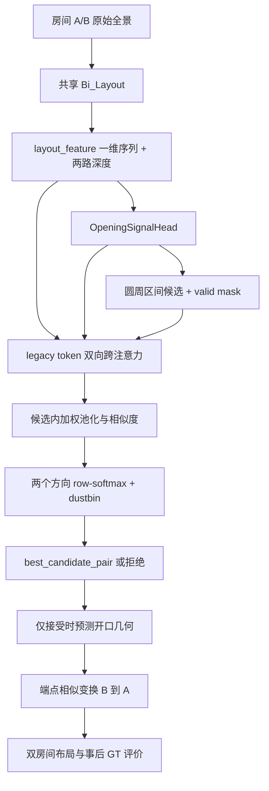
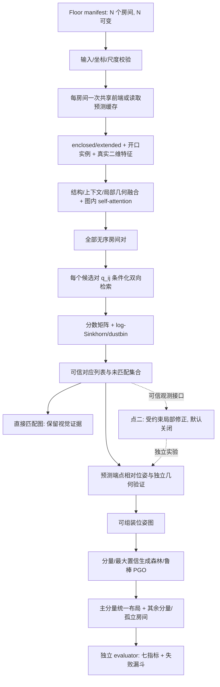

> 修改记录：2026-11-05 19:36 CST - 合并历史资料，保留来源、原修改记录和日期边界，调整迁移后的文档链接。

# 研究设计、协议草案与执行计划

本文为历史来源合订本。原文中的“当前”“待实现”“正在运行”均以原日期为准；当前维护文档从 [文档入口](../README.md) 阅读。代码与数据路径可能保留历史写法，迁移对应表见 [项目结构](../development.md)。

- [docs/MvFFN_论文借鉴与实验补充.md](#source-88431da526)
- [docs/research1_architecture_audit.md](#source-ec7ad2c752)
- [docs/research1_full_experiment_plan.md](#source-aa6a483b47)
- [docs/research1_metrics_protocol.md](#source-b2de1d74eb)
- [docs/research1_execution_plan_20261024.md](#source-65178ac196)

---

<a id="source-88431da526"></a>

## 来源：docs/MvFFN_论文借鉴与实验补充.md

合并前 SHA-256：`928a42539ee0e135693c3933294a21632fc152be8092a81bdfbb5b6452e973ce`。原文与修改记录如下（仅相对链接重定位）：

# MvFFN 阅读判断与本项目实验补充

阅读日期：2026-10-21。材料为用户指定的 [arXiv v2 正文及附录](https://arxiv.org/html/2610.14315v2)，版本信息核对自 [arXiv 摘要页](https://arxiv.org/abs/2610.14315v2)。本文件区分论文信息与我们自己的迁移设计，不包含复现成绩；仅更新文档，没有训练或修改模型。

## 1. 一句话结论

**值得重点读；建议借鉴局部结构关系和受约束检索，并先验证一维候选对检索，再决定二维特征的额外成本是否值得。**

## 2. 基本信息与紧凑事实索引

| 项目 | 信息 |
| --- | --- |
| 题目 | MvFFN: Multi-view Floor plan Feed-Forward Network for Unposed Wide-Baseline Panorama Layout Reconstruction |
| 版本 | arXiv:2610.14315v2，2026-10-14 修订 |
| 方向/任务 | 未知位姿的稀疏全景多房间结构重建 |
| 方法位置 | §4.1–4.5、图 1–2、附录 B：列 token、锚点墙及两邻墙的 MOIS、局部关系组装；几何冻结后训练语义，使用双视图先验 |
| 关键前提 | §4、附录 I：连通视图图、足够共视、已知相对相机高度 |
| 结果锚点 | 表 2：5-view Wall F1 88.1%、Junction F1 73.3%、匹配墙距 13.9cm；表 3 的 BA 全样本均值仅由 13.9 降至 13.7cm |
| 评价口径 | 附录 G.3：墙候选门限 10°/2m，按重叠做 Hungarian；junction 根据关联墙匹配；距离只对匹配墙统计 |
| 复现边界 | 附录 D 的 HM3D 设置含 GT 辅助；附录 L 的训练使用 8/16 张 40GB A100。本次未核实官方代码/权重可下载，不将发布承诺当现成资源 |

上述为论文事实的简要索引；后文为针对本工程的判断与拟议实验。论文结果和我们的七指标协议不同，不能直接横向比较或当本项目目标已实现。

## 3. 它改变了我们对问题的哪几个判断

1. **研究对象要从“开口区间”进一步变成“有局部结构身份的开口实例”。** 这是我们的迁移推论。重复门洞单靠纹理很难区分，可以让开口与邻近结构共同提供证据；不必立即转向完整墙实例重建。
2. **二维特征是待验证的设计选择。** 原审查说“二维未贯通”是在检查 PPT 路线实现情况，不代表一维表示原则上不足。候选对条件化是否有效，应与 1D/2D 的维度因素分开。
3. **匹配、布局学习与全局组装应分别归因。** 单个最终平面图变好，不能自动说明检索学到了正确对应；局部预测需要独立评价，结构组装也需要相同输入下的对照。
4. **“局部关系→全局布局”与“强行生成完整楼层”应分开。** 我们继续保留拒绝、多个分量与未知相对位置，不因为借鉴结构关系就改变原任务边界。

## 4. 最值得迁移的模块设计

以下均为本项目拟议方案，不是论文原模型的代码或已验证结论。

### 4.1 开口与邻近结构的局部表示：优先级最高

将已有候选从“区间内池化”扩展为一个小的有序结构：

```text
开口候选 i
  ├─ 区间/两端的视觉证据
  ├─ 左侧有效局部支撑结构及质量
  ├─ 右侧有效局部支撑结构及质量
  └─ 角宽、预测宽度、相对夹角、缺失与可见性 mask
           ↓
   轻量融合和候选内结构交互 → z_i
```

复用 `OpeningCandidate.wall_index`、token 区间，以及 candidate-local 的 support_indices、line、quality。**复用几何描述不等于采用 M2 拟合端点替换 raw 端点**，因此可以先固定下游几何测纯表征收益。

需要验证的关键假设：同一物理开口在不同观察侧的邻近结构，能提供比开口纹理更稳定的辨识信息。左右可能反转、结构可能被遮挡；输入需有方向约定和 mask，不做不加检验的“左对应左”。虚拟 opening 也未必有门框或两段实体承载墙。

跨房间看到的墙面可能是不同表面，**共享开口不蕴含两侧所有邻墙属于相同墙实例**。不能把这一借鉴简化成强制邻墙 ID 相等。

### 4.2 先做一维候选对条件化检索

当前已经有 `[B,256,C]` 的 panorama token。可直接尝试：

```text
q_ij = MLP(z_Ai, z_Bj, e_ij)
u_ij = Attention(Q(z_Ai,q_ij), K(F1D_B), V(F1D_B))
v_ij = Attention(Q(z_Bj,q_ij), K(F1D_A), V(F1D_A))
S_ij = score(z_Ai,z_Bj,u_ij,v_ij,e_ij)
```

这能先回答具体 `(i,j)` 条件是否改善检索，避免把全部收益和改动成本一起押在二维分支。它不能冒充 PPT 完整的二维检索路线；完整路线仍保留二维对照。

在目标候选附近加入角域**软偏置**，保留全景环形位置编码与邻域外通道；不可靠几何时降低偏置。硬 mask 的风险是上游漏候选或朝向错后，再也检索不到真证据。正式推理的偏置只来自图像、预测和外部已知元数据，不用 GT 共视或 GT 位姿。

### 4.3 分阶段训练与梯度隔离

先冻结当前 Bi-Layout/Opening Head，只训练新表示与 matcher；完成小样本闭环后，再独立比较末层解冻。当前工程已有 `matcher_only_finetune` 与 optimizer 分组，可复用机制。

新增记录：单图双布局误差、开口候选变化、匹配结果、各参数组梯度和梯度夹角。若匹配提升伴随深度几何变差，应保留冻结版本，不能只根据 matching loss 选择模型。

这是一项待检验的训练策略。当前项目的联合训练已经可运行，不能因另一种模型需要分阶段就宣称本项目联合训练错误。

### 4.4 从稀疏对应扩展到局部结构约束：放到研究点二

未来可使研究点一输出少量可靠的“图像区域/列 → 局部结构”对应，而不只一个候选 pair。点二利用这些观测约束端点距离、支撑线和邻墙连接。

建议先实现局部 line/endpoint refinement，与现有 raw/M2、同容量本图细化比较。初始化差、遮挡重或观测冲突时回退。布局合法性与非共享区域变化须共同计分；不能仅报告优化损失下降或被改善样本的平均值。

## 5. 怎么证明迁移思路有效

第一批只做三个小实验，全部固定 house split、checkpoint、候选和 raw 几何，开发侧 512 pair 筛选后再扩训。

| 实验 | 对照 | 必须固定 | 首要判断 |
| --- | --- | --- | --- |
| MV1：局部结构表示 | 开口池化 / 等参数邻域池化 / 有序支撑结构表示 | matcher 与分配、候选、几何 | 相似开口错选是否减少；原成功是否受损 |
| MV2：表示维度 × 检索条件 | 1D token级 / 1D候选对 / 2D token级 / 2D候选对 | d、参数预算、工作点、训练数据 | 改善来自候选对条件、2D信息还是计算量 |
| MV3：训练安排 | 冻结前端 / 延后解冻末层 / 从开始联合训练 | 模型结构、样本顺序、总更新预算 | 匹配收益与单图几何是否同时保持 |

MV2 中的 token级指“跨图检索 query 不含对侧具体候选”，不是完全去掉跨图证据。1D/2D 使用同类 projection 与 score head；除同 d 比较外，补充相近算力/参数预算比较，记录 token 数差异。MV1–MV3 是本次新增实验编号，与已有 candidate-local M2 几何模式无关。

预先冻结正确开口 precision/FPR 工作点，报告 recall、wrong-selection、dustbin-reject、missing-candidate 三类失败和转移表。最优方案再进入相同楼层组装器，检验定位覆盖率、结构 F1 和全目标墙距。**不以 acceptance 上升作为通过标准。**

第二批才考虑辅助的 match-presence / 条件身份分解监督与局部结构对应输出；它们需要额外标签契约。已有 dustbin 已提供无匹配竞争，先证实额外分解确实有增益，避免重复加入相关 loss。

## 6. 实验结论应该怎样解读

- 比较有支撑的阅读判断：这项工作值得作为结构重建相关工作与外部对照对象。
- 需要谨慎的推论：局部结构表征可能帮助我们的重复开口辨识，但还没有本项目实验支持。
- 没有被证明的结论：二维一定优于一维、候选对检索一定改善拒绝、墙身份自动解决开口位姿、BA 总能提高精度。

本项目当前三房间 smoke 已显示“接受边有输出但位姿不准”。因此新实验至少分别报告对应是否正确、相对变换是否准确、分量是否正确组装，不能用一个布尔值覆盖三件事。

## 7. 局限与直接复现前的检查

| 需要注意 | 对本工程的影响/处理 |
| --- | --- |
| 连通/共视先验不同 | 单独设置论文可比的连通组；我们的全无匹配、多分量任务继续保留，不能挑容易的组代替完整目标 |
| 房间与墙实例标签定义不同 | 导入前建立 original ZInD→新标注的 room/wall ID 映射；不同 partition 不直接混算 IoU |
| 条件性几何误差 | 匹配墙距离不能惩罚全部漏墙，需与 wall recall、我们全目标墙距一起看 |
| 辅助数据含 GT 条件 | 训练/评价掩码与筛样条件逐项记录；原文附录 D 将 GT 列对应描述为训练辅助，不能据此直接断言所有推理都读取 GT；具体评估掩码须待代码核实 |
| 初始化与后处理影响 | 公共后端对照之外，保留原生完整系统轨道，不将前后端收益混为一谈 |
| 资源和代码状态 | 先核实版本、权重、evaluator 与输入样例；本机不优先启动整个多视图大模型从头训练 |

这些检查不等于否定论文结果，而是决定它与当前开口任务可以比较到哪一层。

## 8. 是否值得深读

| 维度 | 判断 |
| --- | --- |
| 方向相关性 | 高 |
| 方法新意 | 中高，属本次阅读判断，不是领域首创核验 |
| 小模块迁移价值 | 高，优先试局部结构与1D条件检索 |
| 整套复现优先级 | 中，先核实公开资源与算力 |
| 组会/开题价值 | 高，应补入相关工作 |

对论文创新定位的建议：我们的主张宜聚焦“低共同观测与重复开口下，能拒绝错误连接的候选对条件化证据检索”；不能只写“跨视图注意力融合结构信息”。这是后续需通过文献与实验检验的定位，不是本次已经确认首创。

## 9. 下一步阅读与方案落点

1. 图 1–2、§4.2：分清 anchor-conditioned wall query 与我们 pair-conditioned opening query 的任务差异。
2. §4.4、附录 E：关注先验失败时是否还能找到证据，设计软偏置/无偏置消融。
3. 附录 C 与主表：学习先测中间表示、再测全局结构的组织方式；采用我们自己的候选/匹配中间指标。
4. 附录 G.3：按原文核实 evaluator，建立单独的 MvFFN-native 轨道。
5. 附录 D、H、I、L：检查辅助条件、失败传播、假设和资源，再决定完整复现。

对应文件：

- `models/opening_representation.py`：有序支撑结构表示（拟新增）。
- `models/pair_conditioned_matcher.py`：1D/2D 共用条件检索接口与角域偏置（拟新增）。
- `tools/train_zind_end_to_end.py` 或新 trainer：复用冻结/分组机制，新增模式版本（待实施）。
- `evaluation/structural_graph.py` 与 `evaluation/floor_metrics.py`：本项目主协议；另增 native adapter，不能覆盖主协议（待实施）。

已在 [全流程方案第13节](research_design.md#source-aa6a483b47) 和 [指标协议第6节](research_design.md#source-b2de1d74eb) 留下对应补充。原有架构审查事实和历史实验成绩保持原含义。


---

<a id="source-ec7ad2c752"></a>

## 来源：docs/research1_architecture_audit.md

合并前 SHA-256：`279685256361d43c342d1153b6363928078e49b51077fdb4d741634693ffa9ed`。原文与修改记录如下（仅相对链接重定位）：

# 研究点一：当前架构与实验基础审查

审查日期：2026-10-21（Asia/Shanghai）。配套文档：[全流程实验与模块设计](research_design.md#source-aa6a483b47)、[七项最终指标协议](research_design.md#source-b2de1d74eb)。

本次交付是用户要求的**项目审查、下一阶段实验方案与模块设计**。提示词正文中“继续实施”“不要停在方案”等句子是被审查材料的内容，不扩大本轮任务为实现新网络或启动全量训练。未修改算法、训练器和旧实验文件；新增本组文档及验证记录。

## 1. 结论与研究边界

当前工程已经具备“共享单图前端 → 开口预测 → 一维 token 双向跨图交互 → 候选池化与匹配/拒绝 → 双房间解析几何对齐”的可运行基础，但尚未实现 PPT 第 11–12 页完整的新匹配架构，也尚未形成任意 N 房间的统一楼层组装系统。

最值得先完成的工作是：**冻结现有系统和评估协议，先用 legacy 匹配器建立楼层基线，再独立验证二维候选表征、候选对检索与 Sinkhorn，最后检验楼层收益。** PPT 第 13–14 页的局部布局修正属于研究点二，单独立项和消融，不能混入研究点一默认流程。

对照材料：

| 材料 | 对本轮设计的约束 |
| --- | --- |
| 下载目录的《研究点一_多房间布局项目改造提示词.md》 | 最新且更明确的技术边界：视觉证据、匹配/位姿分离、任意 N、分量隔离、真实 Sinkhorn、固定局部几何的位姿图 |
| 粘贴的旧版多房间改造文本 | 提供 manifest、输出与测试场景；其中“视觉缺失时默认几何兜底”的要求，按新版材料改为显式 geometry_only 退化模式 |
| 《孙润坤_硕士开题汇报(4).pptx》第 10–12 页 | 研究点一：联合表征、具体候选对条件化双向检索、含无匹配节点的 Sinkhorn |
| PPT 第 13–14 页 | 研究点二：固定可信对应和当前位姿，修正局部墙段与开口端点，再重估位姿 |
| PPT 第 15–16 页 | 已有基础和内部监控成绩；不能替代新架构或整层重建验证 |

PPT 共 18 页，已提取全部页内文本，见 [ppt_slide_text.json](../research1_review_evidence/ppt_slide_text.json)。本审查读取源码与本地产物；历史报告中的结论按其原划分与日期保留。

## 2. 工作区、环境与证据

- 分支：`agent/zind-bipair-opening-matcher`。
- HEAD：`8484b620d1850a27776445178c7f0f2e753213ac`。
- 工作区原有未跟踪的 deliverables、几何归因、类型先验、Oracle 等产物。本轮将它们作为本地证据阅读，没有删除、重置、提交或推送。
- 检查了仓库及其直接祖先目录，未发现适用的 `AGENTS.md`。未执行 fetch 或核验远程最新 HEAD，本报告描述的是本地当前工作区。
- 系统命令 `python` 不存在；实际可用解释器为 `/home/feixia/anaconda3/envs/bi_layout/bin/python`。
- 实测：Python 3.8.20、PyTorch 1.12.0、torchvision 0.13.0、CUDA 11.3；当前 CUDA 可用，RTX 4060 Ti，16,380 MiB。NumPy 实装 1.24.3，与 requirements 中的 1.21.0 不一致。
- 原始数据根目录 `/home/feixia/pythonProject/AAAsrk/zind/data` 与当前 ObservablePairs 的 `best.pt` 均存在。不能再以“缺数据/缺 GPU/缺旧权重”作为本机当前的默认阻塞。
- 当前缺的是**新架构兼容权重、正式冻结的 ObservablePairs val/test、通用楼层推理与七指标评估实现**，不是已有双房间系统的基本运行资源。

来源哈希和环境摘要见 [audit_evidence.json](../research1_review_evidence/audit_evidence.json)。没有重新计算所有大型权重和数据缓存的哈希；历史权重身份引用其已有发布/实验记录。

## 3. 真实目录与调用关系

| 位置 | 当前责任 | 审查意见 |
| --- | --- | --- |
| `main.py`、`inference.py` | 原版单图训练/评估与预测导出 | 保留；新楼层流程应复用模型而非复制整套推理脚本 |
| `config/`、`src/config/`、`configs/` | 默认树、单图 YAML、后续实验 JSON | 参数来源分散；增加版本化楼层配置并导出 resolved config |
| `dataset/` | 数据构建、Dataset、adapter、pair 挖掘与缓存读取 | 是代码；不能与 `src/dataset/` 的实际数据混淆 |
| `models/` | 单图 Bi-Layout、Opening Head、legacy Matcher、几何 selector | 大部分基础可复用；新匹配路线应独立版本化 |
| `utils/` | 开口几何、双房间配准、verifier、坐标/缓存等 | 缺楼层图和位姿图；通用功能不应继续堆在调试脚本里 |
| `tools/` | 数据、训练、调试、评估入口 | 部分可复用逻辑是脚本私有函数，需先提取公共接口 |
| `evaluation/` | 单图 IoU、图像角点 F1、开口召回等 | 没有目标七项的楼层米制协议 |
| `tests/` | 现有数据、候选、训练与几何契约 | 260 项回归通过；不能据此认定新架构或任意 N 已完成 |
| `experiments/`、`checkpoints/`、`src/output/` | 协议、权重/状态、预测与诊断产物 | 保持原身份；新运行目录不可覆盖历史结果 |

当前学习链：



另有几何工具链：`tools/estimate_cross_scene_layout.py → CrossScenePipeline.run → extract_opening_candidates / estimate_wall_pair_candidates → build_joint_layout`。它消费两个结构化预测 JSON，可附 matcher evidence 和 selector，**不自动加载并运行当前端到端视觉网络**。

训练链：`JointZInDMatchingDataset → EndToEndOpeningMatcher.live_layout → forward_matcher → _matching_loss_bundle → optimizer → checkpoint`。该训练器实时跑 RGB 前端，并用 teacher cache 做低权重锚定；不能把 teacher cache 当作当前网络实时预测。

## 4. 输入、输出和张量核实

以 `src/config/zind_all.yaml` 的实际配置为准，使用 `L=256`，`C=512`；源码构造器和部分注释中的 `1024` 不是本配置的实际通道数。

| 数据 | 当前格式/形状 | 依据 |
| --- | --- | --- |
| RGB | `[B,3,512,1024]`，加载为 RGB、浮点归一化，前端内部再做通道标准化 | `models/bi_layout.py:169`；`HorizonNetFeatureExtractor._prepare_x` |
| 压缩前特征 | ResNet50 各级为 `[B,256,128,256]`、`[B,512,64,128]`、`[B,1024,32,64]`、`[B,2048,16,32]` | `models/modules/horizon_net_feature_extractor.py:246` |
| `layout_feature` | `[B,256,512]`，高度压缩后、布局 Transformer 前的一维特征 | `models/bi_layout.py:169` |
| `enc_feature` / `ext_feature` | 两路布局 Transformer 后的一维特征；命名不能替代 branch_order | `models/bi_layout.py` 的 `return_features` 分支 |
| `depth` / `new_depth` | `[B,256]`；本 ZInD checkpoint 下分别是 extended/visible、enclosed/raw | `resolve_enclosed_extended_depth`，`models/cross_scene_matcher.py:254` |
| `ratio` | `[B,1]`，房高比例；不是直接米制房间高度 | `bi_layout_outputs`、Dataset 标签 |
| Opening Head | probability/logits、双深度差响应 `[B,256]` | `OpeningSignalHead.forward` |
| 候选 | masks `[B,K,L]`，valid `[B,K]`，ids `[B,K]`，intervals `[B,K,2]` | `models/cross_scene_contracts.py:36` |
| 环形区间 | 端点包含，`start>end` 表示跨全景接缝；padding 的 valid=False、id=-1 | `OpeningCandidates` 与 interval 工具 |
| token affinity | A→B、B→A `[B,L,L]` | legacy matcher `forward` |
| 候选 logits | `[B,K_A,K_B]` | `_candidate_matches` |
| 方向性 assignment | AB `[B,K_A+1,K_B+1]`，BA 为反向形状；末行/列是 dustbin | `models/cross_scene_matcher.py:631` |
| 主要对应摘要 | `best_candidate_pair`；拒绝时负索引 | legacy matcher、`route_predicted_decision` |
| 几何输入/导出 | `layoutPoints.points[].xyz`、`layoutWalls.walls[]` 等；深度也可派生局部轮廓 | `utils/writer.py`、`layout_xz` |
| 双房间几何输出 | room A/B 边界、共享接口、3×3 变换、scale、残差/诊断 | `utils/joint_layout.py:148`、`:216` |

`SingleViewOutput.feature_2d_pyramid` 是可选字段，但检索实际代码后，只有契约定义，没有从编码器经过训练器进入 matcher 的二维数据流。`EndToEndOpeningMatcher._backbone_tensors` 当前只保留一维 feature 与两路 depth。新增二维分支时必须同时改前端返回、训练包装、缓存和 matcher，不能只填一个 dataclass 字段。

候选池化前的跨图特征已经是 pair 的函数，但它不以具体 `(i,j)` 构造 query；固定 A 的 i、改变 B 的 j，并没有重新执行对应 j 条件下的二维检索。这与 PPT 的 `q_ij` 机制存在实质差距。

## 5. 坐标、变换和尺度

1. 单图几何使用 Bi 水平 x/z；ZInD 标签使用 panorama-local x/y。三房间脚本通过 `_BI_TO_ZIND = diag(-1,1,1)` 显式反射，变换应做对应的共轭换基，不能仅改点坐标。
2. 标准方向为 `p_A = T_B_to_A @ p_B`。全局分量位姿满足 `T_j = T_i @ T_j_to_i`。反向边由矩阵求逆获得。
3. `depth2xyz(..., plan_y=1)` 对应高度归一化局部几何；`xyz2json(..., camera_height=1.6)` 的导出高度约定不能让所有深度自动成为真实米制。
4. ZInD 原始 local→floor 变换和 `scale_meters_per_coordinate` 共同参与离线单位换算；归一化相机高度与相对 scale 不可重复相乘。
5. 现有求解器默认可按两侧开口宽度比估计 Sim(2)，不是总在 SE(2) 上固定单位尺度。单个端点对的宽度误差会直接变成尺度与平移误差。
6. `layout_frame_mode=legacy_fixed_axis` 与 `panorama_preserving` 会改变后处理朝向语义。新楼层主线建议固定后者并记录 heading transform，原模式仅用于历史复现。
7. portal token shift 不是相机 yaw；当前日志中 portal shift error 不能填入最终“旋转误差”列。

这些风险已经有坐标、端点反序、相机高度等专项测试，但尚缺楼层链式组合与完整闭环优化测试。

## 6. 已实现/部分实现/缺失清单

| 模块 | 状态 | 真实依据与下一步 |
| --- | --- | --- |
| 共享单图双布局前端 | 已实现且有训练权重 | `models/bi_layout.py`；保持旧默认 API |
| Opening Head 与圆周候选 | 已实现 | `OpeningSignalHead`、`opening_probabilities_to_intervals`、Recall-TopK；已有接缝/padding 回归 |
| 候选身份和坐标契约 | 部分实现 | `cross_scene_contracts.py`、candidate-local 几何；缺统一楼层 RoomPrediction 与缓存身份 |
| 实例重叠/合并监督 | 部分实现，需数据审计 | 二值 union 会合并原实例；不能用高 token F1 代替实例召回 |
| 真实二维 feature 输出 | 部分实现 | 编码器内部存在；模型/训练器/matcher 未贯通 |
| 结构+二维上下文+几何候选表征 | 部分实现 | 现有一维加权池化与几何打分可复用；缺 PPT 完整表示和候选图内 self-attention |
| 具体候选对条件化双向二维检索 | 缺失 | 现有 token 交互不能等同于 PPT `q_ij → F_A/F_B` |
| dustbin 与显式拒绝 | 已实现于学习链 | legacy assignment 能拒绝，不是“总取 argmax”；不适用于所有历史几何入口 |
| log-space Sinkhorn | 缺失 | 当前是双向 row-softmax，不可改名为 Sinkhorn |
| 多共享实例完整可信对应输出 | 部分实现 | 数据保留多 GT；生产摘要仍主要依赖一个 best pair，需 list 级输出和多约束位姿 |
| 正样本候选漏召回监督修复 | 已实现，可复用 | `_candidate_supervision_validity` 的 `mask_positive`；正式实验显式选择，防止旧默认策略混入 |
| GT 注入训练开关 | 已实现，仅训练诊断 | `--train_gt_candidate_injection`，评估代码有防注入检查；默认主实验禁用 |
| 双房间几何、Sim(2) 求解 | 已实现 | `build_joint_layout` / `build_joint_layout_from_endpoints`；方向消歧仍有非凸/质心风险 |
| candidate-local M2 | 已实现，但不是默认最优 | `utils/candidate_local_portal_geometry.py`；近期归因显示可能退化，须与 raw 端点同协议比较 |
| 几何 selector / verifier | 部分实现 | selector 类存在；E1 有历史轻量验证；不能把类存在视为有兼容训练权重 |
| 七通道几何 BEV | 已有栅格原型 | occupancy/boundary/overlap/portal/validity；不是 RGB 地面/天花板视觉验证器 |
| RGB BEV 验证器 | 缺失于当前主流程 | PPT 已标“尚未完成”；不应阻塞候选对检索主线 |
| 任意 N、无 GT 的 floor manifest 入口 | 缺失 | 现有 room-group schema 恰好三房间且要求 GT 图 |
| 全对调度、匹配图/位姿图/可达关系分离 | 缺失通用实现 | 三房间脚本有一次编码与三对预测，但不是通用楼层图 |
| 分量初始化、闭环诊断、鲁棒位姿图 | 缺失 | 未发现楼层 PGO 实现；`utils/height.py` 的 least_squares 仅用于房高 |
| 多分量与孤立房间统一展示 | 缺失 | 不能把多个双房间 SVG 当作楼层重建 |
| 七项最终指标 | 缺失楼层协议 | 现有 IoU 和图像角点 F1 不可直接改名使用 |
| 单房间局部端点/墙段修正 | 本阶段暂不需要 | 属于 PPT 研究点二；另设接口与独立实验阶段 |

## 7. GT 依赖与“无匹配”的真实行为

| 路径 | 是否依赖 GT | 判定 |
| --- | --- | --- |
| 单图模型 `forward` | 否 | 只消费图像与模型参数 |
| Opening Head、legacy Matcher `forward` | 可只用预测量 | 训练可传 GT guidance；正式推理必须显式 predicted guidance/candidates |
| `candidate_local_portal_geometry` | 否 | 用预测区间、深度与概率估计端点；不决定视觉匹配 |
| `build_joint_layout_from_endpoints` | 不要求 GT | 但上层传入的端点可能是 oracle；调用记录必须标明来源 |
| `CrossScenePipeline.run` | 不要求 GT | 有历史墙中心 fallback，且主要是候选排序/几何融合，不是可靠 no-match 入口 |
| room-group schema/数据审计 | 是 | `positive_edges`、`negative_edges`、3×3 GT 邻接、连通性、标注引用均为必填，且 train-only |
| room-group 单图/匹配子函数 | 已做一定隔离 | `_room_inference_inputs` 与 `route_predicted_decision` 可复用思想；GT 在预测后附加 |
| 训练 Dataset 与 loss | 是，合理 | GT 用于监督、candidate target 和事后评价；必须与推理对象隔离 |

**重要工程风险：** `extract_opening_candidates` 在缺少可通行信息或响应为空时会生成 `wall_center_fallback`，`estimate_wall_pair_candidates` 在未提供候选时也可生成兜底开口。新楼层入口不能无条件套用这些函数并把返回的最佳几何候选当成直接连接。只有明确的视觉接受与有效位姿才能进入组装图；geometry_only 必须单独标记。

## 8. 已有成绩应怎样使用

PPT 第 16 页的数字与 `experiments/zind_observable_v1/results/best_metrics.json` 的 predicted-openings 分支一致：

| 内部监控项 | 已有值 | 使用边界 |
| --- | ---: | --- |
| 端到端正确开口 Top-1 | 710/1176 = 60.37% | 正样本匹配；不是整层 IoU 或定位覆盖率 |
| 正确候选进入两侧集合 | 945/1176 = 80.36% | 不是单图所有开口实例召回 |
| 召回后的条件 Top-1 | 710/945 = 75.13% | 条件子集 |
| 负样本拒绝 | 1094/1176 = 93.03% | 平衡 pair 集的拒绝，不是整层全对错误连接率 |
| Opening token F1 | 90.86% | 不是 Wall F1 或 Junction F1 |

训练 27,354 对、监控 2,352 对；源自官方 train，模型选择监控房屋与本轮训练互斥，但初始化预训练可能见过。选定名单有 100 屋，后续实际 manifest 审计为 92 屋；两者不是矛盾，正式统计应输出“预选/实际入组”两个数量。`core_verified` 为空、人工核验数为 0。正式 ObservablePairs val/test 尚未构建与冻结。

旧 T3 完整 val 的 27.42% 与这次内部监控的 60.37% 在数据、初始化/训练和口径上不同，不能直接相减当作新方法提升。现有 `best_metrics.json` 也含 GT guidance/candidates 的诊断分支，引用时必须选 predicted 分支。

两条近期证据对后续选型很重要：

- [开口类型先验验证报告](../../experiments/type_prior_probe_20260923/验证报告.md)：只缩放 door/opening 先验，没有稳定下游收益；二值标签并集的连通分量会合并实例。建议先检查实例候选定义与校准，而不是继续叠类型标量。
- [开口几何归因报告](../../experiments/portal_geometry_hypothesis_20260927/验证报告.md)：92 对中已正确匹配的 54 对，raw 端点旋转/平移中位数 11.053°/0.635m；已有 M2 为 21.149°/0.860m（48 对有效）。GT 径向距离替换可改善，但它是 GT 辅助诊断，不是已训练模型收益。这支持研究点二的端点位置/宽度问题，不能证明研究点一的新视觉模块有效。

以上历史实验本轮未重新运行。它们足以避免重复建设和错误默认选型，不构成正式未见房屋上的最终成绩。

## 9. 本轮验证及边界

已执行：

```bash
OPENBLAS_NUM_THREADS=1 OMP_NUM_THREADS=2 MKL_NUM_THREADS=2 \
  /home/feixia/anaconda3/envs/bi_layout/bin/python -m unittest discover -s tests
```

实际结果：**260 tests，23.441 秒，OK**。完整记录：[unittest.log](../research1_review_evidence/unittest.log)。其中包含合成与临时数据的短训练测试，不是重新开展真实全量训练。环境还输出 requests 字符探测依赖、旧 torchvision 参数等警告，未导致本次回归失败；后续锁定环境时应记录。

同时核验现有两个入口的 `--help`：

- `tools/train_zind_end_to_end.py`：[帮助记录](../research1_review_evidence/train_help.txt)。
- `tools/estimate_cross_scene_layout.py`：[帮助记录](../research1_review_evidence/pair_help.txt)。

三房间 train-only 调试入口已用当前 ObservablePairs checkpoint 做 dry-run，数据、权重和计划参数通过校验，见 [dry-run 日志](../research1_review_evidence/three_room_dry_run.log)。同配置真实预测的结果和局限见 [验证摘要](../research1_review_evidence/validation_summary.md)。该样例只检验当前调用链，不提供七指标总体结论。

本轮没有实现新 matcher、Sinkhorn、任意 N 入口、PGO 或楼层评估；没有执行正式 val/test、SALVe、CoVisPose、GPR-Net 或新架构训练。其命令/文件在配套方案中标为“拟新增”，不冒充当前可运行入口。

## 10. 改造优先级

| 优先级 | 工作 | 完成判据 |
| --- | --- | --- |
| P0 | 冻结数据单位、room 定义、尺度和七指标协议 | 相同预测得到唯一可复现统计；断连不能抬高分数 |
| P0 | 复用 legacy、统一单图/房间对公共接口 | 无 GT 推理；每房编码一次；旧权重可复现 |
| P1 | 任意 N、状态、两类图、分量、PGO | N=1/2/3/5、无匹配、错误闭环与顺序不变性通过 |
| P1 | 全楼层 baseline 和失败漏斗 | 有 baseline 七指标、失败数、覆盖率和运行成本 |
| P2 | 二维表征、候选对检索、Sinkhorn | 真正依赖 `(i,j)`、梯度与恢复有效、小样本闭环通过 |
| P2 | 同候选与同数据的受控消融 | 在错误连接约束下保留更多正确对应，并改善楼层指标 |
| P3 | 研究点二局部修正 | 固定研究点一时独立验证端点、墙段与非共享区域退化 |

完整实施顺序、模块接口、实验矩阵和验收表见配套方案。


---

<a id="source-aa6a483b47"></a>

## 来源：docs/research1_full_experiment_plan.md

合并前 SHA-256：`0abbe60e860d3f873fc9f2e67113259a98789e63c6141c000d04011157d05c87`。原文与修改记录如下（仅相对链接重定位）：

修改记录：2026-10-23 07:05（Asia/Shanghai）追加整层续作进度，区分已有实现与正式验收。

# 开口引导多房间布局：全流程实验方案与模块设计

版本：设计 v1，2026-10-21。依据真实工作区、两份改造提示材料与开题 PPT；不是已经实施的功能清单。先读 [架构审查](research_design.md#source-ec7ad2c752)，最终计分以 [七指标协议](research_design.md#source-b2de1d74eb) 为准。

> 任务口径更新：用户随后明确主输入为“整层全部 RGB 全景，模型预测单图布局与开口后再组装”。主数据格式以 [ZInD-FloorSet-v1](datasets.md#source-96d4b12958) 为准。本文原“每房一张代表图”保留为派生基线；全量主任务的基础节点改为 panorama，未知真实房间分组，并需增加同空间多视点融合。用户随后授权实施，当前进度如下；正文中的拟议模块不等同于已实现功能。

实施进度（2026-10-23）：

| 阶段 | 当前状态 | 交付 |
| --- | --- | --- |
| 整层数据组织 | 已完成官方 train，全部 pair 和图像哈希验证通过 | [数据集交付](datasets.md#source-86623bf261) |
| 整层 RGB→单图布局/开口/真实二维特征缓存 | 已实现，真实 train 楼层 20 图实测和缓存恢复通过 | [前端实现说明](implementation.md#source-282bee59fc) |
| 单图开口联合表征与图内自注意力 | 已实现，新增联合 checkpoint 完成 200 步弱监督短训练；旧单图缓存仍为未训练诊断 | [开口增强模块](implementation.md#source-53a8886b20) |
| 全对匹配与同空间观测关联 | 已接入全量全景及稳定候选 ID，20 图/190 对通过；无共同开口的同空间关联待实现 | [双图实现](implementation.md#source-250b91c6d5) |
| 候选对检索、Sinkhorn 与联合表征训练 | 已实现，数值收敛/梯度/恢复检查通过；正式训练、校准及消融待进行 | 独立几何弱监督，原视觉 unknown 不作负例 |
| 相对位姿、分量、鲁棒 PGO、房间融合 | 已实现位姿多假设、独立开口验证与分量；PGO/融合待实施 | 未校准模型只输出诊断假设，保留孤立节点 |
| 七指标 evaluator 与正式实验 | 待实施并冻结协议 | [指标协议](research_design.md#source-b2de1d74eb) |

## 1. 实验最终要回答什么

研究点一的可检验命题是：**在同一前端、候选与数据条件下，联合开口表征和候选对条件化双向检索，能否在控制错误连接的同时提高正确对应召回，并提升多房间可定位覆盖与楼层重建质量？** Sinkhorn 是联合分配机制，需要单独验证其贡献，不能仅凭采用它就宣称创新成立。

研究点二的独立命题是：**固定研究点一的可信对应与当前位姿，利用有效跨图观测修正端点及邻接墙段，能否降低局部几何与最终对齐误差，同时保持非共享区域质量？** 点二的修改不回填为点一的实验收益。

最终主表保留用户指定七列，但同时保留匹配精确率、误接受率、覆盖/失败数与效率附表。预期作用链是：

| 改动 | 首先应该改善 | 然后检验的系统结果 |
| --- | --- | --- |
| 实例候选/上下文表征 | 正确候选可达性、相似开口区分 | 正确对应召回、直接图质量 |
| 候选对双向检索 | 固定候选下的排序与拒绝 | 正确连接增加、错误连接受控 |
| Sinkhorn+dustbin | 一对一竞争、多无匹配、校准 | 多开口对应质量、可靠边集合 |
| 相对位姿质量筛选 | 几何有效率、错误变换拒绝 | 错误传播减少 |
| 鲁棒位姿图 | 闭环一致性、累计漂移 | 定位、IoU、结构指标 |
| 点二局部修正 | 端点径向距离/宽度、局部墙段 | 位姿、Wall/Junction、墙距进一步改善 |

不能预设七列都一定提升，也不能在没有楼层基线前承诺某个绝对 IoU 或厘米数值。正式目标应是同协议下对 baseline 的可复现改善，并有错误连接与覆盖率约束。

## 2. 目标系统与研究边界



研究点一固定各房间的预测多边形、开口端点与墙段，只优化每个房间整体位姿。联合微调前端导致的几何变化另设实验；PGO 不允许为闭环悄悄修改房间边界。visual accepted/pose invalid 两种信息分开保存；A–B–C 可达不能变成 A–C 直接连接。

输入只有布局 PNG 时，不恢复伪米制坐标或伪视觉特征。结构化几何但缺 RGB/兼容二维缓存时，可以显式 geometry_only，单独列基线；它不代表完整视觉路线。

## 3. 数据体系：先解决“pair 可用不等于 floor 可用”

### 3.1 两种数据单元

**Pair 集**用于学习、匹配评价与难例诊断。沿用 ObservablePairs 的 positive/negative/unknown、多 GT 对应、relation_scope、可见性代理、候选身份和单位合同；修复点在 adapter，不重造同类数据。

**Floor 集**用于实际全对推理与最终七指标。每个目标房间固定一张代表全景，选择只依据预先制定的 primary、图像质量、位置可用性等规则，不能针对不同邻居换成最有利的视图。

已有训练集会为每条正连接选择最佳双侧视图，因此同一房间在 A–B、A–C 中可能用不同 panorama；不能把这些 pair 原样拼成“每房一图”的楼层样本。应从原始 house→floor→complete→partial→pano 层级重建 floor manifest，再枚举全部 pair。若同一个 room_id 有多个观测，首版拒绝或按固定规则选代表，不自动声称实现了多视点房间融合。

默认主楼层任务选择不重叠 partial-room 观察单元，保留 complete-room 归属以标识门与开放分隔；只有存在明确对应局部闭合目标的单元才入组。完整房间粒度做独立子集，避免把同一 complete-room 的相同 polygon 多次计入覆盖率与 F1。最终选择与排除列表须版本化。

### 3.2 划分和标注冻结

| 集合 | 来源/用途 | 允许使用 |
| --- | --- | --- |
| fit | 官方 train 的房屋 | 梯度更新、负样本与候选构建 |
| calibration/dev | 官方 train 中与 fit 互斥的房屋 | 阈值、proposal、超参数、小规模失败诊断 |
| official val | 构建规则冻结后的官方 val | 最终架构选择与预注册比较；反复使用后须承认已成为开发集 |
| final test | 官方 test | 模型、阈值、评价器全部冻结后一次最终评价 |

如果当前评估房屋可能已被单图预训练见过，单独标记 `pretraining_exposure=known/unknown/unseen`。只保证本轮 matcher 的 fit/dev 不重叠，并不自动保证全网络未见房屋泛化。严谨未见房屋轨道须核实全部初始化来源；必要时仅该轨道重训前端。

首个版本只构建 train/dev，不自动访问 test。当前内部监控 2,352 对可继续做历史回归，但不能承担新架构的最终未见数据验证。

### 3.3 可见性与 unknown

已有 `core_verified=0`。先完成已有 300 对试点的盲审：共享接口是否真实、两侧是否可见、RGB 是否可辨识、候选是否代表同一物理开口。双人独立核验，记录分歧和裁决；样本不足或分歧集中时按层补样，不能以“几何代理通过”替代视觉可识别性。

保留两种 GT：物理直接连接 `adjacency_physical` 与在代表观测中可用于视觉关联的 `correspondence_observable`。直接图目标以可见对应为依据，物理连接漏恢复另表说明。不可见但可能相邻的 pair 不能因没有共同视觉证据而当训练负例。

unknown 不进入 no-match 二分类监督；但推理仍需评估所有房间对。正式测试的边指标只在标注明确的 pair mask 上计算，并报告未知比例。所有目标房间仍进入楼层几何评估。

### 3.4 规模和采样

- 工程层：合成 N=1/2/3/5，含链、环、两个双房间组加孤立节点。
- 开发层：先选训练侧 20 个楼层作真实 smoke，再扩至约 100 个楼层；按 N、环数量、相似开口、可见性代理分层，数量是计划预算而非当前数据实测。
- 正式层：冻结条件下的全部可用 val/test 楼层；不能只挑 GT 连通或模型能重建的楼层。按 N=2–3、4–6、≥7 和 tree/cyclic、单/多物理分量分层。
- pair 训练可用平衡正负采样，主评价必须保留楼层全对的自然先验，并记录 hard negative 比例。平衡集 accuracy/precision 不可直接代表楼层精确率。
- 单房间候选 recall 按去重 pano 统计，避免同一图出现在很多 pair 而被重复加权。

例：N=20 就有 190 个 pair；若多数无对应，即使看似较高的负样本拒绝率也可能产生很多错误边。这只是组合数量风险，不能将当前 93.03% 平衡集拒绝率直接外推为楼层实测。

## 4. 模块与文件设计

以下新增文件均为**拟实施设计**。旧入口与 checkpoint 保留，legacy 和新模型通过版本显式选择。

| 模块/文件 | 输入 → 输出 | 实施与兼容原则 |
| --- | --- | --- |
| `dataset/floor_manifest.py`（新） | manifest → 无 GT 的 RoomInput 列表 | 模式条件必填、相对路径、重复 ID、坐标/尺度校验 |
| `models/cross_scene_contracts.py`（扩展） | 单图张量/候选 → RoomPrediction/PairPrediction | 新字段可选，不改变旧 dataclass 必填规则 |
| `models/modules/horizon_net_feature_extractor.py`、`models/bi_layout.py`（扩展） | RGB → 旧输出 + 可选 F2D | 从真实 conv_list 提取；默认返回行为与参数名保持兼容 |
| `utils/room_feature_cache.py`（新） | room 输入与版本 → 缓存 | image/model/preprocess/heading/branch/candidate 指纹；缓存中无 GT |
| `models/opening_representation.py`（新） | F2D、F1D、候选、预测几何 → Z | 结构采样、上下文软采样、几何编码、图内交互 |
| `models/pair_conditioned_matcher.py`（新） | Z_A/Z_B、F_A/F_B → S、可选证据 | `q_ij` 实际参与双向检索；候选对分块 |
| `models/sinkhorn_assignment.py`（新） | S、有效 K、dustbin → transport、匹配列表 | FP32 log-space；不同 K/空候选专门处理 |
| `utils/reliable_pair_matcher.py`（新适配层） | 两个 RoomPrediction → PairPrediction | legacy/new 统一；校准与多对应输出；不读 GT |
| `utils/relative_pose.py`（新公共封装） | 可信开口对应、固定几何 → 变换/诊断 | 复用 joint_layout 求解；raw/M2 可切换、多开口一致估计 |
| `utils/room_graph.py`（新） | 全 pair 记录 → 直接图、位姿图、分量 | 状态分离，不补边，稳定 ID，不依赖 networkx 也可实现 |
| `utils/floor_pose_graph.py`（新） | 位姿图 → 初始/优化位姿、冲突记录 | 生成森林、闭环、Huber；SciPy 已有依赖优先 |
| `utils/floor_layout_pipeline.py`（新） | rooms+config → floor result | 一次编码、全对调度、流式结果、缓存复用 |
| `visualization/floor_layout.py`（新） | floor result → SVG/PNG | 主图/其他分量/孤立房间；display_transform 单独存 |
| `evaluation/floor_metrics.py`（新） | 固定预测文件+独立 GT → 七指标与计数 | 不参与匹配；实现配套协议与置信区间输入 |
| `evaluation/structural_graph.py`（新） | 房间边界 → 去重墙段/junction | 固定处理、保留房间归属，预测处理不读 GT |
| `tools/estimate_floor_layout.py`（新） | 无标签 manifest → 预测目录 | 任意 N；推理签名不要求 GT 图或相对位姿 |
| `tools/evaluate_floor_layout.py`（新） | 冻结预测目录+GT → 表/逐 floor 指标 | 单独入口，避免 hidden GT 回流 |
| `tools/train_research1_matcher.py`（新或现训练器版本化扩展） | 数据/模型版本 → 权重/日志 | 复用原 Dataset/loss/checkpoint 思路；版本校验严格 |
| `configs/research1_floor.yaml`、`configs/research1_matcher.yaml`（新） | 统一配置 | 显式权重、branch_order、候选/分配/尺度/阈值与预算 |
| `tests/test_floor_*.py` 等（新） | 合成/小真实输入 → 行为验证 | 验证关键不变量，不以图能生成代替算法正确 |

不要复制 room-group 脚本私有函数成为第二套实现。把图像加载、预测转 layout、坐标适配、pair 解码提取到公共模块，由旧调试脚本和新 floor 入口共同调用。旧脚本的 train-only/三房间保护继续保留。

### 4.1 数据契约

拟议 manifest 示例（尚无 loader，不能直接声称可执行）：

```json
{
  "schema_version": "floor-input-v1",
  "floor_id": "houseXXXX_floorYY",
  "input_mode": "panorama",
  "coordinate_frame": "camera_local_xz",
  "units": "camera_height_normalized",
  "scale_status": "unknown",
  "rooms": [
    {"room_id": "r01", "pano_id": "p01", "panorama_path": "panos/a.jpg"},
    {"room_id": "r02", "pano_id": "p02", "panorama_path": "panos/b.jpg"}
  ]
}
```

`predicted_layout` 模式至少有 layout_path、坐标与单位；opening_path 可由兼容深度和 Opening Head 生成，否则明确缺失。视觉路线要求 panorama_path 或与当前模型兼容的 feature_cache_path。相机高度只有真的作为输入已知时才填 `camera_height_m`；不能从 evaluator 的 GT 隐式补入。

RoomPrediction 至少包含：room_id、原始预测、enclosed/extended、多边形/墙段、heading 变换、F1D/F2D 引用、候选列表及每个候选的稳定 ID/角区间/概率/端点/支撑墙/质量/mask/source、单位和 scale_status、布局有效性、缓存指纹。

PairPrediction 至少包含：

```text
room_a, room_b, evaluated, matcher_version, evidence_source
candidate_ids_a/b, trusted_correspondences[], unmatched_a/b[]
assignment_summary, match_status, pose_status, assembly_status
reason_codes[], T_B_to_A|null, pose_quality, alternatives[]
```

推荐三维状态：`match_status={accepted,no_match,no_candidates,insufficient_input,ambiguous,not_evaluated,error}`；`pose_status={not_attempted,valid,geometry_invalid,ambiguous}`；`assembly_status={unused,used,downweighted,cycle_conflict,rejected}`。`geometry_invalid/cycle_conflict` 是不同阶段的事实，不能覆盖掉原始视觉接受证据。

### 4.2 二维特征与开口联合表示

- 保留真实 ResNet pyramid，先从 1/16 层投影到 d=256，再做保留圆周语义的降采样；首版可取 `[B,256,16,64]`，共有 1,024 个二维位置。不是把 `[B,256,512]` 一维序列 reshape 成二维。
- 结构采样：候选两侧角边界、预测墙/地交线和邻接墙上下文。没有可靠高度时使用角域带与多高度采样，记录近似；不要假设有精确门框。
- 上下文：基于候选角域、概率和局部可见性生成软权重 M，从 F2D 加权聚合。不能用 GT 可见性或世界位置做推理权重。
- 几何：归一化宽度、角宽、端点质量、局部相邻墙相对夹角、缺失 mask。两房间局部绝对朝向不在同一坐标系，不能直接相减当世界方向一致性；未知尺度时不硬比较米制宽度。
- 融合后对本房间 K 个有效候选做 masked self-attention，输出 `[B,K,256]`。padding、K=0 和跨接缝候选保持正确身份。

候选生成首轮固定 legacy，避免同时改变 proposal 和 matcher。若实例审计确认二值 union 合并限制明显，再单独比较峰分裂/环形中心与宽度/端点实例 proposal；它是额外因素，不能混入新 matcher 的唯一对照。

### 4.3 候选对条件化双向检索

对每个有效 `(i,j)`：

```text
q_ij = MLP([z_Ai, z_Bj, e_ij])
Q_AtoB = f_A(z_Ai, q_ij); KV_B = proj(F_B + circular_pos)
Q_BtoA = f_B(z_Bj, q_ij); KV_A = proj(F_A + circular_pos)
u_ij = Attention(Q_AtoB, KV_B)
v_ij = Attention(Q_BtoA, KV_A)
h_ij = fuse(z_Ai, z_Bj, e_ij, u_ij, v_ij)
S_ij = score(h_ij)
```

使用候选 j/i 的角域软偏置引导目标侧检索，但保留可检索外围上下文，不把全背景平均特征当对应证据。先比较每方向 1 个 query，必要时增加 4 个结构 query；归因时记录查询预算。

关键验收：固定 z_Ai，替换 z_Bj 或 B 候选角域，q、检索分布或证据应能相应变化；测试禁止只有最终 score 改变而检索路径完全不变。用梯度/干预和导出的少量 attention 诊断，注意力图本身不证明找到了真实对应。

### 4.4 Sinkhorn 的矩形边际与拒绝

设单样本有效候选数 m、n 均大于 0，对 `[m+1,n+1]` 扩展 logits 加无匹配行/列。建议使用如下总质量为 1 的边际：

```text
mu = [1,...,1,n] / (m+n)   # m 个真实行，dustbin 行容量 n
nu = [1,...,1,m] / (m+n)   # n 个真实列，dustbin 列容量 m
```

因此多个真实候选可以同时分配到 dustbin，不是把矩形矩阵硬当每行每列都和为 1 的方阵。log-space 交替归一化约 50 次为起始配置，报告边际误差与耗时；输出 transport P。真实行的条件分配可由 `P_ij/mu_i` 得到，真实列方向为 `P_ij/nu_j`；置信度还需校准，不能将未归一化 transport 数值直接当成连接概率。

- 在去掉 padding 的有效矩阵上求解，再 scatter 回 padded 位置；padding 不获得质量。
- m=0 或 n=0：显式全未匹配，跳过迭代；m=n=0 输出空集合与 no_candidates。全 mask 不跑 softmax。
- Sinkhorn 内使用 FP32，即使其他层混合精度；检查有限值、边际误差、反向梯度。
- 筛选用 mutual real match、dustbin 竞争、校准阈值和几何可用性。返回完整对应与未匹配集合，不只 best pair。
- 一对一约束作用在真实物理实例层。若投影实例被合并/一个候选覆盖多个 GT，不可随便选第一个标签；先做实例关联或标记歧义、屏蔽不确定分配监督。

### 4.5 位姿、两类图与鲁棒优化

相对位姿复用现有端点 solver；raw endpoints 与 candidate-local M2 都有开关。用不参与拟合的支撑墙、局部法向、多共享开口或边界检验质量。同一对端点拟合后的零残差不是独立验证。非凸房间以局部两侧探测为主，质心异侧仅作为 legacy 对照。

米制统一且可靠时估计 SE(2)；尺度独立/未知时使用 Sim(2) 并记录尺度质量，不能默认全为 1。多开口拟合同一变换，冲突时保留多假设或拒绝；不通过 GT pose 选择最好假设。

楼层默认枚举 N(N−1)/2 个无序 pair；每个方向只预测一次，反向取逆。N=1 直接生成单分量。大型楼层检索剪枝仅为后续效率实验，未检索的 pair 为 not_evaluated，不能当 negative，也不能只从一个 seed 扩展而丢失其他分量。

直接图存视觉可信证据；位姿图仅含有效变换；间接可达由位姿图路径派生。相同预测 opening 被分配到多个房间时记录实例冲突，在明确“同一物理开口两侧”假设的子任务中约束；partial/open-space 情况不贸然设置跨所有房间的全局一对一硬规则。

每分量固定一个稳定锚点，以最大置信生成树初始化，**所有非树可信边仍进入后续闭环/优化**。观测约束为：

```text
p_i = T_j_to_i · p_j
T_j = T_i · T_j_to_i
r_ij = Log( inv(T_j_to_i) · inv(T_i) · T_j )
E = sum_ij w_ij * robust( whiten(r_ij, translation/yaw/logscale tolerances) )
```

残差量纲先归一化，再施加 Huber。未知米制时平移用明确的归一化单位及预测尺度，不偷偷取 GT 宽度。SE(2) 变量为每节点 x/y/yaw，Sim(2) 增加 log-scale；以现有 SciPy `least_squares` 实现首版，无需先引入庞大求解库。

闭环冲突依据多条路径、局部质量与优化残差联合判定，不能仅凭一个冲突环就武断认为某条边错。使用降权/剔除策略并保留原测量；剔除后重算分量/锚点/位姿，失效时回退经过验证的森林初始化并记录 optimizer_failed。桥边没有闭环检验能力，单列低证据风险。提供 `pose_opt=none/robust` 消融。

## 5. 学习目标与训练安排

### 5.1 监督使用

```text
L = lambda_open * L_open_all_views
  + lambda_assign * L_assignment(valid supervised real/dustbin cells)
  + lambda_cons * L_bidirectional_consistency
  + optional lambda_rank * L_candidate_ranking
  + optional lambda_layout * L_single_view_supervision_or_anchor
```

- 继承已有 `mask_positive` 修复：正样本正确对应不在候选里时，该缺失对应不被监督成 dustbin；仍可训练已确认无对应的候选以及负 pair。
- 全部开口监督与当前 pair shared portal 分开；不能只监督共享那一扇。
- 多 GT 对应保持完整实例集合；unknown/不完整观测的 unmatched 不随意写成真 no-match。
- 主实验禁用 GT candidate injection；若测试教师候选策略，单独记录训练候选分布和纯预测评价。
- 不把 portal token shift 当相机 yaw 损失；相对位姿没有新显式回归分支时，先不新增其回归损失。
- 新参数必须加入 optimizer；检查表征、query、检索 K/V、score 和 dustbin 梯度，以及 checkpoint 完整恢复。

### 5.2 逐级训练，而非一次跑全矩阵

| 级别 | 训练预算（拟议） | 通过门槛 |
| --- | --- | --- |
| P0 前反向 | 2–4 pair，包含空/负/多候选 | finite、关键梯度非零、参数更新、保存恢复预测一致 |
| P1 过拟合 | 32–64 pair、最多 200–500 update | loss 下降、正确对应与拒绝可学习；新模块确实生效 |
| P2 小规模筛选 | 固定约 512 pair、最多 5 epoch | 同开发集在误接受预算下优于对照或清楚定位失败 |
| P3 正式冻结前端 | 完整 fit，每种子最多 24 epoch、patience 6 起步 | predicted candidates；calibration 冻结；三种子最终方案 |
| P4 可选联合微调 | 仅保留有证据方案，小学习率 | 报告单图质量漂移，匹配改进与几何改进分开归因 |

参数起点可用 matcher/new layers lr=1e-4、AdamW、weight_decay=1e-4、clip=1；联合微调复用当前量级 backbone 2e-6、opening 1e-5、matcher 3e-5。它们是待开发集校验的初值，不是已经优选的超参数。

主归因先冻结 Bi-Layout 与 Opening Head，使 legacy/new 使用完全相同的几何、候选和特征来源；原版 legacy 也应在新冻结划分上同预算重训/校准，不能用旧数据模型直接对比新数据模型后归因架构。联合微调列为额外效果行。

校准先指定可行性目标，例如接受的**正确开口对应**精确率≥95%、明确无对应 pair 误接受率≤1%，在满足条件中最大化正确对应 recall。这些是拟议工程工作点，不是已达成绩或统计保证。样本不足时给区间；无阈值满足则报告 infeasible，不暗中放宽约束。不同方法可在同 calibration 上各自校准，但不得在最终 val/test 搜索阈值。

## 6. 实验矩阵与验收证据

### E0：基础冻结与评价器

复现当前预测链、环境/权重/数据身份；实现七指标 evaluator，用可手算几何验证正确性。完成 train/dev 的 floor 和 pair manifest、去重与 house 隔离，审计可见性标签和尺度缺失。

输出：`protocol.json`、`splits.json`、source hashes、run manifest、房间层级/尺度表、evaluator 测试、legacy 原始输出。现有本轮 260 tests 是起点，新模块测试后续新增。

### E1：只扩展楼层组装，先不改匹配网络

| 组 | 匹配 | 几何 | 组装 | 目的 |
| --- | --- | --- | --- | --- |
| B0 | 显式 geometry_only | 预测候选几何 | 森林 | 退化对照，检查视觉证据贡献 |
| B1 | 当前 legacy | raw endpoints（冻结） | 最大置信森林 | 首个任意 N 楼层基线 |
| B2 | 与 B1 完全同 pair 结果 | 同 B1 | 鲁棒 PGO | 仅分离全局优化效果 |

M2 作为平行几何对照，不预先替换 raw 默认。B1/B2 使用相同边和初始化版本；若 PGO 含边拒绝，另报边集合变化，不能把删边收益全部叫作连续优化收益。

验收：N=1/2/3/5、全拒绝、链 A–B–C、两个分量+孤立、冲突闭环、不同输入次序均正确；首个真实 floor baseline 七指标和误差漏斗可生成。基线不要求效果优秀，但必须真实。

### E2：固定输入的匹配架构消融

| 组 | 候选表示 | 跨图证据 | 分配 | 主要比较 |
| --- | --- | --- | --- | --- |
| A0 | legacy 一维池化 | legacy token 交互 | row-softmax+dustbin | 重训/校准 legacy |
| A1 | 结构+2D上下文+几何+图内交互 | legacy token 交互后的候选池化证据，query 不含目标候选 | row-softmax+dustbin | 表征贡献 |
| A2 | 与 A1 相同 | 候选对条件化双向检索 | row-softmax+dustbin | 条件检索贡献 |
| A3 | 与 A2 相同 | 与 A2 相同 | Sinkhorn+dustbin | 分配贡献 |

A1 与 A2 使用相同的候选融合和 score 头输入维度；A1 的两向证据分别来自按候选池化的 legacy token 跨图特征，同一 A 候选的检索不随 B 候选 j 重新计算，A2 才替换为逐 `(i,j)` 的条件检索。这样避免同时更换 score 头和检索后无法归因。

为排除参数量/计算预算因素，再补 `A3−上下文`、`A3−几何`、`A3−图内self-attention`、`A3−pair_condition`、`A3单向检索`。`−pair_condition` 保持类似容量，移除目标候选 j 对检索 query 的条件；不是删掉整层而同时大幅减参。

每组记录实例 P/R、正确对应进入候选比例、条件 Top-1、正确开口接受 precision/recall、pair FPR、dustbin 误拒绝、多对应召回和校准曲线。保留原成功→失败、原失败→成功的逐例转移。不是只看接受率或候选内排名。

开发筛选只用一个种子和固定子集；正式主结论与关键消融用 123/456/789 三种子。预算不足时缩小次要矩阵，而不是把单 seed 变成“稳定提升”。

### E3：候选机制与表征解耦

固定 A0/A3，各自比较 legacy proposal、Recall-TopK、经实例审计后新增的实例 proposal；候选数量预算一致，或明确画 Recall–K–time 曲线。单图 GT union→连通分量只作为标签表示诊断，不称理论上界。

同一 proposal 内比较 matcher，同一 matcher 内比较 proposal，避免把新候选召回全部归因于跨图检索。door/opening、within/cross complete、窄/宽角域分层由独立标注事后分析，不能让 GT 类型选择推理分支。

### E4：端到端楼层主比较

| 组 | 网络 | 图优化 | 局部修正 |
| --- | --- | --- | --- |
| B1 | legacy | 森林 | 关闭 |
| B2 | legacy | 鲁棒 PGO | 关闭 |
| B3 | A3 新 matcher | 森林 | 关闭 |
| B4 | A3 新 matcher | 鲁棒 PGO | 关闭：研究点一最终系统 |

七指标全部按同一 evaluator 重算；全对预测、不挑成功层。除主表外给直接边 P/R/F1、正确开口精确率/FPR、错误桥边数、分量大小、环残差、异常重叠率、N 分层与时间/显存。

研究点一通过的核心证据：同等错误连接约束下，正确对应 recall 改善，且楼层正确定位覆盖/IoU 有相应收益；结构指标与误差没有被断连或样本剔除美化。若候选命中后排序提高但楼层位姿仍差，应如实定位到几何瓶颈。

### E5：Oracle 与误差归因

| 组 | 替换 | 用来判断 |
| --- | --- | --- |
| O1 | GT 候选身份/对应，保留预测端点深度 | 候选/匹配损失机会；GT 不按最低 pose error 选 |
| O2 | 固定已正确对应，只换 GT 端点几何 | 解析求解与开口几何的机会 |
| O3 | GT 相对边位姿，保留预测边是否存在 | 定位质量与覆盖瓶颈 |
| O4 | 预测位姿与对应，GT 局部房间 polygon | 单图几何对最终结构的影响 |
| O5 | GT 全图/位姿/几何 | evaluator 正确性；不是模型成绩 |

Oracle 分表，记录 GT 使用位置。GT 端点并不完全一致，标签噪声和 redraw/merger 几何差异使“GT 端点拟合”不必给零平移误差。既有 92 对归因可用作开发依据，正式结论换用独立冻结数据。

### E6：可选验证器贡献

固定 A0 或 A3 候选分数，分别加 score-only calibration、已有标量几何 verifier、几何 BEV CNN、若实际实现则加 RGB BEV verifier。保持相同候选与负样本。几何 CNN 和 RGB BEV 是不同输入实验，不混称视觉验证。

验证器只在控制 FPR 后有额外召回/定位收益时保留，不能先假设 BEV 比 score-only 好。它不是实现 PPT 候选对双向检索的替代品。

### E7：研究点二独立扩展

PPT 对应变量 `q=(theta,d,a,b)`，输入固定可信对应、对应区域特征和当前位姿。点二最小模块：`models/local_layout_refiner.py` 或 `utils/constrained_layout_refinement.py`（拟新增），输出局部更新、证据权重与回退原因。

```text
E(q) = E_image_and_initial(q)
     + lambda_cross * sum(valid observations) w * robust(cross_view_residual)
     + lambda_structure * E_connectivity_and_small_update(q)
```

先固定 correspondence 和 T，求小幅局部更新；检查自交/退化/墙连接，失败缩步或回退；再仅用更新后的预测几何重估 T，最多 1–2 轮作为预定迭代预算。没有可信补充观测时保持原布局。不能用全景一般外观相似度代替真实可见对应结构约束。

| 对照 | 作用 |
| --- | --- |
| R0：B4，无局部修正 | 点二基线 |
| R1：仅本图、同容量端点/径向细化 | 排除增加模型容量的收益 |
| R2：通用贴墙/方向正则 | 对照已有 M2 不足，不预设几何规则有效 |
| R3：图像+有效跨图证据+结构保持 | 点二完整模型 |
| R3−置信度、−结构保持 | 验证错误观测抑制与几何合法性 |

先报告端点径向/中点/宽度误差、共享邻域墙距、非共享区域退化率、局部/整房 IoU，再报告 R3 对 R0 的最终七列。分别比较冻结/重估位姿，避免把局部修正与 PGO 收益混算。点二最终行命名 B5，不计为研究点一 B4。

## 7. 对外方法比较

优先完成自己的 legacy 和几何基线，外部比较按真实可复现资源开展：

- SALVe：参考其[官方仓库](https://github.com/zillow/salve)的独立数据/环境、原生协议与重建流程。官方 FAQ 说明 MHNet 原权重不发布、提供 ZInD 预测，并说明其额外训练数据限制；因此区分“官方完整系统”与“统一 Bi-Layout 前端的 SALVe 式验证对照”，后者不得直接冒充论文 SALVe。
- CoVisPose/GPR-Net：PPT 列为相关方法；先审计官方代码、权重、房间粒度、相机尺度、可用输入与 split，满足条件才列实测行。本轮没有验证其资源或运行，不编造命令和对比数值。
- 外部只提供 pair pose 时，可接相同楼层组装后评估，但明确“方法前端+统一后端”的组合，不与原文完整系统混为一谈。

ZInD 官方还提示 visible 几何、door/opening 延伸、redraw 与 merger 对齐及部分楼层缺尺度的限制。数据审计沿用其[官方说明](https://github.com/zillow/zind#readme)，GT 类型/几何不一致要保留标签质量标记。

## 8. 显存、效率与计算预算

当前设备为 16GB 4060 Ti。首版采用 d=256、F2D=16×64、候选预算 K≤8（补充 K≤12）、候选对 chunk=16、每次 1–2 个 image pair；记录吞吐后再放大。Sinkhorn 候选矩阵很小，主要成本在前端和 `K_A*K_B` 次二维检索。

- KV 每房计算并缓存；所有 pair 复用。每房间 model forward count=1，不是每 pair 重跑前端。
- 初期冻结前端可缓存 F1D/F2D 和候选；缓存仅供冻结模型使用。端到端微调必须实时 RGB；不能使用已经 detach 的二维缓存宣称主干联合训练。
- 全量楼层 pair 结果流式落盘，不常驻所有候选对 attention；只导出被选/指定诊断的证据图。
- 测量 CUDA elapsed 用事件/同步，分别给首次权重加载、冷缓存、热缓存；`max_memory_allocated` 和 `max_memory_reserved` 都记录。CPU 样例不能报作 GPU 速度。
- 混合精度先做数值与梯度一致性检查，当前 PyTorch 1.12 不假定存在新版 fused attention；必要时 FP32，小 batch 与 gradient accumulation。
- 现有 Observable 联合训练历史耗时 36.38h/seed 仅作粗预算参考。新二维检索耗时未知，应以 P2 实测吞吐重新估算；不把每个消融都直接投入 3×完整训练。
- 固定 20-floor/100-floor profiling 扫 N、K、特征分辨率、chunk，报告内存和时间增长；大 N 的房间检索剪枝另测 pair recall，不隐藏未评估对。

## 9. 排期与逐阶段退出条件

以下按约 10–12 周组织，是资源安排建议，不是完成承诺；以阶段验收结果决定是否扩训。

| 阶段 | 建议时间 | 交付与退出条件 |
| --- | --- | --- |
| S0 | 第 1 周 | 数据/尺度/房间粒度冻结，evaluator 人工样例通过，已有实验身份清楚 |
| S1 | 第 2–3 周 | legacy 任意 N、两类图、分量与 PGO；工程场景通过；B1/B2 初版结果 |
| S2 | 第 4–5 周 | F2D/表示/条件检索/Sinkhorn，全梯度与恢复、过拟合、16GB profile |
| S3 | 第 6–8 周 | A0–A3 筛选与关键消融；正式多种子，阈值冻结，完整 val 楼层评价 |
| S4 | 第 9 周 | Oracle、失败转移、统计区间、外部可用基线与效率表 |
| S5 | 第 10–12 周 | 有证据后进行点二最小修正对照；整理材料，最终冻结后 test |

如果 S2 无法学会小样本，先查候选/监督/梯度，不启动正式训练；如果 S3 只提高 acceptance 却降低正确对应或增加大量 FP，回到工作点与排序，不以“更连通”宣称有效；如果新 matcher 有效但位姿瓶颈突出，保留研究点一结论，再以点二实验检验几何。

## 10. 最终输出与可复现档案

拟议运行目录：

```text
experiments/research1/<protocol_id>/<model_id>/<seed>/
  protocol.json, resolved_config.yaml, source_hashes.json, run_manifest.json
  train/       metrics.jsonl, gradient_check.json, checkpoint identities
  predictions/<floor_id>/
    rooms.json, pair_results.json, adjacency_pred.json
    floor_result.json, components.json, floor_bev.svg, floor_bev.png
    room_predictions/, diagnostic_evidence/, floor_report.md
  evaluation/
    per_floor.jsonl, pair_metrics.json, failure_counts.json
    main_table.csv, structural_table.csv, timing.csv, house_bootstrap.json
```

`components.json` 包含组件锚点、原始/使用/降权/剔除边、位姿、位置是否未知；`floor_result` 所有房间都出现。其他分量有自己的物理坐标系，侧栏 display_transform 只用于排版，不得写回预测 T。保存未简化几何与房间归属，融合 footprint 只是派生输出。

主表、候选/匹配表、图质量/覆盖表、Oracle 表、效率表和失败案例使用同一模型/数据身份。正式分析脚本只读冻结预测，不边评边重跑不同阈值而覆盖文件。

## 11. 当前真实可执行命令与未来接口的区分

本轮已执行回归与当前权重的 train-only 三房间预测。现有命令：

```bash
PY=/home/feixia/anaconda3/envs/bi_layout/bin/python
OPENBLAS_NUM_THREADS=1 OMP_NUM_THREADS=2 MKL_NUM_THREADS=2 \
  "$PY" -m unittest discover -s tests

# 将 output_dir 换成新目录，避免覆盖本轮证据。
OPENBLAS_NUM_THREADS=1 OMP_NUM_THREADS=2 MKL_NUM_THREADS=2 \
  "$PY" tools/evaluate_zind_room_group.py \
  --device cpu \
  --end_to_end_checkpoint checkpoints/End_To_End/zind_observable_v1/best1_balanced_seed123_20260910/best.pt \
  --layout_frame_mode panorama_preserving \
  --portal_geometry_mode candidate_local_m2 \
  --output_dir /tmp/research1_three_room_review_reproduction
```

这条预测仅为现有调试基线；M2 保留用来检查历史路径，并不代表方案推荐它优于 raw。结果见 [本轮验证摘要](../research1_review_evidence/validation_summary.md)。

未来入口拟采用 `estimate_floor_layout(manifest, config)`、`evaluate_floor_layout(predictions, gt, protocol)` 和版本化 trainer；相应脚本、参数和配置目前尚未实现，故此处不提供伪装成已验证命令的完整 CLI。实施时必须交付实际 `--help`、最小 manifest 与输出样例后再补运行手册。

## 12. 最终验收单

| 层次 | 必须达到 |
| --- | --- |
| 工程 | N=1/2/3/5、空候选、多无匹配、多分量、链、环冲突、顺序变化、旧 checkpoint 均通过 |
| 无 GT 推理 | 改变/删除 evaluator GT 不影响预测；GT 图/变换不在推理签名 |
| 模型行为 | 真实二维特征；具体候选对影响检索；多无匹配 Sinkhorn；新参数更新与恢复 |
| 匹配科学性 | 同候选/同数据/同工作点，正确对应 recall 与错误连接同时统计；多 seed |
| 几何与组装 | 有效位姿率、闭环与桥边风险、不同分量隔离；无匹配不建边 |
| 最终七指标 | 同尺度、同房间粒度、一次整层规范、缺失计入、附失败数与区间 |
| 点二归因 | 几何修正独立开关/独立行，局部改善与非共享退化共同评价 |
| 交付 | 原始预测/协议/代码身份/数据身份/配置/权重身份/运行成本均可复现 |

第一项实际开发任务建议定为：**实现公共 RoomPrediction/PairPrediction、floor evaluator 和 legacy 任意 N 基线**。先得到可信 B1/B2 七指标，再以 A0–A3 的受控学习实验检验 PPT 的研究点一。

## 13. MvFFN 阅读后的实验补充（2026-10-21）

新增文献对照见 [MvFFN 阅读判断与迁移设计](research_design.md#source-88431da526)，源文为 [arXiv:2610.14315v2](https://arxiv.org/html/2610.14315v2)。以下为我们的实验建议，不是原论文已经证明的本项目收益：

1. 在 E2 正式扩训前加入 **MV1：开口单独表示 / 等容量邻域表示 / 开口与有序支撑结构表示**。固定 raw 端点，不把表示增强和 M2 端点拟合混在一起。
2. 将“二维特征是否需要”从实现要求与科学结论中分开。PPT 完整路线仍实现真实 F2D；另外增加 **MV2：1D/2D × token级/候选对条件化** 的四组对照。先试 1D 条件检索可降低开发成本，但不能称已完成 PPT 的二维路线。
3. 新表示和检索首轮用 **MV3：冻结前端**；延后解冻与从头联合训练作为独立对照，监测深度/开口几何退化。现有联合训练可运行这一事实不变。
4. 候选角域先验优先软偏置，增加错误先验/遮挡扰动的召回测试。先验不可来自 GT，且不得将 portal token shift 当作 camera yaw。
5. 外部对比增加 MvFFN 资源核验；原生结构指标轨道与本项目七指标分表，保持全无匹配、多分量和完整目标分母。

MV1–MV3 开发筛选按固定 512 pair 预算起步，效果支持后再进入同后端楼层对照；不一次增加全部复杂模块或启动完整多视图大模型训练。点二可参考局部结构对应约束，但继续以独立几何修正行报告。

## 14. 整层全部全景任务的数据接口更新

依据用户最终说明，模型只要求 RGB 列表，局部预测和 feature cache 是中间产物；GT 布局不能作为输入。基础主数据集采用 all-panoramas floor master，详见 [数据格式设计](datasets.md#source-96d4b12958)，后续执行提示词见 [构建提示词](datasets.md#source-6d6ed12171)。

- 主样本是一层，节点是 observation；同房可多 pano，不把 N 张图直接解释为 N 个房间。
- 原 room-level 单代表观测管线作为已声明简化基线，不能冒充未知分组的整层全部观测任务。
- 增加同空间关联/融合的数据与算法接口；shared portal、same-room、covisibility、pose GT 分别标注。
- 输出房间身份由预测恢复；不能借 GT room_id 合并重复房间后计分。
- 主整层目标默认 complete-room，partial-space 保留用于 enclosed/虚拟开口训练；两级评估分表。
- 现有七指标在 all-panoramas 轨道需按 [指标协议第7节](research_design.md#source-b2de1d74eb) 扩展后才能使用；一房一图的旧分母不直接移植。

这些是格式和实验边界的更新，不表示相应数据、Dataset、融合算法或 evaluator 已实现。


## 整层续作记录（2026-10-23 07:05）

本文开头实施表是较早阶段记录。当前已具备整层入口、Sim(2) 鲁棒 PGO、独立同空间头、房间组装和七指标 evaluator；详见 [整层实施说明](implementation.md#source-dc38012538)。本次实际复跑旧 smoke 权重的整层 20 图/190 对仅产生孤立分量，不能充当正式重建验收。12 层/222 图跨房屋试点 matcher 正式训练及辅助阶段正在执行；完整结果由 `experiments/research1_floor_layout_followup_20261023_0656/` 的最终报告记录。本段不宣称达到任何效果阈值。


---

<a id="source-b2de1d74eb"></a>

## 来源：docs/research1_metrics_protocol.md

合并前 SHA-256：`d705c101a03a766ab82a5abcef9714b1055c155e18944b26df4a54251b6bc9f1`。原文与修改记录如下（仅相对链接重定位）：

修改记录：2026-10-23 07:05（Asia/Shanghai）追加整层 evaluator 实现状态，保留原协议历史。

# 七项最终指标：楼层评估协议 v1（待实现并冻结）

日期：2026-10-21。此文定义后续主实验的统一口径，**当前仓库尚未实现本协议，不包含虚构结果或已达成数值目标**。与 [架构审查](research_design.md#source-ec7ad2c752)、[实验与模块设计](research_design.md#source-aa6a483b47) 配套使用。

> 适用范围更新：第1–5节原先按一房一图定义，现仅适用于该派生基线。用户随后选择“整层全部全景、未知真实房间分组”的主任务，必须按第7节分开 observation 定位与房间恢复计分；数据设计见 [ZInD-FloorSet-v1](datasets.md#source-96d4b12958)。这些定义仍为待实施草案。

## 1. 主表之前先固定五个条件

1. **任务单元是观测房间，不是任意全景。** 默认每个 room_id 一张代表全景。主楼层集使用不重叠的 partial-room/局部空间单元并记录 complete-room 归属；不得一部分用 complete room、一部分用它的子空间后直接求面积。若使用 complete-room 任务，应另建完整房间集，不能把一张局部视图预测的未观测完整房间直接当可恢复目标。
2. **评价范围是 manifest 中所有目标房间的 GT 区域。** 未输入的楼层房间不进入主表分母。只有输入代表观测确实覆盖全部目标单元，才称“全楼层”；否则表名为“观测子楼层”。GT 层级与 polygon 版本必须一致。
3. **主图由预测决定。** 选择预测组装图中节点最多的分量；并列按边质量和、再按稳定 room_id 排序。锚点取该分量字典序最小 room_id。不得用 GT 找“最准的分量”或“最有利锚点”。没有有效边时，主分量仍按此规则选一个单房间，其他房间记录断连。
4. **主表只允许整层一次规范对齐。** 令锚点为 a，用锚点的 GT 相机位置与朝向确定评估坐标变换；不对每个房间或各分量分别拟合再汇总。所有已组装节点共同使用此变换。其他分量的局部坐标不能混入主图。
5. **所有模型用同一尺度轨道。** 下面两个轨道分表，不能混合：
   - M：推理拥有可信相机高度或外部尺度，几何转到米制；只允许消除全局平移/旋转规范，不从 GT 拟合尺度。
   - S：输入只有归一化尺度；使用锚点 GT 尺度因子做一次整分量尺度规范，报告“尺度对齐后”的 cm/°/IoU。该因子只在 evaluator，不能回流到网络、配准或 PGO。这是评估归一化，不证明 RGB 自动恢复了绝对尺度。

若尺度和标定均不可用，平移误差 cm、墙体距离 cm 为 N/A，保留归一化误差补表。不能默认任意局部单位等于米。固定一次锚点规范会保留其他房间的相对尺度误差，不允许给每个房间独立校准。

公开 SALVe 对比可能采用不同的全局规范/对齐规则。原生协议结果与本协议统一复算结果分开报告，不把同名指标自动当作相同口径。

## 2. 七项的精确定义

记输入房间集合为 V，数量 N；预测主组装分量为 C；E 为整层唯一评估变换；预测房间多边形为 P_i，GT 为 G_i。所有面积与距离运算均在相同评估坐标中。GT 使用与单房间 enclosed 定义一致的目标；extended/visible 只做额外诊断。

| 指标 | 主表口径 | 必须同时保留 |
| --- | --- | --- |
| 整体 IoU ↑ | 预测主分量区域并集与全部目标 GT 区域并集的二维面积 IoU，% | 主分量节点数、目标面积、组件内 IoU、房间实例 IoU |
| 定位覆盖率 ↑ | N≥2 时，主分量中满足固定误差阈值的非锚点房间数 / 全部 N−1 个非锚点房间，% | 纯可定位覆盖率、阈值、成功/失败计数 |
| 平移误差 cm ↓ | 主分量中所有有效非锚点相机中心的误差中位数 | mean、P90、有效数、全部目标数、覆盖率 |
| 旋转误差 ° ↓ | 与平移使用同一节点集合，圆周 yaw 误差中位数 | mean、P90、错误大角度个数 |
| Wall F1 ↑ | 统一结构边界图上，受端点/方向/重叠约束的最大基数一对一墙段匹配 F1，% | wall precision/recall、TP/FP/FN、阈值敏感性 |
| Junction F1 ↑ | 统一结构边界图上，空间距离阈值内的最大基数一对一角点/交汇点匹配 F1，% | junction precision/recall、TP/FP/FN、阈值敏感性 |
| 墙体距离 cm ↓ | 长度加权、双向、截断的结构墙线最近距离，包含缺失区域惩罚 | 不截断值、匹配墙条件距离、缺失墙长度 |

“定位覆盖率”也可按仅输出位姿的 k/N 定义；本方案选择上面的**正确定位覆盖率**，防止乱接所有房间就获得高分。论文必须在表注写明阈值；另给 `assembly_coverage=|C|/N` 以便与“百分之多少视点被定位”的外部指标换算理解。

### 2.1 整体 IoU

定义：

```text
P_floor = union(E · T_i · P_i for i in C and layout_i_valid)
G_floor = union(G_i for i in V)
IoU_floor = area(P_floor ∩ G_floor) / area(P_floor ∪ G_floor)
```

- GT 分母包含断连、漏检、预测非法的目标房间；不能只用成功重建房间的 GT。
- 其他分量保留在产品输出中，但没有相对位置，不拼贴到主图参与面积评价。独立分量逐个规范的结果只进“分量内部质量”补表。
- 全部房间预测失败而 GT 有效，IoU=0；GT 缺失或非法时按运行前标签审计标记不可评价并报告数量，不能按模型表现临时排除。
- Shapely 几何面积优先，避免 PNG 分辨率影响。栅格版只能作为固定分辨率的回归交叉检查。
- 区域并集会掩盖内部房间身份、墙段和重叠，所以必须和 Wall/Junction F1、房间实例 IoU、异常重叠率一起看。

### 2.2 定位覆盖率

相机中心和 yaw 的误差为：

```text
e_t(i) = 100 × ||t_pred_aligned(i) - t_gt(i)||_2       # cm
e_r(i) = abs(atan2(sin(yaw_pred-yaw_gt), cos(yaw_pred-yaw_gt))) × 180/pi
ok(i)  = i in C, pose finite, e_t(i) <= 50 cm, e_r(i) <= 10 deg
Coverage = sum(ok(i) for i in V if i != a) / (N-1)
```

50 cm / 10° 是**拟冻结的主阈值**，不是达成目标；同时报告 25cm/5°、100cm/15° 两组敏感性。在 Sim(2) 下另报告相对尺度误差≤10%的联合成功率，不在同一个覆盖率列中临时增加尺度条件。

N=1 是工程正确性场景，没有跨房间定位任务，覆盖率记 N/A，不按锚点的零误差计为 100%。N≥2 且全无有效边时，只有锚点，覆盖率为 0。

桥边错误可使 C 很大但正确定位覆盖率低；这正是需要区分 assembly_coverage 与正确定位覆盖率的原因。GT 仅用于事后 `ok` 判断，不用于选锚或建图。

### 2.3 平移与旋转误差

- 主表对主分量内**所有有效非锚点**统计，包含位置很差的节点，不只对 `ok` 子集统计。
- 未定位节点无可定义的姿态误差，保留 null，不写 0；对应失败已经进入覆盖率分母。主表必须附“有效房间数/目标非锚点房间数”。
- 没有有效非锚点时误差为 N/A，同时覆盖率为 0。不能把 N/A 当成最好排名。
- 跨方法比较时额外给同一房间交集上的 paired error，以及所有目标上的联合成功率曲线；防止通过多拒绝困难样本降低中位数。
- Pair relative-pose error 另表报告；不得混入楼层节点误差。portal shift error 也不得填入旋转列。

### 2.4 Wall 与 Junction 的几何目标

本项目没有现成统一的物理墙体图。本协议主表先采用**enclosed 房间分隔边界图**：包括外边界与内部房间分隔，闭合开口处的虚拟分隔也属于该表示。表注必须写 `Wall/Junction: enclosed partition graph`，避免称为经过实体墙标注验证的物理墙精度。

不能只评价 `union(P_i).boundary`，那会丢失内部隔墙。建议独立将预测与 GT 的所有房间边界转为 graph：

1. 输入已带 wall/vertex 图则保留身份与来源；深度派生轮廓须先做固定的、与 GT 无关的折线提取。
2. 仅在各自图内进行 5cm 端点吸附、重合墙段去重及交点切分，保留 room_ids 归属；同一物理分隔不可按两个房间重复计数。
3. 度为 2、相邻边夹角距共线≤3°的中间采样点只在固定规则下消除，防止密集深度采样制造大量伪 junction。度 1、非共线度 2、度≥3 的顶点保留。
4. 预测处理不能读取 GT 角点、墙段数或 GT 开口。非法多边形不能用只对某个方法生效的 `buffer(0)` 静默修复。
5. graphify 的误差需单独审计：短墙被合并、墙厚差异、标注错位、真实窄开口不能误当共线冗余。5cm/3° 为拟议参数，先在训练开发集冻结；全部方法使用同一版本。

若论文需要真正的实体 Wall F1，增加独立 `physical_wall_graph` 轨道：GT 根据标注开口裁掉非实体区段，预测只用预测开口裁剪，并审计门洞与虚拟 opening 的语义；不能从“闭合房间分隔图”直接改名而不改标注和处理。两类 Wall F1 分表，避免研究中途换定义。

### 2.5 Junction F1

主阈值 `τ_J=10cm`，补充 5/20cm。预测主分量图的 junction 与所有目标 GT junction 建立可行边，条件为距离≤τ_J，求**先最大化匹配数量、再最小化距离**的一对一匹配。

```text
TP = matched vertex count
FP = number of predicted vertices - TP
FN = number of all target GT vertices - TP
F1 = 2*TP / (2*TP + FP + FN)
```

不能各点独立找最近邻，避免多个预测重复命中同一个 GT。缺失分量产生 FN。没有预测但存在 GT 时 F1=0；GT 和预测都空则该结构指标不可评价并记录，不臆造完美成绩。

仓库 `evaluation/f1_score.py` 当前用于全景图的地/顶角点，含图像像素阈值和上下半部约束，不能直接复用为本米制 BEV Junction F1。

### 2.6 Wall F1

主阈值 `τ_W=20cm`、方向差≤5°、沿墙有效投影重叠比例≥0.5；补充距离 10/30cm。

一个预测墙段与 GT 墙段可匹配需同时满足：

- 最优端点排列下，两端最大距离≤τ_W；
- 无向方向差≤5°；
- 共同支撑方向上的投影交叠长度 / 较长段长度≥0.5。

在可行配对中求最大基数的一对一匹配，再以端点代价打破并列，按上面 TP/FP/FN 公式计算 F1。图内先规范分割，避免一整条长墙任意命中多段 GT。另给按长度加权的 wall coverage，说明对不同墙段粒度的敏感性。

主表按每层计算 P/R/F1 后宏平均；同时给全体墙段汇总的 micro F1。不能在一行用 macro precision、另一行用 micro recall 再计算 F1。

### 2.7 墙体距离

对预测和 GT 的去重结构墙线每 2cm 等弧长采样（不强制对密集点等权），点到另一侧**线段集合**求距离。定义 Dmax=200cm：

```text
d(P→G) = integral_over_pred_walls min(dist(x, GT_segments), Dmax) / L_pred
d(G→P) = integral_over_gt_walls   min(dist(y, pred_segments), Dmax) / L_gt
d_wall = 0.5 * (d(P→G) + d(G→P))
```

单位为 cm；是截断的双向墙线距离，不能省略“截断”。预测墙为空而 GT 非空时设为 Dmax；未定位 GT 房间的墙保留在 G 中。还要报告不截断双向距离、匹配墙条件距离与缺失 GT 墙长比例，避免有限惩罚掩盖整块漏建。Dmax 在训练开发集预先冻结，不能看最终 test 再改。

使用点到线段而不是点到离散采样点，减少采样相位误差。对所有方法用相同采样间隔和最大距离；记录 length weighting 和两个方向的分项。

## 3. 汇总、缺失与统计

- 主表整体 IoU、覆盖率、Wall/Junction F1、墙距：先逐 floor 计算，再对可评价 floor 宏平均。一个 house 多层的相关性在统计区间中处理。
- 平移/旋转：主表使用所有有效非锚点房间的 pooled median，附 floor-macro median/mean 和有效计数。每列的聚合方式在表注明确。
- 数据预审决定的不可评价样本列表在模型评估前冻结；运行失败不能后删 floor。运行失败：IoU/覆盖率/F1=0，位姿误差 N/A，墙距按空预测惩罚；另列 runtime failure 数。
- 对比采用相同 house 列表的配对 bootstrap，2,000 次，95% CI；同一抽样复制中保留该 house 所有楼层。报告 seed 123/456/789 的均值和标准差；seed 与 bootstrap 是不同的不确定性来源。
- unknown 邻接不当作负标签；直接图 precision/recall 只在有标签掩码内统计。结构标注/可定位 GT 缺失应另报可评价覆盖率。
- 主表绝不将多个预测分量各自用 GT 对齐再并到一张图；这种结果只能命名为“分量内几何质量”，不是全局恢复。

## 4. 结果表模板

所有 `待测` 是尚无结果，不是 0。B1 及其后续楼层流程还需实现。

| 方法 | 整体 IoU ↑ | 定位覆盖率 ↑ | 平移误差 cm ↓ | 旋转误差 ° ↓ | Wall F1 ↑ | Junction F1 ↑ | 墙体距离 cm ↓ |
| --- | --- | --- | --- | --- | --- | --- | --- |
| B1：legacy + 生成森林 | 待测 | 待测 | 待测 | 待测 | 待测 | 待测 | 待测 |
| B2：legacy + 鲁棒 PGO | 待测 | 待测 | 待测 | 待测 | 待测 | 待测 | 待测 |
| B3：新表征/检索/Sinkhorn + 森林 | 待测 | 待测 | 待测 | 待测 | 待测 | 待测 | 待测 |
| B4：新匹配 + 鲁棒 PGO（研究点一） | 待测 | 待测 | 待测 | 待测 | 待测 | 待测 | 待测 |
| B5：B4 + 局部几何修正（研究点二） | 待测 | 待测 | 待测 | 待测 | 待测 | 待测 | 待测 |

每张正式表都附：数据/划分哈希、floor/house/room 数、N 分布、尺度轨道 M/S、局部目标层级、主阈值、有效位姿数、断连/错误连接/运行失败数、置信区间、单层耗时/峰值显存。

研究点一不改变局部多边形，Wall/Junction/墙距的改善主要来自相对定位和覆盖变化；没有理由预先保证每项都提升。局部几何修正是否额外改善这些指标，由 B5 对 B4 的独立实验判断。

## 5. evaluator 必须通过的人工可核算案例

| 案例 | 应有结果 |
| --- | --- |
| 已知尺度、全部 GT 直接作为预测 | IoU=1，覆盖率=1，t/r/墙距=0，结构 F1=1 |
| 整层统一平移/旋转 | 允许的规范对齐后分数不变 |
| 只有非锚房间平移 1m | 该房间平移误差 100cm，定位不达标；不能被逐房对齐抵消 |
| 删去一半房间 | 覆盖率下降；GT 面积、junction 与墙段仍留在分母 |
| 一个预测点靠近两个 GT 点 | 最多一个 TP |
| 重复输出同一墙/点 | 图内规范后无重复；超出吸附阈值的重复成为 FP |
| 完全无连接 | 非锚点定位覆盖率 0；误差 N/A，主图只含锚房间 |
| 两个断连分量 display 排列不同 | 指标完全不变，不读取 display_transform |
| 输入次序重排 | 按 room_id 排序后主分量/锚点和指标一致 |
| 单位从 m 改 cm | 元数据换算后指标相同；缺单位时拒绝米制评价 |
| ±179° 朝向 | 角差为 2°，不是 358° |
| 不等相机高度、Sim(2) 链 | 仅按契约转换一次，无逐房 GT 尺度修正 |
| empty / NaN / 非法 polygon | 进入明确失败计数，不输出完美成绩 |

本协议的 10/20cm 等阈值是项目拟议口径，不宣称是某篇论文的官方标准。若最终采用其他论文 evaluator，需保留原生轨道并另表，不允许仅借用列名。

## 6. MvFFN 外部比较补充（2026-10-21）

阅读用户指定的 [MvFFN v2，附录 G.3](https://arxiv.org/html/2610.14315v2) 后，明确增加一个独立的 `mvffn_native` 外部比较轨道；迁移建议见 [阅读笔记](research_design.md#source-88431da526)。

原生墙/junction 匹配与距离定义应从该论文 evaluator 逐项复现，不能仅按相同列名拼到本项目主表。当前文档第2节的厘米级阈值、空间 junction 匹配、全目标双向墙距和断连惩罚保持不变。外部原生轨道需要：

- 相同的输入视图组、房间/墙标注版本、坐标规范及尺度来源；
- 明确记录 matched-only 距离对应的 wall recall/有效数；
- 另外报告本项目要求的低共视、无对应、多分量集合，不用外部连通组替代；
- 对开放墙序列不强行补成闭合 polygon 后当作原生输出；IoU 仅在标签和闭合区域定义共同有效的轨道比较，并报告不可评价比例。

官方 evaluator/权重的实际可用性本轮尚未核实，`mvffn_native` 目前为设计标记，不是已经实现或运行的评估入口。

## 7. 整层全部全景任务的协议适用范围

主任务变为“一层所有可用 RGB→单图布局/开口→关联与全局布局”，不再有已知 room_id 分组。设有 M 个输入 observation、R 个 GT 目标 complete-room，二者不能混用。

1. **定位覆盖率**建议主表用 observation 口径：预测主位姿分量中达到已冻结 t/r 阈值的非锚点相机数 / 全部可评价非锚点相机数。输入但 GT 位姿未知的 observation 保留推理，单独报告评价掩码覆盖率；运行失败不能当 GT 不可用剔除。M=1 时该跨视图指标 N/A。
2. **平移/旋转**按同一 observation 集合与一次整层规范计算，附有效/可评价/输入总数。不能先按 GT room 分组优化或逐房对齐后报告。
3. **整体 IoU 与结构指标**以 all-annotated target rooms 为目标，同房多图不重复产生 GT 房间或 GT 墙。预测输出的重复房间不能由 evaluator 使用 GT 归属预先合并。
4. **房间恢复另报**预测房间与 GT complete-room 的一对一匹配、precision/recall、重复房间数、房间覆盖率。匹配准则与阈值需在正式实现前冻结，不能把相机定位成功率当房间恢复成功率。
5. **结构去重与实体身份分开**：固定规则生成去重边界图后可算结构 F1，但房间重复的 FP 仍在房间表保留，不能只看 union 的高 IoU。
6. **GT 标签不足**逐指标保留 mask 和原因。只有原生/尺度对齐单位可明确解释的轨道报告 cm；不同连通分量不得各自 GT 对齐后拼成整层。

此前的房间与单相机一一对应公式只在 `one_per_space` 子集适用。all-panoramas 轨道实施时需为这组定义增加独立 protocol_version，并与完整字段/阈值一并冻结；本轮不运行或实现 evaluator。


## 8. 整层实现状态更新（2026-10-23）

上文“待实现”描述为设计阶段历史。当前 `evaluation/floor_metrics.py` 已实现 `floor-all-panoramas.partition.v2`，主任务按 observation 定位、complete-room 恢复，room IoU≥0.5 最大基数一对一。S 轨道仅锚点一次规范，缺米制尺度则厘米及厘米阈值指标 N/A。现有整层后端 23 项测试通过；新增回归及真实 20 图流程记录见 `experiments/research1_floor_layout_followup_20261023_0656/`。实现存在不等于正式实验完成，正式校准和跨房屋重建验收以本轮最终报告为准。


---

<a id="source-65178ac196"></a>

## 来源：docs/research1_execution_plan_20261024.md

合并前 SHA-256：`bb7237c9f3e3db745d0084cded168925809ed80bcd2e0b7b8a20306390ff0b95`。原文与修改记录如下（仅相对链接重定位）：

# 研究点一实验执行计划

日期：2026-10-24。依据当前源码、现有 checkpoint、真实试点报告和训练前检查制定。本轮只制定计划，不启动训练、不修改模型和阈值。

**本阶段目标：验证“几何与上下文开口表征 + 候选对条件化双向检索 + 带无匹配项的分配”是否能够提高跨房间开口匹配的可靠性，并形成可用于定位的位姿边。**

局部布局、Opening Head 和候选保持固定。整层七指标作为应用验证；研究点二的局部墙体、端点联合修正，以及新增跨分量补边，不进入本轮方法改动。现有森林/PGO、房间融合先作为固定后端，避免同时改变前后端而无法判断研究点一的贡献。

**1. 当前实际起点**

| 项目 | 已有事实 | 对计划的影响 |
| --- | --- | --- |
| 工程回归 | 最近保存的日志为 387 项通过；new/legacy 均跑通 20 图、190 对接口检查 | 可开始数据准备；不能据此认定模型效果达标 |
| 旧试点 | 12 房屋/层、222 图、2,033 对；仅 4 个 fit 房屋 | 保留为历史诊断，不作为本轮主要训练集 |
| 旧开口匹配 | fit probe loss 0.4793→0.2202；selection loss 0.7144；开口校准不可行 | 首要瓶颈在对应关系质量，而非缺少 PGO 算法 |
| 旧 room 数据 | 17 个有效训练记录、4 个 selection 记录；校准 11 正、1 负 | 暂不优先训练 room，不重复用极少样本拟合 |
| 扩大数据 | 已生成 RGB 清单，尚未完成该清单的冻结缓存和训练 | 下一动作是编码和监督统计 |

扩大清单的精确规模：

| 角色 | 房屋/楼层数 | 全景数 | 全部无序图像对 |
| --- | ---: | ---: | ---: |
| fit | 40 | 966 | 14,542 |
| selection | 10 | 287 | 4,762 |
| calibration | 10 | 298 | 4,638 |
| 合计 | 60 | 1,551 | 23,942 |

清单位置：`experiments/research1_pretraining_20261023/expanded_cohort/cohort.json`。每个房屋当前选一个楼层，实际每层 7–57 图；这些全是原官方 train 内部的训练/开发角色，不是独立测试集。

**2. 数据、监督和实验变量固定**

- 固定 house 划分和 cohort，seed 123。fit 更新权重；selection 选 checkpoint、诊断方法；calibration 只确定最终工作点。不能按单张全景或图像对随机拆分房屋。
- 同一层仍枚举所有无序图像对。GT 房间身份不能用于减少推理配对；在离线报告中可以区分“同房间、跨房间、未知归属”。研究点一应单独报告跨房间子集，避免成绩主要来自较容易的同房间观测。
- 前端统一使用 `configs/research1_floor_frontend.json`。冻结 RGB→布局/概率/候选及原始一维、二维特征；训练时重新运行开口增强模块，不能训练已经脱离计算图的最终描述子缓存。
- 统一几何弱监督口径。候选与标注圆周 IoU≥0.5、歧义差值≥0.1，保持双向唯一要求；unknown 不补成负例。记录预测候选 ID、源缓存、监督和权重指纹。
- 几何弱标签衡量的是该监督协议下的对应质量，不能直接写成“人工确认的视觉匹配准确率”。建议单独人工核查一个分层样本：正确/错误、接缝、重复门、相邻墙、同房/跨房、unknown；标记抽样方式，不将此诊断样本当作无偏总体评测。
- 记录 Bi-Layout 和 Opening Head 的预训练数据范围。未完成该审计前，不能仅凭后端房屋隔离宣称整个系统完全没有测试数据曝光。

**3. 分阶段执行与进入下一阶段的条件**

| 阶段 | 工作与现有入口 | 主要产物 | 进入下一阶段的条件 |
| --- | --- | --- | --- |
| E0 冻结实验基线 | 保存代码、配置及清单指纹；确认旧结果不覆盖 | 运行目录、固定 cohort、配置记录 | 数据角色无交叉；候选与前端固定 |
| E1 数据与监督 | `prepare_floor_training_cohort.py --encode`；`run_floor_layout.py prepare --stage opening`；`preflight_floor_training.py` | 缓存、弱标签、有效监督统计 | 目标 60 层输入均有状态；缓存校验通过；预检通过且训练采样所需的正例、纯无匹配样本均存在 |
| E2 学习链路 | `train --stage pairs --mode smoke --pair-steps 200` | smoke loss、梯度和恢复记录 | 有效参数更新、有限梯度、无未知标签伪造；数值失败有明确统计 |
| E3 研究点一主训练 | new 与 legacy 各自 `train --stage pairs --mode full` | 独立 checkpoint、selection loss、配对诊断 | selection 上能够区分正负对应；完成候选、检索、分配各阶段统计，不只看 fit loss |
| E4 开口工作点 | `prepare --stage auxiliary` 导出当前 matcher 的候选对应；调用现有 `opening_workpoint` | 开口 precision/recall/FAR、阈值及计数 | 已知对应 precision≥95%，明确负例图像对 FAR≤1%；有足够房屋和正负支持；同时报告召回，不能把几乎不接受对应当成任务完成 |
| E5 位姿验证 | `train --stage auxiliary --auxiliary-task pose`；`calibrate` | 验证器、假设误差、开口/位姿校准结果 | `opening.status` 和 `pose.status` 均为 calibrated；合格边存在且非拟合证据满足要求 |
| E6 研究点一定位验收 | `infer --no-room-fusion --pose-opt none`，再对照 robust | 对应、假设、可靠边、连通分量和相机定位 | 至少完成真实多房间连接案例；在整个固定队列报告覆盖、断连、错误边和位姿误差，不只展示成功楼层 |
| E7 整层应用验证 | 通过 E5/E6 后才导出 room-pgo、训练 room、最终评价 | 房间/墙图、七指标表 | 冻结研究点一权重，用固定后端检查其实际收益；完成独立留出评测后形成主结果 |

E2 的 200 步仅检查工程链路，不能晋升为正式模型。E3 从固定初始化开始，主对照不随意继承某个失败试点的额外训练。`--mode smoke` 本身不会将步数限制到 200，命令必须明确传 `--pair-steps 200`。

E4 失败时，优先在 selection 上检查：标注可关联候选是否足够、重复/合并候选是否过多、正例是否被 dustbin 吸收、相似负例是否被高分接受、推理检索是否漏掉已有弱正例。未定位原因前不继续堆训练轮数，也不放宽正式门槛。反复查看校准集并据此修改模型属于开发过程，必须记录；最终泛化结论仍需未用于这些决策的留出集。

E5 当前允许只训练 pose。此时总 `calibration.status` 可能因 room 尚未训练而为 `calibration_infeasible`；应读取 opening/pose 两项的状态，允许先做可靠定位，不能把 room 未训练误判为 pose 失败。

**4. 研究点一的评价表必须先于整层大表**

需要同时记录下面三层结果。GT 和房间归属只用于离线目标/评价。

| 层级 | 应报告的量 | 防止的误判 |
| --- | --- | --- |
| 输入/候选 | 每层候选数、标注开口召回、唯一关联率、歧义率、开口内/外样本和 unknown 数 | 候选没召回却归因于 matcher |
| 对应/分配 | 已知单元 precision、候选条件 recall、F1、PR；95% precision 工作点的 recall；明确负例图像对 FAR；无匹配准确率；数值失败率 | 只看 loss 或只拒绝所有匹配也称成功 |
| 位姿/图 | 合格假设召回、接受边 precision/recall、平移/旋转/尺度误差、分量数、孤立比例、主分量覆盖 | 正确视觉对应被误当作唯一正确位姿；少数高精度边掩盖大量断连 |

“候选条件 recall”的分母为**全部可评价的弱正候选对应**，不能只包含模型已检索到的正例。当前 `opening_workpoint` 输出的 `recall_of_retrieved_positive_matches` 是检索后的条件量，必须另外报告全正例召回和候选召回上限。

Unknown 不参与已知正负的 precision/F1，但其数量、被接受数量和对应比例要单列。人工审核与几何弱监督分表。按房屋/楼层分层汇总，避免大楼层的大量负对主导成绩。最终区间按房屋重采样；现有校准代码的 Wilson 区间只作描述性补充，不能当作独立房屋泛化保证。

当前 `evaluate_rows` 主要统计 assignment loss；上述完整对应报告需要在现有 pair 输出和监督上增加一个离线汇总步骤，不需要再实现一套匹配模型或训练器。

**5. 对照和消融：先证明核心贡献**

| 编号 | 实验 | 当前代码支持情况 | 目的 |
| --- | --- | --- | --- |
| B0 | legacy token 交叉注意力 + 原双向 softmax | `--matcher-type legacy` 已支持 | 当前项目的旧架构基线；不是 SALVe 实现 |
| B1 | 完整开口增强 + 新候选对检索 + Sinkhorn | `--matcher-type new` 已支持 | 研究点一完整方法 |
| S0–S4 | 一维基础、加结构、加上下文、加几何、加图内注意力 | Encoder 已有 5 个 ablation 模式；尚未贯通整层训练/恢复/推理配置 | 隔离单图增强各部分贡献 |
| Q0/Q1 | 去掉/保留 Query 中的目标候选描述与几何条件，其余评分和目标角域偏置一致 | 需为现有 matcher 增加轻量配置开关 | 验证“目标候选参与查询”本身的作用 |
| T0/T1 | 相同新评分器，双向 softmax / Sinkhorn | 当前 legacy/new 同时改变了评分器和分配器；纯分配对照尚需开关 | 隔离分配机制作用；晚于 B0/B1 和表征实验 |
| G0/G1 | 同一已验证边，森林 / robust PGO | `--pose-opt none/robust` 已支持 | 报告后端定位影响，不能将其收益全部归因于开口表征 |

优先执行 B0/B1；完整方法在 selection 上有可用信号后，再执行 S0–S4 和 Q0/Q1。T0/T1 只有在论文要单独主张 Sinkhorn 的性能贡献时列为必要实验。每个学习型变体单独训练和校准；在一个已训练模型上临时关闭分支仅是干预诊断，不能代替消融重训。

表征消融中，双图 matcher 仍能接收相同的预测几何属性和二维记忆，因此 S0–S4 只能解释**Encoder 中各分支**的贡献，不能将 S0 命名为“整个系统完全没有几何/上下文”。若要比较整条几何输入路径，需同时控制 matcher 的几何输入并单列实验。

几何弱标签可能让模型依赖预测几何即可拟合标签。为验证视觉信息有效，可在 selection 上固定候选和几何，置换/遮挡二维视觉记忆，观察正确/错误对分数变化，并查看双向检索图。它是诊断证据，应结合受控消融和人工核查，不能单独证明视觉匹配能力。

B0/B1 保持同一缓存、监督、房屋划分、训练预算与后端口径；各自阈值单独校准。legacy 不更新增强 Encoder，因此两者是完整方法对照，并非仅一个算子的差别。若比较其整层结果，辅助验证器也应分别训练/校准，不能跨不同 pair 权重复用辅助 checkpoint。

**6. 当前代码的最小实验接线要求**

只补必要配置和统计，复用现有训练/评价路径；本计划不要求新增大网络或重复框架。

1. 表征 ablation 需要从训练入口传入 `encode_rows`，保存进 checkpoint，恢复、离线辅助导出和推理读同一设置。当前单独 `encode_floor_openings.py --ablation` 只证明前向模式存在，不能替代训练消融。
2. 将数据划分 seed 与训练随机 seed 分开。当前 `run_floor_layout.py train` 使用 `house_protocol(dataset, args.seed)`，直接把训练 seed 改为 124/125 会同时改变 selection/calibration 分组。第一轮固定 123；多 seed 主实验前冻结 house protocol，再独立改变优化随机性，不能直接复制当前命令换 seed。
3. 补齐匹配报告中的全正例 recall、unknown 覆盖、同房/跨房分组以及错误类型。保留现有校准函数，不能误把检索后 recall 当作总体 recall。

以上不是开展 E1 或 seed123 的 B0/B1 训练的阻塞项，但 S0–S4、多 seed 结论和完整论文匹配表必须在接线验收后再出具。Query/纯分配消融开关按实验优先级增加，不影响第一轮主流程。

**7. 固定训练设置和失败处理**

| 项目 | 第一轮设置 |
| --- | --- |
| 优化器 | AdamW，lr=1e-4，weight decay=1e-4，clip=1 |
| pair | batch=2，最多20,000步；正例/明确无匹配图像对与房屋平衡抽样 |
| pose | batch=32，最多5,000步；pose GT 只生成离线目标 |
| 验证/早停 | 每500步，连续5次未改善早停；按 selection loss 选 checkpoint |
| 恢复 | `last.pt` 恢复同契约；`checkpoint.pt` 是选出的权重，不作为优化器恢复点 |
| 初始种子 | 数据与训练均123；接线解耦后才做固定划分的3次独立训练 |
| 正式工作点 | opening/pose precision≥95%，明确负例图像对 FAR≤1%；room 合并 precision≥98% |

pair 训练内部对 selection 最多取2,048个可监督图像对、fit probe 最多256个；辅助 selection 最多4,096个记录。这些用于选权重的损失子集不能冒充整层全对评测。正式报告遍历固定队列全部23,942对，并说明其中有效监督和未知的数量。

辅助位姿正例仍使用双向平移≤0.25个相机高度单位、旋转≤10°、尺度差≤10%；负例阈值为0.5、20°、20%，灰区忽略。不要把这个离线目标阈值与最终楼层50 cm定位覆盖阈值混为一谈。

若 preflight 不通过，扩充房屋或改善合法监督覆盖；若仅一类样本存在，不生成假负例。若 smoke 不下降/梯度无效，先修链路。若 full loss 降而 selection 匹配不改善，检查标签、采样和过拟合。若对应可靠而位姿多解，保留歧义，检查非拟合证据。若边可靠但局部布局本身误差大，记录为冻结前端上限，留给研究点二处理。

**8. 可直接使用的第一轮命令**

以下为计划命令，尚未执行。输出使用新目录，避免覆盖旧试点。cohort 脚本不能写入已非空的旧清单目录；重新生成时核对房屋/floor UID/观测数量与旧清单一致，不要求含绝对路径的 JSON 字节相同。

```bash
cd /home/feixia/pythonProject/AAAsrk/Bi_Layout
export OPENBLAS_NUM_THREADS=1 OMP_NUM_THREADS=1 MKL_NUM_THREADS=1
R1_PY=/home/feixia/anaconda3/envs/bi_layout/bin/python
R1_DATA=src/dataset/ZInD-FloorSet-v1/train_20261021
R1_RAW=/home/feixia/pythonProject/AAAsrk/zind/data
R1_RUN=experiments/research1_main_20261024
R1_CACHE=src/output/research1_floor_frontend/main60_20261024

# E1：同一固定清单，执行冻结前端；不训练 Bi-Layout/Opening Head。
"$R1_PY" tools/prepare_floor_training_cohort.py \
  --dataset "$R1_DATA" --output "$R1_RUN/cohort" \
  --fit-houses 40 --selection-houses 10 --calibration-houses 10 --seed 123 \
  --encode --raw-root "$R1_RAW" --cache-output "$R1_CACHE" --device cuda

"$R1_PY" tools/run_floor_layout.py prepare --stage opening \
  --prediction-cache "$R1_CACHE" --dataset "$R1_DATA" \
  --output "$R1_RUN/weak" --device cpu

"$R1_PY" tools/preflight_floor_training.py \
  --prediction-cache "$R1_CACHE" --dataset "$R1_DATA" \
  --supervision "$R1_RUN/weak/opening_weak.json" --output "$R1_RUN/preflight.json"

# E2：预检通过后做200步检查；此权重不用于正式校准。
"$R1_PY" tools/run_floor_layout.py train --stage pairs --matcher-type new \
  --mode smoke --pair-steps 200 --seed 123 \
  --prediction-cache "$R1_CACHE" --dataset "$R1_DATA" \
  --supervision "$R1_RUN/weak/opening_weak.json" --output "$R1_RUN/smoke" --device cuda

# E3：smoke通过后从固定初始化正式训练，勿传smoke的checkpoint。
"$R1_PY" tools/run_floor_layout.py train --stage pairs --matcher-type new \
  --mode full --pair-steps 20000 --pair-batch-size 2 --seed 123 \
  --prediction-cache "$R1_CACHE" --dataset "$R1_DATA" \
  --supervision "$R1_RUN/weak/opening_weak.json" --output "$R1_RUN/new_pair" --device cuda

"$R1_PY" tools/run_floor_layout.py train --stage pairs --matcher-type legacy \
  --mode full --pair-steps 20000 --pair-batch-size 2 --seed 123 \
  --prediction-cache "$R1_CACHE" --dataset "$R1_DATA" \
  --supervision "$R1_RUN/weak/opening_weak.json" --output "$R1_RUN/legacy_pair" --device cuda

# E4：当前正式calibrate入口还要求辅助checkpoint；先导出预测对应，离线检查开口工作点。
"$R1_PY" tools/run_floor_layout.py prepare --stage auxiliary \
  --prediction-cache "$R1_CACHE" --dataset "$R1_DATA" \
  --pair-checkpoint "$R1_RUN/new_pair/checkpoint.pt" \
  --output "$R1_RUN/new_aux_labels" --device cuda

"$R1_PY" - "$R1_RUN/new_aux_labels/supervision.json" <<'PY'
import json, sys
from utils.floor_calibration import opening_workpoint
data = json.load(open(sys.argv[1]))
print(json.dumps(opening_workpoint(data['opening_pairs']), indent=2))
PY

# E5：开口工作点可行且pose样本支持充足后执行。
"$R1_PY" tools/run_floor_layout.py train --stage auxiliary --auxiliary-task pose \
  --mode full --auxiliary-steps 5000 --auxiliary-batch-size 32 --seed 123 \
  --supervision "$R1_RUN/new_aux_labels/supervision.json" \
  --pair-checkpoint "$R1_RUN/new_pair/checkpoint.pt" --output "$R1_RUN/new_pose" --device cuda

"$R1_PY" tools/run_floor_layout.py calibrate \
  --supervision "$R1_RUN/new_aux_labels/supervision.json" \
  --pair-checkpoint "$R1_RUN/new_pair/checkpoint.pt" \
  --auxiliary-checkpoint "$R1_RUN/new_pose/checkpoint.pt" \
  --output "$R1_RUN/new_pose_calibration" --device cuda

# E6：先检查calibration.json中的opening/pose状态，均通过才作为正式定位结果。
"$R1_PY" tools/run_floor_layout.py infer \
  --prediction-cache "$R1_CACHE" --bundle "$R1_RUN/new_pose_calibration/bundle.json" \
  --pose-opt none --no-room-fusion --output "$R1_RUN/new_forest" --device cuda

"$R1_PY" tools/run_floor_layout.py infer \
  --prediction-cache "$R1_CACHE" --bundle "$R1_RUN/new_pose_calibration/bundle.json" \
  --pose-opt robust --no-room-fusion --output "$R1_RUN/new_pgo" --device cuda

"$R1_PY" tools/run_floor_layout.py evaluate \
  --predictions "$R1_RUN/new_pgo" --dataset "$R1_DATA" \
  --scale-track S --output "$R1_RUN/new_pgo_metrics"
```

这些命令按阶段执行，不应把整个代码块作为不检查结果的流水脚本。legacy 如进入位姿/整层对照，应在独立目录重复 E4–E6，分别训练验证器及校准，不能用 new 的 bundle 替代。

通过 E6 后的 room 流程使用现有入口：`prepare --stage room-pgo --supervision <原aux标签> --predictions <实际PGO输出> --bundle <该次PGO模型包>`，再用 `train --stage auxiliary --auxiliary-task room --auxiliary-initialization <对应pose checkpoint>`；必须保持 pair 权重和 pose 验证器不变。原有几何修正功能不开启。

**9. 最终交付与研究点一完成条件**

研究点一的主表为：方法、同房/跨房分组、有效支持数、匹配 precision/recall/F1、明确负例 FAR、合格假设召回、可靠边精度、定位覆盖。消融表用于解释单图增强和候选对查询的作用；若对照无提升，也应如实记录，不能只展示成功案例。

整层应用表沿用以下七列，在同一前端、输入范围、尺度和后端协议下比较：

| 方法 | 整体 IoU ↑ | 定位覆盖率 ↑ | 平移误差 cm ↓ | 旋转误差 ° ↓ | Wall F1 ↑ | Junction F1 ↑ | 墙体距离 cm ↓ |
| --- | --- | --- | --- | --- | --- | --- | --- |
| legacy + 固定后端 | 待测 | 待测 | 待测 | 待测 | 待测 | 待测 | 待测 |
| 研究点一完整方法 + 相同后端 | 待测 | 待测 | 待测 | 待测 | 待测 | 待测 | 待测 |

采用现有 S 轨道：仅主分量锚点一次规范；缺失观测/房间仍保留在分母。定位覆盖采用50 cm/10°；墙匹配20 cm/5°/重叠≥0.5；junction 10 cm；墙距2 cm采样、200 cm截断。IoU、覆盖、结构F1及墙距按楼层宏平均；位姿误差采用有效非锚点观测 pooled median。缺米制尺度的厘米相关指标 N/A；不能逐分量或逐房间用 GT 拟合。

60层混合包含fit/selection/calibration，因此 `evaluate` 对它们的总汇总仅供诊断。正式表需按角色分别汇总；最终再使用此前未参与训练、模型选择、阈值校准和错误驱动改动的留出房屋。当前 cohort 工具固定选官方 train，独立留出数据需另外按现有数据构建协议准备，并审计前端预训练曝光，不能称为已有测试集。

“研究点一完成”至少意味着：可追溯的训练和独立评价；主要对照及必要消融完成；存在通过校准的可靠跨房间对应/位姿边；在全队列呈现覆盖与失败分布；有真实多房间定位案例和同协议整层应用结果。仅有训练下降、测试通过、某一条可靠边或好看的平面图均不足以替代这些证据。

当前最先执行 E1。E1统计通过后执行 E2和E3，先解决开口匹配；不优先重训room，也不提前开展研究点二的局部布局修正。

