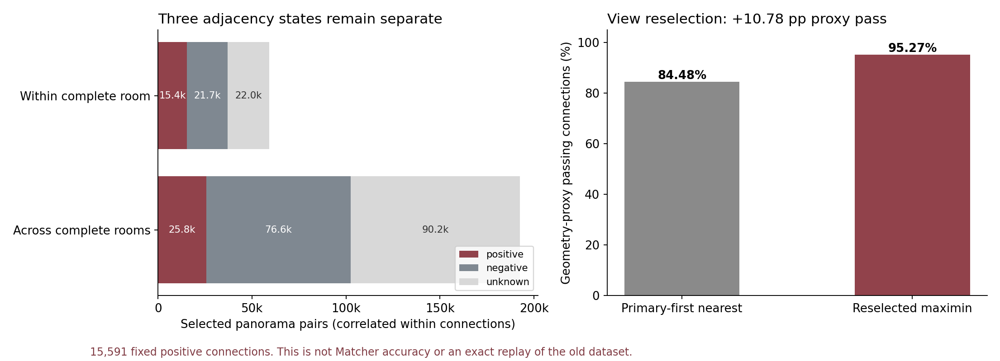

> 修改记录：2026-11-05 19:42 CST - 仅将说明链接指向合并档案，保留原实验正文与结果。

# ZInD-ObservablePairs-v1：数据与端到端训练结果

本目录发布本次**实际使用的数据索引与结果证据**。数据集构建日期为 2026-09-10，训练于北京时间 2026-09-12 04:25 正常完成。原 BiPair 数据与旧实验保留。

## 数据集

| 自动标签 | 选中 panorama pair 数 |
|---|---:|
| positive | 41,169 |
| negative | 98,299 |
| unknown | 112,182 |
| 合计 | **251,650** |

主索引区分跨完整房间和同完整房间内子空间，保留全部 GT 对应集合、逐侧几何可见性代理、来源与米制尺度。35,659 对通过双侧观测代理筛选；**人工核验数为 0，core_verified 为空**。几何通过不等于 RGB 可辨识。

- [压缩分片及校验清单](release_manifest.json)：按顺序恢复后与实际本地主索引逐字节一致，保留完整记录，不是抽样索引。
- [构建统计](dataset/summary.json)、[数据来源哈希](dataset/source_hashes.json)、[300 对人工审核试点及抽样权重](dataset/pilot_sampling.json)。
- [完整索引与源图像审计](audit/audit.json)、[官方坐标对照](audit/coordinate_contract.json)。
- [详细构建报告](../../docs/archive/datasets.md#source-943ea1aae3)、[构建实现](../../dataset/zind_observable_pairs.py)、[全部阈值](../../configs/zind_observable_pairs_v1.json)。



## 本轮实际训练视图

[训练视图说明与哈希](training/selection_summary.json)，实际使用且保留顺序的样本 ID：[train](training/train_ids.json)、[内部监控集](training/val_ids.json)。原训练 manifest 含重复展开的单图候选，体积约 1 GB；这里发布精确成员顺序与原 manifest 哈希，候选可由构建代码和原 ZInD 标注重建。

从每个正连接选择最佳代理通过视点，并按连接范围选等量有非相邻证书的负样本；unknown 不参与二分类。训练 **27,354 对**，内部监控 **2,352 对**，均正负各半；100 个监控房屋来自官方训练划分，与本轮训练房屋互斥且不属于人工校准试点。

**这里的 `val.json` 是训练器接口名，实际为内部监控集，不是正式 ZInD-ObservablePairs 验证集。** 已有预训练权重可能见过这些房屋，标签也尚未人工确认；正式 val/test 未构建或使用，阈值没有伪造冻结。因此不能直接与旧数据集分数比较并归因于数据重建。

## 联合训练结果

Bi-Layout + Opening Head + Matcher 联合反向传播；FP32、batch 4、最多 24 轮、patience 6。实际 **21 轮，36.38 小时**，最佳第 **15** 轮，正常早停。使用与历史 T3 相同的原模块化初始化及候选损失配置，保留多 GT 集合；预测候选漏掉目标时屏蔽对应正样本候选分类损失，不改负样本。

| 最佳内部监控指标（预测 guidance / 预测候选） | 结果 |
|---|---:|
| 正样本端到端 Top-1 | **60.37%** |
| 正确候选召回率 | 80.36% |
| 候选命中后的条件 Top-1 | 75.13% |
| 负样本拒绝率 | **93.03%** |
| Harmonic | **73.23%** |
| Opening token F1 | 90.86% |

1,176 个正样本中：710 个成功，231 个候选漏检，235 个候选命中后选择失败。后期训练分数继续提高而监控分数下降，不支持继续增加 epoch。此处不报告完整相对位姿或拼接成功率。

- [结果分析](results/训练结果摘要.md)
- [最佳轮完整指标](results/best_metrics.json)、[最后一轮](results/latest_metrics.json)、[21 轮 CSV](results/epochs.csv)、[逐轮原始 JSONL](results/metrics.jsonl)
- [真实梯度预检](results/gradient_preflight.json)、[完成记录](results/COMPLETED.json)、[精确命令配置](results/job_config.json)、[接入回归测试](results/adapter_tests.log)

## 恢复与复现

原始 RGB 与大体积模型权重不随 Git 提交。使用已有 ZInD 数据及项目初始化模型；最终 best.pt / last.pt 的大小与 SHA-256 保存在 [release_manifest.json](release_manifest.json)。发布指标不表示 checkpoint 本体已上传。

```bash
# 只需 Python 标准库；输出必须为新目录
python tools/restore_zind_observable_release.py \
  --release experiments/zind_observable_v1 \
  --output src/dataset/ZInD-ObservablePairs-v1/published

# 从自己的 ZInD 原始数据完整重建；只有 train，无伪造冻结记录
python tools/build_zind_observable_pairs.py \
  --root ../zind/data --partition ../zind/zind_partition.json \
  --output src/dataset/ZInD-ObservablePairs-v1/reproduced --split train
```

恢复的 `main_index.jsonl` 完整包含标签及 GT，实际训练成员索引位于本发布目录的 `training/`。完整训练 manifest 可用 `tools/prepare_zind_observable_training.py` 从重建的数据集生成，并与 selection_summary.json 中原始哈希比较。普通推理只使用 RGB 白名单；GT 数据只用于离线监督/诊断。训练 manifest 的 `dataRoot` 和结果日志中的绝对路径反映原运行机器，换机器时显式传入 `--data_root` 并调整命令路径。教师缓存只用于低权重正则，不代替实时 RGB 前向。

审核材料通过 `tools/prepare_zind_observable_review.py` 本地生成，两阶段分包发放；原始 RGB 未发布。分片压缩参数和导出流程见 `tools/export_zind_observable_release.py`。正式 val/test 仍需先完成训练试点审核、阈值校准和冻结。
