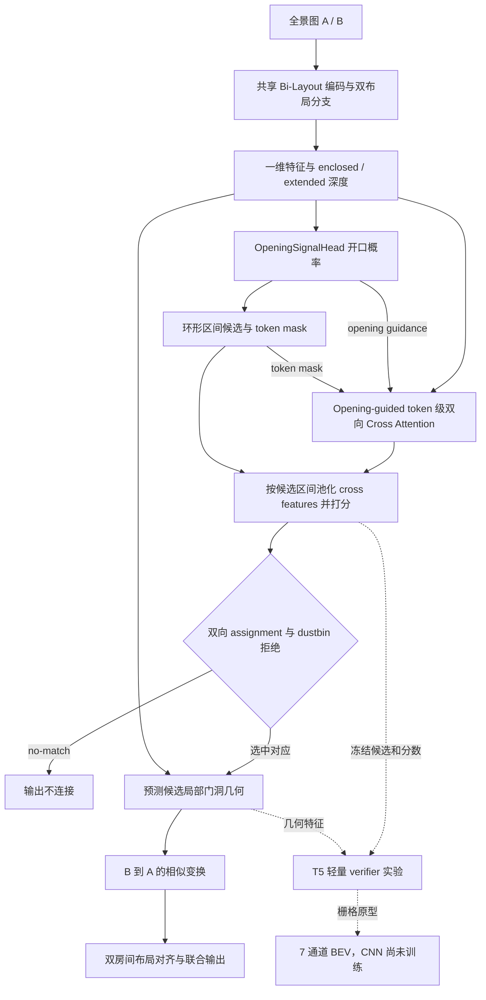

> 统一文档已合并至 [项目总览与学习手册](项目总览与学习手册.md#reading)（2026-09-07）。本文件保留为历史资料；其中“当前状态”和“下一步”以原记录日期为准，后续阅读与维护以统一手册为入口。

# Bi-Layout 项目学习索引

> 更新日期：2026-09-07。依据当前工作区源码、已保存的实验报告和指标整理；代码基线为 `50a6ae5`，也包含其后的本地实现。本次更新只整理文档，没有重新训练或评估模型。

项目已经从**单张全景图的双布局估计**，扩展到**双全景共享开口匹配、相对几何对齐与联合布局**。当前学习重点是理解完整链路，以及为什么“开口检测好”“愿意匹配”和“最终选对并拼好”是不同的问题。

先读下面的项目总览和进展，再按九个阶段查源码。初次阅读不必逐张浏览报告图片。

## 索引范围

- 本次编号索引共 **266 项**，覆盖 **181 个源码、测试与 YAML 配置文件**，以及主要设计文档和实验产物；补入旧索引漏收的 38 个源码/测试文件，包括端到端训练、T4 预检、候选失败审计、局部门洞几何和 T5 verifier/raster。
- `dataset/` 是加载与构建代码；`src/dataset/` 是实际数据与缓存；`experiments/` 保存实验协议、诊断与预检；`src/output/` 保存推理、几何评估和可视化结果；`checkpoints/` 保存权重及训练指标。
- 权重、原始图片、批量中间结果、缓存和压缩包不逐文件研读。第九阶段保留原有示例，并补入能解释当前结论的报告和指标入口；部分产物仅存在于本机，重新克隆仓库后可能需要生成或同步。
- 原索引中的“当前未提交”标签已移除，避免把 Git 状态当成长期功能说明。代码存在、单测通过、预检通过和完成正式实验是不同状态，进展以下方证据为准。
- 旧索引引用的 `Bi_Layout_网络架构图_可编辑.md` 当前不存在；单图架构请看 [论文网络图](assets/figure/bi_layout_network.png)、[模型实现](models/bi_layout.py) 和下面的数据流。

## 项目总览：先区分三条数据与任务线

| 主线 | 输入与目标 | 主要入口 | 学习时的区别 |
| --- | --- | --- | --- |
| 单图 Bi-Layout | 一张全景图 → enclosed / extended 双布局 | [main.py](main.py)、[inference.py](inference.py) | 学习共享编码器、两套全局上下文、深度/房高输出与布局 IoU。 |
| ZInD-BiPair-v1 | 同一 complete room 内，不同 partial room 经 opening 连接 | [数据说明](ZInD-BiPair-v1数据集说明.md)、[构建器](dataset/zind_bipair_builder.py) | 第一版严格 partial-opening 数据；JSONL + NPZ，不能直接等同于 complete-room pairs。 |
| ZInD_matching | 不同 complete room 之间的 door/opening 正负全景对 | [格式说明](ZInD匹配数据格式.md)、[端到端训练器](tools/train_zind_end_to_end.py) | 虽然格式建立得更早，但当前端到端训练、T0–T3、T4/T5 诊断使用的是这条线。 |

`ZInD_matching` 的历史完整训练划分为 train/val/test = **29,325 / 3,630 / 3,689 pairs**；BiPair-v1 则为 **9,224 / 1,142 / 990 pairs**。两套规模、开口语义和指标不能混在一起比较，分别见 [端到端结果](ZInD端到端训练结果.md) 与 [BiPair-v1 说明](ZInD-BiPair-v1数据集说明.md)。

### 当前代码的数据流



端到端训练已经覆盖 live Bi-Layout、Opening Head 和 Matcher；候选提取中的阈值/离散选择，以及后续解析几何与布局拼接，不应理解成全部可微。T5 verifier 是独立预检路径，尚不能把它视为所有正式推理入口的默认组件。

### 必须先记住的接口约定

| 对象 | 当前约定 | 代码依据 |
| --- | --- | --- |
| 输入与一维特征 | ZInD 配置下，每侧图像 `[B,3,512,1024]`，`layout_feature` 为 `[B,256,512]`；它是 Transformer 前的特征，不能与返回的 `enc_feature` 混用。 | [Bi-Layout](models/bi_layout.py)、[ZInD 配置](src/config/zind_all.yaml) |
| 双深度语义 | 当前 ZInD checkpoint 使用 `extended_first`：`depth` 对应 extended/visible，`new_depth` 对应 enclosed/raw；不能凭字段名中的 `new` 推断语义。 | [分支解析与 Matcher](models/cross_scene_matcher.py)、[live_layout](tools/train_zind_end_to_end.py) |
| 候选与监督 | `OpeningCandidates.masks` 为 `[B,K,256]`；区间端点包含在内，`start > end` 表示跨全景接缝。Padding 的 valid 为 false、ID/interval 为 -1。 | [跨场景数据契约](models/cross_scene_contracts.py) |
| 全部开口与共享开口 | `opening_all_*` 监督每张图的全部开口；`shared_portal_*` 只指当前 pair 的共享接口；二者不能替换。 | [PairBatch](models/cross_scene_contracts.py) |
| 相对变换 | `T_B_to_A` 表示 `p_A = T_B_to_A p_B`；相似变换允许 scale。Bi 的 x/z、ZInD 的局部 x/y 与楼层全局坐标需要显式转换，局部平移值不直接等于米。 | [联合布局](utils/joint_layout.py)、[坐标审计契约](src/output/zind_room_group_debug/t3_geometry_oracle_0665_floor03/coordinate_contract.md) |
| Token shift 与相机 yaw | Matcher 的 `relative_token_shift_radians` 描述 B-token 相对 A-token 的环形位移；历史键 `relative_yaw_radians` 是兼容别名。相机中心不同的时候，它通常不等于相机相对 yaw；当前 M2 位姿来自预测门洞端点几何。 | [Matcher 的 _cyclic_shift_scores](models/cross_scene_matcher.py)、[端点对齐](utils/joint_layout.py) |
| 预测与 GT | 正式预测使用 predicted guidance/candidates；GT 可作为训练标签、训练期明确启用的注入或事后评估。Teacher-forced / oracle 结果不能当成真实推理成绩。 | [训练器](tools/train_zind_end_to_end.py)、[候选审计](tools/audit_zind_candidate_failures.py) |

**编号提醒：** 架构文档的 `M2` 是 Bi-Layout 双分支解码器；后期几何报告里的 `candidate-local M2` 是局部门洞拟合方案，指向 [candidate_local_portal_geometry.py](utils/candidate_local_portal_geometry.py)。同样，v2 的 G0/G1 候选阈值配置与几何报告中的 G0/G1/G2 方法也属于不同实验命名空间。

## 当前进展与结果口径

以下均是已保存产物的整理，不代表本次重新运行后的成绩。尤其要区分完整 val、历史 test、小规模预检和 train 定性案例。

| 阶段 | 已有证据与结论 | 阅读入口 |
| --- | --- | --- |
| 首次端到端联合训练 | 历史运行完成 15 轮并早停；test 端到端 Top-1 为 **25.65%**。可训练链路已跑通，但候选召回与排序仍是瓶颈。 | [2026-08-04 结果](ZInD端到端训练结果.md) |
| v2 兼容性与小样本预检 | 验证 missing-positive assignment 屏蔽、listwise ranking 与有限梯度；G0→G1 阈值扫描提高候选召回，却没有提高端到端 Top-1。 | [v2 preflight](experiments/zind_e2e_v2/preflight/ZInD_v2_preflight.md) |
| v2 T0–T3 完整 val 消融 | 本地四组均已有 best 指标；T3 的完整 val Top-1 为 **27.42%**、Harmonic 为 **0.423333**，是后续几何与候选诊断的冻结基线。 | [实验协议](experiments/zind_e2e_v2/full_ablation_g0_seed123/run_manifest.json)、[T3 指标](checkpoints/End_To_End/zind_e2e_v2/g0_seed123/T3/best_metrics.json) |
| candidate-local M2 几何 | 完整 val 已跑完 3,630 pairs。正确匹配的 S3 子集上，局部门洞几何改善位姿与 BEV；全部正样本中满足 yaw<15° 且 translation<1m 的比例仍仅 **12.32%**。 | [完整几何报告](src/output/zind_geometry_val_full/t3_frozen_m2/report.md) |
| T4 Recall-TopK 与 Matcher 微调 | proposal recall 从 1080/1827 增至 1107/1827；但初始 overfit 门槛未通过，后续 matcher-only 中等实验也未通过泛化门槛，正式 T4 训练未启动。 | [T4 初始预检](experiments/zind_e2e_v3/g0_seed123/T4_recall/preflight/REPORT.md)、[medium 诊断](experiments/zind_e2e_v3/g0_seed123/T4_recall/medium_diagnostic/REPORT.md) |
| T5 候选失败审计 | train-4096 与 full-val 的主要失败原因排序不一致，报告结论为 **inconclusive**；需要扩展证据才能确定优先修改 Opening、Proposal 还是 Matcher。 | [候选失败报告](experiments/zind_e2e_v3/g0_seed123/T5_candidate_recall/audit/REPORT.md)、[视觉审计](experiments/zind_e2e_v3/g0_seed123/T5_candidate_recall/audit/visual_audit/REPORT.md) |
| T5 轻量 verifier / BEV 原型 | Phase B 的 E1 Logistic 在完整 val 将 S3 从 **501 提升到 526**，Harmonic 从 **0.423333 提升到 0.438200**；E2 MLP 未通过。7 通道 raster 已实现，CNN 尚未训练。 | [verifier preflight](experiments/zind_e2e_v3/g0_seed123/T5_bev_verifier/preflight/REPORT.md) |
| 三房间展示 | house 0665 / floor03 是 train 定性案例；已有 pairwise 对齐和拒绝记录，尚无该样本的完整三房间统一坐标 joint BEV 成图。 | [真实汇报图审计](experiments/ppt_real_outputs_audit/README.md) |

### T0–T3：先看训练改动，再看指标

同一 `G0 / seed123` 协议下，从各组 `best_metrics.json → validation.predicted_openings` 读取；分母均为完整 val 的 1,827 positives / 1,803 negatives。

| 组别 | missing-positive assignment 策略 | Ranking 权重 | 候选召回 | 端到端 Top-1 | 负样本拒绝 | Harmonic | 指标文件 |
| --- | --- | ---: | ---: | ---: | ---: | ---: | --- |
| T0 | `legacy_dustbin` | 0.0 | 59.22% | 25.23% | 93.68% | 0.397565 | [T0](checkpoints/End_To_End/zind_e2e_v2/g0_seed123/T0/best_metrics.json) |
| T1 | `mask_positive` | 0.0 | 58.29% | 26.87% | 93.07% | 0.417060 | [T1](checkpoints/End_To_End/zind_e2e_v2/g0_seed123/T1/best_metrics.json) |
| T2 | `legacy_dustbin` | 0.1 | 59.22% | 25.29% | 93.79% | 0.398345 | [T2](checkpoints/End_To_End/zind_e2e_v2/g0_seed123/T2/best_metrics.json) |
| T3 | `mask_positive` | 0.1 | 59.11% | 27.42% | 92.79% | 0.423333 | [T3](checkpoints/End_To_End/zind_e2e_v2/g0_seed123/T3/best_metrics.json) |

`mask_positive` 解决的是“正样本中正确候选未生成，却仍被 assignment 当成 no-match 教”的问题；它只屏蔽相应 candidate assignment 监督，保留真负样本的 dustbin 学习。Ranking 项帮助区分有效的 real-real 候选。表内是单 seed 验证结果，不能用它与历史 test 的 25.65% 相减后宣称测试集提升。

旧 [training_status.json](experiments/zind_e2e_v2/full_ablation_g0_seed123/training_status.json) 的时间停留在 2026-08-10，仍写着 T0 running / T1–T3 pending；它是历史快照。查看进展应结合后续指标与完整评估报告，不能据此判断当前进程仍在运行。

### 用 T3 漏斗理解当前瓶颈

```text
完整 val：3,630 pairs = 1,827 positives + 1,803 negatives

1,827 个正样本
├─ 747：没有召回正确候选
└─ 1,080：正确候选存在（candidate recall = 59.11%）
   ├─ 437：被 dustbin / no-match 拒绝
   ├─ 142：接受了匹配，但选错候选
   └─ 501：接受且选对（conditional Top-1 = 46.39%）

端到端 Top-1 = 1,080 / 1,827 × 501 / 1,080 = 27.42%
```

这里 S3 指“正样本最终接受且候选选对”，不是 pose 或联合布局已经正确。`positive acceptance` 只问是否接受连接；纯 real-real 排序的 Top-1 又不包含 dustbin 拒绝，三者应分别看。训练器的 Harmonic 是端到端 Top-1 与负样本拒绝率的调和平均，不是 Opening token F1，定义及复核见 [完整几何评估器](tools/evaluate_zind_portal_geometry_val_full.py)。

M2 的 S3 几何结果中，yaw 中位误差由 frame-polygon 的 **33.24°** 降为 **9.34°**，平移中位误差由 **1.760m** 降为 **0.719m**；两者有效数分别为 501 与 497，严格配对统计见 [完整报告](src/output/zind_geometry_val_full/t3_frozen_m2/report.md)。这支持几何改善，但无法补回进入几何前已经丢失的正样本。

T5 E1 的系统收益也需要分解：负样本拒绝率由 **92.79% 降至 91.68%**，正确匹配数增加 25；Phase A 消融没有证明标量 BEV 几何提供独立排序增益。因此目前支持的是轻量 verifier 的整体效果，不能归因为“BEV CNN 已提升性能”。

## 最短源码阅读路线

1. **单图基础：** [main.py](main.py) → [dataset/build.py](dataset/build.py) → [base_dataset.py](dataset/communal/base_dataset.py) → [Bi_Layout.forward](models/bi_layout.py) → [criterion.py](models/other/criterion.py) → [accuracy.py](evaluation/accuracy.py)。先能解释两套深度监督、房高比例和 IoU。
2. **跨图接口：** [cross_scene_contracts.py](models/cross_scene_contracts.py) → [zind_matching_feature_dataset.py](dataset/zind_matching_feature_dataset.py) → [OpeningSignalHead / OpeningGuidedCrossAttentionMatcher](models/cross_scene_matcher.py)。重点追候选 mask、padding、双向 assignment 和 dustbin。
3. **联合训练：** 在 [train_zind_end_to_end.py](tools/train_zind_end_to_end.py) 中依次读 `JointZInDMatchingDataset` → `EndToEndOpeningMatcher.live_layout` → `_candidate_inputs` / `_opening_guidance_inputs` → `_forward_loss` → `train_one_epoch` / `evaluate`。核对图像、环形旋转、特征 teacher 和 live 梯度各走哪条路。
4. **几何链路：** [prediction_to_layout](tools/debug_cross_scene_flow.py) → [frame_preserving_manhattan](postprocessing/post_process.py) → [estimate_candidate_local_portal_geometry](utils/candidate_local_portal_geometry.py) → [build_joint_layout_from_endpoints](utils/joint_layout.py) → [完整 val 评估器](tools/evaluate_zind_portal_geometry_val_full.py)。重点理解全景朝向的保留、门洞端点和 B→A 变换。
5. **当前实验：** [candidate_failure_trace.py](utils/candidate_failure_trace.py) → [候选失败审计](tools/audit_zind_candidate_failures.py) → [verifier Phase A](tools/preflight_zind_bev_verifier.py) → [Phase B](tools/run_zind_bev_verifier_phase_b.py) → [BEV rasterizer](utils/candidate_bev_rasterizer.py)。先确定失败发生在哪一步，再读对应改动。

下面是完整文件索引；源码按依赖顺序读，报告用于对照实际结果。

## 第一阶段：项目目标与设计文档

| 序号 | 文件 | 简要介绍 |
| ---: | --- | --- |
| 1 | [README.md](README.md) | 项目总入口：论文目标、安装方式、数据目录、权重、训练、测试及当前双分支配置语义。 |
| 2 | [README_文档总索引.md](README_文档总索引.md) | 已有的一页式文档导航，帮助先建立单图 Bi-Layout 与跨场景扩展的关系。 |
| 3 | [跨场景共享开口融合网络架构_可编辑.md](跨场景共享开口融合网络架构_可编辑.md) | 跨场景研究主线的完整设计文档，覆盖 M0–M9、数据契约、损失、推理和实现状态。 |
| 4 | [ZInD-BiPair-v1数据集说明.md](ZInD-BiPair-v1数据集说明.md) | 推荐 pair 数据集的样本定义、开口匹配、NPZ 标签、规模、验证结果与构建命令。 |
| 5 | [ZInD匹配数据格式.md](ZInD匹配数据格式.md) | 跨 complete-room door/opening 格式，说明 manifest、候选区间、位姿及 batch 契约；也是当前端到端训练的数据基础。 |
| 6 | [ZInD端到端训练结果.md](ZInD端到端训练结果.md) | 首次联合训练的配置、梯度预检、历史 val/test 指标和权重身份；后续 T3/T5 结果见本索引前文。 |
| 7 | [src/output/progress_report_20260716/进度汇报结果.md](src/output/progress_report_20260716/进度汇报结果.md) | 2026-07-16 的阶段性实验汇报，用于了解跨场景工程、开口召回和相邻 pair 评估进度。 |
| 8 | [atlanta_subset_report/README.md](atlanta_subset_report/README.md) | MP3D Atlanta/非曼哈顿候选子集的筛选启发式、统计结论和文件说明。 |
| 9 | [visualization/visualizer/README.md](visualization/visualizer/README.md) | 独立 360LayoutVisualizer 的使用入口；后续阅读 OpenGL 可视化代码前先看。 |
| 10 | [LICENSE](LICENSE) | MIT 许可证；了解代码复用、修改和再发布的法律边界，无需研读算法。 |

## 第二阶段：环境、配置与程序入口

| 序号 | 文件 | 简要介绍 |
| ---: | --- | --- |
| 11 | [requirements.txt](requirements.txt) | Python 依赖清单；先据此认识 PyTorch、几何、图像和可视化技术栈。 |
| 12 | [config/\_\_init\_\_.py](config/__init__.py) | 配置包入口，对外暴露默认配置及配置更新函数。 |
| 13 | [config/defaults.py](config/defaults.py) | 全局 YACS 默认配置树，定义模型、训练、数据、损失和评估的可选项。 |
| 14 | [src/config/mp3d.yaml](src/config/mp3d.yaml) | MatterportLayout 上训练/测试 Bi-Layout 的主配置，也是理解默认网络参数的首选样例。 |
| 15 | [src/config/mp3d_test_o0.yaml](src/config/mp3d_test_o0.yaml) | MP3D 的 O0/全精度测试配置，用于对照混合精度设置。 |
| 16 | [src/config/zind_all.yaml](src/config/zind_all.yaml) | ZInD 全量房型配置；跨场景工具默认引用的单图骨干配置。 |
| 17 | [src/config/zind_simple.yaml](src/config/zind_simple.yaml) | ZInD 简单房型子集配置，用于较受控的单图训练与评估。 |
| 18 | [src/config/other/horizon_net_mp3d.yaml](src/config/other/horizon_net_mp3d.yaml) | 在统一框架中复现 HorizonNet/MP3D 的对照配置。 |
| 19 | [src/config/other/horizon_net_zind.yaml](src/config/other/horizon_net_zind.yaml) | 在统一框架中复现 HorizonNet/ZInD 的对照配置。 |
| 20 | [src/config/other/led_net_mp3d.yaml](src/config/other/led_net_mp3d.yaml) | 在 MP3D 上运行 LED2-Net 风格模型的基线配置。 |
| 21 | [src/config/other/led_net_zind.yaml](src/config/other/led_net_zind.yaml) | 在 ZInD 上运行 LED2-Net 风格模型的基线配置。 |
| 22 | [main.py](main.py) | 单图模型核心入口：解析配置、分布式启动、训练循环、验证、指标和 checkpoint 保存。 |
| 23 | [inference.py](inference.py) | 单张全景图预处理、模型加载、推理，以及 JSON/PNG/OBJ 结果导出的完整路径。 |
| 24 | [convert_ckpt.py](convert_ckpt.py) | 将训练 checkpoint 转换为发布/推理所需权重格式的小工具。 |

## 第三阶段：基础数据管线、预处理与几何工具

| 序号 | 文件 | 简要介绍 |
| ---: | --- | --- |
| 25 | [dataset/\_\_init\_\_.py](dataset/__init__.py) | 数据集包入口，集中导出 MP3D、ZInD、双全景及特征数据集。 |
| 26 | [dataset/build.py](dataset/build.py) | 根据配置选择 Dataset、数据增强和 DataLoader，是 `main.py` 到数据层的桥梁。 |
| 27 | [dataset/communal/\_\_init\_\_.py](dataset/communal/__init__.py) | 通用数据处理子包标记，无独立算法。 |
| 28 | [dataset/communal/base_dataset.py](dataset/communal/base_dataset.py) | 单图数据集基类：把图像和角点标签统一转换为深度、比例、角点热图与对象监督。 |
| 29 | [dataset/communal/read.py](dataset/communal/read.py) | 读取图像、MP3D/ZInD 标签与划分，并把原始标注整理为统一记录。 |
| 30 | [dataset/communal/data_augmentation.py](dataset/communal/data_augmentation.py) | 全景拉伸、旋转、翻转和颜色增强，重点理解环形坐标与标签同步变换。 |
| 31 | [dataset/mp3d_dataset.py](dataset/mp3d_dataset.py) | MatterportLayout 的 Dataset 实现，负责样本筛选、读取和通用处理。 |
| 32 | [dataset/zind_dataset.py](dataset/zind_dataset.py) | 当前 ZInD 单图 Dataset，支持简单房型、平顶、墙数和消失点对齐等筛选。 |
| 33 | [dataset/zind_dataset_dop.py](dataset/zind_dataset_dop.py) | 较早的 ZInD Dataset 变体；适合与当前实现对照，理解历史数据路径。 |
| 34 | [dataset/zind_new_dataset.py](dataset/zind_new_dataset.py) | 另一版 ZInD 加载实现，保留了新旧标注转换与筛选逻辑。 |
| 35 | [dataset/zind/zind_two_head_preprocess.py](dataset/zind/zind_two_head_preprocess.py) | 为 ZInD 双头/Bi-Layout 监督生成或修整 raw、visible 等布局标签的预处理脚本。 |
| 36 | [preprocessing/\_\_init\_\_.py](preprocessing/__init__.py) | 预处理包标记，无独立运行逻辑。 |
| 37 | [preprocessing/filter.py](preprocessing/filter.py) | 按相机中心、边界交叉和多边形自交过滤无效布局。 |
| 38 | [preprocessing/pano_lsd_align.py](preprocessing/pano_lsd_align.py) | 全景线段检测、球面几何、消失点估计与曼哈顿方向对齐的底层实现。 |
| 39 | [utils/conversion.py](utils/conversion.py) | pixel、UV、经纬度、XYZ、depth 之间的核心坐标转换；后续几何代码的基础。 |
| 40 | [utils/boundary.py](utils/boundary.py) | 角点、边界、深度、热图和布局类型之间的转换与检测工具。 |
| 41 | [utils/height.py](utils/height.py) | 从天花板/地板边界估计比例与房高，并提供 ratio/height 相互转换。 |
| 42 | [utils/visibility_polygon.py](utils/visibility_polygon.py) | 基于线段扫描求视点可见多边形，用于可见区域和布局几何分析。 |
| 43 | [utils/misc.py](utils/misc.py) | Tensor/NumPy 及字典转换等轻量通用函数。 |
| 44 | [utils/time_watch.py](utils/time_watch.py) | 简单计时器，用于记录训练或推理阶段耗时。 |
| 45 | [utils/logger.py](utils/logger.py) | 项目日志器初始化、文件输出和格式控制。 |
| 46 | [utils/writer.py](utils/writer.py) | 将预测 XYZ 布局和高度比例写成项目 JSON 输出格式。 |

## 第四阶段：单图 Bi-Layout 模型、损失、后处理与评估

| 序号 | 文件 | 简要介绍 |
| ---: | --- | --- |
| 47 | [models/base_model.py](models/base_model.py) | 模型基类，提供参数统计、权重初始化和加载等公共能力。 |
| 48 | [models/build.py](models/build.py) | 按配置名称实例化模型，是训练入口与具体网络类之间的工厂。 |
| 49 | [models/bi_layout.py](models/bi_layout.py) | 项目核心单图网络：共享图像编码器、双布局分支、Transformer 和深度/比例输出头。 |
| 50 | [models/modules/horizon_net_feature_extractor.py](models/modules/horizon_net_feature_extractor.py) | 环形 padding、多尺度 CNN 和高度压缩，将全景图编码为沿经度排列的 token 特征。 |
| 51 | [models/modules/position_encoding.py](models/modules/position_encoding.py) | 为一维环形序列构造正弦位置编码。 |
| 52 | [models/modules/share_feature_guidance_module.py](models/modules/share_feature_guidance_module.py) | Bi-Layout 的共享特征引导 Transformer，用不同查询提取两种布局语义。 |
| 53 | [models/modules/transformer_modules.py](models/modules/transformer_modules.py) | Attention、CrossAttention、相对/绝对位置、前馈层等主要 Transformer 积木。 |
| 54 | [models/modules/transformer.py](models/modules/transformer.py) | 基础 Transformer 堆叠封装。 |
| 55 | [models/modules/conv_transformer.py](models/modules/conv_transformer.py) | 融合卷积与自注意力的一维序列 Transformer 变体。 |
| 56 | [models/modules/swg_transformer.py](models/modules/swg_transformer.py) | SWG Transformer 网络封装，用于可切换的骨干/基线实验。 |
| 57 | [models/modules/swin_transformer.py](models/modules/swin_transformer.py) | Swin Transformer 风格封装，用于统一模型接口下的对照结构。 |
| 58 | [models/modules/patch_feature_extractor.py](models/modules/patch_feature_extractor.py) | 将图像切分并编码为 patch 序列的轻量特征提取器。 |
| 59 | [models/modules/\_\_init\_\_.py](models/modules/__init__.py) | 模型组件子包标记。 |
| 60 | [models/\_\_init\_\_.py](models/__init__.py) | 模型包入口，触发具体模型注册/导入。 |
| 61 | [models/other/init_env.py](models/other/init_env.py) | 固定随机种子、确定性选项和 DataLoader worker 随机状态。 |
| 62 | [models/other/criterion.py](models/other/criterion.py) | 根据配置构建各项损失，并把模型输出与真值汇总成总损失。 |
| 63 | [models/other/optimizer.py](models/other/optimizer.py) | 根据配置创建优化器并处理参数组。 |
| 64 | [models/other/scheduler.py](models/other/scheduler.py) | 带 warm-up 的学习率调度器实现。 |
| 65 | [models/other/\_\_init\_\_.py](models/other/__init__.py) | 训练辅助组件子包标记。 |
| 66 | [loss/boundary_loss.py](loss/boundary_loss.py) | 对预测布局边界/深度计算回归损失。 |
| 67 | [loss/led_loss.py](loss/led_loss.py) | LED2-Net 风格的布局深度和房高联合损失。 |
| 68 | [loss/grad_loss.py](loss/grad_loss.py) | 约束深度梯度、边缘方向或局部几何变化。 |
| 69 | [loss/object_loss.py](loss/object_loss.py) | 针对角点/开口等对象热图的类别不平衡损失。 |
| 70 | [loss/\_\_init\_\_.py](loss/__init__.py) | 损失包入口，汇总可由配置选择的损失类。 |
| 71 | [postprocessing/post_process.py](postprocessing/post_process.py) | 深度转 Manhattan/Atlanta 布局；新增预测 heading 估计与 frame-preserving Manhattan 拟合，保留全景局部朝向。 |
| 72 | [postprocessing/dula/layout.py](postprocessing/dula/layout.py) | 当前 DuLa 风格的平面布局拟合与近邻结构合并算法。 |
| 73 | [postprocessing/dula/layout_old.py](postprocessing/dula/layout_old.py) | 旧版 DuLa 布局拟合，主要用于历史对照。 |
| 74 | [postprocessing/dula/\_\_init\_\_.py](postprocessing/dula/__init__.py) | DuLa 后处理子包标记。 |
| 75 | [postprocessing/\_\_init\_\_.py](postprocessing/__init__.py) | 后处理包标记。 |
| 76 | [evaluation/iou.py](evaluation/iou.py) | 2D/3D IoU、交集面积和高度 IoU 的基础实现。 |
| 77 | [evaluation/accuracy.py](evaluation/accuracy.py) | 主评估入口，汇总布局 IoU、角点、深度、开口和双分支消歧指标。 |
| 78 | [evaluation/f1_score.py](evaluation/f1_score.py) | 角点匹配与匈牙利分配基础上的 junction F1。 |
| 79 | [evaluation/opening_recall.py](evaluation/opening_recall.py) | 唯一全景去重、环形开口区间提取、Token AP/召回和 Interval Recall 指标。 |
| 80 | [evaluation/analyse_layout_type.py](evaluation/analyse_layout_type.py) | 分析布局类型、墙数或样本难度分布的辅助评估脚本。 |
| 81 | [evaluation/eval_visible_iou.py](evaluation/eval_visible_iou.py) | 在数据集层面评估可见布局 IoU。 |
| 82 | [evaluation/subset_selection.py](evaluation/subset_selection.py) | 按布局属性/难度选择评估子集。 |
| 83 | [evaluation/\_\_init\_\_.py](evaluation/__init__.py) | 评估包标记。 |

## 第五阶段：跨场景数据、模型与工程管线

| 序号 | 文件 | 简要介绍 |
| ---: | --- | --- |
| 84 | [dataset/zind_pair_mining.py](dataset/zind_pair_mining.py) | 从 ZInD 房屋拓扑和重复门洞标注中挖掘跨 complete-room 正负全景对，是 ZInD_matching 的构建基础。 |
| 85 | [dataset/panorama_pair_dataset.py](dataset/panorama_pair_dataset.py) | 读取旧匹配 manifest，将候选区间展开为 mask/affinity，并完成双图 batch padding。 |
| 86 | [dataset/zind_bipair_builder.py](dataset/zind_bipair_builder.py) | ZInD-BiPair-v1 的核心构造逻辑：严格筛视图、匹配 portal、生成正负 pair 和 NPZ 标签。 |
| 87 | [dataset/zind_bipair_adapter.py](dataset/zind_bipair_adapter.py) | 把 BiPair batch 转换为跨场景模型的统一 `PairBatch`/候选契约。 |
| 88 | [dataset/zind_bipair_dataset.py](dataset/zind_bipair_dataset.py) | 加载 BiPair JSONL 与 NPZ，解析路径、图像、密集监督并执行 collate。 |
| 89 | [dataset/zind_opening_dataset.py](dataset/zind_opening_dataset.py) | 将 pair manifest 去重为单视图 Opening Head 数据，并加载冻结特征缓存和同步环形增强。 |
| 90 | [dataset/zind_bipair_feature_dataset.py](dataset/zind_bipair_feature_dataset.py) | 把冻结的单视图 Bi-Layout 特征重新连接到 BiPair 记录，供 matcher 训练使用。 |
| 91 | [dataset/zind_matching_feature_dataset.py](dataset/zind_matching_feature_dataset.py) | 加载 `ZInD_matching` 特征缓存，保留原候选身份并校验 house split；联合训练 Dataset 也以它为基础。 |
| 92 | [models/cross_scene_contracts.py](models/cross_scene_contracts.py) | 跨场景各模块的强类型数据契约：坐标系、候选、单图输出、pair batch 与 matcher 输出。 |
| 93 | [models/cross_scene_matcher.py](models/cross_scene_matcher.py) | Opening Head、候选池化、双向 Cross Attention 与 dustbin；新增 Recall-TopK、missing-target mask、listwise ranking 和 positive-to-dustbin margin。 |
| 94 | [models/geometry_consistency_selector.py](models/geometry_consistency_selector.py) | 用候选几何指标选择最佳联合布局，并提供监督损失。 |
| 95 | [utils/joint_layout.py](utils/joint_layout.py) | 根据共享门洞求相似变换、拼接与渲染；新增显式端点入口，供 candidate-local M2 直接对齐，避免依赖全局墙索引。 |
| 96 | [utils/candidate_local_portal_geometry.py](utils/candidate_local_portal_geometry.py) | 从预测 raw 深度轮廓与候选区间进行局部 RANSAC/TLS 拟合、射线求交和质量诊断；本模块不决定候选是否匹配。 |
| 97 | [utils/candidate_failure_trace.py](utils/candidate_failure_trace.py) | 跟踪阈值、连通域、peak expansion、dedup/cap 等 proposal 阶段；GT 后验诊断与正式候选生成分开。 |
| 98 | [utils/candidate_conditioned_verifier.py](utils/candidate_conditioned_verifier.py) | 稳定 Top-N、候选 padding、Matcher 单元特征、预测端点和 polygon 几何特征；供独立 verifier 预检使用。 |
| 99 | [utils/candidate_bev_rasterizer.py](utils/candidate_bev_rasterizer.py) | 将预测布局归一化到 A 门洞中心与宽度，输出 7×128×128 BEV：两侧占据/边界、重叠、portal line、validity；范围为 ±6 个门洞宽度。 |
| 100 | [utils/cross_scene_estimator.py](utils/cross_scene_estimator.py) | 从双深度提取开口、生成墙对候选、做多边形校验/NMS并计算几何一致性分数。 |
| 101 | [utils/cross_scene_pipeline.py](utils/cross_scene_pipeline.py) | 统一跨场景工程管线：参数校验、候选融合、选择、版本化和原子化输出。 |
| 102 | [utils/cross_scene_logger.py](utils/cross_scene_logger.py) | 记录跨场景实验的匹配、相对位姿、候选排名及结构化指标。 |
| 103 | [utils/opening_checkpoint.py](utils/opening_checkpoint.py) | 严格验证并加载 Opening Head checkpoint、文件身份、模型契约和阈值。 |
| 104 | [utils/matcher_checkpoint.py](utils/matcher_checkpoint.py) | 严格验证并加载跨场景 matcher checkpoint 及其依赖身份。 |
| 105 | [utils/\_\_init\_\_.py](utils/__init__.py) | 工具包标记；读完各具体模块后快速浏览即可。 |

## 第六阶段：数据构建、训练、评估与推理工具

| 序号 | 文件 | 简要介绍 |
| ---: | --- | --- |
| 106 | [tools/download_zind.py](tools/download_zind.py) | 下载/整理 ZInD 原始数据的命令行工具。 |
| 107 | [tools/build_atlanta_subset.py](tools/build_atlanta_subset.py) | 分析 MP3D 多边形边方向，构建 Atlanta、复杂 Manhattan 和近 Manhattan 子集报告。 |
| 108 | [tools/build_zind_matching_dataset.py](tools/build_zind_matching_dataset.py) | 调用 pair mining 生成 `ZInD_matching` 的 train/val/test manifest。 |
| 109 | [tools/build_zind_bipair_v1.py](tools/build_zind_bipair_v1.py) | 构建推荐的 ZInD-BiPair-v1：遍历 split、写 JSONL/NPZ、统计并安全处理覆盖。 |
| 110 | [tools/validate_zind_bipair_v1.py](tools/validate_zind_bipair_v1.py) | 全量校验 BiPair 文件、数组形状、路径、位姿、完整布局和房屋级数据泄漏。 |
| 111 | [tools/evaluate_zind_opening_recall.py](tools/evaluate_zind_opening_recall.py) | 在 GT 或 Bi-Layout 双深度上评估开口召回，并用 val 标定运行阈值。 |
| 112 | [tools/cache_zind_matching_features.py](tools/cache_zind_matching_features.py) | 为 ZInD_matching 的唯一全景缓存冻结 Bi-Layout 特征和预测深度，供模块化训练与联合训练 teacher 使用。 |
| 113 | [tools/train_zind_opening_head.py](tools/train_zind_opening_head.py) | 在 BiPair 单视图缓存上训练 OpeningSignalHead，含阈值扫描、恢复训练和原子 checkpoint。 |
| 114 | [tools/train_zind_matching_opening_head.py](tools/train_zind_matching_opening_head.py) | 在 doors+openings 的 `ZInD_matching` 缓存上做 Opening Head 域适配。 |
| 115 | [tools/train_zind_cross_scene_matcher.py](tools/train_zind_cross_scene_matcher.py) | 在 BiPair 冻结特征上训练跨场景 matcher，组织多项匹配损失、评估与 checkpoint。 |
| 116 | [tools/train_zind_matching_matcher.py](tools/train_zind_matching_matcher.py) | 保留 manifest 候选身份，在冻结特征上训练 complete-room Matcher，并区分 teacher-forced/预测候选指标。 |
| 117 | [tools/train_zind_end_to_end.py](tools/train_zind_end_to_end.py) | 从原始双图联合训练 Bi-Layout、Opening 与 Matcher；含独立 guidance/candidate 来源、mask/rank 损失、训练期注入及 matcher-only 阶段。 |
| 118 | [tools/analyze_zind_candidate_recall.py](tools/analyze_zind_candidate_recall.py) | v2 validation 兼容性复核、G0/G1 阈值扫描、失败分类和 guidance/candidate 四格诊断。 |
| 119 | [tools/run_zind_small_overfit.py](tools/run_zind_small_overfit.py) | 固定 train 子集执行 T0–T3 overfit，记录 loss、候选排名和梯度有限性。 |
| 120 | [tools/debug_cross_scene_flow.py](tools/debug_cross_scene_flow.py) | 逐阶段检查单图特征、开口、Matcher 和融合；`prediction_to_layout` 提供 raw / frame-preserving 等几何表示。 |
| 121 | [tools/estimate_cross_scene_layout.py](tools/estimate_cross_scene_layout.py) | 面向真实双房间输入的统一跨场景估计 CLI，支持证据、selector、诊断和输出目录。 |
| 122 | [tools/evaluate_zind_cross_scene_pairs.py](tools/evaluate_zind_cross_scene_pairs.py) | 批量运行 ZInD pair 跨场景推理，汇总候选、位姿和联合布局评估结果。 |
| 123 | [tools/join_room_layouts.py](tools/join_room_layouts.py) | 使用已知或指定的共享门洞，把两个单房间 JSON 布局变换并合并。 |
| 124 | [tools/evaluate_zind_room_group.py](tools/evaluate_zind_room_group.py) | 固定 train 房间组的条件 pairwise 融合；预测决定连边与拒绝，GT 仅在预测后附加供诊断。 |
| 125 | [tools/audit_zind_joint_geometry.py](tools/audit_zind_joint_geometry.py) | CPU 上对已保存三房间输出做坐标与几何 oracle，定位 Manhattan 朝向丢失和区间到墙的映射错误。 |
| 126 | [tools/audit_zind_portal_geometry.py](tools/audit_zind_portal_geometry.py) | 在保存的 pre-Manhattan 轮廓上比较局部门洞方案；先冻结预测几何，再附加 train GT 评估。 |
| 127 | [tools/evaluate_zind_portal_geometry_val.py](tools/evaluate_zind_portal_geometry_val.py) | 确定性 val smoke：每 pair 一次 live 前向，再比较 legacy/frame/M2 三条几何分支。 |
| 128 | [tools/evaluate_zind_portal_geometry_val_full.py](tools/evaluate_zind_portal_geometry_val_full.py) | 完整 val 的冻结 T3/M2 诊断；含 matcher parity、S0–S5 漏斗、位姿/BEV、scale 对照与 house bootstrap。 |
| 129 | [tools/audit_zind_t4_recall.py](tools/audit_zind_t4_recall.py) | 从冻结 T3 val 输出重放 proposal，审计候选召回、dustbin 分数和错误选择；不加载模型。 |
| 130 | [tools/prepare_zind_t4_preflight_subsets.py](tools/prepare_zind_t4_preflight_subsets.py) | 生成确定性 train/val 引用子集，供 T4 小规模预检和对照使用。 |
| 131 | [tools/preflight_zind_t4_cpu.py](tools/preflight_zind_t4_cpu.py) | T4 recall / dustbin margin 的合成 CPU 可学习性预检。 |
| 132 | [tools/preflight_zind_t4_matcher_only.py](tools/preflight_zind_t4_matcher_only.py) | 从 T3 初始化并冻结上游缓存，执行单 batch 与固定子集 Matcher overfit，核对参数变化与梯度。 |
| 133 | [tools/summarize_zind_t4_preflight.py](tools/summarize_zind_t4_preflight.py) | 汇总 T4 的 14 项预检条件，生成是否可进入正式训练的机器可读结论。 |
| 134 | [tools/diagnose_zind_t4_medium.py](tools/diagnose_zind_t4_medium.py) | 1024-train / 512-val 中等泛化诊断，比较一致 proposal 下的 injection×margin 四格实验。 |
| 135 | [tools/audit_zind_candidate_failures.py](tools/audit_zind_candidate_failures.py) | T3 冻结、可恢复的候选失败审计；unique-room 缓存、stage funnel、O0–O5 oracle 与 train/val 一致性分析。 |
| 136 | [tools/visual_audit_zind_candidate_failures.py](tools/visual_audit_zind_candidate_failures.py) | 用冻结 artifact 和 val RGB 生成可追溯可视化，对照自动分类、直接视觉证据和人工推断。 |
| 137 | [tools/preflight_zind_bev_verifier.py](tools/preflight_zind_bev_verifier.py) | 冻结 T3/M2 的候选 Top-N、预测特征与 Phase A Logistic/MLP 预检及消融。 |
| 138 | [tools/run_zind_bev_verifier_phase_b.py](tools/run_zind_bev_verifier_phase_b.py) | 补齐冻结负样本，训练/评估带拒绝决策的轻量 E1/E2，核对完整 val 的 S3、Harmonic 和负样本拒绝。 |
| 139 | [tools/generate_zind_bev_raster_examples.py](tools/generate_zind_bev_raster_examples.py) | Phase B 通过后生成少量 predicted-only 栅格与预览示例；不是 CNN 训练入口。 |

## 第七阶段：测试——用行为契约反向巩固实现

| 序号 | 文件 | 简要介绍 |
| ---: | --- | --- |
| 140 | [tests/test_bi_layout_config.py](tests/test_bi_layout_config.py) | 验证 `use_same_head`、`share_TF`、`two_conv_out` 等双分支配置的真实结构与输出。 |
| 141 | [tests/test_cross_scene_engineering.py](tests/test_cross_scene_engineering.py) | 覆盖跨场景契约、管线校验、候选选择和工程输出的集成行为。 |
| 142 | [tests/test_cross_scene_estimator.py](tests/test_cross_scene_estimator.py) | 验证开口提取、深度解释、候选打分、NMS 和多边形有效性。 |
| 143 | [tests/test_cross_scene_matcher.py](tests/test_cross_scene_matcher.py) | 验证 Opening Head、双向注意力 matcher、候选/dustbin 与各类损失。 |
| 144 | [tests/test_joint_layout.py](tests/test_joint_layout.py) | 验证门洞端点对齐、相似变换和联合布局渲染。 |
| 145 | [tests/test_matcher_checkpoint.py](tests/test_matcher_checkpoint.py) | 验证 matcher checkpoint 的契约、路径身份、哈希和错误拒绝策略。 |
| 146 | [tests/test_opening_checkpoint.py](tests/test_opening_checkpoint.py) | 验证 Opening Head checkpoint 加载、模型元数据与阈值解析。 |
| 147 | [tests/test_opening_recall.py](tests/test_opening_recall.py) | 验证唯一视图去重、环形连通域、区间 IoU、AP/召回和阈值扫描。 |
| 148 | [tests/test_train_zind_matching_matcher.py](tests/test_train_zind_matching_matcher.py) | 检查 ZInD_matching Matcher 训练参数、初始化/恢复和缓存契约。 |
| 149 | [tests/test_train_zind_matching_opening_head.py](tests/test_train_zind_matching_opening_head.py) | 检查 ZInD_matching Opening Head 域适配的参数与恢复规则。 |
| 150 | [tests/test_zind_bipair_adapter.py](tests/test_zind_bipair_adapter.py) | 验证 BiPair 样本到统一跨场景 `PairBatch` 的字段、形状与正负语义。 |
| 151 | [tests/test_zind_bipair_builder.py](tests/test_zind_bipair_builder.py) | 用合成房屋验证 portal 匹配、正负 pair、标签数组和相对变换。 |
| 152 | [tests/test_zind_bipair_feature_dataset.py](tests/test_zind_bipair_feature_dataset.py) | 验证冻结特征回连 pair、重复 portal 合并、路径覆盖和缓存形状。 |
| 153 | [tests/test_zind_dataset_limit.py](tests/test_zind_dataset_limit.py) | 验证 ZInD Dataset 的测试条数限制及稳定取样行为。 |
| 154 | [tests/test_zind_matcher_training.py](tests/test_zind_matcher_training.py) | 验证跨场景 matcher 训练步骤、损失可反传和关键指标。 |
| 155 | [tests/test_zind_matching_feature_cache.py](tests/test_zind_matching_feature_cache.py) | 验证 ZInD_matching 唯一视图特征缓存、复用、标签与元数据契约。 |
| 156 | [tests/test_zind_matching_feature_dataset.py](tests/test_zind_matching_feature_dataset.py) | 验证 ZInD_matching 特征 Dataset 的候选身份、batch 和 split 隔离。 |
| 157 | [tests/test_zind_opening_training.py](tests/test_zind_opening_training.py) | 验证 Opening Head 单视图数据、同步增强、缓存读取、训练与 resume。 |
| 158 | [tests/test_zind_pair_mining.py](tests/test_zind_pair_mining.py) | 验证 ZInD 门洞端点全局匹配、环形 token 区间和正负 pair 挖掘。 |
| 159 | [tests/test_zind_end_to_end_candidate_fixes.py](tests/test_zind_end_to_end_candidate_fixes.py) | 验证 missing-target mask、ranking/padding 有限梯度、guidance/candidate 解耦及 skip-test 生命周期。 |
| 160 | [tests/test_evaluate_zind_room_group.py](tests/test_evaluate_zind_room_group.py) | 验证房间组输入契约、predicted-only 路由、冻结 Matcher 的接受/拒绝及 GT 后验附加。 |
| 161 | [tests/test_audit_zind_joint_geometry.py](tests/test_audit_zind_joint_geometry.py) | 验证相似变换、坐标组合、B→A 方向与 oracle 使用边界。 |
| 162 | [tests/test_frame_preserving_manhattan.py](tests/test_frame_preserving_manhattan.py) | 验证预测 heading、旋转后拟合与还原、frame-preserving 模式及旧模式兼容性。 |
| 163 | [tests/test_audit_zind_portal_geometry.py](tests/test_audit_zind_portal_geometry.py) | 验证局部门洞直线/射线几何、退化情况与审计输入限制。 |
| 164 | [tests/test_candidate_local_portal_geometry.py](tests/test_candidate_local_portal_geometry.py) | 验证正式局部门洞估计、失败/质量输出与冻结审计结果一致性。 |
| 165 | [tests/test_evaluate_zind_portal_geometry_val.py](tests/test_evaluate_zind_portal_geometry_val.py) | 验证 val smoke 确定性选择、GT 隔离、中断恢复及汇总契约。 |
| 166 | [tests/test_evaluate_zind_portal_geometry_val_full.py](tests/test_evaluate_zind_portal_geometry_val_full.py) | 验证完整 manifest、Matcher 指标一致性、scale 诊断、resume 与 bootstrap。 |
| 167 | [tests/test_zind_t4_recall.py](tests/test_zind_t4_recall.py) | 验证环形 Recall-TopK、dedup/cap、训练期 GT injection 隔离和 dustbin margin。 |
| 168 | [tests/test_zind_t4_matcher_only.py](tests/test_zind_t4_matcher_only.py) | 验证 matcher-only 阶段只更新指定参数、上游冻结及训练配置约束。 |
| 169 | [tests/test_zind_t4_medium.py](tests/test_zind_t4_medium.py) | 验证中等子集选择和诊断契约。 |
| 170 | [tests/test_audit_zind_candidate_failures.py](tests/test_audit_zind_candidate_failures.py) | 验证 proposal trace、失败原因分类与候选审计契约。 |
| 171 | [tests/test_visual_audit_zind_candidate_failures.py](tests/test_visual_audit_zind_candidate_failures.py) | 验证冻结 full-val 统计重算、视觉审计样本与输出契约。 |
| 172 | [tests/test_candidate_conditioned_verifier.py](tests/test_candidate_conditioned_verifier.py) | 验证 Top-N 稳定排序、padding、预测几何特征及 GT 特征排除。 |
| 173 | [tests/test_candidate_bev_rasterizer.py](tests/test_candidate_bev_rasterizer.py) | 验证门洞中心归一化、七通道栅格、无效几何与 clipping 元数据。 |

## 第八阶段：可视化实现

| 序号 | 文件 | 简要介绍 |
| ---: | --- | --- |
| 174 | [visualization/\_\_init\_\_.py](visualization/__init__.py) | 可视化包标记。 |
| 175 | [visualization/boundary.py](visualization/boundary.py) | 在全景图上绘制角点、天花板/地板边界和对象热图。 |
| 176 | [visualization/floorplan.py](visualization/floorplan.py) | 绘制单布局平面图及预测/真值 IoU 叠加图。 |
| 177 | [visualization/grad.py](visualization/grad.py) | 将深度梯度、方向和边缘响应转换为便于诊断的图像。 |
| 178 | [visualization/obj3d.py](visualization/obj3d.py) | 从全景纹理与深度生成带纹理的 3D OBJ 网格。 |
| 179 | [visualization/visualizer/ArcBall.py](visualization/visualizer/ArcBall.py) | 交互式 3D 旋转的 ArcBall 数学与鼠标控制实现。 |
| 180 | [visualization/visualizer/Viewer/LayoutView.py](visualization/visualizer/Viewer/LayoutView.py) | PyQt/OpenGL 布局窗口，创建纹理、VAO、shader 并渲染全景房间。 |
| 181 | [visualization/visualizer/Viewer/Utils.py](visualization/visualizer/Viewer/Utils.py) | 把布局 JSON 转换为 3D mesh、线框和顶点数据。 |
| 182 | [visualization/visualizer/Viewer/\_\_init\_\_.py](visualization/visualizer/Viewer/__init__.py) | Viewer 子包标记。 |
| 183 | [visualization/visualizer/\_\_init\_\_.py](visualization/visualizer/__init__.py) | 交互式可视化器包标记。 |
| 184 | [visualization/visualizer/earcut/\_\_init\_\_.py](visualization/visualizer/earcut/__init__.py) | Earcut 多边形三角剖分包入口。 |
| 185 | [visualization/visualizer/earcut/earcut.py](visualization/visualizer/earcut/earcut.py) | 将可能带孔的 2D 多边形三角剖分，供地面/天花板网格渲染。 |
| 186 | [visualization/visualizer/requirements.txt](visualization/visualizer/requirements.txt) | 独立可视化器所需的 PyQt/OpenGL 依赖。 |
| 187 | [visualization/visualizer/shader/\_\_init\_\_.py](visualization/visualizer/shader/__init__.py) | shader Python 包标记。 |
| 188 | [visualization/visualizer/shader/fragment_line.glsl](visualization/visualizer/shader/fragment_line.glsl) | OpenGL 线框片元着色器源码。 |
| 189 | [visualization/visualizer/shader/fragment_line.py](visualization/visualizer/shader/fragment_line.py) | 将线框片元 shader 以 Python 字符串形式提供给程序。 |
| 190 | [visualization/visualizer/shader/fragment_pano.glsl](visualization/visualizer/shader/fragment_pano.glsl) | 全景纹理片元着色器源码。 |
| 191 | [visualization/visualizer/shader/fragment_pano.py](visualization/visualizer/shader/fragment_pano.py) | 全景片元 shader 的 Python 内嵌版本。 |
| 192 | [visualization/visualizer/shader/geometry_line.glsl](visualization/visualizer/shader/geometry_line.glsl) | 将线段扩展成屏幕可见宽度的几何着色器。 |
| 193 | [visualization/visualizer/shader/geometry_line.py](visualization/visualizer/shader/geometry_line.py) | 线框几何 shader 的 Python 内嵌版本。 |
| 194 | [visualization/visualizer/shader/vertex_line.glsl](visualization/visualizer/shader/vertex_line.glsl) | 线框顶点坐标变换 shader。 |
| 195 | [visualization/visualizer/shader/vertex_line.py](visualization/visualizer/shader/vertex_line.py) | 线框顶点 shader 的 Python 内嵌版本。 |
| 196 | [visualization/visualizer/shader/vertex_pano.glsl](visualization/visualizer/shader/vertex_pano.glsl) | 全景网格顶点坐标与纹理坐标变换 shader。 |
| 197 | [visualization/visualizer/shader/vertex_pano.py](visualization/visualizer/shader/vertex_pano.py) | 全景顶点 shader 的 Python 内嵌版本。 |
| 198 | [visualization/visualizer/src/example.json](visualization/visualizer/src/example.json) | 360LayoutVisualizer 可直接载入的布局 JSON 样例。 |
| 199 | [visualization/visualizer/visualizer.py](visualization/visualizer/visualizer.py) | 可视化器 GUI 主入口，组合窗口、图像和 3D LayoutView。 |

## 第九阶段：论文图片、实验报告与样例产物

先读当前实验报告，再浏览论文图、子集统计和历史个例。报告里的测试数量、运行时间与 GPU 状态是各自生成时的记录，本次文档更新没有重跑这些实验。

| 序号 | 文件 | 简要介绍 |
| ---: | --- | --- |
| 200 | [experiments/zind_e2e_v2/preflight/ZInD_v2_preflight.md](experiments/zind_e2e_v2/preflight/ZInD_v2_preflight.md) | v2 的兼容性、阈值扫描、guidance/candidate 四格诊断与 T0–T3 小样本可学习性证据。 |
| 201 | [experiments/zind_e2e_v2/full_ablation_g0_seed123/run_manifest.json](experiments/zind_e2e_v2/full_ablation_g0_seed123/run_manifest.json) | 完整 T0–T3 消融的 G0 候选参数、损失开关、seed、训练配置和初始化约定。 |
| 202 | [experiments/zind_e2e_v2/full_ablation_g0_seed123/run_full_ablation.sh](experiments/zind_e2e_v2/full_ablation_g0_seed123/run_full_ablation.sh) | 串行单 GPU 消融的历史执行脚本；学习如何把损失开关和运行参数固定为可复现的实验协议。 |
| 203 | [checkpoints/End_To_End/zind_e2e_v2/g0_seed123/T0/best_metrics.json](checkpoints/End_To_End/zind_e2e_v2/g0_seed123/T0/best_metrics.json) | T0 最佳轮训练与 val 指标；比较时读取 `validation.predicted_openings`。 |
| 204 | [checkpoints/End_To_End/zind_e2e_v2/g0_seed123/T1/best_metrics.json](checkpoints/End_To_End/zind_e2e_v2/g0_seed123/T1/best_metrics.json) | T1 的 missing-positive mask 消融指标。 |
| 205 | [checkpoints/End_To_End/zind_e2e_v2/g0_seed123/T2/best_metrics.json](checkpoints/End_To_End/zind_e2e_v2/g0_seed123/T2/best_metrics.json) | T2 的 listwise ranking 消融指标。 |
| 206 | [checkpoints/End_To_End/zind_e2e_v2/g0_seed123/T3/best_metrics.json](checkpoints/End_To_End/zind_e2e_v2/g0_seed123/T3/best_metrics.json) | T3 的 mask + ranking 联合配置指标，也是后续冻结评估的对齐基准。 |
| 207 | [src/output/zind_room_group_debug/t3_geometry_oracle_0665_floor03/coordinate_contract.md](src/output/zind_room_group_debug/t3_geometry_oracle_0665_floor03/coordinate_contract.md) | 旧三房间输出的坐标、尺度、朝向和 GT 使用契约；解释当时为何无法从导出 polygon 直接恢复全景朝向。 |
| 208 | [src/output/zind_room_group_debug/t3_geometry_oracle_0665_floor03/diagnosis.md](src/output/zind_room_group_debug/t3_geometry_oracle_0665_floor03/diagnosis.md) | 固定 train 案例的 C0–C4 oracle 定位：区分候选、polygon frame 和尺度导致的误差。 |
| 209 | [src/output/zind_room_group_debug/t3_portal_geometry_audit_0665_floor03/diagnosis.md](src/output/zind_room_group_debug/t3_portal_geometry_audit_0665_floor03/diagnosis.md) | 保存预测上的 M0–M4 局部门洞方案对照；正式 candidate-local M2 的前置依据。 |
| 210 | [src/output/zind_geometry_val_smoke/t3_seed123_64/report.md](src/output/zind_geometry_val_smoke/t3_seed123_64/report.md) | 64-pair val 几何 smoke，用于先检查契约与评估链路，不代替完整 val。 |
| 211 | [src/output/zind_geometry_val_full/t3_frozen_m2/report.md](src/output/zind_geometry_val_full/t3_frozen_m2/report.md) | 3,630-pair 完整 val：T3 指标复现、M2 位姿/BEV 改善、S3 分母与端到端瓶颈。 |
| 212 | [experiments/zind_e2e_v3/g0_seed123/T4_recall/preflight/REPORT.md](experiments/zind_e2e_v3/g0_seed123/T4_recall/preflight/REPORT.md) | Recall-TopK、dustbin margin、小子集 overfit 与首次 T4 启动门槛；最终没有启动完整训练。 |
| 213 | [experiments/zind_e2e_v3/g0_seed123/T4_recall/medium_diagnostic/REPORT.md](experiments/zind_e2e_v3/g0_seed123/T4_recall/medium_diagnostic/REPORT.md) | Matcher-only 的跨 house 泛化诊断；解释 acceptance 上升但 S3 下降及 `STOP_MEDIUM_GATE`。 |
| 214 | [experiments/zind_e2e_v3/g0_seed123/T5_candidate_recall/audit/REPORT.md](experiments/zind_e2e_v3/g0_seed123/T5_candidate_recall/audit/REPORT.md) | 9485 unique rooms 的冻结审计、747 missing 候选原因、oracle 对照及 train/val 不一致结论。 |
| 215 | [experiments/zind_e2e_v3/g0_seed123/T5_candidate_recall/audit/visual_audit/REPORT.md](experiments/zind_e2e_v3/g0_seed123/T5_candidate_recall/audit/visual_audit/REPORT.md) | 真实 RGB、区间和分数对照；区分视觉事实、机制推断与标注歧义，说明 dustbin 序列化恢复限制。 |
| 216 | [experiments/zind_e2e_v3/g0_seed123/T5_bev_verifier/preflight/REPORT.md](experiments/zind_e2e_v3/g0_seed123/T5_bev_verifier/preflight/REPORT.md) | 当前轻量 verifier 的 Phase A/B、消融、house bootstrap 与 raster 原型状态；E1 通过，E2 未通过。 |
| 217 | [experiments/ppt_real_outputs_audit/README.md](experiments/ppt_real_outputs_audit/README.md) | 汇报图片的样本、模型、预测/GT 口径与缺失图清单；避免把 train 个例或 oracle 当作总体预测成绩。 |
| 218 | [assets/figure/bi_layout_network.png](assets/figure/bi_layout_network.png) | README 使用的 Bi-Layout 论文网络架构图。 |
| 219 | [assets/figure/full_table.png](assets/figure/full_table.png) | README 使用的论文完整定量对比表。 |
| 220 | [atlanta_subset_report/assets/test_atlanta_top12_floorplans.png](atlanta_subset_report/assets/test_atlanta_top12_floorplans.png) | 测试集 Atlanta 候选中排名靠前的 12 个平面图联系表。 |
| 221 | [atlanta_subset_report/atlanta_candidate_stats.csv](atlanta_subset_report/atlanta_candidate_stats.csv) | 每个候选的 split、墙数、方向残差和分类统计，可配合筛选脚本查看。 |
| 222 | [atlanta_subset_report/splits/train_atlanta_candidate.txt](atlanta_subset_report/splits/train_atlanta_candidate.txt) | 训练集 Atlanta/非曼哈顿候选样本 ID 列表。 |
| 223 | [atlanta_subset_report/splits/val_atlanta_candidate.txt](atlanta_subset_report/splits/val_atlanta_candidate.txt) | 验证集 Atlanta/非曼哈顿候选样本 ID 列表。 |
| 224 | [atlanta_subset_report/splits/test_atlanta_candidate.txt](atlanta_subset_report/splits/test_atlanta_candidate.txt) | 测试集 Atlanta/非曼哈顿候选样本 ID 列表。 |
| 225 | [atlanta_subset_report/splits/train_complex_manhattan_wallnum_gt4.txt](atlanta_subset_report/splits/train_complex_manhattan_wallnum_gt4.txt) | 训练集墙数大于 4 的复杂 Manhattan 样本列表。 |
| 226 | [atlanta_subset_report/splits/val_complex_manhattan_wallnum_gt4.txt](atlanta_subset_report/splits/val_complex_manhattan_wallnum_gt4.txt) | 验证集墙数大于 4 的复杂 Manhattan 样本列表。 |
| 227 | [atlanta_subset_report/splits/test_complex_manhattan_wallnum_gt4.txt](atlanta_subset_report/splits/test_complex_manhattan_wallnum_gt4.txt) | 测试集墙数大于 4 的复杂 Manhattan 样本列表。 |
| 228 | [atlanta_subset_report/splits/train_manhattan_like.txt](atlanta_subset_report/splits/train_manhattan_like.txt) | 训练集近 Manhattan 样本 ID 列表。 |
| 229 | [atlanta_subset_report/splits/val_manhattan_like.txt](atlanta_subset_report/splits/val_manhattan_like.txt) | 验证集近 Manhattan 样本 ID 列表。 |
| 230 | [atlanta_subset_report/splits/test_manhattan_like.txt](atlanta_subset_report/splits/test_manhattan_like.txt) | 测试集近 Manhattan 样本 ID 列表。 |
| 231 | [atlanta_subset_report/tmp_floorplans/UwV83HsGsw3_71ada030981d4468b76dcebc1b6fb940.png](atlanta_subset_report/tmp_floorplans/UwV83HsGsw3_71ada030981d4468b76dcebc1b6fb940.png) | Atlanta 候选 `UwV83HsGsw3_71ada...` 的单样本平面图。 |
| 232 | [atlanta_subset_report/tmp_floorplans/UwV83HsGsw3_b51c75363db94cc09b68d661fcfcd186.png](atlanta_subset_report/tmp_floorplans/UwV83HsGsw3_b51c75363db94cc09b68d661fcfcd186.png) | Atlanta 候选 `UwV83HsGsw3_b51c...` 的单样本平面图。 |
| 233 | [atlanta_subset_report/tmp_floorplans/UwV83HsGsw3_b979526475874ad68ae33f02d407a1fc.png](atlanta_subset_report/tmp_floorplans/UwV83HsGsw3_b979526475874ad68ae33f02d407a1fc.png) | Atlanta 候选 `UwV83HsGsw3_b979...` 的单样本平面图。 |
| 234 | [atlanta_subset_report/tmp_floorplans/e9zR4mvMWw7_2224be23a70a475ea6daa55d4c90a91b.png](atlanta_subset_report/tmp_floorplans/e9zR4mvMWw7_2224be23a70a475ea6daa55d4c90a91b.png) | Atlanta 候选 `e9zR4mvMWw7_2224...` 的单样本平面图。 |
| 235 | [atlanta_subset_report/tmp_floorplans/q9vSo1VnCiC_a84d84665ef94d0c86f38bc2250bab55.png](atlanta_subset_report/tmp_floorplans/q9vSo1VnCiC_a84d84665ef94d0c86f38bc2250bab55.png) | Atlanta 候选 `q9vSo1VnCiC_a84d...` 的单样本平面图。 |
| 236 | [atlanta_subset_report/tmp_floorplans/q9vSo1VnCiC_ca6944f5dd334193bb86058ba5ab5dc3.png](atlanta_subset_report/tmp_floorplans/q9vSo1VnCiC_ca6944f5dd334193bb86058ba5ab5dc3.png) | Atlanta 候选 `q9vSo1VnCiC_ca69...` 的单样本平面图。 |
| 237 | [atlanta_subset_report/tmp_floorplans/uNb9QFRL6hY_ab84a27288034713b2c24e41b31acc78.png](atlanta_subset_report/tmp_floorplans/uNb9QFRL6hY_ab84a27288034713b2c24e41b31acc78.png) | Atlanta 候选 `uNb9QFRL6hY_ab84...` 的单样本平面图。 |
| 238 | [atlanta_subset_report/tmp_floorplans/uNb9QFRL6hY_b1aedc485cfa4b47be0977925c3dc799.png](atlanta_subset_report/tmp_floorplans/uNb9QFRL6hY_b1aedc485cfa4b47be0977925c3dc799.png) | Atlanta 候选 `uNb9QFRL6hY_b1ae...` 的单样本平面图。 |
| 239 | [atlanta_subset_report/tmp_floorplans/uNb9QFRL6hY_e8fcf8c5bd324655a25186117151ccbd.png](atlanta_subset_report/tmp_floorplans/uNb9QFRL6hY_e8fcf8c5bd324655a25186117151ccbd.png) | Atlanta 候选 `uNb9QFRL6hY_e8fc...` 的单样本平面图。 |
| 240 | [atlanta_subset_report/tmp_floorplans/wc2JMjhGNzB_b41b10699d614f24851b56a9a0e743c6.png](atlanta_subset_report/tmp_floorplans/wc2JMjhGNzB_b41b10699d614f24851b56a9a0e743c6.png) | Atlanta 候选 `wc2JMjhGNzB_b41b...` 的单样本平面图。 |
| 241 | [atlanta_subset_report/tmp_floorplans/yqstnuAEVhm_c93bf298b1cb41a1b368a6ce8bcff53d.png](atlanta_subset_report/tmp_floorplans/yqstnuAEVhm_c93bf298b1cb41a1b368a6ce8bcff53d.png) | Atlanta 候选 `yqstnuAEVhm_c93b...` 的单样本平面图。 |
| 242 | [atlanta_subset_report/tmp_floorplans/yqstnuAEVhm_e650c19e3eb34cc0b98374e5a23d1f65.png](atlanta_subset_report/tmp_floorplans/yqstnuAEVhm_e650c19e3eb34cc0b98374e5a23d1f65.png) | Atlanta 候选 `yqstnuAEVhm_e650...` 的单样本平面图。 |
| 243 | [bilayout_test_382_report/index.html](bilayout_test_382_report/index.html) | 382 个测试样本的新旧双分支对比交互报告入口；先看汇总，再点个例。 |
| 244 | [bilayout_test_382_report/assets/metrics_val_test.png](bilayout_test_382_report/assets/metrics_val_test.png) | 验证/测试集主要指标对比图。 |
| 245 | [bilayout_test_382_report/assets/distribution_summary.png](bilayout_test_382_report/assets/distribution_summary.png) | 新旧预测优劣与成功/失败分布汇总。 |
| 246 | [bilayout_test_382_report/assets/case_success.png](bilayout_test_382_report/assets/case_success.png) | 新旧分支都成功的代表案例组合图。 |
| 247 | [bilayout_test_382_report/assets/case_new_better.png](bilayout_test_382_report/assets/case_new_better.png) | 新分支优于原分支的代表案例组合图。 |
| 248 | [bilayout_test_382_report/assets/case_original_better.png](bilayout_test_382_report/assets/case_original_better.png) | 原分支优于新分支的代表案例组合图。 |
| 249 | [bilayout_test_382_report/assets/case_both_fail.png](bilayout_test_382_report/assets/case_both_fail.png) | 两个分支都失败的代表案例组合图。 |
| 250 | [bilayout_test_382_report/assets/best_new.png](bilayout_test_382_report/assets/best_new.png) | 新分支表现最佳案例的新分支预测图。 |
| 251 | [bilayout_test_382_report/assets/best_new_same_sample.png](bilayout_test_382_report/assets/best_new_same_sample.png) | 与最佳新分支案例对应的同一样本对照图。 |
| 252 | [bilayout_test_382_report/assets/best_original.png](bilayout_test_382_report/assets/best_original.png) | 原分支表现最佳案例的预测图。 |
| 253 | [bilayout_test_382_report/assets/new_better_new.png](bilayout_test_382_report/assets/new_better_new.png) | “新分支更好”案例中的新分支详细结果。 |
| 254 | [bilayout_test_382_report/assets/new_better_original.png](bilayout_test_382_report/assets/new_better_original.png) | “新分支更好”案例中的原分支对照结果。 |
| 255 | [bilayout_test_382_report/assets/original_better_new.png](bilayout_test_382_report/assets/original_better_new.png) | “原分支更好”案例中的新分支对照结果。 |
| 256 | [bilayout_test_382_report/assets/original_better_original.png](bilayout_test_382_report/assets/original_better_original.png) | “原分支更好”案例中的原分支详细结果。 |
| 257 | [bilayout_test_382_report/assets/both_fail_new.png](bilayout_test_382_report/assets/both_fail_new.png) | 双失败案例中的新分支结果。 |
| 258 | [bilayout_test_382_report/assets/both_fail_original.png](bilayout_test_382_report/assets/both_fail_original.png) | 双失败案例中的原分支结果。 |
| 259 | [src/output/custom_panorama_test/u=745743147,2360825291&fm=253&fmt=auto&app=138&f=JPEG_pred.json](<src/output/custom_panorama_test/u=745743147,2360825291&fm=253&fmt=auto&app=138&f=JPEG_pred.json>) | 自定义全景单图推理的结构化布局预测。 |
| 260 | [src/output/custom_panorama_test/u=745743147,2360825291&fm=253&fmt=auto&app=138&f=JPEG_pred.png](<src/output/custom_panorama_test/u=745743147,2360825291&fm=253&fmt=auto&app=138&f=JPEG_pred.png>) | 同一自定义全景的边界预测可视化。 |
| 261 | [src/output/custom_panorama_test/u=745743147,2360825291&fm=253&fmt=auto&app=138&f=JPEG_3d.obj](<src/output/custom_panorama_test/u=745743147,2360825291&fm=253&fmt=auto&app=138&f=JPEG_3d.obj>) | 同一自定义全景生成的 3D OBJ 房间网格。 |
| 262 | [src/output/custom_panorama_test/u=745743147,2360825291&fm=253&fmt=auto&app=138&f=JPEG_vp.txt](<src/output/custom_panorama_test/u=745743147,2360825291&fm=253&fmt=auto&app=138&f=JPEG_vp.txt>) | 同一自定义全景预处理得到的消失点/对齐参数。 |
| 263 | [dataset/.DS_Store](dataset/.DS_Store) | macOS Finder 目录元数据，不含项目逻辑，无需研读。 |
| 264 | [models/.DS_Store](models/.DS_Store) | macOS Finder 目录元数据，不含模型逻辑，无需研读。 |
| 265 | [src/.DS_Store](src/.DS_Store) | macOS Finder 目录元数据，不含项目逻辑，无需研读。 |
| 266 | [.gitignore](.gitignore) | 声明不纳入版本控制的权重、缓存、实际数据和 `mp3d.zip`，解释了本索引的范围边界。 |

## 建议的学习节奏

1. **第一遍：总览、第一至第四阶段的核心文件。** 能画出配置 → Dataset → 双分支网络 → loss → post-process → IoU，并解释当前 ZInD 的 `depth/new_depth` 语义。
2. **第二遍：第五、第六阶段的数据与联合训练。** 能追完一对全景的全部开口标签、共享 portal、预测候选、Matcher assignment 与损失，并说明 teacher cache 为什么不等于冻结主干训练。
3. **第三遍：第七阶段对应测试与第九阶段 T3/M2 报告。** 能解释 missing-target mask、候选有效性、B→A 坐标方向，以及为什么选对候选之后仍会出现几何失败。
4. **第四遍：T4/T5 代码、报告与第八阶段可视化。** 能区分候选召回、接受率、正确选择、位姿成功率；读懂 T4 失败与 E1 改善各说明了什么。历史图片和元数据按需浏览。

### 按阅读主题运行小范围检查

以下是学习时可用的命令，不是本次已经执行的测试记录。先准备 README 对应的 `bi_layout` 环境，并在仓库根目录运行；完整训练还需要匹配的原图、manifest、cache 和初始化权重。

```bash
# 查看实际参数，尤其是训练阶段与候选来源开关
conda run -n bi_layout python tools/train_zind_end_to_end.py --help

# 候选监督、padding 和有限梯度
conda run -n bi_layout python -m unittest discover -s tests -p 'test_zind_end_to_end_candidate_fixes.py'

# 局部门洞几何与 frame-preserving 后处理
conda run -n bi_layout python -m unittest discover -s tests -p 'test_candidate_local_portal_geometry.py'
conda run -n bi_layout python -m unittest discover -s tests -p 'test_frame_preserving_manhattan.py'

# Verifier 的预测特征与七通道 BEV 栅格
conda run -n bi_layout python -m unittest discover -s tests -p 'test_candidate_conditioned_verifier.py'
conda run -n bi_layout python -m unittest discover -s tests -p 'test_candidate_bev_rasterizer.py'
```

复现 T0–T3 时应以 [run_manifest.json](experiments/zind_e2e_v2/full_ablation_g0_seed123/run_manifest.json) 和配套命令为准。当前训练器默认仍为 `candidate_proposal_mode=legacy`、`candidate_missing_target_policy=legacy_dustbin`、ranking/margin 权重 0；直接运行默认命令并不等于 T3，也不会自动启用 T4/T5。

### 读完后应能回答的问题

- 为什么 BiPair-v1 的 partial opening 与 ZInD_matching 的 complete-room door/opening 需要分开训练和解释？
- 为什么很高的 Opening token F1 仍可能对应只有约 59% 的正样本候选召回？
- 正样本缺 target 时为什么要屏蔽 assignment，真负样本又为什么必须继续学习 dustbin？
- Manhattan 拟合什么时候改变了全景朝向，candidate-local M2 如何绕开全局墙索引的误配？
- 为什么 T4 增加接受率没有提高 S3，而 T5 E1 的收益仍不能单独归因于 BEV 几何？
- 要从当前 pairwise 结果走到可靠的多房间重建，还缺哪些泛化验证、几何成功率与统一坐标输出？
