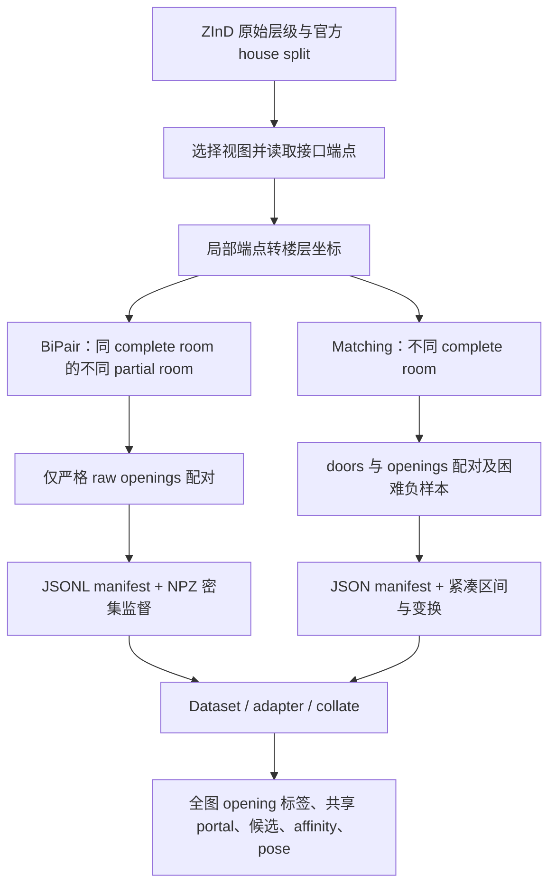
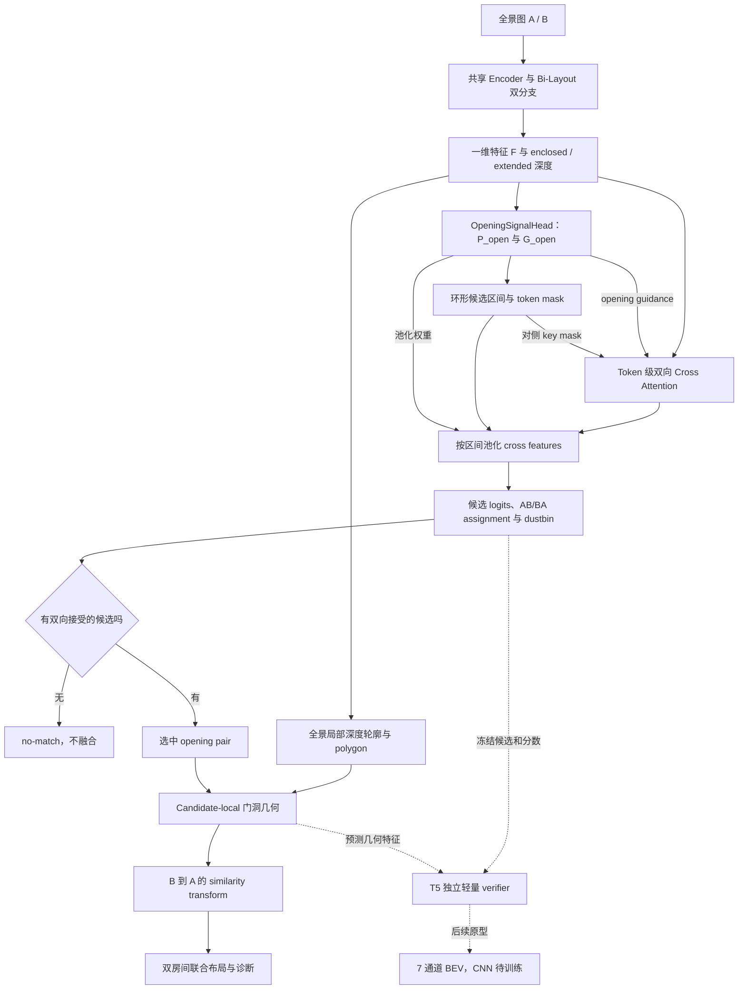

# Bi-Layout 项目总览与学习手册

> 合并更新：2026-09-07。整合用户列出的 6 份 Markdown，依据代码基线 `50a6ae5`、后续本地实现和已有实验产物校正。本文件是统一阅读入口；原文保留为历史资料。本次未重新训练或评估模型。

本项目以单图 Bi-Layout 为基础：先从每张 360° 全景图预测 enclosed 与 extended 两种布局，再从双深度差异和图像特征中寻找可连通开口，在两张图之间匹配同一物理接口，最后估计 B→A 的相对变换并对齐房间布局。

**当前已经跑通 live Bi-Layout、Opening Head、Matcher 的联合训练，以及预测开口驱动的双房间几何融合。** 完整 val 上冻结 T3 的正确匹配率为 27.42%；独立轻量 verifier E1 将正确匹配数从 501 提升到 526。候选召回、跨房屋的选择与拒绝能力仍限制最终效果；BEV CNN 尚未训练，多房间统一重建也仍需继续验证。

## 阅读目录

1. [项目目标、范围与术语](#project)
2. [目录、运行入口与环境](#repository)
3. [两套跨场景数据及标签契约](#datasets)
4. [单图 Bi-Layout 与跨图网络](#architecture)
5. [几何对齐、候选选择和工程输出](#geometry)
6. [训练阶段、监督与损失](#training)
7. [评估指标与证据口径](#metrics)
8. [实验演进：BiPair、首次端到端、T0–T5](#experiments)
9. [构建、运行与复现命令](#commands)
10. [当前瓶颈与尚未完成的工作](#next)
11. [学习路线、文档合并说明](#reading)
12. [完整文件索引：266 项](#file-index)

第一次阅读按 1→3→4→5→6→7→8 建立全局理解；实际运行看第 9 节；查某个文件看第 12 节。

<a id="project"></a>
## 1. 项目目标、范围与术语

### 1.1 从单图布局到跨空间连接

单图布局有标注歧义：看见一个开放接口时，边界可以在接口处闭合，也可以向可见的邻接区域延伸。Bi-Layout 用两个分支分别表达这些布局语义。项目进一步利用二者的差异，预测开口并寻找跨图对应。

“共享开口”包括 door、无门扇的门洞、宽 opening、开放通道等物理接口。几何对齐依赖的是接口两侧的线段及空间关系；具体训练标签覆盖哪些接口，仍由数据集决定。

extended 只表示可见区域的外延，**不保证完整恢复相邻房间**。窄门洞可能只产生局部深度响应；相邻房间的位置需要双侧候选及几何约束，不能由单张 extended 布局直接确定。

### 1.2 三条任务线

| 任务 | 输入与目标 | 数据/入口 | 当前作用 |
| --- | --- | --- | --- |
| 单图 Bi-Layout | 一张全景 → 两套布局和房高比例 | MP3D、ZInD；[main.py](main.py)、[inference.py](inference.py) | 基础网络、单图几何与布局评估。 |
| partial-room 匹配 | 同一 complete room 中不同 partial room 的共享 opening | ZInD-BiPair-v1 | 早期严格数据集、Opening 与 Matcher 模块化训练。 |
| complete-room 匹配 | 不同完整房间之间的 door/opening 连接与拒绝 | ZInD_matching；[端到端训练器](tools/train_zind_end_to_end.py) | 当前 T0–T3、T4/T5 和几何诊断的主要数据线。 |

### 1.3 术语表

| 术语 | 本项目中的含义 |
| --- | --- |
| complete room / partial room | ZInD 的完整房间 / 局部房间层级；两套 pair 数据的配对范围不同。 |
| enclosed / extended | 语义上的闭合布局 / 外延可见布局；当前 ZInD 分支映射见第 4 节。 |
| opening / portal | opening 常指单图全部开口；shared portal 指当前 A/B pair 对应的那个共享接口。 |
| candidate | 从环形 token 区间得到的候选；GT manifest 候选与 predicted 候选的身份、数量可能不同。 |
| guidance | 进入 attention 和池化的开口响应权重；其来源与 candidate 来源是两个独立开关。 |
| dustbin | 每个候选在另一张图中“没有匹配”的额外类别。 |
| teacher-forced | 给 Matcher 使用 GT guidance 或 manifest 候选的诊断设置，必须写明实际来源。 |
| oracle | 使用真实标签替换某环节、估计误差来源或上限的事后实验；不是实际预测。 |
| S3 | 完整 val 几何报告中，正样本被接受且最终选对候选的集合；不代表位姿也正确。 |
| BEV | 从上方观察的平面布局表示，本项目包括 polygon、标量几何特征和栅格原型。 |

**重名约定：** 架构 `M2` 指双布局解码器；几何实验 `candidate-local M2` 指局部门洞拟合方案。v2 候选配置 G0/G1、几何比较 G0/G1/G2 也不是同一组实验。后文始终加上用途说明。

<a id="repository"></a>
## 2. 目录、运行入口与环境

```text
Bi_Layout/
├── main.py / inference.py        单图训练、评估与推理
├── config/ + src/config/         默认配置树与数据集 YAML
├── dataset/                     数据加载、pair 构建和特征缓存适配代码
├── models/                      Bi-Layout、Opening、Matcher、selector
├── loss/ + evaluation/          单图损失与评估；跨图损失也在 matcher/训练工具中
├── preprocessing/               数据过滤、消失点与全景预对齐
├── postprocessing/              Manhattan/Atlanta 与朝向保留拟合
├── utils/                       坐标、几何融合、候选审计、verifier 与 raster
├── tools/                       数据构建、跨图训练、推理、诊断入口
├── tests/                       行为契约与回归测试
├── visualization/               全景边界、平面图、OBJ 与独立 3D 查看器
├── src/dataset/                 实际图片、标签、manifest 和部分缓存
├── checkpoints/                 权重、恢复状态和训练指标
├── experiments/                 实验协议、消融、预检、诊断报告
└── src/output/                  推理结果、几何评估和可视化产物
```

`dataset/` 与 `src/dataset/` 分别是代码和数据；路径配置可能指向项目外的原始 ZInD。权重和大批量产物不会全部随 Git 克隆，读取本地报告时要保留 checkpoint、manifest、配置和 split 的身份信息。

| 入口 | 实际消费的输入 | 用途 |
| --- | --- | --- |
| [main.py](main.py) | 配置、单图 Dataset | 单图训练与 val/test。 |
| [inference.py](inference.py) | 图片 glob、配置、权重 | 单图 JSON/PNG，可选 OBJ。 |
| [train_zind_end_to_end.py](tools/train_zind_end_to_end.py) | 原始双图、matching manifest、teacher cache、初始化权重 | 联合训练或显式 matcher-only 微调。 |
| [debug_cross_scene_flow.py](tools/debug_cross_scene_flow.py) | 模型、双图/样本及运行参数 | 检查 live 特征、开口、匹配和几何表示。 |
| [estimate_cross_scene_layout.py](tools/estimate_cross_scene_layout.py) | 两个预测 layout JSON；可附 extended、matcher evidence、selector | 通用几何候选排序与融合；并非自动加载 T3 的双图网络入口。 |
| [join_room_layouts.py](tools/join_room_layouts.py) | layout JSON + 人工指定两侧 opening | 已知接口的几何拼接。 |
| [evaluate_zind_room_group.py](tools/evaluate_zind_room_group.py) | 固定 train 房间组及模型 | 按预测接受/拒绝进行 pairwise 融合和定性诊断。 |
| [evaluate_zind_portal_geometry_val_full.py](tools/evaluate_zind_portal_geometry_val_full.py) | 完整 val、冻结 T3、固定几何配置 | 一次预测供多条几何分支比较，验证 Matcher parity。 |

原项目环境以 Python 3.8、PyTorch 1.12、torchvision 0.13、CUDA 11.3 为基础，其他依赖见 [requirements.txt](requirements.txt)。这是仓库的历史环境组合，不是通用最新版安装建议；独立 3D 查看器另有 [依赖](visualization/visualizer/requirements.txt) 和 [说明](visualization/visualizer/README.md)。

<a id="datasets"></a>
## 3. 两套跨场景数据及标签契约

### 3.1 共同的生成逻辑

ZInD 的层级为 house → floor → complete_room → partial_room → panorama。两套数据都先按官方 house split 隔离，再利用标注的局部到楼层变换，把接口放入公共坐标比较；确认配对后，回到每张全景的局部坐标生成 256-token 标签。



| 比较项 | ZInD-BiPair-v1 | ZInD_matching |
| --- | --- | --- |
| 配对空间 | 同 complete room、不同 partial room | 不同 complete room、同一楼层 |
| 接口 | `layout_raw.openings` | doors + openings |
| 文件 | `manifests/*_pairs.jsonl` + `labels/*/*.npz` | `train.json` / `val.json` / `test.json` |
| 图片 | 引用原始图片，不复制 | 引用 `dataRoot` 下的原图，不复制 |
| 标签侧重点 | raw/visible 双深度、全部 opening、shared portal、pose、complete layout | 全部候选、共享候选身份、door/opening token 标签与相对变换；密集矩阵按需展开 |
| 训练用途 | 早期冻结特征上的 Opening / Matcher | 域适配和当前完整端到端实验 |

### 3.2 BiPair-v1：严格 partial-opening 数据

视图要求：primary、inside、flat ceiling；raw/visible/complete 三套布局、`floor_plan_transformation`、楼层米制换算和原始图片齐全。正样本来自同一完整房间中不同局部房间的同一 raw opening；负样本来自没有直接 opening 连接的 partial-room pair。

匹配同时满足：中点距离 ≤0.20m、无向方向差 ≤10°、长度相对误差 ≤20%、正反端点最小平均误差 ≤0.25m。原实现见 [zind_bipair_builder.py](dataset/zind_bipair_builder.py)。

历史生成目录为 `/home/feixia/pythonProject/AAAsrk/zind/ZInD-BiPair-v1/`，包含 `dataset_info.json`、manifest、NPZ 和 `statistics/`。文档记录派生数据约 205MB；11,356 个缓存验证通过，house split 泄漏数为 0。

| Split | 正样本 | 困难负样本 | 总数 | 有 pair 的房屋 |
| --- | ---: | ---: | ---: | ---: |
| train | 4612 | 4612 | 9224 | 1101 |
| val | 571 | 571 | 1142 | 133 |
| test | 495 | 495 | 990 | 127 |
| 合计 | 5678 | 5678 | 11356 | 1361 |

训练集共享 opening 的平均端点误差约 0.0599m，三套 split 中同 pair 的 complete layout A/B 重合率约为 1.0。以上是历史数据生成统计，不是模型成绩。

NPZ 标签如下；这些字段“存在”不表示每次实验都启用了对应损失。

| 标签 | 单样本形状 | 语义 |
| --- | --- | --- |
| `depth_enclosed_A/B` | `[256]` | raw/enclosed 深度。 |
| `depth_extended_A/B` | `[256]` | visible/extended 深度。 |
| `extension_depth_A/B` | `[256]` | `max(0, visible-raw)`。 |
| `ratio_A/B` | `[1]` | `(ceiling_height-camera_height)/camera_height`。 |
| `corners_enclosed/extended_A/B` | `[N,2]` | UV 角点。 |
| `opening_mask_all_A/B` | `[256]` | 该视图全部 raw openings。 |
| `portal_mask_A/B` | `[256]` | 当前 pair 的共享 opening；负 pair 为零。 |
| `portal_center/width_A/B` | `[1]` | 环形中心和宽度。 |
| `affinity_gt` | `[256,256]` | 共享 portal masks 的外积。 |
| `T_B_to_A` | `[3,3]` | B 局部坐标到 A 局部坐标的相似变换。 |
| `relative_yaw_gt` | `[1]` | 变换中的相机相对 yaw。 |
| `translation_gt` / `translation_meters_gt` | `[2]` | A 局部坐标平移 / 米制平移。 |
| `relative_scale_gt` | `[1]` | 相对尺度。 |
| `joint_layout_global` | `[N,2]` | complete layout 的楼层坐标 polygon。 |
| `shared_portal_global` | `[2,2]` | 正样本共享 opening 的楼层坐标端点；负样本为空。 |

Opening 监督必须使用 `opening_mask_all_*`。负 pair 没有共享接口，但每张图仍可能有自己的开口。评估按图片去重：历史 val/test 分别为 897/787 张唯一全景。

### 3.3 ZInD_matching：complete-room 数据

生成代码为 [zind_pair_mining.py](dataset/zind_pair_mining.py) 和 [build_zind_matching_dataset.py](tools/build_zind_matching_dataset.py)。每个 partial room 优先选 primary panorama，提取 complete/raw 中可用的 door/opening 标注。

在楼层坐标下比较正反端点平均距离：≤0.06 为正样本匹配条件；同楼层、两侧有接口且最小误差 ≥0.15 才能成为困难负样本；中间区域不作为安全负例。这两个阈值使用代码中的**楼层标注坐标单位**，不能直接加上“米”；BiPair 上述阈值则显式是米制。默认负正比例接近 1:1，无合格负例的楼层不强行补齐。

| Split | 房屋 | 正样本 | 负样本 | 总数 |
| --- | ---: | ---: | ---: | ---: |
| train | 1260 | 14741 | 14584 | 29325 |
| val | 157 | 1827 | 1803 | 3630 |
| test | 158 | 1856 | 1833 | 3689 |
| 合计 | 1575 | 18424 | 18220 | 36644 |

这是 2026-07-16 全量生成记录，缺失标注和缺失图片均记录为 0。构建结果位于 `src/dataset/ZInD_matching/`，含三个 split manifest 与 `summary.json`。

| Manifest 路径/字段 | 含义 |
| --- | --- |
| 顶层 `dataRoot` / `tokenCount` / `pairs` | 原始图片根目录、token 数和样本列表。 |
| `pairs[].id`、`scene_id`、`floor_id` | pair 身份、房屋与楼层。 |
| `image_a/b` | 相对 dataRoot 的图片路径。 |
| `candidates_a/b` | 全部接口，包含 type、index、localEndpoints、globalEndpoints、tokenInterval。 |
| `supervision.is_match` | 是否共享接口。 |
| `supervision.target_candidate_a/b` | 真实候选索引；负 pair 为 -1。 |
| `supervision.relative_transform_b_to_a` | 3×3 GT similarity matrix。 |
| `supervision.relative_yaw_radians` | 从 GT 变换提取的相机 yaw。 |
| `supervision.pose_valid` | 位姿监督有效性；正样本有效。 |

完整的 256×256 affinity 不逐条存入 manifest，由 DataLoader 根据共享区间按需展开。

### 3.4 一个真实样本如何成为监督

已核对 `train.json` 中的 `0919_floor_01_pano_41_pano_29_3`：A 是 complete_room_01 / kitchen / pano_41，B 是 complete_room_06 / bedroom / pano_29。A 有 5 个候选，B 有 4 个候选。

| A 候选索引 | 类型 | 环形 token 区间 | 当前 pair 真值 |
| ---: | --- | --- | --- |
| 0 | door | `[247,1]`，跨接缝 | 否 |
| 1 | door | `[143,162]` | 否 |
| 2 | door | `[107,117]` | 是，对应 B 候选 1 |
| 3 | door | `[155,160]` | 否 |
| 4 | door | `[135,143]` | 否 |

A 真值门局部端点约为 `[[0.5024,1.9959],[1.0023,1.8260]]`，楼层端点约为 `[[0.0112,-1.8036],[0.2246,-1.8036]]`；B 真值门区间为 `[97,109]`，楼层端点约为 `[[0.0041,-1.7669],[0.2241,-1.7669]]`。端点平均误差 0.0370 满足正样本条件。

```text
is_match = true
target_candidate_pair = [2, 1]
opening_target_A = A 全部 5 个候选区间的并集
opening_target_B = B 全部 4 个候选区间的并集
affinity_target_AB = A[107..117] × B[97..109]，共 11×13=143 个正 token 对
relative_yaw_radians ≈ 2.8274 rad = 162.0°，这是 GT 相机 yaw
pose_valid = true
```

该样本的 GT B→A 变换约为：

```text
[[-0.95104665, -0.30904734, 1.97987342],
 [ 0.30904734, -0.95104665, 2.89796359],
 [ 0.0,         0.0,        1.0       ]]
```

负样本仍保留各自全部 opening 标签，但共享 affinity 为零、候选真值为 `[-1,-1]`、`pose_valid=false`。

### 3.5 Batch、候选身份与 feature cache

[PanoramaPairDataset / ZInDPairDataset](dataset/panorama_pair_dataset.py) 的常用 batch 接口如下；[BiPair adapter](dataset/zind_bipair_adapter.py) 将其他命名转到 [PairBatch](models/cross_scene_contracts.py)。

| 字段 | Batch 形状 | 说明 |
| --- | --- | --- |
| `image_A/B` | `[B,3,H,W]` | 双图，当前主配置为 512×1024。 |
| `candidate_masks_A/B` | `[B,Kmax,256]` | 候选区间 mask。 |
| `candidate_valid_A/B` | `[B,Kmax]` | 排除 padding。 |
| `opening_target_A/B` | `[B,256]` | 全部开口标签。 |
| `affinity_target_AB` | `[B,256,256]` | 当前共享 portal 的 token 对应。 |
| `is_match` / `pose_valid` | `[B]` | 正负标签 / 位姿监督掩码。 |
| `target_candidate_pair` | `[B,2]` | manifest 候选的对应索引。 |
| `relative_transform_B_to_A` | `[B,3,3]` | GT B→A 变换。 |
| `relative_yaw_radians` | `[B]` | GT 相机 yaw，不直接作为 portal shift 标签。 |

规范化 `OpeningCandidates` 中，mask 为 bool，ID/interval 为 long；padding 的 valid=false、ID=-1、interval=`[-1,-1]`。区间端点包含在内，`start>end` 表示跨 seam。

预测候选会因阈值、split、merge、dedup、cap 改变数量和顺序，所以不能把 manifest 的索引直接当成预测候选索引。训练时需要按环形区间 IoU 重映射目标；当前主实验 target IoU 为 0.30。

[cache_zind_matching_features.py](tools/cache_zind_matching_features.py) 按唯一视图缓存 Bi-Layout 特征与深度，[zind_matching_feature_dataset.py](dataset/zind_matching_feature_dataset.py) 再关联 pair 与候选。缓存用于冻结特征训练，也可作为端到端训练的低权重 teacher；使用 cache 不代表 live 主干被冻结，具体取决于训练阶段。

<a id="architecture"></a>
## 4. 单图 Bi-Layout 与跨图网络

<a id="single-view"></a>
### 4.1 单图结构与分支语义

[Bi_Layout.forward](models/bi_layout.py) 共享图像编码器，使用两套 learned context/query 区分布局；[HorizonNetFeatureExtractor](models/modules/horizon_net_feature_extractor.py) 通过 CNN、左右环形 padding 和高度压缩，将图像转为 256 个水平 tokens；[Share_Feature_Guidance_Module](models/modules/share_feature_guidance_module.py) 解码两套布局特征。

当前 [zind_all.yaml](src/config/zind_all.yaml) 的特征维度 C=512，构造器默认值可能为 1024，必须以实际配置为准。

| 返回字段 | 当前 ZInD 语义 | 形状 |
| --- | --- | --- |
| `depth` | visible / extended | `[B,256]` |
| `new_depth` | raw / enclosed | `[B,256]` |
| `ratio` | 两分支房高比例预测的平均 | `[B,1]` |
| `layout_feature` | Transformer 前的序列特征，当前跨图主线使用它 | `[B,256,C]` |
| `enc_feature` / `ext_feature` | 两条解码支路的特征返回键；语义仍须结合当前标签顺序 | `[B,256,C]` |
| `corner_heat_map` | 可选角点热图 | `[B,256]` |

`resolve_enclosed_extended_depth(..., "extended_first")` 显式把 `new_depth` 取为 enclosed，把 `depth` 取为 extended。旧文档中直接将 origin 等同 enclosed、new 等同 extended 的写法不适用于当前 ZInD 权重。

| 配置开关 | 实际作用 | 当前 ZInD 配置 |
| --- | --- | --- |
| `use_same_head` | true 复用输出 heads；false 两分支各有输出 heads | false |
| `share_TF` | true 复用 Transformer；false 创建第二个 Transformer | true |
| `two_conv_out` | true 使用两套高度压缩；图像 encoder 仍共享 | false |
| `output_number` | 1 或 2；双高度压缩要求 2 且为卷积 backbone | 2 |

权重必须与结构开关匹配，不能把改变开关当成无需重训的普通配置切换。相关检查见 [test_bi_layout_config.py](tests/test_bi_layout_config.py)。

### 4.2 整体数据流：按实际实现排列



M3 的几何转换可与 Opening/Matcher 的 token 路径并行；当前 OpeningSignalHead 不需要先读取 walls，跨图网络也不是必须先做 Manhattan 后处理。旧图“先候选池化，再候选级 Cross Attention”已在此校正为真实的 token attention → cross-feature pooling。

### 4.3 保留 M0–M9 名称，但分清其职责和状态

| 模块 | 职责与主要输入输出 | 代码 | 当前状态 |
| --- | --- | --- | --- |
| M0 Pair Input | manifest / 图片 → 双图、标签、候选与元数据 | [pair dataset](dataset/panorama_pair_dataset.py)、[联合训练 Dataset](tools/train_zind_end_to_end.py) | 已实现。 |
| M1 Shared Encoder | `[B,3,512,1024]` → `[B,256,C]` 特征 | [feature extractor](models/modules/horizon_net_feature_extractor.py) | 已有单图权重，参与 joint 微调。 |
| M2 Dual Decoder | context/query → enclosed、extended、ratio | [Bi-Layout](models/bi_layout.py) | 已实现，参与 joint 微调。 |
| M3 Geometry Converter | depth → UV/XYZ、局部轮廓、polygon、walls 与有效性 | [conversion](utils/conversion.py)、[post-process](postprocessing/post_process.py) | 已实现；需保留坐标与 heading。 |
| M4 Opening | 特征+双深度 → opening probability、expansion depth、区间 | [OpeningSignalHead](models/cross_scene_matcher.py) | BiPair、matching 训练与 joint 路径均已有。 |
| M5 Matcher | token features+guidance+候选 → affinity、assignment、匹配/拒绝 | [Matcher](models/cross_scene_matcher.py) | 已训练，后续基线为 T3。 |
| M6 Opening Pair / Geometry | 整理候选对及几何证据；选中区间到显式端点 | [estimator](utils/cross_scene_estimator.py)、[candidate-local 几何](utils/candidate_local_portal_geometry.py) | 解析/离散实现，入口不同路由不同。 |
| M7 Relative Pose | 双侧门洞端点 → B→A 的 yaw、translation、scale | [joint_layout](utils/joint_layout.py) | 解析几何；不是已训练独立 pose head。 |
| M8 Selector | 几何+特征代价 → 候选排序 | [estimator](utils/cross_scene_estimator.py)、[GeometryConsistencySelector](models/geometry_consistency_selector.py) | 确定性排序已有；该 learned selector 没有已确认的正式训练结果。T5 E1 属于另一条预检实现。 |
| M9 Joint Output | 变换、边界、共享接口、诊断 → JSON / SVG / PNG | [pipeline](utils/cross_scene_pipeline.py)、[logger](utils/cross_scene_logger.py) | 双房间工程输出已有。 |

### 4.4 Opening Head：深度差异与可学习响应

代码先将深度取绝对值并钳制到正数，构造三个几何通道：

```text
delta = relu(D_ext - D_enc)
relative_delta = clamp(delta / D_enc, max=10)
log_ratio = clamp(relu(log(D_ext / D_enc)), max=4)

concat(LayerNorm(F), delta, relative_delta, log_ratio)
  → 1×1 Conv → 环形 padding + Conv → opening_logits / depth_scale_logits

P_open = sigmoid(learned_opening_logits + geometry_prior_logits)
G_open = delta × P_open × exp(tanh(depth_scale_logits))
```

geometry prior 由每视图 relative peak 与 magnitude gate 组合；细节以 [OpeningSignalHead](models/cross_scene_matcher.py) 为准。`G_open` 是局部外延深度证据，不是邻接完整房间形状；当前头没有独立的语义门类别预测，也不直接返回旧设计表中的逐 token opening-width head。

候选生成分两类：`legacy` 按概率阈值提取环形连通区间；实验性的 `recall_topk` 再使用峰值、扩张、去重与数量上限。无学习证据时，通用 JSON 工程管线还可从深度差异或墙中心 fallback 生成候选，不能把 fallback 当成网络召回成功。

### 4.5 Matcher：token attention、池化与双向拒绝

`OpeningGuidedCrossAttentionMatcher.forward` 在 256-token 特征上投影 Q/K/V，并对 key 侧加入 `log(P_open)` 偏置和候选 token mask：A 查询 B，B 查询 A。残差、投影与前馈层得到 `cross_feature_A/B`。

随后 `OpeningTokenPooler` 才按每个候选的 mask 与 opening guidance 加权池化 cross features，得到 `[B,K_A,C]` 与 `[B,K_B,C]`。归一化的 query/key 投影点积经 temperature 缩放，形成候选 logits。

| 输出 | 形状 | 含义 |
| --- | --- | --- |
| `Aff_AB/BA` | `[B,256,256]` | 各方向 token attention 的多头平均。 |
| `S_A/S_B` | `[B,256]` | guidance 与跨图 attention 聚合的共享响应。 |
| `E_A_open/E_B_open` | `[B,K_A/B,C]` | 对 cross features 池化的候选特征。 |
| `candidate_assignment_AB` | `[B,K_A+1,K_B+1]` | A→B 逐行 softmax，含 dustbin。 |
| `candidate_assignment_BA` | `[B,K_B+1,K_A+1]` | B→A 逐行 softmax，含 dustbin。 |
| `candidate_pair_score` | `[B,K_A,K_B]` | 双向 affinity 与两侧候选开口置信度的组合。 |
| `best_candidate_pair` | `[B,2]` | 最佳双向接受 pair；无匹配时 `[-1,-1]`。 |
| `pair_match_probability` / `pair_no_match_probability` | `[B]` | pair 汇总分数；它们不是互补的二分类 softmax。 |
| `relative_token_shift_radians` | `[B]` | 共享 portal 的 B-token−A-token 环形位移。 |

候选分数和接受条件可概括为：

```text
mutual_affinity(i,j) = sqrt(Assign_AB(i,j) × Assign_BA(j,i))
opening_confidence(i,j) = sqrt(mean_guidance_A(i) × mean_guidance_B(j))
score(i,j) = mutual_affinity(i,j) × opening_confidence(i,j)

accepted(i,j) = valid(i,j)
             and Assign_AB(i,j) > Assign_AB(i,dustbin)
             and Assign_BA(j,i) > Assign_BA(j,dustbin)
best = accepted 集合中的最高 score；集合为空则 no-match
```

因此 raw real-real score 的第一名，不一定是最终被接受的第一名。`pair_match_probability` 是最大 real-real score，`pair_no_match_probability` 从双侧平均拒绝概率聚合；两者不保证和为 1，也不能随意用一条 0.5 阈值代替正式双向 assignment 决策。

portal shift 不是 camera yaw：相机中心变化时，同一门洞在全景中的经度位移同时包含视点影响。历史返回键 `relative_yaw_radians` 在 Matcher 中仅是 shift 的兼容别名；manifest 中同名字段则是真实相机 yaw，必须按来源区分。

<a id="geometry"></a>
## 5. 几何对齐、候选选择和工程输出

### 5.1 坐标、单位与变换方向

| 坐标/对象 | 约定 |
| --- | --- |
| Bi 平面 | 水平 x/z；经度使用 `atan2(x,z)`。 |
| ZInD panorama-local | x/y；接口投影采用 Bi 水平 `[-x,y]`，所以存在 x 镜像约定。 |
| ZInD floor | 通过每张全景的 `floor_plan_transformation` 从局部变换到楼层。 |
| `T_B_to_A` | `p_A = T_B_to_A @ p_B`，这里 A 是参考局部坐标，不是天然的绝对世界坐标。 |
| 米制平移误差 | 局部平移误差 × A 的 local-to-floor scale × 楼层 `scale_meters_per_coordinate`。 |

```text
M_A = panorama A 的 local-to-floor similarity matrix
M_B = panorama B 的 local-to-floor similarity matrix
T_B_to_A = inverse(M_A) @ M_B

如果 C_i 是 canonical → panorama-local：
T_local_B_to_A = C_A @ T_canonical_B_to_A @ inverse(C_B)
```

不能仅凭 JSON 中的 `world` 或 `meters` 字样判断实际单位。旧 `build_joint_layout` 保留通用 `floorplan-xz-meters` 标签；ZInD candidate-local 路径显式使用 panorama-A local xy，并在评估时附加米制换算。完整历史审计见 [coordinate_contract.md](src/output/zind_room_group_debug/t3_geometry_oracle_0665_floor03/coordinate_contract.md)。

### 5.2 从深度到门洞：为什么要保留朝向

单图深度可经 [conversion](utils/conversion.py) 转为局部轮廓，再做 Manhattan/Atlanta 拟合。旧三房间案例的失效点是：固定轴 Manhattan polygon 被当作仍保留全景 heading 的局部 polygon，导致 token 射线投到错误墙段。

当前 [post_process.py](postprocessing/post_process.py) 提供 heading 估计与 `frame_preserving_manhattan`，围绕预测朝向拟合后还原回局部坐标；[prediction_to_layout](tools/debug_cross_scene_flow.py) 保留多种几何表示。对旧文件缺失的 pre-Manhattan 轮廓、raw depth 或 heading，不能用 GT 恢复后冒充原始预测。

candidate-local M2 进一步从**选中的预测 token 区间和局部 raw 深度轮廓**估计门洞端点，减少对全局墙索引的依赖：扩展局部上下文 → RANSAC/TLS 直线拟合 → 区间边界射线求交 → 几何有效性和支持质量诊断。它只解释选中的接口，不修改 Matcher 排名或使用 GT 选门。

实现与不变量见 [candidate_local_portal_geometry.py](utils/candidate_local_portal_geometry.py) 和 [对应测试](tests/test_candidate_local_portal_geometry.py)。Hard failure 与 soft quality flag 应分别统计，soft flag 不自动等于正式拒绝规则。

### 5.3 从双侧端点求相对位姿

[joint_layout.py](utils/joint_layout.py) 提供两条入口：

- `build_joint_layout(layout_a, layout_b, DoorSpec_a, DoorSpec_b)`：由墙编号和区间比例取端点。
- `build_joint_layout_from_endpoints(...)`：直接消费显式局部门洞端点，可用于 candidate-local M2。

对每一组 same/reversed 端点对应，拟合 `p_A = s R p_B + t`；scale 可从门洞宽度比估计，也可按配置保持原尺度。当前底层函数按两个房间质心的开口侧向乘积选择映射；更广泛的 overlap 等排序属于外层候选评估。

width-ratio scale 对理想线段符合 Sim(2)，但端点噪声会放大平移误差。大量样本接近 unit-scale，仍存在少数非单位标签；不能把某个 unit-scale train 个例或事后 scale oracle 推广成所有样本的默认规则。

### 5.4 两条推理路线与 selector 的边界

| 路线 | 决策逻辑 | 使用目的 |
| --- | --- | --- |
| 通用 JSON 工程管线 | 提取深度/墙中心候选 → 枚举开口对 → 几何与可选 matcher evidence 打分 → NMS/top-k → 可选 selector | 调试、自定义布局融合、工程兜底。 |
| 冻结 T3 的 room-group / val 路线 | predicted guidance/candidates → learned 双向 dustbin 决策 → 接受后调用固定几何；GT 后验附加 | 测量真实匹配与条件几何效果。 |
| T5 verifier 预检 | 冻结 T3/M2 的 Top-N 候选 → 预测特征 → 轻量 rank/拒绝模型 | 独立实验，尚未合入所有正式入口。 |

通用排序可使用开口宽度、墙长、尺度、面积/重叠、质心侧向关系、opening confidence 和 matcher feature score。[GeometryConsistencySelector](models/geometry_consistency_selector.py) 是可学习候选分布接口，存在代码和损失不等于已有训练好的部署模型，也不能用 T5 E1 的结果替它背书。

### 5.5 输出如何阅读

`estimate_cross_scene_layout.py --name NAME` 写出 `NAME_candidates.json`、`NAME_best_joint.json`、`NAME_best_joint.svg`，可用时输出 PNG，并记录评估日志。

| 输出字段 | 含义与限制 |
| --- | --- |
| `rooms` / `boundary` / `cameraCenter` | A 保持参考坐标，B 的边界与相机中心经过相对变换。 |
| `sharedOpening` | 两侧接口、局部/共同坐标端点与宽度；`sharedDoor` 是兼容字段。 |
| `alignment.roomBToWorld` | 该输出参考系中的 B 变换；需结合 coordinateSystem 阅读。 |
| `roomBScale` / `endpointMapping` | 尺度和 same/reversed 映射。 |
| `diagnostics` / candidate metrics | 有效性、排序与失败原因。 |
| candidate `confidence` | 通用管线保留候选上的相对 softmax；不是已经校准的真实正确率。 |

候选容器的 `formatVersion=2` 与底层 joint JSON 的版本可能不同，不能用旧设计示意的单一 schema 替代实际导出字段。负样本拒绝时应保留 no-match 证据，独立 polygon 图本身不证明拒绝成功。

<a id="training"></a>
## 6. 训练阶段、监督与损失

### 6.1 从模块化训练到 live 联合微调

| 阶段 | 可训练部分 | 数据与入口 | cache 的用途 |
| --- | --- | --- | --- |
| 单图训练 | Bi-Layout encoder / decoder / heads | [main.py](main.py) | 常规 Dataset，不是跨图 feature cache 训练。 |
| 单独 Opening | OpeningSignalHead | [BiPair Opening](tools/train_zind_opening_head.py)、[matching Opening](tools/train_zind_matching_opening_head.py) | 冻结主干特征与深度。 |
| 模块化 Matcher | 依该训练器阶段配置的 Matcher 参数 | [BiPair Matcher](tools/train_zind_cross_scene_matcher.py)、[matching Matcher](tools/train_zind_matching_matcher.py) | 冻结的单图特征回连 pair。 |
| `training_stage=joint` | live Bi-Layout、Opening、Matcher | [train_zind_end_to_end.py](tools/train_zind_end_to_end.py) | feature/depth anchor teacher，不替代 live forward。 |
| `matcher_only_finetune` | Matcher，排除冻结 Opening | 同一训练器，要求 T3 初始化权重 | 上游 frozen+eval，反传目标是 matching loss。 |
| T5 lightweight verifier | 独立 Logistic / MLP | [Phase A](tools/preflight_zind_bev_verifier.py)、[Phase B](tools/run_zind_bev_verifier_phase_b.py) | T3/M2 冻结 artifact；没有重新训练主干或 BEV CNN。 |

联合训练路径：`JointZInDMatchingDataset` 读取图片与 teacher → `live_layout` 合并 A/B 为一次主干 batch → `_candidate_inputs` 和 `_opening_guidance_inputs` 决定来源 → `forward_matcher` → `_forward_loss` → backward / optimizer。

图像沿宽度环形旋转时，A/B 各自的 token 标签、候选 masks、teacher 和 affinity 两个轴必须同步移动。默认一 token 对应 4 个图像像素。

### 6.2 guidance 与 candidates 的独立来源

| 设置 | 能说明什么 |
| --- | --- |
| predicted guidance + predicted candidates | 实际开口预测驱动的跨图结果。 |
| GT guidance + predicted candidates | 固定候选生成误差，隔离 guidance 影响。 |
| predicted guidance + GT candidates | 固定正确候选输入，检查 Matcher 的条件能力和分布差异。 |
| GT guidance + GT candidates | Teacher-forced 诊断；不是自动系统结果。 |

首次完整 joint 训练及 v2 协议为：第 1 轮 GT guidance/candidates；第 2 轮 mixed guidance + predicted candidates；第 3 轮起 predicted/predicted。早期 BiPair Matcher 的 12 轮实验使用过 4/4/4 的 guidance 调度，两者不能混用。

T4 的 `train_gt_candidate_injection` 是额外的训练期补目标措施，eval 禁用；它提高 train target-present 覆盖率，也可能造成与 predicted-only val 的分布差异。

### 6.3 实际训练损失与旧设计损失分开看

单图训练的布局、比例、梯度/角点等损失由 [criterion.py](models/other/criterion.py)、[loss/](loss) 和 YAML 组合。当前 joint 微调不能简单写成“把所有 M0–M9 loss 相加”；其主干稳定项主要是 feature/depth teacher anchor。

实际 `opening_detection_loss` 使用加权 BCE 与 Tversky，默认 pos_weight=2.5、Tversky 权重 0.5、alpha=0.3、beta=0.7：

```text
L_open = BCEWithLogits(P_logits, opening_all; pos_weight)
       + 0.5 × (1 - Tversky(P, opening_all))

L_joint = L_matching
        + w_open × mean(L_open_A, L_open_B)
        + w_feature × L_feature_anchor
        + w_depth × L_depth_anchor
```

`L_matching` 由训练器的 `_matching_loss_bundle` 和 [matcher 训练工具](tools/train_zind_cross_scene_matcher.py) 组织，包括下列按权重启用的项：

| 项 | 监督对象 | 关键约束 |
| --- | --- | --- |
| candidate assignment | 双向候选对应或 dustbin | 要用重映射后的 predicted 目标和 valid mask。 |
| bidirectional consistency | 两个方向的候选关系 | 真负例的 dustbin 监督仍需保留。 |
| token affinity | 共享 portal 的 token 对应 | 由共享 mask 构建，不能用全部 opening 外积替代。 |
| shared response | 两侧共享区域 | 是否启用由实验权重决定；v2 协议为 0。 |
| portal shift | 共享 portal 的环形 B−A 位移 | 不使用 GT 相机 yaw 代替。 |
| listwise ranking | 有效 real-real 候选的正确排序 | T2/T3 开启；有效 pair 与有限梯度必须检查。 |
| positive dustbin margin | 正样本正确候选超过双向 dustbin 的 margin | T4 探索项，只对有效 target 生效。 |

通用 `opening_matching_loss` 还提供 expansion SmoothL1 等接口，`relative_pose_loss` 与 `geometry_selector_loss` 也存在；但**接口可用不等于 T3 正式训练消费了这些损失**。M6–M9 的离散/解析几何没有纳入该 joint 反传链路。

### 6.4 missing target、padding 与 T0–T3 因子

`legacy_dustbin` 会让缺少正确预测候选的正样本继续产生无匹配 assignment 监督；`mask_positive` 屏蔽这类样本对应的 candidate assignment 贡献，避免把“候选没找到”教成“两个空间没有连接”。真负例仍正常学习拒绝。

T0/T1 关闭 listwise ranking，T2/T3 权重为 0.1；T1/T3 使用 mask_positive，T0/T2 使用 legacy。候选分数中的平方根必须排除 padding 零乘积的非有限反传问题；该修复与 source 解耦见 [test_zind_end_to_end_candidate_fixes.py](tests/test_zind_end_to_end_candidate_fixes.py)。

### 6.5 训练稳定性与参数身份

历史首次 joint 运行使用 RTX 4060 Ti 16GB、FP32、batch=4、LR 为 Bi-Layout 2e-6 / Opening 1e-5 / Matcher 3e-5；最大 24 轮、patience=6、cosine 最低 LR 为初始的 10%。实际完成 15 轮，最佳为显示第 9 轮，GPU 运行约 28.35 小时，batch=4 梯度预检峰值 10.95GiB。

当时 FP16 预检出现上游非有限梯度，PyTorch 1.12 的该骨干双线性上采样不支持 CUDA BF16，因此正式运行采用 FP32。应根据真实环境和预检结果选择精度，不能只凭某个 CLI help 的简短描述认定 AMP 已验证稳定。

checkpoint 应与分支配置、Opening 阈值、feature schema、manifest/cache 和训练阶段匹配。[opening_checkpoint.py](utils/opening_checkpoint.py) 与 [matcher_checkpoint.py](utils/matcher_checkpoint.py) 提供严格加载；resume 权重与仅初始化 best 权重用途不同。

<a id="metrics"></a>
## 7. 评估指标与证据口径

### 7.1 从开口到最终布局逐层评估

| 指标 | 分母/对象 | 不能替代的指标 |
| --- | --- | --- |
| 单图 2D/3D IoU | 单图布局与 GT；包括分支/消歧评估 | 跨图匹配或联合布局效果。 |
| Opening token P/R/F1/AP | token；独立单图评估按 panorama 去重 | 完整 opening 区间覆盖率。 |
| Interval Recall@IoU | GT 环形 opening 区间 | 正 pair 两侧同时召回。 |
| Positive candidate recall | 正 pair 中存在 IoU 达标真实候选对的比例 | 最终被接受且选对的比例。 |
| Positive acceptance | 正 pair 被判为有连接 | 被接受的具体候选是否正确。 |
| Pure ranking Top-k / MRR | target-present 的 real-real 候选排序 | dustbin-aware 最终选择。 |
| Conditional Top-1 | target-present 正 pair 中最终接受且选对 | 全部正样本端到端成功。 |
| End-to-end Top-1 | 全部正 pair 中最终接受且选对，即 S3/positives | 位姿成功或联合 IoU。 |
| Negative rejection | 全部负 pair 中正确拒绝 | 正样本召回。 |
| Yaw / translation / log-scale error | 指定几何有效集合 | 若只看 S3，不能代表整体成功率。 |
| Joint BEV IoU / valid fusion | 对齐布局与 GT，需注明 raw/frame 表示及有效数 | 开口或 Matcher 的单独能力。 |

`Conditional Top-k` 的定义还应结合各报告读取；历史 teacher-forced、pure ranking 与含拒绝的 Top-1 不可只凭同名列拼表。

```text
E2E_Top1 = positive_candidate_recall × conditional_Top1
Balanced = (E2E_Top1 + negative_rejection) / 2
Harmonic = 2 × E2E_Top1 × negative_rejection / (E2E_Top1 + negative_rejection)
```

Harmonic 是系统正负表现的调和平均，不是 Opening F1。定义和 T3 指标 parity 可查 [完整 val 评估器](tools/evaluate_zind_portal_geometry_val_full.py)。

### 7.2 比较实验前固定口径

每张结果表都应注明：数据集、split 与 house 划分、checkpoint/配置、guidance/candidate 来源、是否使用 GT/oracle、分母和有效样本数、接受规则。val 诊断不替代最终 test；train 三房间示例不代表泛化。

阈值也有不同对象：BiPair 深度差异先验历史为 0.12；BiPair 已训练 Opening Head 为 0.375；matching/T3 为 0.47；通用 JSON 规则管线默认 0.25；T4 扩张边界也用到 0.12。它们不是一个参数在所有入口里的通用最优值。

几何 oracle、GT 注入以及事后挑选的成功案例应显式注明。已保存报告中的运行状态和测试通过数是当时记录，本次只核对文档与产物，不把旧记录当成本轮运行结果。

<a id="experiments"></a>
## 8. 实验演进：BiPair、首次端到端、T0–T5

### 8.1 BiPair：数据、Opening 和模块化 Matcher

早期数据验证后已经继续完成 Opening 和 Matcher 训练，因此原 BiPair 文档末尾“还没有开始训练”的表述只适用于当时的数据准备阶段。

| 实验 | 数据与口径 | 历史结果 |
| --- | --- | --- |
| GT 双深度 opening 先验 | BiPair test，val 固定阈值 0.12 | Token P/R/F1=93.98%/88.32%/91.06%，区间 Recall@IoU0.3=88.34%。 |
| Bi-Layout 预测双深度先验 | 同一 BiPair test，阈值 0.12 | Token P/R/F1=76.97%/78.92%/77.93%，区间 Recall=80.89%。 |
| 已训练 Opening Head | BiPair test 的 787 张唯一 panorama，val 阈值 0.375 | Token Recall=88.08%，F1=83.02%，区间 Recall=86.23%；历史最佳 epoch 13。 |
| 已训练 Matcher | BiPair predicted-opening val，实际训练/验证读取 9,094/1,134 pairs | Candidate recall=77.44%，E2E Top-1=34.28%，negative rejection=85.46%，Balanced=59.87%；12 轮训练，最佳显示第 11 轮。 |
| 跨完整房间小样本诊断 | 旧 BiPair checkpoint 在 matching 的 8 pairs 上运行 | 工程执行 8/8 完成，但 Matcher Top-1=0/8，5/8 使用 fallback；只能说明存在明显域差距。 |

BiPair 生成规模 9,224/1,142 与该 Matcher 实际运行的 9,094/1,134 是不同统计口径。应查 manifest/cache 筛选记录，不能擅自把二者互相覆盖。Matcher 数值已对照 [best_metrics.json](checkpoints/Cross_Scene_Matcher/zind_bipair_v1/best_metrics.json)；Opening 和早期域差距为原架构文档记录的历史结果。

### 8.2 首次 matching 端到端：2026-08-04 报告

这次运行验证了 opening/matching loss 可反传到 Bi-Layout CNN、Transformer 和深度 heads。配置及 15 轮早停过程见第 6.5 节。

| predicted-opening 指标 | 历史 best val | 历史 best test |
| --- | ---: | ---: |
| Opening token precision | — | 86.82% |
| Opening token recall | — | 92.26% |
| Opening token F1 | 88.69% | 89.46% |
| Positive candidate recall | 58.89% | 58.19% |
| Conditional Top-1 | — | 44.07% |
| Conditional Top-3 | — | 91.02% |
| End-to-end Top-1 | 25.40% | 25.65% |
| Negative rejection | 93.73% | 92.96% |
| Harmonic | 0.3997 | 0.4020 |
| Balanced | 0.5956 | 0.5930 |
| Mean portal-shift error | — | 65.11° |

Teacher-forced manifest 候选的历史 test Top-1=27.96%、negative rejection=93.29%、Harmonic=0.4303、Balanced=0.6063；这一行属于诊断，不是预测候选系统成绩。

同次报告的模块化 Matcher test 对照为 candidate recall=57.60%、E2E Top-1=23.38%、negative rejection=92.91%、Harmonic=0.3736、Balanced=0.5815。联合微调有改善，但没有消除“候选覆盖不全”和“正确候选未被最终接受/选中”的连续瓶颈。原始结果可查 [test_metrics.json](checkpoints/End_To_End/zind_matching_v1/test_metrics.json) 和 [best_metrics.json](checkpoints/End_To_End/zind_matching_v1/best_metrics.json)。

历史权重身份由原训练报告记录，本轮没有重新计算大权重哈希：

| 产物 | 大小 | 报告中的 SHA-256 | 用途 |
| --- | ---: | --- | --- |
| `checkpoints/End_To_End/zind_matching_v1/best.pt` | 418,835,381 bytes | `9406f52e209ffb7645b1187dcf21097e8ea0d924685c1521d74657bd6c7de2f8` | 最佳统一网络权重。 |
| `checkpoints/End_To_End/zind_matching_v1/last.pt` | 1,255,777,484 bytes | `49fc6133b09f11593d6763a901d3a7f8f87a75c18dc39f6c087a687596925339` | 含优化器/调度器等恢复状态。 |
| `checkpoints/End_To_End/zind_e2e_v2/g0_seed123/T3/best.pt` | 418,836,277 bytes | `ca083dbbc5a05d738dad36404ad708c623c272aef7a64398b4de3a793278cc5d` | 后续完整 val、M2、T4/T5 冻结基线。 |

### 8.3 v2 preflight 与完整 T0–T3 消融

[v2 preflight](experiments/zind_e2e_v2/preflight/ZInD_v2_preflight.md) 验证了历史 forward/loss 兼容性、missing-positive mask、源开关解耦及 padding/ranking 的有限梯度。有限阈值扫描选择的候选 G1=0.55 / min width 2，将历史 val candidate recall 从 58.8944% 提至 60.0985%，但 E2E Top-1 从 25.3968% 变成 25.3421%；提高候选召回并没有自动变成系统收益。

随后完整消融使用 [G0 / seed123 协议](experiments/zind_e2e_v2/full_ablation_g0_seed123/run_manifest.json)：threshold=0.47、min width=2、每侧 max candidates=12、target IoU=0.30。下表来自各组 `best_metrics.json → validation.predicted_openings`，分母为完整 val 的 1,827 positives / 1,803 negatives。

| 组别 | missing-positive assignment 策略 | Ranking 权重 | 候选召回 | 端到端 Top-1 | 负样本拒绝 | Harmonic | 指标文件 |
| --- | --- | ---: | ---: | ---: | ---: | ---: | --- |
| T0 | `legacy_dustbin` | 0.0 | 59.22% | 25.23% | 93.68% | 0.397565 | [T0](checkpoints/End_To_End/zind_e2e_v2/g0_seed123/T0/best_metrics.json) |
| T1 | `mask_positive` | 0.0 | 58.29% | 26.87% | 93.07% | 0.417060 | [T1](checkpoints/End_To_End/zind_e2e_v2/g0_seed123/T1/best_metrics.json) |
| T2 | `legacy_dustbin` | 0.1 | 59.22% | 25.29% | 93.79% | 0.398345 | [T2](checkpoints/End_To_End/zind_e2e_v2/g0_seed123/T2/best_metrics.json) |
| T3 | `mask_positive` | 0.1 | 59.11% | 27.42% | 92.79% | 0.423333 | [T3](checkpoints/End_To_End/zind_e2e_v2/g0_seed123/T3/best_metrics.json) |

这支持 mask_positive 在该单 seed 实验中的作用，T3 为后续诊断基线；不能将本表 val 的 27.42% 与上一节历史 test 的 25.65% 相减后声称测试集提升。

[training_status.json](experiments/zind_e2e_v2/full_ablation_g0_seed123/training_status.json) 停留在 2026-08-10 的 T0 running / T1–T3 pending，是历史快照；后续已有四组 best 指标。不能以此判断当前仍有训练进程运行。

### 8.4 冻结 T3 + candidate-local M2：从个例到完整 val

三房间 train oracle 首先定位了固定轴 Manhattan 的 frame/wall 映射问题；局部门洞审计比较不同方案后，candidate-local M2 进入 smoke 和 full-val 评估。报告分别见 [坐标/几何 oracle](src/output/zind_room_group_debug/t3_geometry_oracle_0665_floor03/diagnosis.md)、[局部门洞审计](src/output/zind_room_group_debug/t3_portal_geometry_audit_0665_floor03/diagnosis.md)、[64-pair smoke](src/output/zind_geometry_val_smoke/t3_seed123_64/report.md) 和 [完整 val](src/output/zind_geometry_val_full/t3_frozen_m2/report.md)。

完整 val 3,630 pairs、157 houses 均已评估，Matcher 指标与冻结 T3 一致。正样本漏斗为：

```text
1,827 positives
├─ 747：没有正确候选
└─ 1,080：正确候选已召回，recall=59.11%
   ├─ 437：最终 no-match / dustbin reject
   ├─ 142：接受但选错候选
   └─ 501：接受且选对，S3 / positives = 27.42%

conditional Top-1 = 501 / 1,080 = 46.39%
E2E Top-1 = 59.11% × 46.39% ≈ 27.42%
```

同一 S3 基础集合上，各几何方法结果如下；有效数不同，严格配对结论以完整报告为准。

| 几何方法 | Pose valid | Yaw 中位/平均误差 | 平移中位/平均误差 | abs(log-scale) 中位/平均误差 |
| --- | ---: | --- | --- | --- |
| legacy polygon | 501/501 | 26.29° / 44.59° | 1.696m / 2.772m | 0.475 / 0.638 |
| frame-preserving polygon | 501/501 | 33.24° / 48.59° | 1.760m / 2.822m | 0.542 / 0.692 |
| candidate-local M2 | 497/501 | 9.34° / 28.29° | 0.719m / 1.467m | 0.184 / 0.406 |

M2 的 frame/raw BEV 平均值分别为 0.681/0.772；相对 frame-polygon 的配对位姿与 BEV 改善得到 house bootstrap 支持。但全部正样本中同时满足 yaw<15°、translation<1m 的比例仅 12.32%；条件几何改善仍受上游 72.58% 正样本未进入正确候选几何的限制。

D1 unit-scale / D2 oracle-scale 属于事后诊断，未覆盖正式 M2 scale。该 S3 集中 500/501 接近 unit-scale，不能据此证明对一般非单位样本也应固定 scale=1。

### 8.5 T4：召回增强与 Matcher-only 泛化失败

初始 [T4 preflight](experiments/zind_e2e_v3/g0_seed123/T4_recall/preflight/REPORT.md) 使用 threshold=0.47、Top-K=4、peak min=0.20、expansion boundary=0.12、dedup IoU=0.50、max=12。完整 val recall 从 1080/1827 提升到 1107/1827（59.11%→60.59%），但 fixed-input total loss 没有稳定下降，14 项门槛中该项失败，完整训练未启动。

后续 [medium 诊断](experiments/zind_e2e_v3/g0_seed123/T4_recall/medium_diagnostic/REPORT.md) 扩为 1024 train / 512 val，按 house 确定性取样，固定 T3 上游，比较 injection×margin 四格。正式候选配置 I1_M1 相对同 Recall-TopK 的 T3：

| Medium val 指标 | 同 proposal 的 T3 | I1_M1 |
| --- | ---: | ---: |
| 正样本 acceptance | 110/256 | 121/256 |
| S3 | 69/256 | 65/256 |
| Negative rejection | 242/256 | 242/256 |
| Harmonic | 0.419463 | 0.400295 |

结果为 `STOP_MEDIUM_GATE`：更愿意匹配，但没有更会选对候选。Train-only injection 缓解 target 缺失，却扩大 train/val target-present 差异；margin 主要改变 acceptance。正式 `T4_recall_matcher_ft` 未启动，不能把预检代码或小规模 checkpoint 写成完成正式 T4。

### 8.6 T5 候选失败审计：原因还不能一概而论

[候选审计](experiments/zind_e2e_v3/g0_seed123/T5_candidate_recall/audit/REPORT.md) 在 train-4096 positives 与 full-val positives 上冻结 T3，去重为 9,485 个 unique rooms，做逐阶段 trace、O0–O5 oracle 和 house bootstrap。

Full-val 的 747 个 missing candidates 被互斥归类为：merge=413、无开口信号=293、below threshold=19、split=16、dedup=4、cap=1、expansion failure=1。它们是审计规则下的后验类别，不能只凭名称认定已经找到因果。

Train 的主要责任域为 proposal logic，val 为 Matcher；稳定性门槛未通过，结论为 **inconclusive**，提出扩展 full-train 证据。O1–O5 含 GT/oracle，均不是有效正式推理输入。

[视觉审计](experiments/zind_e2e_v3/g0_seed123/T5_candidate_recall/audit/visual_audit/REPORT.md) 进一步区分 RGB 可见事实、机制推断和标注歧义；compact dustbin 序列化存在 padding 定位限制，恢复值与直接保存值需要标明 provenance，不能把恢复值当成原始保存的 logits。

### 8.7 T5 verifier：有整体收益，BEV 独立归因仍不足

[verifier preflight](experiments/zind_e2e_v3/g0_seed123/T5_bev_verifier/preflight/REPORT.md) 固定 Top-N=3；Phase A 使用 91 个预测特征加 91 个 missing masks，输入维度 182，GT 只用于标签/事后指标，不进入特征。Phase B 补齐负样本，评价完整决策。

| Phase B 完整 val | S3 / 1827 | Harmonic | Negative rejection | Positive acceptance | 结果 |
| --- | ---: | ---: | ---: | ---: | --- |
| E0 T3 | 501 | 0.423333 | 92.79% | 44.12% | baseline |
| E1 Logistic | 526 | 0.438200 | 91.68% | 47.02% | 通过预检门槛 |
| E2 MLP | 487 | 0.414693 | 93.34% | 40.07% | 未通过 |

E1 增加 25 个正确匹配，负样本拒绝下降约 1.11 个百分点；原 501 成功保留率为 97.21%。Phase A 消融中，单用 T3 score 的 physical-compatible Top-1 为 731，全特征为 729，说明目前不能把整体收益独立归因于标量 BEV 几何。

[candidate_bev_rasterizer.py](utils/candidate_bev_rasterizer.py) 已实现 predicted-only 原型：以 A 门洞中心为原点、端点方向对齐 x 轴、除以预测门洞宽度；范围 ±6 个门洞宽度，分辨率 128×128。七通道为 A/B-transformed occupancy、A/B-transformed boundary、overlap、portal line、validity。**栅格原型和示例已完成，CNN 未训练。**

### 8.8 三房间与汇报图的实际范围

house 0665 / floor03 / rooms 04-01-05 / panos 37-34-30 是 train qualitative/debug case。已有两个预测正连接的 pairwise joint BEV、一个负 pair 拒绝记录及独立 polygon；尚没有将这三个房间放入统一全局坐标的完整 joint BEV 成图。

[PPT 真实输出审计](experiments/ppt_real_outputs_audit/README.md) 记录了各图的 checkpoint、GT 后验叠加、事后样本选择与版式不足。将它们用于汇报时，应区分单图预测、双房间相对对齐、负样本拒绝证据和三房间统一重建这四种结果。

<a id="commands"></a>
## 9. 构建、运行与复现命令

以下命令供学习与复现使用，本次合并没有执行训练或数据重建。路径是示例或历史目录，需要与本机文件对应；新实验使用独立输出目录，历史 T3 等权重身份应保留。

### 9.1 环境与单图入口

仓库 README 的历史环境安装方式：

```bash
conda create -n bi_layout python=3.8 -y
conda activate bi_layout
pip install -r requirements.txt
conda install pytorch==1.12.0 torchvision==0.13.0 cudatoolkit=11.3 -c pytorch -y
```

准备好 MP3D/ZInD 数据与匹配的 `checkpoints/Bi_Layout_Net/` 权重后：

```bash
# 单图训练与评估
conda run -n bi_layout python main.py --cfg src/config/mp3d.yaml --mode train
conda run -n bi_layout python main.py --cfg src/config/zind_all.yaml --mode test

# 单图推理；将图片路径替换为实际路径
conda run -n bi_layout python inference.py \
  --cfg src/config/zind_all.yaml \
  --img_glob '/path/to/panoramas/*.jpg' \
  --output_dir src/output/manual_single_view
```

### 9.2 构建并检查两套 pair 数据

```bash
# complete-room matching；输出目录用于一次新构建
conda run -n bi_layout python tools/build_zind_matching_dataset.py \
  --zind_root /path/to/zind/data \
  --partition /path/to/zind/zind_partition.json \
  --output_dir src/output/zind_matching_new

# 小规模格式检查
conda run -n bi_layout python tools/build_zind_matching_dataset.py \
  --zind_root /path/to/zind/data \
  --partition /path/to/zind/zind_partition.json \
  --max_houses_per_split 3 \
  --output_dir src/output/zind_matching_format_check

# partial-opening BiPair-v1
conda run -n bi_layout python tools/build_zind_bipair_v1.py \
  --zind_root /path/to/zind/data \
  --partition /path/to/zind/zind_partition.json \
  --output_dir src/output/ZInD-BiPair-v1-new

conda run -n bi_layout python tools/validate_zind_bipair_v1.py \
  src/output/ZInD-BiPair-v1-new
```

加载 batch 的两种接口：

```python
from dataset.panorama_pair_dataset import build_pair_dataloader
from dataset.zind_bipair_dataset import build_zind_bipair_dataloader

matching_loader = build_pair_dataloader(
    "src/dataset/ZInD_matching/train.json",
    batch_size=4,
    shuffle=True,
    # data_root="/new/location/zind/data",  # 搬迁后可覆盖 manifest dataRoot
)
bipair_loader = build_zind_bipair_dataloader(
    "src/output/ZInD-BiPair-v1-new/manifests/train_pairs.jsonl",
    batch_size=4,
    shuffle=True,
)
```

### 9.3 开口评估与模块化训练入口

```bash
# 默认数据位置符合本机设置时，先在 val 检查预测深度开口先验
conda run -n bi_layout python tools/evaluate_zind_opening_recall.py \
  --source predicted-depth --split val --branch_order extended_first --device cuda

# 查看各阶段实际参数和输入要求
conda run -n bi_layout python tools/cache_zind_matching_features.py --help
conda run -n bi_layout python tools/train_zind_matching_opening_head.py --help
conda run -n bi_layout python tools/train_zind_matching_matcher.py --help
conda run -n bi_layout python tools/train_zind_end_to_end.py --help
```

阈值在 val 标定后应固定用于 test。BiPair Opening/Matcher 对应的是 `train_zind_opening_head.py` 与 `train_zind_cross_scene_matcher.py`，不要因脚本名称相近误用数据域。

### 9.4 联合训练与 T3 协议

首次 joint 报告的运行参数主体如下，示例改用独立输出目录，并跳过训练结束后的 test 评估，适合先做 train/val 实验；数据/cache/三组初始化权重仍须按当前训练器要求准备。

```bash
conda run -n bi_layout python tools/train_zind_end_to_end.py \
  --epochs 24 --early_stop_patience 6 \
  --batch_size 4 --accumulation_steps 1 --workers 4 \
  --no_activation_checkpoint --progress_every 250 \
  --output_dir checkpoints/End_To_End/manual_joint_run \
  --skip_test
```

当前默认参数为 `training_stage=joint`、`candidate_proposal_mode=legacy`、`candidate_missing_target_policy=legacy_dustbin`、ranking/margin 权重为 0。这不是 T3；T3 还要求 `mask_positive` 与 rank loss 0.1，以及完整的 G0、seed、初始化等配置。

精确复现 T0–T3 应读 [run_manifest.json](experiments/zind_e2e_v2/full_ablation_g0_seed123/run_manifest.json)、[commands.txt](experiments/zind_e2e_v2/full_ablation_g0_seed123/commands.txt) 和 [run_full_ablation.sh](experiments/zind_e2e_v2/full_ablation_g0_seed123/run_full_ablation.sh)。仅复制两个 loss 参数不能保证复现实验身份。

### 9.5 几何融合与诊断

```bash
# 已有两个预测布局 JSON：通用候选排序融合
conda run -n bi_layout python tools/estimate_cross_scene_layout.py \
  --layout_a /path/to/A_pred.json --layout_b /path/to/B_pred.json \
  --output_dir src/output/manual_pair --name A_B

# 已知共享接口：WALL:START_RATIO:END_RATIO
conda run -n bi_layout python tools/join_room_layouts.py \
  --layout_a /path/to/A_pred.json --layout_b /path/to/B_pred.json \
  --opening_a 1:0.25:0.55 --opening_b 3:0.30:0.60 \
  --output_dir src/output/manual_joint --name A_B

# T3/M2 完整 val 和独立 verifier 的参数说明
conda run -n bi_layout python tools/evaluate_zind_portal_geometry_val_full.py --help
conda run -n bi_layout python tools/preflight_zind_bev_verifier.py --help
conda run -n bi_layout python tools/run_zind_bev_verifier_phase_b.py --help
```

通用 JSON 融合命令没有自动使用 T5 E1，也不能代替房间组/完整 val 的 predicted-only Matcher 决策实验。历史几何报告中的完整执行命令、checkpoint 哈希与断点恢复信息应配套阅读。

### 9.6 按主题运行测试

```bash
conda run -n bi_layout python -m unittest discover -s tests -p 'test_bi_layout_config.py'
conda run -n bi_layout python -m unittest discover -s tests -p 'test_zind_end_to_end_candidate_fixes.py'
conda run -n bi_layout python -m unittest discover -s tests -p 'test_frame_preserving_manhattan.py'
conda run -n bi_layout python -m unittest discover -s tests -p 'test_candidate_local_portal_geometry.py'
conda run -n bi_layout python -m unittest discover -s tests -p 'test_zind_t4_recall.py'
conda run -n bi_layout python -m unittest discover -s tests -p 'test_candidate_conditioned_verifier.py'
conda run -n bi_layout python -m unittest discover -s tests -p 'test_candidate_bev_rasterizer.py'
```

这些命令验证模块行为，不能取代真实数据的完整评估或训练预检。依赖本地 ZInD manifest 或冻结 T3 审计文件的集成测试，在这些外部材料缺失时显式跳过；准备好材料后会执行原有断言，纯合成测试照常运行。

GitHub 保存源码、协议、可读报告、关键 JSON 指标与少量精选图片。原始数据、模型权重、tensor cache、逐样本批量输出和大批量诊断图仍保留在本地；相关报告中的产物路径需要按数据准备和运行步骤生成。

<a id="next"></a>
## 10. 当前瓶颈与尚未完成的工作

| 已有认识 | 仍缺的证据或工作 | 对应模块 |
| --- | --- | --- |
| T3 仅 1080/1827 positives 召回正确候选 | train/val 失败责任域不一致，需要更稳定的全量诊断或有控制的 proposal/Opening 实验 | Opening、candidate generator、failure audit |
| 召回后仍有 437 次拒绝、142 次错误选择 | 改善跨 house 候选选择与拒绝校准，同时维持负样本表现 | Matcher、loss、verifier |
| T4 增加 acceptance 但 medium S3 下降 | 解决泛化与 train-only injection 的分布差异，再决定是否扩大训练 | T4 预检与 medium |
| M2 条件位姿优于旧 polygon 映射 | 提高端到端 pose 成功率，覆盖 soft/hard failure 与非单位尺度 | Candidate-local geometry、scale |
| E1 完整 val 整体有效 | 分离分数校准、几何信息和 BEV 的独立贡献；CNN 训练与结果仍为空缺 | T5 verifier / raster |
| 双房间对齐与三房间 pairwise 例子已有 | 多边变换组合、统一参考系、循环一致性和真实多房间联合输出尚需进一步实现/验证 | Room graph / joint fusion |
| 多项 val-only 诊断完成 | 固定方案后的独立 test 与更广泛泛化验证仍不能由这些 val 表替代 | 评估协议 |

这些是当前证据对应的后续方向，不是本次已经执行的开发任务。训练更多轮、固定 unit scale、替换 selector 或训练 CNN 都需要分别验证，不能从一个改善指标直接推导为下一方案已经成立。

<a id="reading"></a>
## 11. 学习路线、文档合并说明

### 11.1 按一次实际数据流读代码

1. **单图：** [main.py](main.py) → [dataset/build.py](dataset/build.py) → [base_dataset.py](dataset/communal/base_dataset.py) → [Bi_Layout.forward](models/bi_layout.py) → [criterion.py](models/other/criterion.py) → [accuracy.py](evaluation/accuracy.py)。目标：说清两套布局监督、特征和深度输出。
2. **跨图数据：** [pair mining](dataset/zind_pair_mining.py) / [BiPair builder](dataset/zind_bipair_builder.py) → [feature dataset](dataset/zind_matching_feature_dataset.py) → [PairBatch](models/cross_scene_contracts.py)。目标：区分全部 opening、共享 portal、GT 候选和预测候选。
3. **匹配与训练：** [Opening / Matcher](models/cross_scene_matcher.py) → [train_zind_end_to_end.py](tools/train_zind_end_to_end.py) 的 `live_layout`、`_candidate_inputs`、`_forward_loss`、`train_one_epoch`、`evaluate`。目标：追清 guidance、池化、dustbin 和梯度流。
4. **几何：** [prediction_to_layout](tools/debug_cross_scene_flow.py) → [frame_preserving_manhattan](postprocessing/post_process.py) → [candidate-local 门洞](utils/candidate_local_portal_geometry.py) → [端点拼接](utils/joint_layout.py) → [完整 val 评估](tools/evaluate_zind_portal_geometry_val_full.py)。目标：能解释坐标方向、单位和条件指标。
5. **当前研究：** [candidate trace](utils/candidate_failure_trace.py) → [失败审计](tools/audit_zind_candidate_failures.py) → [verifier Phase A](tools/preflight_zind_bev_verifier.py) → [Phase B](tools/run_zind_bev_verifier_phase_b.py) → [rasterizer](utils/candidate_bev_rasterizer.py)。目标：用可核验的实验区分 recall、ranking、acceptance 和 geometry。

每条路线配合第 12 节对应测试学习；再看报告，将张量、物理几何与指标对应到具体样本。历史图片和元数据文件按需浏览。

### 11.2 六份原文合并到哪里

| 原文（历史资料） | 统一后的主要章节 | 合并处理 |
| --- | --- | --- |
| [学习索引.md](学习索引.md) | 第 8、11、12 节 | 保留最新实验摘要与 266 项文件索引，重组到知识主线后。 |
| [跨场景共享开口融合网络架构_可编辑.md](跨场景共享开口融合网络架构_可编辑.md) | 第 1、4、5、6、7 节 | 保留 M0–M9 和几何设计，校正真实 attention 顺序、输出和已训练范围。 |
| [README_文档总索引.md](README_文档总索引.md) | 本文目录、第 2、11、12 节 | 合并导航，修复指向缺失单图架构文件的旧链接。 |
| [ZInD-BiPair-v1数据集说明.md](ZInD-BiPair-v1数据集说明.md) | 第 3.2、8.1、9.2 节 | 保留筛选、NPZ、统计、验证与加载方式；“尚未训练”归入历史。 |
| [ZInD端到端训练结果.md](ZInD端到端训练结果.md) | 第 6、8.2、9.4 节 | 保留首次运行参数、test/val 对照和权重身份，与后续 T3 分开。 |
| [ZInD匹配数据格式.md](ZInD匹配数据格式.md) | 第 3.3–3.5、9.2 节 | 保留 complete-room 规则、真实样本与 batch；修正 yaw/shift 和单位混用。 |

原文中的“当前”和“下一步”以其记录日期为准；持续更新以本手册为入口。未原样复制重复大图、重复模块表、对历史截图的讨论及已经失效的计划状态。

### 11.3 本次统一的关键冲突

| 旧文档可能造成的理解 | 当前整理后的说明 |
| --- | --- |
| BiPair 是所有跨图实验的统一数据 | partial-room 与 complete-room 两套数据并存；当前 T 系列主要使用 matching。 |
| new 分支就是 extended | 当前 ZInD `new_depth=enclosed`、`depth=extended`。 |
| 候选池化后做 candidate-level attention | 当前先 token-level attention，再池化 cross features。 |
| `relative_yaw_radians` 总是 camera yaw | Manifest 中是 camera yaw，Matcher 兼容键中是 token shift。 |
| 位姿/几何/selector loss 存在即已 joint 训练 | T3 训练覆盖 live Bi-Layout / Opening / Matcher；解析几何与独立 selector 需分开说明。 |
| 有 joint 图就证明整链正确 | 必须核对候选、接受、坐标、有效几何和 GT 口径。 |
| T4 代码已实现等于正式训练完成 | 两阶段预检/泛化未通过，正式 T4 未启动。 |
| T5 verifier 增益证明 BEV CNN 有效 | E1 整体有效，几何独立归因不足，CNN 尚未训练。 |
| 旧状态文件仍标 running，因此任务仍运行 | 状态文件是历史快照，不能代替后续指标和实时进程检查。 |

<a id="file-index"></a>
## 12. 完整文件索引

以下保留原学习索引的 **266 个独立条目**，覆盖 **181 个源码、测试与 YAML 文件**，并保留主要文档、报告和示例图。与本手册对应的原文条目按历史资料阅读；当前实现和结论以正文为准。大规模数据、权重和中间结果不逐文件展开，部分本机产物在重新克隆后需要同步或生成。

### 12.1 项目目标与设计文档

| 序号 | 文件 | 简要介绍 |
| ---: | --- | --- |
| 1 | [README.md](README.md) | 项目总入口：论文目标、安装方式、数据目录、权重、训练、测试及当前双分支配置语义。 |
| 2 | [README_文档总索引.md](README_文档总索引.md) | 已有的一页式文档导航，帮助先建立单图 Bi-Layout 与跨场景扩展的关系。 |
| 3 | [跨场景共享开口融合网络架构_可编辑.md](跨场景共享开口融合网络架构_可编辑.md) | 跨场景研究主线的完整设计文档，覆盖 M0–M9、数据契约、损失、推理和实现状态。 |
| 4 | [ZInD-BiPair-v1数据集说明.md](ZInD-BiPair-v1数据集说明.md) | 推荐 pair 数据集的样本定义、开口匹配、NPZ 标签、规模、验证结果与构建命令。 |
| 5 | [ZInD匹配数据格式.md](ZInD匹配数据格式.md) | 跨 complete-room door/opening 格式，说明 manifest、候选区间、位姿及 batch 契约；也是当前端到端训练的数据基础。 |
| 6 | [ZInD端到端训练结果.md](ZInD端到端训练结果.md) | 首次联合训练的配置、梯度预检、历史 val/test 指标和权重身份；后续 T3/T5 结果见本索引前文。 |
| 7 | [src/output/progress_report_20260716/进度汇报结果.md](src/output/progress_report_20260716/进度汇报结果.md) | 2026-07-16 的阶段性实验汇报，用于了解跨场景工程、开口召回和相邻 pair 评估进度。 |
| 8 | [atlanta_subset_report/README.md](atlanta_subset_report/README.md) | MP3D Atlanta/非曼哈顿候选子集的筛选启发式、统计结论和文件说明。 |
| 9 | [visualization/visualizer/README.md](visualization/visualizer/README.md) | 独立 360LayoutVisualizer 的使用入口；后续阅读 OpenGL 可视化代码前先看。 |
| 10 | [LICENSE](LICENSE) | MIT 许可证；了解代码复用、修改和再发布的法律边界，无需研读算法。 |

### 12.2 环境、配置与程序入口

| 序号 | 文件 | 简要介绍 |
| ---: | --- | --- |
| 11 | [requirements.txt](requirements.txt) | Python 依赖清单；先据此认识 PyTorch、几何、图像和可视化技术栈。 |
| 12 | [config/\_\_init\_\_.py](config/__init__.py) | 配置包入口，对外暴露默认配置及配置更新函数。 |
| 13 | [config/defaults.py](config/defaults.py) | 全局 YACS 默认配置树，定义模型、训练、数据、损失和评估的可选项。 |
| 14 | [src/config/mp3d.yaml](src/config/mp3d.yaml) | MatterportLayout 上训练/测试 Bi-Layout 的主配置，也是理解默认网络参数的首选样例。 |
| 15 | [src/config/mp3d_test_o0.yaml](src/config/mp3d_test_o0.yaml) | MP3D 的 O0/全精度测试配置，用于对照混合精度设置。 |
| 16 | [src/config/zind_all.yaml](src/config/zind_all.yaml) | ZInD 全量房型配置；跨场景工具默认引用的单图骨干配置。 |
| 17 | [src/config/zind_simple.yaml](src/config/zind_simple.yaml) | ZInD 简单房型子集配置，用于较受控的单图训练与评估。 |
| 18 | [src/config/other/horizon_net_mp3d.yaml](src/config/other/horizon_net_mp3d.yaml) | 在统一框架中复现 HorizonNet/MP3D 的对照配置。 |
| 19 | [src/config/other/horizon_net_zind.yaml](src/config/other/horizon_net_zind.yaml) | 在统一框架中复现 HorizonNet/ZInD 的对照配置。 |
| 20 | [src/config/other/led_net_mp3d.yaml](src/config/other/led_net_mp3d.yaml) | 在 MP3D 上运行 LED2-Net 风格模型的基线配置。 |
| 21 | [src/config/other/led_net_zind.yaml](src/config/other/led_net_zind.yaml) | 在 ZInD 上运行 LED2-Net 风格模型的基线配置。 |
| 22 | [main.py](main.py) | 单图模型核心入口：解析配置、分布式启动、训练循环、验证、指标和 checkpoint 保存。 |
| 23 | [inference.py](inference.py) | 单张全景图预处理、模型加载、推理，以及 JSON/PNG/OBJ 结果导出的完整路径。 |
| 24 | [convert_ckpt.py](convert_ckpt.py) | 将训练 checkpoint 转换为发布/推理所需权重格式的小工具。 |

### 12.3 基础数据管线、预处理与几何工具

| 序号 | 文件 | 简要介绍 |
| ---: | --- | --- |
| 25 | [dataset/\_\_init\_\_.py](dataset/__init__.py) | 数据集包入口，集中导出 MP3D、ZInD、双全景及特征数据集。 |
| 26 | [dataset/build.py](dataset/build.py) | 根据配置选择 Dataset、数据增强和 DataLoader，是 `main.py` 到数据层的桥梁。 |
| 27 | [dataset/communal/\_\_init\_\_.py](dataset/communal/__init__.py) | 通用数据处理子包标记，无独立算法。 |
| 28 | [dataset/communal/base_dataset.py](dataset/communal/base_dataset.py) | 单图数据集基类：把图像和角点标签统一转换为深度、比例、角点热图与对象监督。 |
| 29 | [dataset/communal/read.py](dataset/communal/read.py) | 读取图像、MP3D/ZInD 标签与划分，并把原始标注整理为统一记录。 |
| 30 | [dataset/communal/data_augmentation.py](dataset/communal/data_augmentation.py) | 全景拉伸、旋转、翻转和颜色增强，重点理解环形坐标与标签同步变换。 |
| 31 | [dataset/mp3d_dataset.py](dataset/mp3d_dataset.py) | MatterportLayout 的 Dataset 实现，负责样本筛选、读取和通用处理。 |
| 32 | [dataset/zind_dataset.py](dataset/zind_dataset.py) | 当前 ZInD 单图 Dataset，支持简单房型、平顶、墙数和消失点对齐等筛选。 |
| 33 | [dataset/zind_dataset_dop.py](dataset/zind_dataset_dop.py) | 较早的 ZInD Dataset 变体；适合与当前实现对照，理解历史数据路径。 |
| 34 | [dataset/zind_new_dataset.py](dataset/zind_new_dataset.py) | 另一版 ZInD 加载实现，保留了新旧标注转换与筛选逻辑。 |
| 35 | [dataset/zind/zind_two_head_preprocess.py](dataset/zind/zind_two_head_preprocess.py) | 为 ZInD 双头/Bi-Layout 监督生成或修整 raw、visible 等布局标签的预处理脚本。 |
| 36 | [preprocessing/\_\_init\_\_.py](preprocessing/__init__.py) | 预处理包标记，无独立运行逻辑。 |
| 37 | [preprocessing/filter.py](preprocessing/filter.py) | 按相机中心、边界交叉和多边形自交过滤无效布局。 |
| 38 | [preprocessing/pano_lsd_align.py](preprocessing/pano_lsd_align.py) | 全景线段检测、球面几何、消失点估计与曼哈顿方向对齐的底层实现。 |
| 39 | [utils/conversion.py](utils/conversion.py) | pixel、UV、经纬度、XYZ、depth 之间的核心坐标转换；后续几何代码的基础。 |
| 40 | [utils/boundary.py](utils/boundary.py) | 角点、边界、深度、热图和布局类型之间的转换与检测工具。 |
| 41 | [utils/height.py](utils/height.py) | 从天花板/地板边界估计比例与房高，并提供 ratio/height 相互转换。 |
| 42 | [utils/visibility_polygon.py](utils/visibility_polygon.py) | 基于线段扫描求视点可见多边形，用于可见区域和布局几何分析。 |
| 43 | [utils/misc.py](utils/misc.py) | Tensor/NumPy 及字典转换等轻量通用函数。 |
| 44 | [utils/time_watch.py](utils/time_watch.py) | 简单计时器，用于记录训练或推理阶段耗时。 |
| 45 | [utils/logger.py](utils/logger.py) | 项目日志器初始化、文件输出和格式控制。 |
| 46 | [utils/writer.py](utils/writer.py) | 将预测 XYZ 布局和高度比例写成项目 JSON 输出格式。 |

### 12.4 单图 Bi-Layout 模型、损失、后处理与评估

| 序号 | 文件 | 简要介绍 |
| ---: | --- | --- |
| 47 | [models/base_model.py](models/base_model.py) | 模型基类，提供参数统计、权重初始化和加载等公共能力。 |
| 48 | [models/build.py](models/build.py) | 按配置名称实例化模型，是训练入口与具体网络类之间的工厂。 |
| 49 | [models/bi_layout.py](models/bi_layout.py) | 项目核心单图网络：共享图像编码器、双布局分支、Transformer 和深度/比例输出头。 |
| 50 | [models/modules/horizon_net_feature_extractor.py](models/modules/horizon_net_feature_extractor.py) | 环形 padding、多尺度 CNN 和高度压缩，将全景图编码为沿经度排列的 token 特征。 |
| 51 | [models/modules/position_encoding.py](models/modules/position_encoding.py) | 为一维环形序列构造正弦位置编码。 |
| 52 | [models/modules/share_feature_guidance_module.py](models/modules/share_feature_guidance_module.py) | Bi-Layout 的共享特征引导 Transformer，用不同查询提取两种布局语义。 |
| 53 | [models/modules/transformer_modules.py](models/modules/transformer_modules.py) | Attention、CrossAttention、相对/绝对位置、前馈层等主要 Transformer 积木。 |
| 54 | [models/modules/transformer.py](models/modules/transformer.py) | 基础 Transformer 堆叠封装。 |
| 55 | [models/modules/conv_transformer.py](models/modules/conv_transformer.py) | 融合卷积与自注意力的一维序列 Transformer 变体。 |
| 56 | [models/modules/swg_transformer.py](models/modules/swg_transformer.py) | SWG Transformer 网络封装，用于可切换的骨干/基线实验。 |
| 57 | [models/modules/swin_transformer.py](models/modules/swin_transformer.py) | Swin Transformer 风格封装，用于统一模型接口下的对照结构。 |
| 58 | [models/modules/patch_feature_extractor.py](models/modules/patch_feature_extractor.py) | 将图像切分并编码为 patch 序列的轻量特征提取器。 |
| 59 | [models/modules/\_\_init\_\_.py](models/modules/__init__.py) | 模型组件子包标记。 |
| 60 | [models/\_\_init\_\_.py](models/__init__.py) | 模型包入口，触发具体模型注册/导入。 |
| 61 | [models/other/init_env.py](models/other/init_env.py) | 固定随机种子、确定性选项和 DataLoader worker 随机状态。 |
| 62 | [models/other/criterion.py](models/other/criterion.py) | 根据配置构建各项损失，并把模型输出与真值汇总成总损失。 |
| 63 | [models/other/optimizer.py](models/other/optimizer.py) | 根据配置创建优化器并处理参数组。 |
| 64 | [models/other/scheduler.py](models/other/scheduler.py) | 带 warm-up 的学习率调度器实现。 |
| 65 | [models/other/\_\_init\_\_.py](models/other/__init__.py) | 训练辅助组件子包标记。 |
| 66 | [loss/boundary_loss.py](loss/boundary_loss.py) | 对预测布局边界/深度计算回归损失。 |
| 67 | [loss/led_loss.py](loss/led_loss.py) | LED2-Net 风格的布局深度和房高联合损失。 |
| 68 | [loss/grad_loss.py](loss/grad_loss.py) | 约束深度梯度、边缘方向或局部几何变化。 |
| 69 | [loss/object_loss.py](loss/object_loss.py) | 针对角点/开口等对象热图的类别不平衡损失。 |
| 70 | [loss/\_\_init\_\_.py](loss/__init__.py) | 损失包入口，汇总可由配置选择的损失类。 |
| 71 | [postprocessing/post_process.py](postprocessing/post_process.py) | 深度转 Manhattan/Atlanta 布局；新增预测 heading 估计与 frame-preserving Manhattan 拟合，保留全景局部朝向。 |
| 72 | [postprocessing/dula/layout.py](postprocessing/dula/layout.py) | 当前 DuLa 风格的平面布局拟合与近邻结构合并算法。 |
| 73 | [postprocessing/dula/layout_old.py](postprocessing/dula/layout_old.py) | 旧版 DuLa 布局拟合，主要用于历史对照。 |
| 74 | [postprocessing/dula/\_\_init\_\_.py](postprocessing/dula/__init__.py) | DuLa 后处理子包标记。 |
| 75 | [postprocessing/\_\_init\_\_.py](postprocessing/__init__.py) | 后处理包标记。 |
| 76 | [evaluation/iou.py](evaluation/iou.py) | 2D/3D IoU、交集面积和高度 IoU 的基础实现。 |
| 77 | [evaluation/accuracy.py](evaluation/accuracy.py) | 主评估入口，汇总布局 IoU、角点、深度、开口和双分支消歧指标。 |
| 78 | [evaluation/f1_score.py](evaluation/f1_score.py) | 角点匹配与匈牙利分配基础上的 junction F1。 |
| 79 | [evaluation/opening_recall.py](evaluation/opening_recall.py) | 唯一全景去重、环形开口区间提取、Token AP/召回和 Interval Recall 指标。 |
| 80 | [evaluation/analyse_layout_type.py](evaluation/analyse_layout_type.py) | 分析布局类型、墙数或样本难度分布的辅助评估脚本。 |
| 81 | [evaluation/eval_visible_iou.py](evaluation/eval_visible_iou.py) | 在数据集层面评估可见布局 IoU。 |
| 82 | [evaluation/subset_selection.py](evaluation/subset_selection.py) | 按布局属性/难度选择评估子集。 |
| 83 | [evaluation/\_\_init\_\_.py](evaluation/__init__.py) | 评估包标记。 |

### 12.5 跨场景数据、模型与工程管线

| 序号 | 文件 | 简要介绍 |
| ---: | --- | --- |
| 84 | [dataset/zind_pair_mining.py](dataset/zind_pair_mining.py) | 从 ZInD 房屋拓扑和重复门洞标注中挖掘跨 complete-room 正负全景对，是 ZInD_matching 的构建基础。 |
| 85 | [dataset/panorama_pair_dataset.py](dataset/panorama_pair_dataset.py) | 读取旧匹配 manifest，将候选区间展开为 mask/affinity，并完成双图 batch padding。 |
| 86 | [dataset/zind_bipair_builder.py](dataset/zind_bipair_builder.py) | ZInD-BiPair-v1 的核心构造逻辑：严格筛视图、匹配 portal、生成正负 pair 和 NPZ 标签。 |
| 87 | [dataset/zind_bipair_adapter.py](dataset/zind_bipair_adapter.py) | 把 BiPair batch 转换为跨场景模型的统一 `PairBatch`/候选契约。 |
| 88 | [dataset/zind_bipair_dataset.py](dataset/zind_bipair_dataset.py) | 加载 BiPair JSONL 与 NPZ，解析路径、图像、密集监督并执行 collate。 |
| 89 | [dataset/zind_opening_dataset.py](dataset/zind_opening_dataset.py) | 将 pair manifest 去重为单视图 Opening Head 数据，并加载冻结特征缓存和同步环形增强。 |
| 90 | [dataset/zind_bipair_feature_dataset.py](dataset/zind_bipair_feature_dataset.py) | 把冻结的单视图 Bi-Layout 特征重新连接到 BiPair 记录，供 matcher 训练使用。 |
| 91 | [dataset/zind_matching_feature_dataset.py](dataset/zind_matching_feature_dataset.py) | 加载 `ZInD_matching` 特征缓存，保留原候选身份并校验 house split；联合训练 Dataset 也以它为基础。 |
| 92 | [models/cross_scene_contracts.py](models/cross_scene_contracts.py) | 跨场景各模块的强类型数据契约：坐标系、候选、单图输出、pair batch 与 matcher 输出。 |
| 93 | [models/cross_scene_matcher.py](models/cross_scene_matcher.py) | Opening Head、候选池化、双向 Cross Attention 与 dustbin；新增 Recall-TopK、missing-target mask、listwise ranking 和 positive-to-dustbin margin。 |
| 94 | [models/geometry_consistency_selector.py](models/geometry_consistency_selector.py) | 用候选几何指标选择最佳联合布局，并提供监督损失。 |
| 95 | [utils/joint_layout.py](utils/joint_layout.py) | 根据共享门洞求相似变换、拼接与渲染；新增显式端点入口，供 candidate-local M2 直接对齐，避免依赖全局墙索引。 |
| 96 | [utils/candidate_local_portal_geometry.py](utils/candidate_local_portal_geometry.py) | 从预测 raw 深度轮廓与候选区间进行局部 RANSAC/TLS 拟合、射线求交和质量诊断；本模块不决定候选是否匹配。 |
| 97 | [utils/candidate_failure_trace.py](utils/candidate_failure_trace.py) | 跟踪阈值、连通域、peak expansion、dedup/cap 等 proposal 阶段；GT 后验诊断与正式候选生成分开。 |
| 98 | [utils/candidate_conditioned_verifier.py](utils/candidate_conditioned_verifier.py) | 稳定 Top-N、候选 padding、Matcher 单元特征、预测端点和 polygon 几何特征；供独立 verifier 预检使用。 |
| 99 | [utils/candidate_bev_rasterizer.py](utils/candidate_bev_rasterizer.py) | 将预测布局归一化到 A 门洞中心与宽度，输出 7×128×128 BEV：两侧占据/边界、重叠、portal line、validity；范围为 ±6 个门洞宽度。 |
| 100 | [utils/cross_scene_estimator.py](utils/cross_scene_estimator.py) | 从双深度提取开口、生成墙对候选、做多边形校验/NMS并计算几何一致性分数。 |
| 101 | [utils/cross_scene_pipeline.py](utils/cross_scene_pipeline.py) | 统一跨场景工程管线：参数校验、候选融合、选择、版本化和原子化输出。 |
| 102 | [utils/cross_scene_logger.py](utils/cross_scene_logger.py) | 记录跨场景实验的匹配、相对位姿、候选排名及结构化指标。 |
| 103 | [utils/opening_checkpoint.py](utils/opening_checkpoint.py) | 严格验证并加载 Opening Head checkpoint、文件身份、模型契约和阈值。 |
| 104 | [utils/matcher_checkpoint.py](utils/matcher_checkpoint.py) | 严格验证并加载跨场景 matcher checkpoint 及其依赖身份。 |
| 105 | [utils/\_\_init\_\_.py](utils/__init__.py) | 工具包标记；读完各具体模块后快速浏览即可。 |

### 12.6 数据构建、训练、评估与推理工具

| 序号 | 文件 | 简要介绍 |
| ---: | --- | --- |
| 106 | [tools/download_zind.py](tools/download_zind.py) | 下载/整理 ZInD 原始数据的命令行工具。 |
| 107 | [tools/build_atlanta_subset.py](tools/build_atlanta_subset.py) | 分析 MP3D 多边形边方向，构建 Atlanta、复杂 Manhattan 和近 Manhattan 子集报告。 |
| 108 | [tools/build_zind_matching_dataset.py](tools/build_zind_matching_dataset.py) | 调用 pair mining 生成 `ZInD_matching` 的 train/val/test manifest。 |
| 109 | [tools/build_zind_bipair_v1.py](tools/build_zind_bipair_v1.py) | 构建推荐的 ZInD-BiPair-v1：遍历 split、写 JSONL/NPZ、统计并安全处理覆盖。 |
| 110 | [tools/validate_zind_bipair_v1.py](tools/validate_zind_bipair_v1.py) | 全量校验 BiPair 文件、数组形状、路径、位姿、完整布局和房屋级数据泄漏。 |
| 111 | [tools/evaluate_zind_opening_recall.py](tools/evaluate_zind_opening_recall.py) | 在 GT 或 Bi-Layout 双深度上评估开口召回，并用 val 标定运行阈值。 |
| 112 | [tools/cache_zind_matching_features.py](tools/cache_zind_matching_features.py) | 为 ZInD_matching 的唯一全景缓存冻结 Bi-Layout 特征和预测深度，供模块化训练与联合训练 teacher 使用。 |
| 113 | [tools/train_zind_opening_head.py](tools/train_zind_opening_head.py) | 在 BiPair 单视图缓存上训练 OpeningSignalHead，含阈值扫描、恢复训练和原子 checkpoint。 |
| 114 | [tools/train_zind_matching_opening_head.py](tools/train_zind_matching_opening_head.py) | 在 doors+openings 的 `ZInD_matching` 缓存上做 Opening Head 域适配。 |
| 115 | [tools/train_zind_cross_scene_matcher.py](tools/train_zind_cross_scene_matcher.py) | 在 BiPair 冻结特征上训练跨场景 matcher，组织多项匹配损失、评估与 checkpoint。 |
| 116 | [tools/train_zind_matching_matcher.py](tools/train_zind_matching_matcher.py) | 保留 manifest 候选身份，在冻结特征上训练 complete-room Matcher，并区分 teacher-forced/预测候选指标。 |
| 117 | [tools/train_zind_end_to_end.py](tools/train_zind_end_to_end.py) | 从原始双图联合训练 Bi-Layout、Opening 与 Matcher；含独立 guidance/candidate 来源、mask/rank 损失、训练期注入及 matcher-only 阶段。 |
| 118 | [tools/analyze_zind_candidate_recall.py](tools/analyze_zind_candidate_recall.py) | v2 validation 兼容性复核、G0/G1 阈值扫描、失败分类和 guidance/candidate 四格诊断。 |
| 119 | [tools/run_zind_small_overfit.py](tools/run_zind_small_overfit.py) | 固定 train 子集执行 T0–T3 overfit，记录 loss、候选排名和梯度有限性。 |
| 120 | [tools/debug_cross_scene_flow.py](tools/debug_cross_scene_flow.py) | 逐阶段检查单图特征、开口、Matcher 和融合；`prediction_to_layout` 提供 raw / frame-preserving 等几何表示。 |
| 121 | [tools/estimate_cross_scene_layout.py](tools/estimate_cross_scene_layout.py) | 面向真实双房间输入的统一跨场景估计 CLI，支持证据、selector、诊断和输出目录。 |
| 122 | [tools/evaluate_zind_cross_scene_pairs.py](tools/evaluate_zind_cross_scene_pairs.py) | 批量运行 ZInD pair 跨场景推理，汇总候选、位姿和联合布局评估结果。 |
| 123 | [tools/join_room_layouts.py](tools/join_room_layouts.py) | 使用已知或指定的共享门洞，把两个单房间 JSON 布局变换并合并。 |
| 124 | [tools/evaluate_zind_room_group.py](tools/evaluate_zind_room_group.py) | 固定 train 房间组的条件 pairwise 融合；预测决定连边与拒绝，GT 仅在预测后附加供诊断。 |
| 125 | [tools/audit_zind_joint_geometry.py](tools/audit_zind_joint_geometry.py) | CPU 上对已保存三房间输出做坐标与几何 oracle，定位 Manhattan 朝向丢失和区间到墙的映射错误。 |
| 126 | [tools/audit_zind_portal_geometry.py](tools/audit_zind_portal_geometry.py) | 在保存的 pre-Manhattan 轮廓上比较局部门洞方案；先冻结预测几何，再附加 train GT 评估。 |
| 127 | [tools/evaluate_zind_portal_geometry_val.py](tools/evaluate_zind_portal_geometry_val.py) | 确定性 val smoke：每 pair 一次 live 前向，再比较 legacy/frame/M2 三条几何分支。 |
| 128 | [tools/evaluate_zind_portal_geometry_val_full.py](tools/evaluate_zind_portal_geometry_val_full.py) | 完整 val 的冻结 T3/M2 诊断；含 matcher parity、S0–S5 漏斗、位姿/BEV、scale 对照与 house bootstrap。 |
| 129 | [tools/audit_zind_t4_recall.py](tools/audit_zind_t4_recall.py) | 从冻结 T3 val 输出重放 proposal，审计候选召回、dustbin 分数和错误选择；不加载模型。 |
| 130 | [tools/prepare_zind_t4_preflight_subsets.py](tools/prepare_zind_t4_preflight_subsets.py) | 生成确定性 train/val 引用子集，供 T4 小规模预检和对照使用。 |
| 131 | [tools/preflight_zind_t4_cpu.py](tools/preflight_zind_t4_cpu.py) | T4 recall / dustbin margin 的合成 CPU 可学习性预检。 |
| 132 | [tools/preflight_zind_t4_matcher_only.py](tools/preflight_zind_t4_matcher_only.py) | 从 T3 初始化并冻结上游缓存，执行单 batch 与固定子集 Matcher overfit，核对参数变化与梯度。 |
| 133 | [tools/summarize_zind_t4_preflight.py](tools/summarize_zind_t4_preflight.py) | 汇总 T4 的 14 项预检条件，生成是否可进入正式训练的机器可读结论。 |
| 134 | [tools/diagnose_zind_t4_medium.py](tools/diagnose_zind_t4_medium.py) | 1024-train / 512-val 中等泛化诊断，比较一致 proposal 下的 injection×margin 四格实验。 |
| 135 | [tools/audit_zind_candidate_failures.py](tools/audit_zind_candidate_failures.py) | T3 冻结、可恢复的候选失败审计；unique-room 缓存、stage funnel、O0–O5 oracle 与 train/val 一致性分析。 |
| 136 | [tools/visual_audit_zind_candidate_failures.py](tools/visual_audit_zind_candidate_failures.py) | 用冻结 artifact 和 val RGB 生成可追溯可视化，对照自动分类、直接视觉证据和人工推断。 |
| 137 | [tools/preflight_zind_bev_verifier.py](tools/preflight_zind_bev_verifier.py) | 冻结 T3/M2 的候选 Top-N、预测特征与 Phase A Logistic/MLP 预检及消融。 |
| 138 | [tools/run_zind_bev_verifier_phase_b.py](tools/run_zind_bev_verifier_phase_b.py) | 补齐冻结负样本，训练/评估带拒绝决策的轻量 E1/E2，核对完整 val 的 S3、Harmonic 和负样本拒绝。 |
| 139 | [tools/generate_zind_bev_raster_examples.py](tools/generate_zind_bev_raster_examples.py) | Phase B 通过后生成少量 predicted-only 栅格与预览示例；不是 CNN 训练入口。 |

### 12.7 测试——用行为契约反向巩固实现

| 序号 | 文件 | 简要介绍 |
| ---: | --- | --- |
| 140 | [tests/test_bi_layout_config.py](tests/test_bi_layout_config.py) | 验证 `use_same_head`、`share_TF`、`two_conv_out` 等双分支配置的真实结构与输出。 |
| 141 | [tests/test_cross_scene_engineering.py](tests/test_cross_scene_engineering.py) | 覆盖跨场景契约、管线校验、候选选择和工程输出的集成行为。 |
| 142 | [tests/test_cross_scene_estimator.py](tests/test_cross_scene_estimator.py) | 验证开口提取、深度解释、候选打分、NMS 和多边形有效性。 |
| 143 | [tests/test_cross_scene_matcher.py](tests/test_cross_scene_matcher.py) | 验证 Opening Head、双向注意力 matcher、候选/dustbin 与各类损失。 |
| 144 | [tests/test_joint_layout.py](tests/test_joint_layout.py) | 验证门洞端点对齐、相似变换和联合布局渲染。 |
| 145 | [tests/test_matcher_checkpoint.py](tests/test_matcher_checkpoint.py) | 验证 matcher checkpoint 的契约、路径身份、哈希和错误拒绝策略。 |
| 146 | [tests/test_opening_checkpoint.py](tests/test_opening_checkpoint.py) | 验证 Opening Head checkpoint 加载、模型元数据与阈值解析。 |
| 147 | [tests/test_opening_recall.py](tests/test_opening_recall.py) | 验证唯一视图去重、环形连通域、区间 IoU、AP/召回和阈值扫描。 |
| 148 | [tests/test_train_zind_matching_matcher.py](tests/test_train_zind_matching_matcher.py) | 检查 ZInD_matching Matcher 训练参数、初始化/恢复和缓存契约。 |
| 149 | [tests/test_train_zind_matching_opening_head.py](tests/test_train_zind_matching_opening_head.py) | 检查 ZInD_matching Opening Head 域适配的参数与恢复规则。 |
| 150 | [tests/test_zind_bipair_adapter.py](tests/test_zind_bipair_adapter.py) | 验证 BiPair 样本到统一跨场景 `PairBatch` 的字段、形状与正负语义。 |
| 151 | [tests/test_zind_bipair_builder.py](tests/test_zind_bipair_builder.py) | 用合成房屋验证 portal 匹配、正负 pair、标签数组和相对变换。 |
| 152 | [tests/test_zind_bipair_feature_dataset.py](tests/test_zind_bipair_feature_dataset.py) | 验证冻结特征回连 pair、重复 portal 合并、路径覆盖和缓存形状。 |
| 153 | [tests/test_zind_dataset_limit.py](tests/test_zind_dataset_limit.py) | 验证 ZInD Dataset 的测试条数限制及稳定取样行为。 |
| 154 | [tests/test_zind_matcher_training.py](tests/test_zind_matcher_training.py) | 验证跨场景 matcher 训练步骤、损失可反传和关键指标。 |
| 155 | [tests/test_zind_matching_feature_cache.py](tests/test_zind_matching_feature_cache.py) | 验证 ZInD_matching 唯一视图特征缓存、复用、标签与元数据契约。 |
| 156 | [tests/test_zind_matching_feature_dataset.py](tests/test_zind_matching_feature_dataset.py) | 验证 ZInD_matching 特征 Dataset 的候选身份、batch 和 split 隔离。 |
| 157 | [tests/test_zind_opening_training.py](tests/test_zind_opening_training.py) | 验证 Opening Head 单视图数据、同步增强、缓存读取、训练与 resume。 |
| 158 | [tests/test_zind_pair_mining.py](tests/test_zind_pair_mining.py) | 验证 ZInD 门洞端点全局匹配、环形 token 区间和正负 pair 挖掘。 |
| 159 | [tests/test_zind_end_to_end_candidate_fixes.py](tests/test_zind_end_to_end_candidate_fixes.py) | 验证 missing-target mask、ranking/padding 有限梯度、guidance/candidate 解耦及 skip-test 生命周期。 |
| 160 | [tests/test_evaluate_zind_room_group.py](tests/test_evaluate_zind_room_group.py) | 验证房间组输入契约、predicted-only 路由、冻结 Matcher 的接受/拒绝及 GT 后验附加。 |
| 161 | [tests/test_audit_zind_joint_geometry.py](tests/test_audit_zind_joint_geometry.py) | 验证相似变换、坐标组合、B→A 方向与 oracle 使用边界。 |
| 162 | [tests/test_frame_preserving_manhattan.py](tests/test_frame_preserving_manhattan.py) | 验证预测 heading、旋转后拟合与还原、frame-preserving 模式及旧模式兼容性。 |
| 163 | [tests/test_audit_zind_portal_geometry.py](tests/test_audit_zind_portal_geometry.py) | 验证局部门洞直线/射线几何、退化情况与审计输入限制。 |
| 164 | [tests/test_candidate_local_portal_geometry.py](tests/test_candidate_local_portal_geometry.py) | 验证正式局部门洞估计、失败/质量输出与冻结审计结果一致性。 |
| 165 | [tests/test_evaluate_zind_portal_geometry_val.py](tests/test_evaluate_zind_portal_geometry_val.py) | 验证 val smoke 确定性选择、GT 隔离、中断恢复及汇总契约。 |
| 166 | [tests/test_evaluate_zind_portal_geometry_val_full.py](tests/test_evaluate_zind_portal_geometry_val_full.py) | 验证完整 manifest、Matcher 指标一致性、scale 诊断、resume 与 bootstrap。 |
| 167 | [tests/test_zind_t4_recall.py](tests/test_zind_t4_recall.py) | 验证环形 Recall-TopK、dedup/cap、训练期 GT injection 隔离和 dustbin margin。 |
| 168 | [tests/test_zind_t4_matcher_only.py](tests/test_zind_t4_matcher_only.py) | 验证 matcher-only 阶段只更新指定参数、上游冻结及训练配置约束。 |
| 169 | [tests/test_zind_t4_medium.py](tests/test_zind_t4_medium.py) | 验证中等子集选择和诊断契约。 |
| 170 | [tests/test_audit_zind_candidate_failures.py](tests/test_audit_zind_candidate_failures.py) | 验证 proposal trace、失败原因分类与候选审计契约。 |
| 171 | [tests/test_visual_audit_zind_candidate_failures.py](tests/test_visual_audit_zind_candidate_failures.py) | 验证冻结 full-val 统计重算、视觉审计样本与输出契约。 |
| 172 | [tests/test_candidate_conditioned_verifier.py](tests/test_candidate_conditioned_verifier.py) | 验证 Top-N 稳定排序、padding、预测几何特征及 GT 特征排除。 |
| 173 | [tests/test_candidate_bev_rasterizer.py](tests/test_candidate_bev_rasterizer.py) | 验证门洞中心归一化、七通道栅格、无效几何与 clipping 元数据。 |

### 12.8 可视化实现

| 序号 | 文件 | 简要介绍 |
| ---: | --- | --- |
| 174 | [visualization/\_\_init\_\_.py](visualization/__init__.py) | 可视化包标记。 |
| 175 | [visualization/boundary.py](visualization/boundary.py) | 在全景图上绘制角点、天花板/地板边界和对象热图。 |
| 176 | [visualization/floorplan.py](visualization/floorplan.py) | 绘制单布局平面图及预测/真值 IoU 叠加图。 |
| 177 | [visualization/grad.py](visualization/grad.py) | 将深度梯度、方向和边缘响应转换为便于诊断的图像。 |
| 178 | [visualization/obj3d.py](visualization/obj3d.py) | 从全景纹理与深度生成带纹理的 3D OBJ 网格。 |
| 179 | [visualization/visualizer/ArcBall.py](visualization/visualizer/ArcBall.py) | 交互式 3D 旋转的 ArcBall 数学与鼠标控制实现。 |
| 180 | [visualization/visualizer/Viewer/LayoutView.py](visualization/visualizer/Viewer/LayoutView.py) | PyQt/OpenGL 布局窗口，创建纹理、VAO、shader 并渲染全景房间。 |
| 181 | [visualization/visualizer/Viewer/Utils.py](visualization/visualizer/Viewer/Utils.py) | 把布局 JSON 转换为 3D mesh、线框和顶点数据。 |
| 182 | [visualization/visualizer/Viewer/\_\_init\_\_.py](visualization/visualizer/Viewer/__init__.py) | Viewer 子包标记。 |
| 183 | [visualization/visualizer/\_\_init\_\_.py](visualization/visualizer/__init__.py) | 交互式可视化器包标记。 |
| 184 | [visualization/visualizer/earcut/\_\_init\_\_.py](visualization/visualizer/earcut/__init__.py) | Earcut 多边形三角剖分包入口。 |
| 185 | [visualization/visualizer/earcut/earcut.py](visualization/visualizer/earcut/earcut.py) | 将可能带孔的 2D 多边形三角剖分，供地面/天花板网格渲染。 |
| 186 | [visualization/visualizer/requirements.txt](visualization/visualizer/requirements.txt) | 独立可视化器所需的 PyQt/OpenGL 依赖。 |
| 187 | [visualization/visualizer/shader/\_\_init\_\_.py](visualization/visualizer/shader/__init__.py) | shader Python 包标记。 |
| 188 | [visualization/visualizer/shader/fragment_line.glsl](visualization/visualizer/shader/fragment_line.glsl) | OpenGL 线框片元着色器源码。 |
| 189 | [visualization/visualizer/shader/fragment_line.py](visualization/visualizer/shader/fragment_line.py) | 将线框片元 shader 以 Python 字符串形式提供给程序。 |
| 190 | [visualization/visualizer/shader/fragment_pano.glsl](visualization/visualizer/shader/fragment_pano.glsl) | 全景纹理片元着色器源码。 |
| 191 | [visualization/visualizer/shader/fragment_pano.py](visualization/visualizer/shader/fragment_pano.py) | 全景片元 shader 的 Python 内嵌版本。 |
| 192 | [visualization/visualizer/shader/geometry_line.glsl](visualization/visualizer/shader/geometry_line.glsl) | 将线段扩展成屏幕可见宽度的几何着色器。 |
| 193 | [visualization/visualizer/shader/geometry_line.py](visualization/visualizer/shader/geometry_line.py) | 线框几何 shader 的 Python 内嵌版本。 |
| 194 | [visualization/visualizer/shader/vertex_line.glsl](visualization/visualizer/shader/vertex_line.glsl) | 线框顶点坐标变换 shader。 |
| 195 | [visualization/visualizer/shader/vertex_line.py](visualization/visualizer/shader/vertex_line.py) | 线框顶点 shader 的 Python 内嵌版本。 |
| 196 | [visualization/visualizer/shader/vertex_pano.glsl](visualization/visualizer/shader/vertex_pano.glsl) | 全景网格顶点坐标与纹理坐标变换 shader。 |
| 197 | [visualization/visualizer/shader/vertex_pano.py](visualization/visualizer/shader/vertex_pano.py) | 全景顶点 shader 的 Python 内嵌版本。 |
| 198 | [visualization/visualizer/src/example.json](visualization/visualizer/src/example.json) | 360LayoutVisualizer 可直接载入的布局 JSON 样例。 |
| 199 | [visualization/visualizer/visualizer.py](visualization/visualizer/visualizer.py) | 可视化器 GUI 主入口，组合窗口、图像和 3D LayoutView。 |

### 12.9 论文图片、实验报告与样例产物

先读当前实验报告，再浏览论文图、子集统计和历史个例。报告里的测试数量、运行时间与 GPU 状态是各自生成时的记录，本次文档更新没有重跑这些实验。

| 序号 | 文件 | 简要介绍 |
| ---: | --- | --- |
| 200 | [experiments/zind_e2e_v2/preflight/ZInD_v2_preflight.md](experiments/zind_e2e_v2/preflight/ZInD_v2_preflight.md) | v2 的兼容性、阈值扫描、guidance/candidate 四格诊断与 T0–T3 小样本可学习性证据。 |
| 201 | [experiments/zind_e2e_v2/full_ablation_g0_seed123/run_manifest.json](experiments/zind_e2e_v2/full_ablation_g0_seed123/run_manifest.json) | 完整 T0–T3 消融的 G0 候选参数、损失开关、seed、训练配置和初始化约定。 |
| 202 | [experiments/zind_e2e_v2/full_ablation_g0_seed123/run_full_ablation.sh](experiments/zind_e2e_v2/full_ablation_g0_seed123/run_full_ablation.sh) | 串行单 GPU 消融的历史执行脚本；学习如何把损失开关和运行参数固定为可复现的实验协议。 |
| 203 | [checkpoints/End_To_End/zind_e2e_v2/g0_seed123/T0/best_metrics.json](checkpoints/End_To_End/zind_e2e_v2/g0_seed123/T0/best_metrics.json) | T0 最佳轮训练与 val 指标；比较时读取 `validation.predicted_openings`。 |
| 204 | [checkpoints/End_To_End/zind_e2e_v2/g0_seed123/T1/best_metrics.json](checkpoints/End_To_End/zind_e2e_v2/g0_seed123/T1/best_metrics.json) | T1 的 missing-positive mask 消融指标。 |
| 205 | [checkpoints/End_To_End/zind_e2e_v2/g0_seed123/T2/best_metrics.json](checkpoints/End_To_End/zind_e2e_v2/g0_seed123/T2/best_metrics.json) | T2 的 listwise ranking 消融指标。 |
| 206 | [checkpoints/End_To_End/zind_e2e_v2/g0_seed123/T3/best_metrics.json](checkpoints/End_To_End/zind_e2e_v2/g0_seed123/T3/best_metrics.json) | T3 的 mask + ranking 联合配置指标，也是后续冻结评估的对齐基准。 |
| 207 | [src/output/zind_room_group_debug/t3_geometry_oracle_0665_floor03/coordinate_contract.md](src/output/zind_room_group_debug/t3_geometry_oracle_0665_floor03/coordinate_contract.md) | 旧三房间输出的坐标、尺度、朝向和 GT 使用契约；解释当时为何无法从导出 polygon 直接恢复全景朝向。 |
| 208 | [src/output/zind_room_group_debug/t3_geometry_oracle_0665_floor03/diagnosis.md](src/output/zind_room_group_debug/t3_geometry_oracle_0665_floor03/diagnosis.md) | 固定 train 案例的 C0–C4 oracle 定位：区分候选、polygon frame 和尺度导致的误差。 |
| 209 | [src/output/zind_room_group_debug/t3_portal_geometry_audit_0665_floor03/diagnosis.md](src/output/zind_room_group_debug/t3_portal_geometry_audit_0665_floor03/diagnosis.md) | 保存预测上的 M0–M4 局部门洞方案对照；正式 candidate-local M2 的前置依据。 |
| 210 | [src/output/zind_geometry_val_smoke/t3_seed123_64/report.md](src/output/zind_geometry_val_smoke/t3_seed123_64/report.md) | 64-pair val 几何 smoke，用于先检查契约与评估链路，不代替完整 val。 |
| 211 | [src/output/zind_geometry_val_full/t3_frozen_m2/report.md](src/output/zind_geometry_val_full/t3_frozen_m2/report.md) | 3,630-pair 完整 val：T3 指标复现、M2 位姿/BEV 改善、S3 分母与端到端瓶颈。 |
| 212 | [experiments/zind_e2e_v3/g0_seed123/T4_recall/preflight/REPORT.md](experiments/zind_e2e_v3/g0_seed123/T4_recall/preflight/REPORT.md) | Recall-TopK、dustbin margin、小子集 overfit 与首次 T4 启动门槛；最终没有启动完整训练。 |
| 213 | [experiments/zind_e2e_v3/g0_seed123/T4_recall/medium_diagnostic/REPORT.md](experiments/zind_e2e_v3/g0_seed123/T4_recall/medium_diagnostic/REPORT.md) | Matcher-only 的跨 house 泛化诊断；解释 acceptance 上升但 S3 下降及 `STOP_MEDIUM_GATE`。 |
| 214 | [experiments/zind_e2e_v3/g0_seed123/T5_candidate_recall/audit/REPORT.md](experiments/zind_e2e_v3/g0_seed123/T5_candidate_recall/audit/REPORT.md) | 9485 unique rooms 的冻结审计、747 missing 候选原因、oracle 对照及 train/val 不一致结论。 |
| 215 | [experiments/zind_e2e_v3/g0_seed123/T5_candidate_recall/audit/visual_audit/REPORT.md](experiments/zind_e2e_v3/g0_seed123/T5_candidate_recall/audit/visual_audit/REPORT.md) | 真实 RGB、区间和分数对照；区分视觉事实、机制推断与标注歧义，说明 dustbin 序列化恢复限制。 |
| 216 | [experiments/zind_e2e_v3/g0_seed123/T5_bev_verifier/preflight/REPORT.md](experiments/zind_e2e_v3/g0_seed123/T5_bev_verifier/preflight/REPORT.md) | 当前轻量 verifier 的 Phase A/B、消融、house bootstrap 与 raster 原型状态；E1 通过，E2 未通过。 |
| 217 | [experiments/ppt_real_outputs_audit/README.md](experiments/ppt_real_outputs_audit/README.md) | 汇报图片的样本、模型、预测/GT 口径与缺失图清单；避免把 train 个例或 oracle 当作总体预测成绩。 |
| 218 | [assets/figure/bi_layout_network.png](assets/figure/bi_layout_network.png) | README 使用的 Bi-Layout 论文网络架构图。 |
| 219 | [assets/figure/full_table.png](assets/figure/full_table.png) | README 使用的论文完整定量对比表。 |
| 220 | [atlanta_subset_report/assets/test_atlanta_top12_floorplans.png](atlanta_subset_report/assets/test_atlanta_top12_floorplans.png) | 测试集 Atlanta 候选中排名靠前的 12 个平面图联系表。 |
| 221 | [atlanta_subset_report/atlanta_candidate_stats.csv](atlanta_subset_report/atlanta_candidate_stats.csv) | 每个候选的 split、墙数、方向残差和分类统计，可配合筛选脚本查看。 |
| 222 | [atlanta_subset_report/splits/train_atlanta_candidate.txt](atlanta_subset_report/splits/train_atlanta_candidate.txt) | 训练集 Atlanta/非曼哈顿候选样本 ID 列表。 |
| 223 | [atlanta_subset_report/splits/val_atlanta_candidate.txt](atlanta_subset_report/splits/val_atlanta_candidate.txt) | 验证集 Atlanta/非曼哈顿候选样本 ID 列表。 |
| 224 | [atlanta_subset_report/splits/test_atlanta_candidate.txt](atlanta_subset_report/splits/test_atlanta_candidate.txt) | 测试集 Atlanta/非曼哈顿候选样本 ID 列表。 |
| 225 | [atlanta_subset_report/splits/train_complex_manhattan_wallnum_gt4.txt](atlanta_subset_report/splits/train_complex_manhattan_wallnum_gt4.txt) | 训练集墙数大于 4 的复杂 Manhattan 样本列表。 |
| 226 | [atlanta_subset_report/splits/val_complex_manhattan_wallnum_gt4.txt](atlanta_subset_report/splits/val_complex_manhattan_wallnum_gt4.txt) | 验证集墙数大于 4 的复杂 Manhattan 样本列表。 |
| 227 | [atlanta_subset_report/splits/test_complex_manhattan_wallnum_gt4.txt](atlanta_subset_report/splits/test_complex_manhattan_wallnum_gt4.txt) | 测试集墙数大于 4 的复杂 Manhattan 样本列表。 |
| 228 | [atlanta_subset_report/splits/train_manhattan_like.txt](atlanta_subset_report/splits/train_manhattan_like.txt) | 训练集近 Manhattan 样本 ID 列表。 |
| 229 | [atlanta_subset_report/splits/val_manhattan_like.txt](atlanta_subset_report/splits/val_manhattan_like.txt) | 验证集近 Manhattan 样本 ID 列表。 |
| 230 | [atlanta_subset_report/splits/test_manhattan_like.txt](atlanta_subset_report/splits/test_manhattan_like.txt) | 测试集近 Manhattan 样本 ID 列表。 |
| 231 | [atlanta_subset_report/tmp_floorplans/UwV83HsGsw3_71ada030981d4468b76dcebc1b6fb940.png](atlanta_subset_report/tmp_floorplans/UwV83HsGsw3_71ada030981d4468b76dcebc1b6fb940.png) | Atlanta 候选 `UwV83HsGsw3_71ada...` 的单样本平面图。 |
| 232 | [atlanta_subset_report/tmp_floorplans/UwV83HsGsw3_b51c75363db94cc09b68d661fcfcd186.png](atlanta_subset_report/tmp_floorplans/UwV83HsGsw3_b51c75363db94cc09b68d661fcfcd186.png) | Atlanta 候选 `UwV83HsGsw3_b51c...` 的单样本平面图。 |
| 233 | [atlanta_subset_report/tmp_floorplans/UwV83HsGsw3_b979526475874ad68ae33f02d407a1fc.png](atlanta_subset_report/tmp_floorplans/UwV83HsGsw3_b979526475874ad68ae33f02d407a1fc.png) | Atlanta 候选 `UwV83HsGsw3_b979...` 的单样本平面图。 |
| 234 | [atlanta_subset_report/tmp_floorplans/e9zR4mvMWw7_2224be23a70a475ea6daa55d4c90a91b.png](atlanta_subset_report/tmp_floorplans/e9zR4mvMWw7_2224be23a70a475ea6daa55d4c90a91b.png) | Atlanta 候选 `e9zR4mvMWw7_2224...` 的单样本平面图。 |
| 235 | [atlanta_subset_report/tmp_floorplans/q9vSo1VnCiC_a84d84665ef94d0c86f38bc2250bab55.png](atlanta_subset_report/tmp_floorplans/q9vSo1VnCiC_a84d84665ef94d0c86f38bc2250bab55.png) | Atlanta 候选 `q9vSo1VnCiC_a84d...` 的单样本平面图。 |
| 236 | [atlanta_subset_report/tmp_floorplans/q9vSo1VnCiC_ca6944f5dd334193bb86058ba5ab5dc3.png](atlanta_subset_report/tmp_floorplans/q9vSo1VnCiC_ca6944f5dd334193bb86058ba5ab5dc3.png) | Atlanta 候选 `q9vSo1VnCiC_ca69...` 的单样本平面图。 |
| 237 | [atlanta_subset_report/tmp_floorplans/uNb9QFRL6hY_ab84a27288034713b2c24e41b31acc78.png](atlanta_subset_report/tmp_floorplans/uNb9QFRL6hY_ab84a27288034713b2c24e41b31acc78.png) | Atlanta 候选 `uNb9QFRL6hY_ab84...` 的单样本平面图。 |
| 238 | [atlanta_subset_report/tmp_floorplans/uNb9QFRL6hY_b1aedc485cfa4b47be0977925c3dc799.png](atlanta_subset_report/tmp_floorplans/uNb9QFRL6hY_b1aedc485cfa4b47be0977925c3dc799.png) | Atlanta 候选 `uNb9QFRL6hY_b1ae...` 的单样本平面图。 |
| 239 | [atlanta_subset_report/tmp_floorplans/uNb9QFRL6hY_e8fcf8c5bd324655a25186117151ccbd.png](atlanta_subset_report/tmp_floorplans/uNb9QFRL6hY_e8fcf8c5bd324655a25186117151ccbd.png) | Atlanta 候选 `uNb9QFRL6hY_e8fc...` 的单样本平面图。 |
| 240 | [atlanta_subset_report/tmp_floorplans/wc2JMjhGNzB_b41b10699d614f24851b56a9a0e743c6.png](atlanta_subset_report/tmp_floorplans/wc2JMjhGNzB_b41b10699d614f24851b56a9a0e743c6.png) | Atlanta 候选 `wc2JMjhGNzB_b41b...` 的单样本平面图。 |
| 241 | [atlanta_subset_report/tmp_floorplans/yqstnuAEVhm_c93bf298b1cb41a1b368a6ce8bcff53d.png](atlanta_subset_report/tmp_floorplans/yqstnuAEVhm_c93bf298b1cb41a1b368a6ce8bcff53d.png) | Atlanta 候选 `yqstnuAEVhm_c93b...` 的单样本平面图。 |
| 242 | [atlanta_subset_report/tmp_floorplans/yqstnuAEVhm_e650c19e3eb34cc0b98374e5a23d1f65.png](atlanta_subset_report/tmp_floorplans/yqstnuAEVhm_e650c19e3eb34cc0b98374e5a23d1f65.png) | Atlanta 候选 `yqstnuAEVhm_e650...` 的单样本平面图。 |
| 243 | [bilayout_test_382_report/index.html](bilayout_test_382_report/index.html) | 382 个测试样本的新旧双分支对比交互报告入口；先看汇总，再点个例。 |
| 244 | [bilayout_test_382_report/assets/metrics_val_test.png](bilayout_test_382_report/assets/metrics_val_test.png) | 验证/测试集主要指标对比图。 |
| 245 | [bilayout_test_382_report/assets/distribution_summary.png](bilayout_test_382_report/assets/distribution_summary.png) | 新旧预测优劣与成功/失败分布汇总。 |
| 246 | [bilayout_test_382_report/assets/case_success.png](bilayout_test_382_report/assets/case_success.png) | 新旧分支都成功的代表案例组合图。 |
| 247 | [bilayout_test_382_report/assets/case_new_better.png](bilayout_test_382_report/assets/case_new_better.png) | 新分支优于原分支的代表案例组合图。 |
| 248 | [bilayout_test_382_report/assets/case_original_better.png](bilayout_test_382_report/assets/case_original_better.png) | 原分支优于新分支的代表案例组合图。 |
| 249 | [bilayout_test_382_report/assets/case_both_fail.png](bilayout_test_382_report/assets/case_both_fail.png) | 两个分支都失败的代表案例组合图。 |
| 250 | [bilayout_test_382_report/assets/best_new.png](bilayout_test_382_report/assets/best_new.png) | 新分支表现最佳案例的新分支预测图。 |
| 251 | [bilayout_test_382_report/assets/best_new_same_sample.png](bilayout_test_382_report/assets/best_new_same_sample.png) | 与最佳新分支案例对应的同一样本对照图。 |
| 252 | [bilayout_test_382_report/assets/best_original.png](bilayout_test_382_report/assets/best_original.png) | 原分支表现最佳案例的预测图。 |
| 253 | [bilayout_test_382_report/assets/new_better_new.png](bilayout_test_382_report/assets/new_better_new.png) | “新分支更好”案例中的新分支详细结果。 |
| 254 | [bilayout_test_382_report/assets/new_better_original.png](bilayout_test_382_report/assets/new_better_original.png) | “新分支更好”案例中的原分支对照结果。 |
| 255 | [bilayout_test_382_report/assets/original_better_new.png](bilayout_test_382_report/assets/original_better_new.png) | “原分支更好”案例中的新分支对照结果。 |
| 256 | [bilayout_test_382_report/assets/original_better_original.png](bilayout_test_382_report/assets/original_better_original.png) | “原分支更好”案例中的原分支详细结果。 |
| 257 | [bilayout_test_382_report/assets/both_fail_new.png](bilayout_test_382_report/assets/both_fail_new.png) | 双失败案例中的新分支结果。 |
| 258 | [bilayout_test_382_report/assets/both_fail_original.png](bilayout_test_382_report/assets/both_fail_original.png) | 双失败案例中的原分支结果。 |
| 259 | [src/output/custom_panorama_test/u=745743147,2360825291&fm=253&fmt=auto&app=138&f=JPEG_pred.json](<src/output/custom_panorama_test/u=745743147,2360825291&fm=253&fmt=auto&app=138&f=JPEG_pred.json>) | 自定义全景单图推理的结构化布局预测。 |
| 260 | [src/output/custom_panorama_test/u=745743147,2360825291&fm=253&fmt=auto&app=138&f=JPEG_pred.png](<src/output/custom_panorama_test/u=745743147,2360825291&fm=253&fmt=auto&app=138&f=JPEG_pred.png>) | 同一自定义全景的边界预测可视化。 |
| 261 | [src/output/custom_panorama_test/u=745743147,2360825291&fm=253&fmt=auto&app=138&f=JPEG_3d.obj](<src/output/custom_panorama_test/u=745743147,2360825291&fm=253&fmt=auto&app=138&f=JPEG_3d.obj>) | 同一自定义全景生成的 3D OBJ 房间网格。 |
| 262 | [src/output/custom_panorama_test/u=745743147,2360825291&fm=253&fmt=auto&app=138&f=JPEG_vp.txt](<src/output/custom_panorama_test/u=745743147,2360825291&fm=253&fmt=auto&app=138&f=JPEG_vp.txt>) | 同一自定义全景预处理得到的消失点/对齐参数。 |
| 263 | [dataset/.DS_Store](dataset/.DS_Store) | macOS Finder 目录元数据，不含项目逻辑，无需研读。 |
| 264 | [models/.DS_Store](models/.DS_Store) | macOS Finder 目录元数据，不含模型逻辑，无需研读。 |
| 265 | [src/.DS_Store](src/.DS_Store) | macOS Finder 目录元数据，不含项目逻辑，无需研读。 |
| 266 | [.gitignore](.gitignore) | 声明不纳入版本控制的权重、缓存、实际数据和 `mp3d.zip`，解释了本索引的范围边界。 |
